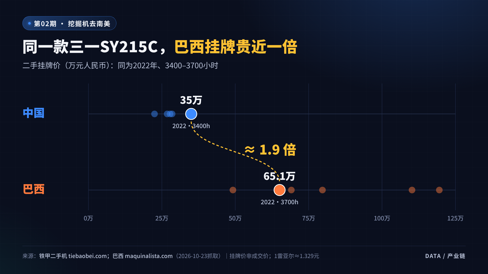
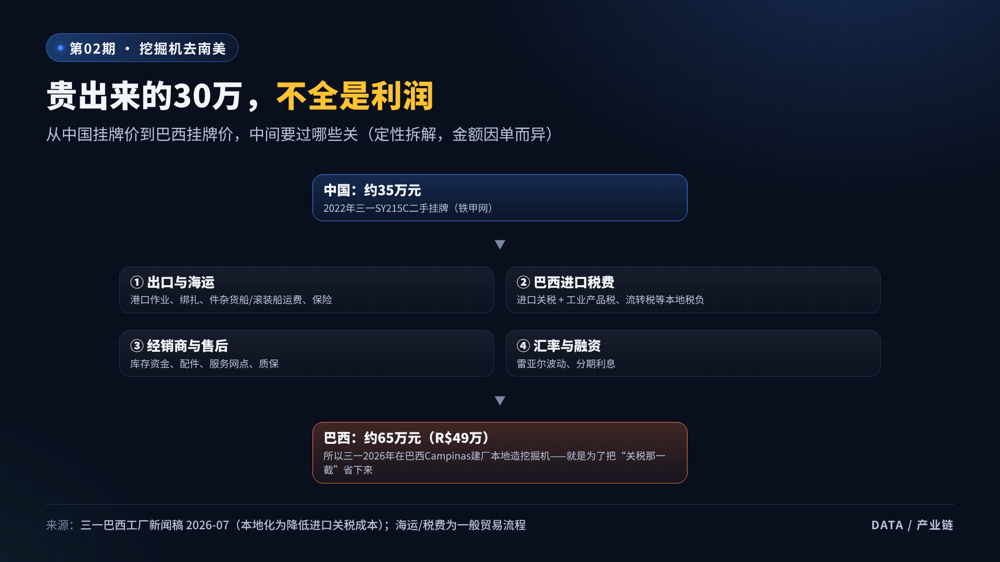
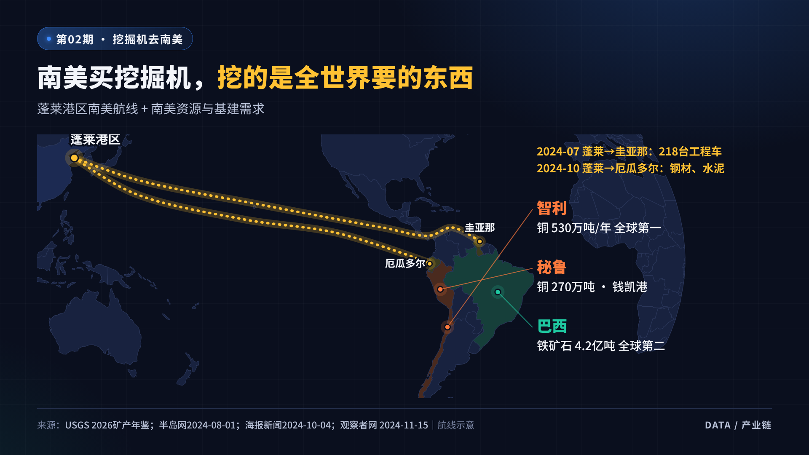

# 这份手册怎么用

1. **想直接录**：翻到每期的“二、口播文案”，引用框里的文字就是配音稿，每段开头标了时间段。6期字数在1,220–1,570字之间，按每分钟约300字计，时长4分10秒到5分10秒。
2. **想剪片**：照着“三、分镜表”逐段铺画面。表里的“素材编号”能在同一期的“四、图表”“五、素材链接”里找到。
3. **想下素材**：“五、素材链接”中所有链接都能直接点开。**S** 是事实来源（截图或高亮用），**V** 是视频，**P** 是图片。每条都注明了授权情况。
4. **想用图表**：37张原创数据图都是横竖两版（`图表/竖版` 1080×1920，`图表/横版` 1920×1080），可以直接拖进剪映。每张都配有3–5秒的动画MP4（`图表/动画_竖版`），数字和线条会自己“长出来”。
5. **开拍前必看**：每期最后的“六、事实边界”列出了哪些话能说、哪些不能说，以及数字口径。

> 核查说明：6个研究 Agent 在2026-10-23并行逐条打开原网页核对，原始核查记录在 `研究记录/` 文件夹（含原文摘录）。文中“自算”表示根据公开数字计算得出，“未验证”的内容没有写进口播。

# 六期总览

| 期数 | 标题 | 核心反差 | 时长 | 推荐顺序 |
|---|---|---|---|---|
| 01 | 中国车卖到哈萨克斯坦近四成，为什么韩国旧车还要借道中国？ | 39%新车份额 vs 韩国二手车从烟台换笼车西行；卖到中亚的单价是利比亚的12倍 | 4′10″ | ③ |
| 02 | 同一台挖掘机，巴西贵了30万：中国工程机械为什么卖遍南美？ | 三一SY215C：国内挂牌35万，巴西挂牌65万 | 4′40″ | ② |
| 03 | 一张横幅、四个logo：韩资在撤，这台五层楼高的锅炉为什么还在山东造？ | 韩国对华投资66→22亿美元 vs 蓬莱5亿元新厂、订单全部出口 | 5′10″ | ① 最有独家感 |
| 04 | 一家卖牛奶的，为什么跑去巴西买150万吨大豆？ | 乳企买大豆；饲料占公斤奶成本77% | 4′20″ | ④ |
| 05 | 悉尼只买16列地铁，为什么签了39.6亿澳元？ | 39.6亿÷16是错的：一份签到2047年的合同 | 4′10″ | ⑤ |
| 06 | 全世界都在抢芯片，美国人却在排队等一台变压器 | 交期50周→128周；美国本土只能满足20% | 4′20″ | ⑥ 央视讲过，放后面 |

**推荐顺序的理由**：第03期有“横幅四个logo”这个别人没有的切口，适合当账号开篇；第02期价格反差最直观；第01期时效性强（9月刚发生）；第04、05期是经典“拆合同”题；第06期央视已经报过，靠“美国为什么造不出来”做差异化。

**六期之间的串联**（可在片尾预告下一期）：
- 02期结尾：“挖出来的铜和铁矿运回中国” → 引出 04期“运回来的还有大豆”。
- 03期“在中国造、卖去中东” ↔ 06期“在中国造、卖去全球的变压器”，同一套“交付能力”的逻辑。
- 01期“中国当过路的桥” ↔ 05期“卖车不如卖服务”，都是“生意不止一种赚法”。

# 叙事方法：从四个样本博主身上学到的东西

我把你转写的4篇口播（巫师财经《AI风口与你无关》《伊朗局势对资本及我国的影响》《劳动是世间万物的本源》，以及《HYROX背后的商业与资本游戏》）拆了一遍，提炼成一个可以反复用的 Skill，保存在 `.claude/skills/douyin-midvideo-script/SKILL.md`。核心如下。

## 样本拆解

| 样本 | 开头15秒在做什么 | 中段怎么推进 | 怎么收尾 |
|---|---|---|---|
| AI风口与你无关 | **立靶子**：“大量媒体谈AI风口，一个视频秒杀他们”，然后先模仿对方的话术，再说“放屁” | 追问钱流：“算力在谁手里？平台谁建的？利润流向谁？”→ 用类比（微信从风口变成自来水） | 给出可执行建议，再加**社交货币**：“谁让你焦虑，就用这个视频回他” |
| 伊朗局势 | “讨论同质化太严重，**换个角度**”＋一个即时数字（霍尔木兹海峡承载全球约30%的海运石油贸易） | 先承认大众观点，再拆穿（“油价涨物价就涨？”）→ **自己做的图**，逐句讲横轴纵轴 → 生活化换算（薯片运费只占几分钱）→ 给一个能自己查的指标（战略石油储备）→ 意外角度（比亚迪） | 情绪升华 + “饭桌上就用这个回他” |
| 劳动是本源 | 接上一期的金句 | 第一性原理 + **自创概念词**（“毛”“萝卜”“主神视角”）+ 游戏类比 | 抛出反转：“没有阴谋，只是一场无意识的市场化运动” |
| HYROX | 热点事件 + “更有意思的是**背后的商业和资本游戏**” | **算账**（报名费、门票、摄影费）→ 起源故事 → **对比**（马拉松不属于任何公司）→ **悬念揭晓**：“股东你猜是谁？王健林，没想到吧” → 护城河 → LVMH接盘 | **反讽**：“老王这波是运气好呢，还是运气好呢” |

## 本账号的写法（已用在6期里）

1. **开头不讲背景，先给冲突**：数字反差、身份反差、大众误读，三选一，15秒内说完。
2. **立一个靶子再打掉**：“你第一反应肯定是……错。”
3. **追钱流**：每期都回答“钱从谁口袋出来、经过谁、落在谁手里、谁担风险”。
4. **每20–30秒一个再钩子**：“这还没完”“问题来了”“你猜是谁”。
5. **大数字换成生活单位**：“每10斤大豆8斤多靠进口”“每7台就有1台来自山东”。
6. **图表要讲出来**：“你看这张图……”，让图当证据，不当装饰。
7. **结尾给社交货币**：一句能在饭桌上复述的结论，加一个评论区问题。
8. **事实分级**：确定的直接说；推算的说“按……估算”；未验证的不进口播。

## 人设：读公开资讯就能看穿整条产业链的人

- **信息来源只说公开渠道**：港口和政府公众号、企业官网公告、海关数据、上市公司年报、外媒报道。
- **“如同亲临”靠细节，不靠在场**：设备编号（X-781）、横幅上的四个logo、船名（山东福义）、航线（蓬莱—圭亚那）、吨位（6.9万吨）。常用句式有：“翻一下烟台港的公众号你就会发现……”“把这几家公司的公告放在一起看……”。
- **硬规则**：口播、字幕、评论区回复里，都不出现“我在港口/现场看到”“我拍到”“我路过”“有人在港口看见”。

# 通用制作规范

## 身份保护
- 第03期的两张照片只用 `原始照片_处理版/` 里的版本：已裁掉“vivo X Fold5 | ZEISS”和拍摄时间水印，并清除了EXIF（含GPS）。原图不要上传。
- 背景里的厂房、道路、绿化带如果能定位到具体位置，剪辑时可以再加一层虚化或只用局部特写。
- 画面来源统一写“资料画面/公开画面”，不要写“本人拍摄”。

## 版权
- **Wikimedia Commons**（CC BY / BY-SA / CC0）：可以商用，但要按协议署名。示例：“图：作者名 / Wikimedia Commons / CC BY-SA 4.0”，写在画面角落或视频简介里都可以。
- **政府网、企业官网、新闻媒体的图片和视频**：属于新闻引用，需要注明出处。不要大段搬运。截取10秒以内配合解说，并在画面上标注来源。
- **Sydney Metro 官方图片**写明了禁止商用，变现账号不要用。
- **央视画面**：可以引用短片段并标“来源：央视新闻”，不要去掉台标。

## 图表使用
- 竖屏视频用 `竖版` PNG 或 `动画_竖版` MP4，横屏或画中画用 `横版`。
- 每张图底部已经印好来源，不需要再加字幕。
- 想改文字或数字：`图表源码/` 里是 HTML 文件，用浏览器打开就能看到效果。文件头的说明里写了重新导出的方法。

## 已知链接情况
- Wikimedia 原图直链（upload.wikimedia.org）在研究环境里被限流，没能逐一确认能打开（文件页和授权都已确认）。建议先打开“文件页”链接，再点“原始文件”下载。
- 现代冰轮官网证书过期，浏览器会提示不安全，点“继续访问”即可。
- B站链接里，部分只通过搜索接口确认了视频存在。

# 第01期｜中国车卖到哈萨克斯坦近四成，为什么还有人把韩国旧车借道中国运过去？

## 一、选题卡

| 项目 | 内容 |
|---|---|
| 备选标题 | ① 中国车占了哈萨克斯坦四成，韩国旧车为什么还要借道山东？ ② 同是韩国二手车，卖到中亚贵12倍，谁在买？ ③ 一条路的开通，往往是因为另一条路被堵了 |
| 时长 / 字数 | 约4分10秒 / 口播约1,220字 |
| 核心反差 | 中国品牌拿下哈萨克斯坦新车市场39%；可韩国二手车却从烟台港换上铁路笼车，一路向西送进哈萨克斯坦 |
| 要打掉的靶子 | ① “韩国二手车便宜，所以穷国买”；② “中国车在中亚卖不动” |
| 钱流主线 | 韩国国内二手车过剩 → 中亚高价收准新车 → 2026年海运主市场被战事堵住 → 车商找陆路 → 中国港口、铁路收“过路钱” |
| 与旧稿的改动 | ① 删掉“韩国车右舵适合中亚”（韩国是左舵，说法不成立）；② 39%是**新车**、**持平**不是增长，发布方是哈萨克斯坦汽车联盟（KAU）；③ 烟台港“1–8月57.6万辆”是所有商品车，不是二手车数量，不能用；④ 9月这批是**滚装海运＋铁路笼车**，不是集装箱海铁联运；⑤ 新增韩国二手车出口、单价、2026年通道变化等数据 |

## 二、口播文案（可直接配音）

> 【0:00–0:15｜钩子】
> 哈萨克斯坦去年卖出去的新车，每10辆里就有4辆是中国品牌。可就在上个月，一批韩国二手车从韩国装船，到烟台港换上铁路笼车，一路向西横穿大半个中国，送进了哈萨克斯坦。中国车卖得这么好，为什么还有人千里迢迢运韩国旧车？

> 【0:15–0:40｜立靶子＋承诺】
> 你可能觉得：旧车嘛，便宜，穷地方买得起。错。这些车一点都不便宜。今天这期，咱们把这条路线、这门生意，还有它为什么偏偏在今年冒出来，一层一层拆开。

> 【0:40–1:30｜事实锚点】
> 先看这条路。烟台港公布的路线是：韩国滚装船把车运到烟台港，下船直接换装铁路笼车，经乌鲁木齐三坪站，到霍尔果斯对面的哈萨克斯坦阿腾科里。就在一个月前，烟台港刚打通“日韩—烟台—蒙古”的笼车通道；再往前，7月份还有一趟从仁川到烟台、再到吉尔吉斯斯坦比什凯克的“海铁公一单制”班列，全程12天。
> 再看这门生意有多大。韩国产业通商部的数据：2025年韩国二手车出口88.7亿美元，比上一年暴涨75%，创了历史纪录。
> 那谁是最大的买家？不是中东，不是非洲，是吉尔吉斯斯坦，一个人口只有700万左右的国家。2025年韩国卖给它的汽车里，新车大概200辆，二手车大约13万辆，占了99%。

> 【1:30–2:20｜机制拆解一：贵出来的旧车】
> 这还没完。你看单价：2024年，卖到利比亚的韩国二手车，平均一辆1758美元；卖到吉尔吉斯斯坦的，平均两万零八百美元，贵了12倍。在韩国国内，有一款2025年的帕里斯帕德，二手挂牌价比新车还贵将近两千万韩元。
> 为什么？韩国媒体和研究员说得很直接：吉尔吉斯斯坦，是通往俄罗斯的转口通道。注意，这是韩国媒体和业内的说法，不是官方统计，也没有任何证据说明烟台这条路上的车去了俄罗斯。咱们只说清楚一件事：中亚方向买的，不是便宜旧车，是高价准新车。

> 【2:20–3:15｜机制拆解二：为什么偏偏是今年】
> 问题来了：这条路为什么偏偏是2026年才冒出来？
> 因为另一条路被堵了。今年上半年，中东战事让韩国二手车最大的海运市场停摆了半年多，1到8月，韩国二手车出口的月均金额比去年少了28%。4月份，俄罗斯又堵上了从欧亚经济联盟国家进口汽车的报废费漏洞。海路走不通，转口变贵，韩国车商只能找新路：往北是蒙古，往西是中亚。而离韩国最近、又有铁路直通新疆的大港口，就是烟台。
> 你看，烟台港8月开蒙古通道，9月开中亚通道，节奏严丝合缝。

> 【3:15–3:55｜拔高：中国在这条路上是什么角色】
> 那哈萨克斯坦人为什么认韩国车？三个公开数据：第一，现代是哈萨克斯坦的新车销冠，起亚排第三，途胜、狮跑、伊兰特都在当地组装，修车配件不发愁；第二，当地车龄20年以上的老车超过41%，换车需求一直在；第三，从今年起，哈萨克斯坦个人进口车只认5年以内的车龄，能进来的只剩准新车。
> 所以这不是中国车和韩国车的输赢。新车市场，中国品牌守住39%；二手车这条路，中国又成了“过路的桥”：港口装卸、铁路运费、换装作业，每一辆路过的车，都在给中国的物流付钱。

> 【3:55–4:30｜收尾＋社交货币】
> 下次有人跟你说“中国车在中亚卖不动，人家都买韩国车”，你就告诉他：新车市场中国占了四成，韩国旧车还得借中国的铁路进去。卖车是一门生意，修路收过路费，是另一门生意。
> 你觉得这条“韩国—烟台—中亚”的路，能走多久？评论区聊聊。

## 三、分镜表

| 时间 | 口播要点 | 画面 | 素材编号 |
|---|---|---|---|
| 0:00–0:15 | 39% vs 韩国旧车西行 | 新车市场环形图 → 路线地图动画 | 图01-D / 图01-A（动画） |
| 0:15–0:40 | 立靶子 | 韩国二手车拍卖场/出口视频 | V1-1 |
| 0:40–1:05 | 路线：滚装→笼车→三坪→阿腾科里 | 路线地图动画 + 烟台政府网笼车新闻图 | 图01-A / P1-1 |
| 1:05–1:30 | 88.7亿、+75%、吉尔吉斯斯坦13万辆 | 柱状图 | 图01-B |
| 1:30–2:20 | 单价差12倍、转口说法 | 单价条形图；韩媒报道画面（只截标题） | 图01-C / V1-2 |
| 2:20–3:15 | 中东停摆、俄堵漏洞、通道接力 | 时间轴逐条出现 | 图01-F |
| 3:15–3:55 | 为什么是韩国车 | 三个原因卡片；阿斯塔纳街头途胜 | 图01-E / P1-5 |
| 3:55–4:30 | 收尾 | 霍尔果斯口岸实景 | V1-4 / P1-3 |

## 四、本期图表（横竖双版本，已生成）

| 编号 | 文件名 | 图形 |
|---|---|---|
| 图01-A | 01_A_过境路线地图 | 路线地图（有动画） |
| 图01-B | 01_B_韩国二手车出口额 | 柱状图（有动画） |
| 图01-C | 01_C_单价差了12倍 | 横向条形图 |
| 图01-D | 01_D_哈萨克斯坦新车市场 | 环形图 |
| 图01-E | 01_E_为什么偏偏是韩国车 | 卡片图 |
| 图01-F | 01_F_通道时间轴 | 时间轴 |

**图01-A** `01_A_过境路线地图`

**图01-B** `01_B_韩国二手车出口额`

**图01-C** `01_C_单价差了12倍`

**图01-D** `01_D_哈萨克斯坦新车市场`

**图01-F** `01_F_通道时间轴`

## 五、素材链接

**事实来源（S）**

| 编号 | 内容 | 链接 |
|---|---|---|
| S1-1 | 烟台市政府网转载烟台港（2026-09-28）：韩国过境二手车搭笼车经三坪站发往阿腾科里 | <https://www.yantai.gov.cn/col/col34864/art/2026/art_0c0289973a9e4fc7aab13ca2c9637fe0.html> |
| S1-2 | 哈萨克斯坦汽车联盟KAU：2025年新车234,852辆，中国品牌39%（与上年持平） | <https://kao.kz/en/novosti/78/> |
| S1-3 | 烟台市政府网（2026-07-24）：海铁公一单制，仁川→烟台→喀什→比什凯克，12天 | <https://www.yantai.gov.cn/col/col34864/art/2026/art_81105a117cfe4c78a9b2f9761ae64af3.html> |
| S1-4 | 韩国产业通商部（2026-01-15）：二手车出口88.7亿美元、+75.1% | <https://www.motir.go.kr/kor/article/ATCL3f49a5a8c/171439/view> |
| S1-5 | Korea JoongAng Daily（2026-02-24）：对吉二手车约13万辆、占99% | <https://www.koreajoongangdaily.com/business/out-with-the-new-in-with-the-old-koreas-used-cars-driving-up-record-export-numbers/11953101> |
| S1-6 | 每经Economy（2025-06-26）：单价吉尔吉斯斯坦2.08万美元 vs 利比亚1758美元；韩国国内二手车243万辆 | <https://v.daum.net/v/20250626210305626> |
| S1-7 | Korea JoongAng Daily（2026-09-26）：1–8月42.8亿美元，月均-28%，转向蒙古和中亚 | <https://www.koreajoongangdaily.com/business/shut-out-of-middle-east-koreas-used-car-exporters-look-to-mongolia/12891906> |
| S1-8 | KED Global（2025-05-12）：帕里斯帕德二手价高于新车 | <https://www.kedglobal.com/automobiles/newsView/ked202505120006> |
| S1-9 | KAU（2026-02）：哈萨克斯坦车龄20年以上超过41% | <https://kao.kz/en/novosti/81/> |
| S1-10 | 24KZ（2026-10-20）：个人进口电子车辆护照限5年车龄 | <https://24.kz/ru/news/social/800638-236-9-tysyach-avtomobilej-zavezli-v-kazakhstan-za-god> |
| S1-11 | Moscow Legal（2026-04-01）：俄罗斯欧亚经济联盟进口车报废费新规 | <https://mosgolaw.com/en/news/Effective+April+1st%2C+2026%2C+new+regulations+governing+the+importation+of+vehicles+from+Eurasian+Economic+Union+%28EAEU%29+member+states-Belarus%2C+Kazakhstan%2C+Kyrgyzstan%2C+and+Armenia-will+come+into+force+in+Russia./> |
| S1-12 | 新京报（2025-05-16）：烟台港一单制首发，韩国→中亚12–14天 | <https://m.bjnews.com.cn/detail/1747381190129077.html> |
| S1-13 | 新华网（2025-11-17）：注册不满180天车辆出口新规 | <https://www.news.cn/tech/20251117/183bbe3b97574605890dd652730876cf/c.html> |
| S1-14 | 霍尔果斯：2025年出口车辆约45万辆 | <https://www.hellenicshippingnews.com/major-xinjiang-port-sees-record-export-of-450000-vehicles-in-2025/> |

**视频（V）**——YouTube 均已用官方接口核对标题与频道

| 编号 | 视频 | 链接 |
|---|---|---|
| V1-1 | ABC News：韩国二手车在俄罗斯、中东需求激增 | <https://www.youtube.com/watch?v=0urAhAByPx8> |
| V1-2 | SBS 8뉴스：停车场满是贵车，“要去吉尔吉斯斯坦” | <https://www.youtube.com/watch?v=iKQeDA2eeqQ> |
| V1-3 | 新华社：200多辆日本车经霍尔果斯铁路运往哈萨克斯坦 | <https://www.youtube.com/watch?v=ypVjH1PDLyw> |
| V1-4 | 新华社：新疆口岸汽车出口加速 | <https://www.youtube.com/watch?v=Jxa1-pCUYGk> |
| V1-5 | CGTN：霍尔果斯中哈贸易交通网 | <https://www.youtube.com/watch?v=vMCJQK3KiU4> |
| V1-6 | CGTN：中国每小时出口近1000辆车 | <https://www.youtube.com/watch?v=UI7cuq_IkyM> |
| V1-7 | 上观新闻（B站）：霍尔果斯国门口的“摆渡人” | <https://www.bilibili.com/video/BV1ag4EeAEJ4> |
| V1-8 | B站：商品车笼车运输装车 | <https://www.bilibili.com/video/BV18JnH6aEW9> |

**图片（P）**

| 编号 | 内容 | 链接 | 授权 |
|---|---|---|---|
| P1-1 | 烟台港铁路笼车（2026-09本条新闻配图） | <https://www.yantai.gov.cn/cms_files/filemanager/49/picture/20269/1f37be1db3d746e19c3b9b22e3280185.jpg> | 政府网新闻图，注明“图源：烟台港” |
| P1-2 | X80442次海铁公班列驶出烟台港 | <https://www.news.cn/20260721/79808170b8c547558349df351c759446/2026072179808170b8c547558349df351c759446_bb67053eb0444acd821218e9db28d80a.jpg> | 国铁济南局供图 / 新华网 |
| P1-3 | 新霍尔果斯口岸（Commons） | <https://commons.wikimedia.org/wiki/File:New_Khorgos_Port_of_Entry.jpg> | CC BY-SA 4.0 / Akira CA |
| P1-4 | 现代Glovis汽车滚装船（Commons） | <https://commons.wikimedia.org/wiki/File:Hyundai_Glovis_car_carrier,_Port_of_Santander.jpg> | CC BY-SA 4.0 |
| P1-5 | 阿斯塔纳街头现代途胜（Commons） | <https://commons.wikimedia.org/wiki/File:Daredzhani,_Astana_(20240819-2024-08-19_14.35.19).jpg> | CC BY-SA 4.0 |
| P1-6 | 俯瞰烟台港（Commons） | <https://commons.wikimedia.org/wiki/File:Yantai_port_harbor.jpg> | CC BY-SA 4.0 / K.Y.K.Z.K. |

## 六、事实边界（开拍前必读）

- 【确定】2026年9月韩国过境二手车经烟台港笼车→三坪站→阿腾科里（原文“近日”，9月28日发布）；烟台港**没有公布车辆数量**。
- 【确定】中国品牌39%是**新车**、官方经销商口径，2025年与2024年**持平**。
- 【确定】韩国二手车出口2025年88.7亿美元；对吉约13万辆占99%；单价2.08万 vs 1758美元。
- 【敏感，只能转述】“吉尔吉斯斯坦是对俄转口通道”是韩国媒体和研究员的说法；口播已加限定，**不得暗示烟台通道的车流向俄罗斯**。
- 【推断】“海路被堵 → 车商转陆路 → 烟台开通道”是时间上的吻合，原文没有直接因果，口播用“节奏严丝合缝”表达，不说“因为”。
- 【常识】吉尔吉斯斯坦人口约700万，可加字幕“约”。
- 【不要用】“韩国车右舵”“中国新能源进不了中亚”“烟台港57.6万辆二手车”。

# 第02期｜同一台挖掘机，巴西贵了30万：中国工程机械为什么卖遍南美？

## 一、选题卡

| 项目 | 内容 |
|---|---|
| 备选标题 | ① 同一台挖掘机，巴西比国内贵30万，钱被谁拿走了？ ② 国内卖不动的挖掘机，都去南美挖什么了？ ③ 中国每出口7台工程机械，就有1台来自山东 |
| 时长 / 字数 | 约4分40秒 / 口播约1,420字 |
| 核心反差 | 同款同年份同工时的三一SY215C，国内挂牌约35万元，巴西挂牌约65万元（≈1.9倍）。但这30万大部分不是利润 |
| 要打掉的靶子 | “卖到国外贵一倍＝出口商暴利” |
| 钱流主线 | 国内基建降温 → 产能出海 → 中资矿山、港口、承包工程在南美 → 设备跟着项目走 → 换回铜、铁矿、大豆 |
| 与旧稿的改动 | ① 目的地从“非洲”改为“南美”，用蓬莱港区—圭亚那、蓬莱—厄瓜多尔两条航线做证据；② “国内40万、非洲100万”这组无出处的数字作废，换成可点开的同型号挂牌价；③ 加入山东产业链和“为什么是中国”两段 |

## 二、口播文案（可直接配音）

> 【0:00–0:15｜钩子】
> 同一款挖掘机，三一SY215C，都是2022年出厂，都开了三千多个小时。在国内的二手平台上，挂35万；在巴西，挂49万雷亚尔，折合人民币65万。同一台机器，漂过一个太平洋，贵了将近一倍。

> 【0:15–0:40｜立靶子＋承诺】
> 你第一反应肯定是：出口商赚翻了，暴利。先别急。这多出来的30万，大部分根本不是利润。今天咱们不光把这笔账拆开，还要顺着这台挖掘机往下挖：中国的工程机械，为什么能卖遍南美？南美到底要这么多挖掘机去挖什么？

> 【0:40–1:25｜事实锚点】
> 先看大盘。2025年，中国工程机械出口602亿美元，增长将近14%。其中挖掘机重新坐回出口第一大品类，一年卖出去107亿美元。卖到拉丁美洲的有66亿美元，增长17%；到了今年8月，对拉美的出口单月同比涨了一倍多。
> 这里面山东是主力。2025年山东工程机械出口90亿美元，全国第二，差不多每出口7台，就有1台来自山东。济宁的山推、济南的临工重机、潍柴旗下的雷沃，还有小松、斗山这些外资厂，都扎在山东。
> 那它们从哪出去？翻一下烟台港的公众号你就会发现：2024年7月，一艘货轮从烟台港蓬莱港区出发，装着218台工程车辆、5000多吨水泥、1369件钢结构，开往南美的圭亚那，这是山东第一条加勒比件杂货航线。三个月后，蓬莱到厄瓜多尔的航线也开了。

> 【1:25–2:20｜机制拆解一：贵出来的30万去哪了】
> 好，回到那30万。一台挖掘机从中国到巴西，要过四道关。
> 第一关，出口和海运：港口作业、绑扎加固、件杂货船的运费、保险。
> 第二关，巴西的进口税费：关税之外还有工业产品税、流转税，一层叠一层。
> 第三关，经销商和售后：库存要压钱，配件要备货，服务网点要养人。
> 第四关，汇率和融资：雷亚尔一波动，分期利息一上来，价格就得往上垫。
> 你说这几关到底有多重？有一个最硬的证据：今年7月，三一在巴西坎皮纳斯的工厂，首批挖掘机下线，规划年产1500台。新闻稿里写得明明白白，本地化生产，就是为了降低进口关税成本。关税要是不痛，谁会跑去地球另一边建厂？
> 所以，差价不等于利润。真正赚钱的，是规模，是后面十几年的配件和服务。

> 【2:20–3:15｜机制拆解二：南美要挖什么】
> 问题来了：南美为什么需要这么多挖掘机？
> 答案就在地底下。智利一年产铜530万吨，全球第一；秘鲁270万吨，两国加起来占全世界三分之一以上。巴西的铁矿石一年4亿多吨，全球第二。智利的锂储量，也是全球第一。挖矿、修路、建港口，全靠挖掘机。
> 而且你仔细看，这些项目背后，很多是中国的钱。2014年，五矿牵头花70亿美元买下秘鲁的拉斯邦巴斯铜矿；2024年11月，中远海运控股的秘鲁钱凯港开港，从那到上海只要23天左右。2025年，中国企业对外承包工程带出去的工程机械，增长了51%。
> 说白了：钱在外面干活，设备就跟着出去。挖出来的铜和铁矿，又顺着同一条航线运回中国。

> 【3:15–3:55｜拔高：为什么是中国】
> 那为什么偏偏是中国来卖？看一组数：2021年，中国国内卖出挖掘机27万台；到2025年，只剩11.9万台，不到峰值的一半。可产能还在，工人还在，供应链还在。于是出口从6.8万台涨到11.7万台，从2024年开始，出口和国内各占一半。
> 发动机、液压件、钢材全在国内配齐，全球前50的工程机械企业里，中国占了13家，徐工排第3，三一排第6。这不是哪家企业突然开窍，是一整套为十几亿人搞基建建起来的产能，转身去给全世界搞基建。

> 【3:55–4:40｜收尾＋社交货币】
> 所以下次再有人跟你说“挖掘机卖到国外翻一倍，暴利”，你就把这四道关给他算一遍：贵出来的钱，一半交给了海关、船和汇率；真正的利润，在规模和后市场。
> 最后留个问题：南美这盘生意，下一步是继续从蓬莱装船，还是像三一一样，直接把工厂搬过去？评论区说说你的判断。

## 三、分镜表

| 时间 | 口播要点 | 画面 | 素材编号 |
|---|---|---|---|
| 0:00–0:15 | 35万 vs 65万 | 价格点图动画；挖掘机空镜 | 图02-A（动画）/ P2-6 |
| 0:15–0:40 | 立靶子 | 大字“暴利？”打问号；工程机械出港空镜 | V2-7 |
| 0:40–1:05 | 602亿、拉美66亿 | 区域出口条形图 | 图02-D |
| 1:05–1:25 | 山东第二、蓬莱港区航线 | 省份条形图 → 新闻截图（半岛网配图） | 图02-F / P2-1 / S2-5 |
| 1:25–2:20 | 四道关 + 三一巴西建厂 | 差价拆解卡片逐条出现；三一巴西新闻截图 | 图02-B / S2-9 |
| 2:20–2:50 | 智利铜、秘鲁铜、巴西铁矿 | 南美资源地图；铜矿实景 | 图02-E / P2-3 / P2-4 |
| 2:50–3:15 | 中资矿山、钱凯港 | 钱凯港视频片段 | V2-1 / V2-2 / V2-6 |
| 3:15–3:55 | 国内销量腰斩、出口补位 | 堆叠柱状图 | 图02-C |
| 3:55–4:40 | 收尾 | 回到价格点图 + 评论区问题字卡 | 图02-A |

## 四、本期图表（横竖双版本，已生成）

| 编号 | 文件名 | 图形 | 说明 |
|---|---|---|---|
| 图02-A | 02_A_同一台挖掘机两地价格 | 点图 + 弧线标注 | 有3秒动画版 |
| 图02-B | 02_B_差价去哪了 | 流程卡片 | 定性拆解，不含无出处金额 |
| 图02-C | 02_C_国内卖不动了 | 堆叠柱状图 | 国内 vs 出口 |
| 图02-D | 02_D_出口去哪了 | 横向条形图 | 2025分区域出口 |
| 图02-E | 02_E_南美要设备干什么 | 地图 + 航线 | 蓬莱—圭亚那/厄瓜多尔 + 资源标注 |
| 图02-F | 02_F_山东出口排第二 | 横向条形图 | 省份排名 |

**图02-A** `02_A_同一台挖掘机两地价格`

**图02-B** `02_B_差价去哪了`

**图02-C** `02_C_国内卖不动了`

**图02-D** `02_D_出口去哪了`

**图02-E** `02_E_南美要设备干什么`

**图02-F** `02_F_山东出口排第二`

## 五、素材链接

**事实来源（S）**

| 编号 | 内容 | 链接 |
|---|---|---|
| S2-1 | 中国机电商会《2025年中国工程机械出口情况分析》：602.3亿美元、拉美66.2亿、山东90.4亿、对外承包工程项下+51.4% | <https://www.cccme.org.cn/news/details.aspx?id=FA31909AA38635DB58A6BB39B8975578&classid=73DE9790C2E56969> |
| S2-2 | 央视新闻联播2026-04-02：前两个月出口106.86亿美元（注意是1–2月口径） | <https://tv.cctv.com/2026/04/02/VIDE4FaSA8AcDqn7XlCOYAOH260402.shtml> |
| S2-3 | 2026年8月对拉美出口同比+121%（券商转引，二手） | <https://finance.jrj.com.cn/2026/09/24113058528637.shtml> |
| S2-4 | 山东省发布会：前三季度工程机械出口459.3亿元、+17.6% | <https://www.sohu.com/a/1090652102_121106991> |
| S2-5 | 半岛网2024-08-01：蓬莱港区→圭亚那，218台工程车 | <http://news.bandao.cn/a/1722504752562720.html> |
| S2-6 | 海报新闻2024-10-04：蓬莱—厄瓜多尔航线开通 | <https://hb.dzwww.com/p/p8kFRR9a9G2.html> |
| S2-7 | 国内二手价：铁甲二手机 SY215C 2022/3400h 35万元 | <https://www.tiebaobei.com/equipment/1780234.html> |
| S2-8 | 巴西挂牌价：maquinalista SY215C 列表页 | <https://www.maquinalista.com/escavadeiras/sany/sy215c/> |
| S2-9 | 三一巴西Campinas工厂首批挖掘机下线（本地化降关税） | <https://kyodonewsprwire.jp/release/202607142544> |
| S2-10 | USGS 2026 铜 / 锂 / 铁矿 | <https://pubs.usgs.gov/periodicals/mcs2026/mcs2026-copper.pdf> · <https://pubs.usgs.gov/periodicals/mcs2026/mcs2026-lithium.pdf> · <https://pubs.usgs.gov/periodicals/mcs2026/mcs2026-iron-ore.pdf> |
| S2-11 | 钱凯港：中远海运60%、一期12.98亿美元、23天到上海 | <https://www.guancha.cn/internation/2024_11_15_755396.shtml> |
| S2-12 | 五矿70.05亿美元收购拉斯邦巴斯 | <https://paper.people.com.cn/zgjjzk/html/2014-08/18/content_1467199.htm> |
| S2-13 | 挖掘机销量：2021年（界面）/ 2024年（界面）/ 2025年（智通财经） | <https://www.jiemian.com/article/7002738.html> · <https://www.jiemian.com/article/10811533.html> · <https://finance.sina.com.cn/stock/hkstock/hkstocknews/2026-01-08/doc-inhfreqm6542661.shtml> |
| S2-14 | 三一2025国际收入558.56亿元、占64% | <https://www.cls.cn/detail/2329920> |

**视频（V）**——YouTube 已用官方接口核对标题与频道；B站为搜索接口确认存在

| 编号 | 视频 | 链接 |
|---|---|---|
| V2-1 | CGTN America：秘鲁钱凯港出口激增 | <https://www.youtube.com/watch?v=AwQZSzrxbZc> |
| V2-2 | CNN en Español：钱凯港实景 | <https://www.youtube.com/watch?v=ZOVrTTmyt4E> |
| V2-3 | 新华社 New China TV：智利铜矿迎来中国设备 | <https://www.youtube.com/watch?v=YbSKUhj4Iyw> |
| V2-4 | 中国新闻社：烟台港汽车排队出海 | <https://www.youtube.com/watch?v=1jwcnlMNj4o> |
| V2-5 | SDLG 临工在巴西 Agrishow 2026 | <https://www.youtube.com/watch?v=7G6-TWnn5fs> |
| V2-6 | DW中文：35亿美元的秘鲁钱凯港 | <https://www.youtube.com/watch?v=WdH81SglNp0> |
| V2-7 | 央视财经（B站）：电动挖掘机出海爆单，5年出口规模3倍增长 | <https://www.bilibili.com/video/BV1FJbQ6pEiv> |
| V2-8 | 央视财经（B站）：钱凯港南美首个智慧港口 | <https://www.bilibili.com/video/BV1rGZVYsEBE> |
| V2-9 | 第一工程机械网（B站）：专访山东临工国际营销副总 | <https://www.bilibili.com/video/BV1p94y1n74k> |
| V2-10 | CCTV《中华考工记》工程机械篇 | <https://www.youtube.com/watch?v=wBpMGKmDaXQ> |

**图片（P）**

| 编号 | 内容 | 链接 | 授权 |
|---|---|---|---|
| P2-1 | 蓬莱港区货轮满载工程车开往圭亚那（半岛都市报） | <https://mfs.bandao.cn/storage/mfs/66ab56302c76e9009831709e.jpeg> | 媒体版权，需授权/注明出处 |
| P2-2 | 蓬莱港全景（Commons） | <https://commons.wikimedia.org/wiki/File:Port_of_Penglai_PANO0001.jpg> | CC BY-SA 4.0 / David290 |
| P2-3 | 智利丘基卡马塔铜矿（Commons） | <https://commons.wikimedia.org/wiki/File:Mina_de_Chuquicamata,_Calama,_Chile,_2016-02-01,_DD_110-112_PAN.JPG> | CC BY-SA 4.0 / Diego Delso |
| P2-4 | 秘鲁拉斯邦巴斯铜矿（Commons） | <https://commons.wikimedia.org/wiki/File:Mina_Las_Bambas.jpg> | CC BY-SA 4.0 / Ondando |
| P2-5 | 三一挖掘机群（Commons） | <https://commons.wikimedia.org/wiki/File:Sany_excavators_2021052209.jpg> | CC BY 3.0 / Huangdan2060 |
| P2-6 | 三一挖掘机（Commons） | <https://commons.wikimedia.org/wiki/File:SANY_R285R_excavator_in_Thailand.jpg> | CC0 |
| P2-7 | 山东临工设备（Commons） | <https://commons.wikimedia.org/wiki/File:Machinery_of_SDLG_202105221.jpg> | CC BY 3.0 / Huangdan2060 |

## 六、事实边界（开拍前必读）

- 【确定】2025年出口602.3亿美元、拉美66.2亿、山东90.4亿美元占14.9%；蓬莱港区2024年开往圭亚那、厄瓜多尔的航线。
- 【确定，但只是挂牌价】中国35万元 vs 巴西R$49万：两边都是挂牌价，不是成交价，巴西价格含本地税费。口播已用“挂”字，字幕也要写“挂牌价”。
- 【不能说】“蓬莱港主要去南美”：没有统计支撑，蓬莱港区还有去印尼、萨哈林、安哥拉的航线。口播只说“开了南美航线”。烟台港整体是“对非第一口岸”。
- 【不能说】央视106.86亿美元是全年数——它是2026年1–2月。
- 【二手】8月对拉美+121%为券商转引，单月数据；口播用“单月同比涨了一倍多”，不要上屏精确数。
- 【常识，未单独核验】圭亚那、厄瓜多尔的基建/能源需求细节，口播未展开。
- 用户提供的“五层楼高、还在移动”的截图，没有找到对应新闻，不能说成“发往南美的工程机械”，最多作“大件运输”资料画面，并标注“资料画面”。

# 第03期｜一张横幅、四个logo：韩资在撤，这台五层楼高的锅炉为什么还在山东造？

## 一、选题卡

| 项目 | 内容 |
|---|---|
| 备选标题 | ① 一张横幅四个logo，拼出一条从阿联酋到山东的产业链 ② 韩国对华投资三年少了三分之二，蓬莱却新建了一座锅炉厂 ③ 挂着“现代”招牌，却已经不归HD现代管 |
| 时长 / 字数 | 约5分10秒 / 口播约1,570字 |
| 核心反差 | 韩国对华直接投资：2022年66亿美元 → 2025年22亿美元（−67%）；同一时期，蓬莱一座总投资5亿元的锅炉新厂竣工，订单排到2027年 |
| 要打掉的靶子 | ① “外资都撤光了”；② “17亿美元是这台锅炉的价格”；③ “现代=HD现代集团在扩产” |
| 钱流主线 | 阿联酋国家资本（ADNOC/ADQ）→ 韩国总包三星E&A → 韩国锅炉公司HPS → 中韩合资现代冰轮在蓬莱制造 → 整台设备出海 |
| 与旧稿的改动 | ① KOTRA的66/35/24/22是**中国商务部**口径（KOTRA整理），不是韩方统计；② 横幅上的 HYUNDAI POWER SYSTEMS（HPS）2021年起由韩国MiCo集团控股，**已不属于HD现代**；③ 照片设备与官网2025-09-30公布的TA'ZIZ工业锅炉订单（165t/h）对应；④ 补充“增收不增利”和“去中国化分散布局”两个反向事实，避免一边倒 |
| 身份保护 | 口播不说“我拍到/我在现场”。照片只以“这张画面”“横幅上写着”引用，使用已去水印、去EXIF的处理版 |

## 二、口播文案（可直接配音）

> 【0:00–0:15｜钩子】
> 先看这张画面：一台五层楼高的钢铁大家伙，趴在几十轴的模块运输车上。上面挂着一张横幅：X-781 Auxiliary Boiler Package，TA'ZIZ Methanol Project。下面四个logo：TA'ZIZ、三星E&A、两个HYUNDAI。这台设备在山东蓬莱造，要去阿联酋。

> 【0:15–0:45｜反差＋立靶子】
> 奇怪的地方在这：按中国商务部的数据，韩国对华直接投资2022年是66亿美元，到2025年只剩22亿，三年少了三分之二。都说韩资在撤。可偏偏在2025年3月，蓬莱一座总投资5亿元的锅炉新厂竣工了，挂的还是“现代”的牌子。
> 今天咱们就用这张横幅上的四个logo，把整条产业链拼出来。你会发现，它跟你想的“外资撤离”，完全不是一回事。

> 【0:45–1:45｜事实锚点：四个logo，四层生意】
> 第一个logo，TA'ZIZ。这是阿联酋国家石油公司ADNOC和主权基金ADQ旗下的化工平台，它在阿布扎比的鲁韦斯建一座甲醇厂，年产180万吨，目标2028年完工，今年5月刚拿到20亿美元的银团贷款。
> 第二个logo，三星E&A。注意，不是三星电子，是三星旗下做工程总包的公司。2025年2月，它拿下了这座甲醇厂17亿美元的设计、采购、施工总包，工期44个月。
> 很多人看到这就会说：哦，这台锅炉值17亿美元。错。17亿是整座工厂的总包，锅炉只是里面一个设备包。
> 第三个logo，HYUNDAI POWER SYSTEMS，简称HPS，一家韩国锅炉公司，它从三星E&A手里接了锅炉分包。
> 第四个logo，烟台现代冰轮重工。翻它的官网新闻就能对上：2025年9月19日，拿到TA'ZIZ项目两份合同，其中一台工业锅炉，每小时产蒸汽165吨，在蓬莱新厂总装，原计划2026年9月底交付。

> 【1:45–2:35｜机制拆解一：“现代”早就不是那个现代】
> 这还没完。你以为挂着HYUNDAI，就是HD现代集团在扩产？
> 往上穿透一下股权：现代冰轮是2004年成立的中韩合资，韩方HPS持股55%，烟台本地上市公司冰轮环境持股45%。而HPS是2018年从现代重工分拆出来的锅炉部门，2021年就被卖给了韩国一家叫MiCo的集团，现在由MiCo控股。
> 也就是说，招牌还叫“现代”，但这门生意，早就不归HD现代管了。这才是“韩资”的真实样子：大集团在收缩，专业的中型企业在找最划算的地方造东西。

> 【2:35–3:25｜机制拆解二：为什么偏偏在蓬莱造】
> 那为什么是蓬莱？看它的订单表：2024年8月，沙特Taiba 2项目，45个余热锅炉模块；2025年1月，沙特Qurayyah项目，36个模块，明确写着在蓬莱新厂组装；今年2月，土耳其浮动电站，50台直流蒸汽发生器；就在这个月，卡塔尔一个LNG项目，6台余热锅炉。全部出口，一台都不留在国内。
> 这些设备有一个共同点：大。大到没法拆成零件运，只能在海边整体造好，直接装船。而蓬莱港区，正是烟台港做工程机械、风电设备这类大件的件杂货港区之一，旁边就是开发区，钢材进来、焊好、整装、出海，一条龙。
> 类似的事在山东不是孤例：青岛的海油工程，就给加拿大的LNG项目造过35个模块，总重17.9万吨。中东、北美的能源项目要赶工期，谁能按时把“整栋楼”交出来，订单就给谁。

> 【3:25–4:00｜拔高：反向事实也要讲】
> 但别急着喊“韩资回流”。两组反向数据：第一，现代冰轮2025年营收9.73亿元，增长32%，净利润却只有3401万元，反而降了44%，订单多了，钱更难赚了。第二，韩国媒体报道，HPS同时在韩国泗川和越南建基地，因为有客户提出“非中国采购”的要求，中国工厂只接美国以外的单。
> 所以真相是：消费、电子这类外资确实在走，现代汽车2023年就把重庆工厂卖了；但离不开港口、钢结构和熟练焊工的重装备，还在中国，只是也给自己留了后路。

> 【4:00–4:40｜收尾＋社交货币】
> 下次有人跟你说“外资全撤光了”，你就把这张横幅给他看：阿联酋的钱、韩国的总包、韩国的锅炉公司、山东的工厂。撤的是“一个国家投到另一个国家”的旧故事，留下来的，是一张谁能交货就跟谁干的全球分工网。
> 你觉得，这种“在中国造、卖去中东”的模式，还能持续几年？评论区说说。

## 三、分镜表

| 时间 | 口播要点 | 画面 | 素材编号 |
|---|---|---|---|
| 0:00–0:15 | 五层楼高设备 + 横幅 | 设备全景（处理版）缓慢推近 → 横幅特写 | 照片A / 照片B |
| 0:15–0:45 | 66→22 vs 5亿新厂 | 柱状图动画 → 蓬莱新厂鸟瞰（韩媒图） | 图03-A / P3-1 |
| 0:45–1:45 | 四个logo四层生意 | 横幅特写上逐个圈出logo → 产业链卡片 | 照片B / 图03-B / P3-2 |
| 1:20–1:30 | 17亿≠锅炉价 | 大字“总包≠设备价” | 字卡 |
| 1:45–2:35 | 股权穿透 | 股权树 | 图03-C |
| 2:35–3:25 | 订单全出口、整装出海 | 订单地图 → 订单时间轴 → 蓬莱HRSG装船视频 | 图03-D / 图03-E / V3-1 / V3-5 |
| 3:25–4:00 | 增收不增利、去中国化 | 双柱对比 | 图03-F |
| 4:00–4:40 | 收尾 | 回到横幅特写 | 照片B |

## 四、本期图表与照片

| 编号 | 文件名 | 图形 |
|---|---|---|
| 图03-A | 03_A_韩资对华投资 | 柱状图（9年） |
| 图03-B | 03_B_横幅上的四个logo | 产业链卡片 |
| 图03-C | 03_C_股权穿透 | 股权树 |
| 图03-D | 03_D_蓬莱的订单去哪 | 世界地图弧线 |
| 图03-E | 03_E_蓬莱订单时间轴 | 时间轴 |
| 图03-F | 03_F_增收不增利 | 双柱对比 |
| 照片A | 原始照片_处理版/03_设备全景_已去水印.jpg | 已裁掉机型和日期水印、清除EXIF |
| 照片B | 原始照片_处理版/03_横幅四个logo_已去水印.jpg | 同上 |

**图03-A** `03_A_韩资对华投资`

**图03-B** `03_B_横幅上的四个logo`

**图03-C** `03_C_股权穿透`

**图03-D** `03_D_蓬莱的订单去哪`

**图03-E** `03_E_蓬莱订单时间轴`

**图03-F** `03_F_增收不增利`

## 五、素材链接

**事实来源（S）**

| 编号 | 内容 | 链接 |
|---|---|---|
| S3-1 | KOTRA北京贸易馆（2026-09-29）：韩国对华投资实行额 66/35/24/22亿美元（中国商务部数据） | <https://dream.kotra.or.kr/kotranews/cms/news/actionKotraBoardDetail.do?CONTENTS_NO=1&MENU_ID=100&SITE_NO=3&bbsGbn=322&bbsSn=322&pNttSn=244299> |
| S3-2 | 蓬莱区2025年重点项目：现代冰轮重工（蓬莱）总投资5亿元、146.6亩、年产7.12万吨 | <https://www.penglai.gov.cn/art/2025/4/9/art_45032_34497.html> |
| S3-3 | 三星E&A（2025-02-03）：TA'ZIZ甲醇EPC 17亿美元、44个月 | <https://www.samsungena.com/en/newsroom/news/view?idx=15676> |
| S3-4 | ADNOC（2025-02-03）：年产180万吨、2028年完工 | <https://adnoc.ae/en/news-and-media/press-releases/2025/taziz-announces-billion-award-to-build-first-methanol-plant-in-the-uae> |
| S3-5 | 现代冰轮官网（2025-09-30）：TA'ZIZ两份合同、工业锅炉165t/h、蓬莱总装、2026年9月底交付 | <https://www.yhhi.com.cn/index/newscenter/89.html> |
| S3-6 | 现代冰轮官网（2025-01-24）：沙特Qurayyah 36个HRSG模块在蓬莱组装 | <https://www.yhhi.com.cn/index/newscenter/78.html> |
| S3-7 | 现代冰轮官网新闻中心（Taiba 2、Karpowership 50台OTSG、卡塔尔NFW等） | <https://www.yhhi.com.cn/index/newscenter.html> |
| S3-8 | 冰轮环境2025年年报（YHHI营收9.73亿、净利3401万、持股45%） | <https://disc.static.szse.cn/disc/disk03/finalpage/2026-04-11/853e84dd-e2aa-429d-99cb-8380c3b26a5d.PDF> |
| S3-9 | 烟台市政府网（2026-06）：烟台港专业化件杂货码头入选世界一流典型案例，芝罘湾、龙口、蓬莱、莱州四港区联动做大件 | <https://www.yantai.gov.cn/col/col34864/art/2026/art_d0b8e4b1cf3d4948afd571831af7dd64.html> |
| S3-10 | LNG Prime（2023-03-08）：海油工程青岛为LNG Canada造35个模块、17.9万吨 | <https://lngprime.com/asia/chinas-cooec-wraps-up-lng-canada-module-job/75612> |
| S3-11 | 투데이에너지（2025-03-28）：HPS蓬莱工厂3月21日竣工、一期3亿元/二期2亿元 | <https://www.todayenergy.kr/news/articleView.html?idxno=281232> |
| S3-12 | 헤럴드경제（2026-03-25）：客户“非中国采购”要求、泗川与越南基地、烟台前段/蓬莱后段 | <https://biz.heraldcorp.com/article/10702151> |
| S3-13 | 블로터（2026-10-23）：中国两法人负责美国以外订单 | <https://www.bloter.net/news/articleView.html?idxno=676376> |
| S3-14 | 머니투데이（2024-01-16）：现代汽车重庆工厂16.2亿元出售 | <https://www.mt.co.kr/industry/2024/01/16/2024011618483154811> |
| S3-15 | thebell（2021-08-04）/ 한국경제（2024-12-26）：MiCo收购、增持HPS | <https://www.thebell.co.kr/front/newsview.asp?key=202108041226082080109527> · <https://plus.hankyung.com/apps/newsinside.view?aid=202412269410c&category=&sns=y> |

> 注：现代冰轮官网（yhhi.com.cn）证书过期，浏览器可能提示“不安全”，点“继续访问”即可，内容为官方原文。

**视频（V）**

| 编号 | 视频 | 链接 |
|---|---|---|
| V3-1 | AAL Shipping：HRSG模块在蓬莱装船运往埃及（2017） | <https://www.youtube.com/watch?v=v2Ew7gZqA_0> |
| V3-2 | 三星E&A官方：TA'ZIZ甲醇项目短片 | <https://www.youtube.com/watch?v=7LJcoGPeDtQ> |
| V3-3 | 三星E&A：什么是模块化（中英字幕） | <https://www.youtube.com/watch?v=yWIv3CorUaY> |
| V3-4 | HPS官方宣传片 | <https://www.youtube.com/watch?v=G474LF92W4M> |
| V3-5 | 新华社：中国企业完成加拿大LNG项目最后一批模块 | <https://www.youtube.com/watch?v=CMc7qOqavpk> |
| V3-6 | LNG Canada官方：模块运抵现场 | <https://www.youtube.com/watch?v=9MPYyYwWB2o> |
| V3-7 | ADNOC：TA'ZIZ合资公司成立 | <https://www.youtube.com/watch?v=6OomeYXigV8> |
| V3-8 | B站：余热锅炉（HRSG）原理科普 | <https://www.bilibili.com/video/BV1sh411P7C8> |

**图片（P）**

| 编号 | 内容 | 链接 | 授权 |
|---|---|---|---|
| P3-1 | 蓬莱新厂鸟瞰（韩国每日经济配图） | <https://pimg.mk.co.kr/news/cms/202503/28/news-p.v1.20250328.2f4c14100e2443bca4f168cff9657503_R.jpg> | 媒体图，注明出处 |
| P3-2 | TA'ZIZ × 三星E&A 签约合影 | <https://www.samsungena.com/upload/editor/6f8f3c88a851431e823494d5c931a23f.jpg> | 官方新闻图 |
| P3-3 | 鲁韦斯工业区位置图（三星E&A） | <https://www.samsungena.com/upload/editor/ce9f902f6c204068bc07a65cde2ff91d.jpg> | 官方新闻图 |
| P3-4 | 鲁韦斯炼厂（Commons） | <https://upload.wikimedia.org/wikipedia/commons/9/9c/ADNOC_Refining_Ruwais_Site-96.jpg> | CC BY-SA 4.0 / Rickmaj |
| P3-5 | 甲醇厂（Commons） | <https://upload.wikimedia.org/wikipedia/commons/2/26/Methanex_-_Methanol_Plant.jpg> | CC BY-SA 4.0 / Ulrich Lange |

## 六、事实边界（开拍前必读）

- 【确定】66→22亿美元（中国商务部口径，KOTRA整理）；5亿元新厂（一期3亿已建、二期2亿规划）；17亿美元是整座甲醇厂EPC。
- 【确定】HPS是现代冰轮55%股东、TA'ZIZ锅炉分包方，2021年起由MiCo控股；口播说“不归HD现代管”是准确的。
- 【依据官网的推断】横幅X-781 = 官网TA'ZIZ订单里那台165t/h工业锅炉。X-781位号本身无公开资料，字幕可写“据现代冰轮官网订单信息”。
- 【不要评论】原计划9月底交付、10月下旬仍在厂内：不要说“延期”。
- 【未验证】PHHI是否有专用码头、从哪个泊位出运：口播只说“蓬莱港区是做大件的件杂货港区”，不说“厂门口直接装船”。
- 【不要用】用户截图里“五层楼高还在移动”的那段网络视频，来源不明，不作为本期素材。
- 身份保护：照片只用处理版；口播、字幕、评论区回复都不出现“我拍的”“我路过”。

# 第04期｜一家卖牛奶的，为什么跑去巴西买150万吨大豆？

## 一、选题卡

| 项目 | 内容 |
|---|---|
| 备选标题 | ① 一家卖牛奶的，为什么去巴西买150万吨大豆？ ② 卖一公斤奶，四分之三的成本是饲料 ③ 中国每吃10斤大豆，8斤多靠进口 |
| 时长 / 字数 | 约4分20秒 / 口播约1,290字 |
| 核心反差 | 做牛奶的蒙牛系牧场，签下的却是2025—2030年150万吨巴西“零毁林”大豆；首船6.9万吨从桑托斯启航 |
| 要打掉的靶子 | ① “大豆是做豆浆的，跟牛奶没关系”；② “150万吨很大，能改变中国大豆进口格局” |
| 钱流主线 | 原奶价格连跌三年 → 牧场只能抠饲料成本（饲料占公斤奶成本约77%）→ 锁定长期、可认证的大豆来源 → 同时满足出口/ESG要求 |
| 与旧稿的改动 | ① 签约方是中粮国际与**蒙牛旗下现代牧业、中国圣牧**（2025年2月）；② 2025年5月这船是**协议首船**，“中国首单零毁林大豆”是2024年5月那单；③ 官方没写“压榨成豆粕”，口播加“一般会”限定；④ 补充进口结构、牧场成本、原奶价格等数据 |

## 二、口播文案（可直接配音）

> 【0:00–0:15｜钩子】
> 2025年5月29日，一艘叫“山东福义”的散货船，装着6.9万吨大豆，从巴西桑托斯港启航，目的地中国。收货的不是油厂，不是饲料厂，是一家卖牛奶的公司——蒙牛旗下的现代牧业。一家卖牛奶的，为什么要去地球另一边买大豆？

> 【0:15–0:40｜立靶子＋承诺】
> 你可能觉得：大豆嘛，做豆浆、榨豆油的，跟牛奶有什么关系？关系大了。今天这期，咱们从一盒牛奶倒着往上游追，一直追到巴西的农场，你会发现，乳企真正想买的，根本不是大豆。

> 【0:40–1:30｜事实锚点】
> 先把合同说清楚。2025年2月，中粮国际跟蒙牛旗下的现代牧业、中国圣牧签了协议：2025到2030年，一共采购150万吨巴西大豆。条件很特别：必须是“零毁林、零植被破坏”的大豆，从2020年底以来，种豆的地没砍过林子，还要第三方认证、到农场现场审核。
> 再看中国大豆的大盘。2025年，中国进口大豆11183万吨，连续第三年创纪录；国产只有2091万吨。算下来，中国每吃10斤大豆，8斤多靠进口。进口的里面，七成多来自巴西。去年6月到10月下旬，中国还暂停了采购美国大豆，美豆的关税是13%，巴西豆只有3%。

> 【1:30–2:30｜机制拆解一：大豆怎么变成牛奶】
> 那大豆怎么变成牛奶？大豆进了中国，一般会先压榨，变成豆油和豆粕。豆粕是高蛋白饲料，奶牛要产奶，就得吃蛋白。
> 你看现代牧业的年报，2024年，他们每产一公斤原奶，成本2块5毛3，其中饲料就占了1块9毛5，饲料占了成本的77%。也就是说，一盒奶的成本里，大头不在奶牛，在饲料槽里。
> 这还没完。问题是奶价在跌。现代牧业的原奶售价，2023年一公斤4块03，2024年3块61，2025年3块34，今年上半年只剩3块21，连跌三年。2024年，现代牧业亏了14亿多。卖价压不住，那就只能从成本上抠，而饲料，就是最大的那块成本。

> 【2:30–3:20｜机制拆解二：为什么非要“零毁林”】
> 那问题来了：抠成本，买便宜的就行，为什么非要“零毁林”的大豆？
> 第一，稳定。长期协议锁的是来源和数量，豆粕价格一波动，牧场利润就跟着坐过山车，同行优然牧业甚至专门做期货对冲豆粕和玉米价格。
> 第二，门槛。欧盟的“零毁林法规”，要求大豆、牛肉、可可这些产品证明不是来自2020年后砍林子的土地，大企业从今年12月30日起适用。中粮的标准，基准日正好也是2020年12月31日。今天不做认证，明天可能就进不了某些市场、拿不到某些客户。
> 第三，码头。中粮国际在桑托斯投了2.85亿美元，建了自己的STS11码头。2024年它是巴西对华第四大大豆出口商。从农场到港口到船，全在自己手里。

> 【3:20–3:55｜拔高：别把150万吨吹大了】
> 但150万吨到底有多大？平摊6年，每年25万吨，放进中国一年1.1亿吨的进口里，只占0.2%左右。它改变不了中国的大豆格局，但它说明了一件事：中国的乳企、粮企，已经开始把手伸进全球农业的最上游，从“买得到”，走向“买得稳、买得干净”。
> 而且，今年8月，现代牧业已经完成要约收购，持有中国圣牧约53.5%的股份，当初签约的两家买方，现在并成了一家，奶牛存栏超过61万头。

> 【3:55–4:30｜收尾＋社交货币】
> 所以下次你拿起一盒牛奶，可以跟身边人说：这盒奶四分之三的成本是饲料，饲料的蛋白，八成以上靠进口，而进口大豆，七成多来自巴西。你喝的是牛奶，背后连着的，是半个地球的农场和航线。
> 你觉得，中国企业把手伸到海外农田，是在保供应，还是在抢定价权？评论区聊聊。

## 三、分镜表

| 时间 | 口播要点 | 画面 | 素材编号 |
|---|---|---|---|
| 0:00–0:15 | 山东福义号、6.9万吨 | 中粮官方首船合影 → 航线地图动画 | P4-1 / 图04-A（动画） |
| 0:15–0:40 | 立靶子 | 牛奶货架 + 奶牛 | P4-6 |
| 0:40–1:05 | 150万吨协议、零毁林 | 新闻截图高亮“零毁林和零植被破坏” | S4-1 |
| 1:05–1:30 | 1.12亿吨、八成靠进口、巴西七成 | 进口来源堆叠条 | 图04-B |
| 1:30–2:00 | 大豆→豆粕→奶牛 | 产业链卡片 | 图04-E |
| 2:00–2:30 | 饲料占77%、奶价连跌 | 瀑布图 → 双折线 | 图04-C / 图04-F |
| 2:30–3:20 | 稳定、EUDR、STS11 | 巴西大豆收获 / 桑托斯港 / WSJ码头视频 | V4-1 / V4-7 / P4-3 |
| 3:20–3:55 | 150万吨只占0.2% | 500格点阵图 | 图04-D（动画） |
| 3:55–4:30 | 收尾 | 牛奶 → 航线地图回放 | 图04-A |

## 四、本期图表（横竖双版本，已生成，全部有3秒动画版）

| 编号 | 文件名 | 图形 |
|---|---|---|
| 图04-A | 04_A_一船大豆的航线 | 航线地图 |
| 图04-B | 04_B_大豆从哪来 | 堆叠条形图 |
| 图04-C | 04_C_一公斤奶的账 | 瀑布图 |
| 图04-D | 04_D_150万吨有多大 | 500格点阵图 |
| 图04-E | 04_E_从农场到奶杯 | 产业链卡片 |
| 图04-F | 04_F_原奶越卖越便宜 | 双折线 |

**图04-A** `04_A_一船大豆的航线`

**图04-B** `04_B_大豆从哪来`

**图04-C** `04_C_一公斤奶的账`

**图04-D** `04_D_150万吨有多大`

**图04-E** `04_E_从农场到奶杯`

**图04-F** `04_F_原奶越卖越便宜`

## 五、素材链接

**事实来源（S）**

| 编号 | 内容 | 链接 |
|---|---|---|
| S4-1 | 中粮集团官网（2025-05-29）：山东福义号6.9万吨、150万吨、零毁林和零植被破坏、交付现代牧业 | <https://www.cofco.com/cn/News/Allnews/Latest/2025/0529/55917.html> |
| S4-2 | 中粮集团英文（2025-02-03，转路透）：协议、2025–2030交付、2024年巴西对华第四大出口商665万吨 | <https://www.cofco.com/en/News/Allnews/2025/0203/55449.html> |
| S4-3 | 中粮国际LinkedIn：STS11首船、基准日2020-12-31、质量平衡 | <https://www.linkedin.com/posts/cofco_santos-sustainability-responsiblesourcing-activity-7333456380307111936-0rgi> |
| S4-4 | 国家统计局2025年统计公报：大豆进口11183万吨、国产2091万吨 | <https://www.stats.gov.cn/sj/zxfbhjd/202602/t20260228_1962662.html> |
| S4-5 | S&P Global（转载）：2025巴西8233万吨占73.6%、美豆1680万吨、关税13% vs 3% | <https://www.hellenicshippingnews.com/tariff-gap-likely-to-keep-chinas-soybean-imports-anchored-to-brazil/> |
| S4-6 | 现代牧业2024年业绩公告（港交所）：售价3.61、成本2.53、饲料1.95元/公斤 | <https://www1.hkexnews.hk/listedco/listconews/sehk/2025/0325/2025032501713.pdf> |
| S4-7 | 现代牧业2026中期报告（港交所）：扭亏、3.21元/公斤、持有圣牧53.53% | <https://www1.hkexnews.hk/listedco/listconews/sehk/2026/0825/2026082502335.pdf> |
| S4-8 | 第一财经：2024年现代牧业亏14.2亿 / 2025年数据 | <https://www.yicai.com/news/102535229.html> · <https://www.yicai.com/news/103134342.html> |
| S4-9 | 优然牧业2024年报：豆粕玉米期货对冲 | <https://www1.hkexnews.hk/listedco/listconews/sehk/2025/0328/2025032802982.pdf> |
| S4-10 | 欧盟EUDR推迟至2026-12-30（FoodNavigator） | <https://www.foodnavigator.com/Article/2025/12/17/eudr-delay-confirmed/> |
| S4-11 | Datamar：STS11投资2.85亿美元 | <https://datamarnews.com/noticias/cofco-international-to-launch-first-phase-of-new-terminal-at-port-of-santos/> |
| S4-12 | 界面新闻：现代牧业收购圣牧、存栏超61万头 | <https://www.jiemian.com/article/14682838.html> |

**视频（V）**

| 编号 | 视频 | 链接 |
|---|---|---|
| V4-1 | 华尔街日报：中国在巴西2.85亿美元的出口枢纽 | <https://www.youtube.com/watch?v=A4l_wHA8kvk> |
| V4-2 | 中粮官方：支持巴西塞拉多可持续大豆种植 | <https://www.youtube.com/watch?v=nLX6soH-nDc> |
| V4-3 | CGTN America：中国转向巴西，大豆进口创纪录 | <https://www.youtube.com/watch?v=3jvmp53st1M> |
| V4-4 | AP Archive：巴西农民扩种大豆 | <https://www.youtube.com/watch?v=w1khpeYkzQU> |
| V4-5 | 中粮国际2026宣传片 | <https://www.youtube.com/watch?v=UY0FIlTV9lQ> |
| V4-6 | B站 海员-宋老师：巴西运6.3万吨大豆回国（一船有多大） | <https://www.bilibili.com/video/BV1uG4y1q7dQ> |
| V4-7 | B站 山村农经：巴西农场大豆收获（自制） | <https://www.bilibili.com/video/BV1Ga411G7pi> |
| V4-8 | B站 央视频：蒙牛总裁高飞专访（2026-10） | <https://www.bilibili.com/video/BV1WtJi6bEbk> |

**图片（P）**

| 编号 | 内容 | 链接 | 授权 |
|---|---|---|---|
| P4-1 | 中粮官方：150万吨可持续大豆首船合影 | <https://www.cofco.com/zljt/10/images/2025/0529/17484980820701046_5235x3490.jpg> | 中粮版权，注明“图源：中粮集团” |
| P4-2 | 巴西马托格罗索大豆田 | <https://commons.wikimedia.org/wiki/File:SojaBrasnorte.jpg> | CC BY 3.0 BR |
| P4-3 | 桑托斯港航拍 | <https://commons.wikimedia.org/wiki/File:Porto_de_Santos_a%C3%A9rea.jpg> | CC BY 2.0 |
| P4-4 | 巴西大豆收获 | <https://commons.wikimedia.org/wiki/File:Ronodon%C3%B3polis_colheita_soja_(Roosevelt_Pinheiro)_28mar09.jpg> | CC BY 3.0 BR |
| P4-5 | 桑托斯港散粮仓库 | <https://commons.wikimedia.org/wiki/File:Exports_Brazil_Santos_Port_-_Bulk_Warehouse.jpg> | CC BY-SA 4.0 |
| P4-6 | 荷斯坦奶牛（公有领域） | <https://upload.wikimedia.org/wikipedia/commons/b/b0/Holstein_dairy_cows.jpg> | Public domain / USDA |

## 六、事实边界（开拍前必读）

- 【确定】首船2025-05-29、6.9万吨、山东福义号、STS11；协议2025–2030共150万吨；买方现代牧业、中国圣牧。
- 【确定】进口11183万吨、国产2091万吨（统计局）；巴西73.6%（S&P）。
- 【推断，已加限定】“压榨成豆粕进奶牛饲料”：官方只说“用于生产可持续乳制品”，口播用“一般会”。
- 【确定】饲料占公斤奶成本约77%（1.95/2.53，自算）；2025年数据来自第一财经转述，港交所原文未打开。
- 【不要说】“每一粒都零毁林”：监管链是质量平衡，只保证总量对得上。
- 【不要说】“中国首单零毁林大豆”：那是2024年5月另一单。
- 【避坑】2025年11月另一船“6.9万吨巴西大豆”因混入农药处理小麦被拒（涉及嘉吉等，与中粮无关）；B站有同名视频，剪辑时千万别混用。

# 第05期｜悉尼只买16列地铁，为什么签了39.6亿澳元？

## 一、选题卡

| 项目 | 内容 |
|---|---|
| 备选标题 | ① 别再拿39.6亿除以16了：一份签到2047年的地铁合同 ② 买车只是门票，30年维护费约等于再买一遍车 ③ 同一个港铁，上一次在悉尼用的是法国车 |
| 时长 / 字数 | 约4分10秒 / 口播约1,230字 |
| 核心反差 | 16列车 vs 39.6亿澳元。除一下，一列车2.5亿澳元？错，这根本不是一张买车发票 |
| 要打掉的靶子 | “39.6亿÷16=单车价格，中国车卖得真贵/真便宜” |
| 钱流主线 | 州政府付钱 → 港铁牵头、中国中车参与的联营体 → 中车造车、交控科技做信号 → 港铁运营15年 → 长期现金流 |
| 与旧稿的改动 | ① 联营体只有港铁＋中国中车（香港），**没有西门子、阿尔斯通**；② 列车只能说“中国中车”，**具体工厂未公布**；③ 交控科技是联营体的**信号分包**（9353万澳元≈4.56亿元），公告时待生效；④ 港铁已于2025年移交伦敦伊丽莎白线和斯德哥尔摩地铁，要用过去时；⑤ 铺轨归John Holland，不在TSMO里 |

## 二、口播文案（可直接配音）

> 【0:00–0:15｜钩子】
> 澳大利亚悉尼，要给新地铁线买16列车。合同签了多少钱？39.6亿澳元，差不多190亿人民币。你掏出计算器一除：一列车两亿多澳元？先别除。这根本不是一张买车的发票。

> 【0:15–0:40｜立靶子＋承诺】
> 网上很多人拿这个数说事，有人说中国车卖得贵，有人说中国车在国外被宰。都错在同一个地方：把一份22年的合同，当成了一次性的采购。今天咱们把这份合同一层一层剥开，看看39.6亿到底买了什么，钱又是谁赚。

> 【0:40–1:30｜事实锚点：一层套娃】
> 先看这条线。悉尼地铁西线，从帕拉马塔方向的韦斯特米德到悉尼市中心，24公里，9个车站，总投资270亿到290亿澳元，目标2032年开通。今年3月，全线隧道已经打通。
> 39.6亿这份合同，叫TSMO。四个字母：Trains，列车；Systems，系统；Maintenance，维护；Operations，运营。中标的是港铁牵头、跟中国中车合组的联营体，叫Metro Trains West。合同期22年：先造车、装系统、调试，到2032年开通，然后再运营、维护15年。
> 而且它只是这条线的一层。铺60公里轨道是另一家公司John Holland，32亿澳元；车站又是另外的合同。TSMO只占这条线总投资的14%左右。

> 【1:30–2:25｜机制拆解一：为什么运营维护这么值钱】
> 那为什么要把造车和运营绑在一起？
> 有一篇研究列车全生命周期成本的论文给过一个行业经验：一辆列车用30年，光维护的总费用，大致就等于当初买车的价格。也就是说，每年维护费约等于车价的3.3%，30年下来，相当于再买一遍车，这还没算电费和人工。
> 所以在这种合同里，买车只是门票。谁造的车，谁来养；车造得好，后面15年维护就省钱，赚的是自己的；车造得烂，赔的也是自己。政府要的不是一堆车，是一条15年里按时、不坏、有人管的地铁。

> 【2:25–3:15｜机制拆解二：钱流到了谁手里】
> 这还没完，咱们往下拆。车，由中国中车提供，16列新一代无人驾驶列车，具体哪家工厂造，官方没公布。
> 信号系统，A股公司交控科技今年2月发公告：拿到联营体的FAO全自动运行系统分包，9353万澳元，约合4.56亿人民币，相当于它2025年全年营收的18%左右。不过注意，公告时合同还要满足一系列先决条件才生效，而且这笔钱要一直分到2032年交付才陆续确认。
> 你看，9353万，只占TSMO的2.4%。一份39.6亿的大合同，真正落到一家中国A股公司头上的，是这一小块。

> 【3:15–3:55｜拔高：同一个港铁，换了一家车】
> 更有意思的是对比。悉尼地铁的第一条线，M1西北线，2014年签约，也是港铁牵头的联营体运营15年，当时的列车是法国阿尔斯通的，在印度工厂造。这一次，同样是港铁，车换成了中国中车。
> 而港铁在海外的生意，也在往澳洲集中：它已经在2025年把伦敦伊丽莎白线、斯德哥尔摩地铁移交给了下一任运营商。2025年，墨尔本、悉尼三项业务，贡献了港铁国际附属公司EBITDA的将近六成。

> 【3:55–4:30｜收尾＋社交货币】
> 所以下次有人拿“39.6亿买16列车”说事，你就告诉他：这是一份签到2047年的合同，买的是车，加系统，加15年的运营和维护。买车只是开始，维护和运营，才是长期的现金流。
> 你觉得，中国企业出海，下一步应该只卖车，还是像这样，连车带服务一起卖？评论区聊聊。

## 三、分镜表

| 时间 | 口播要点 | 画面 | 素材编号 |
|---|---|---|---|
| 0:00–0:15 | 16列 vs 39.6亿 | 大字计算器“÷16”打叉 | 字卡 |
| 0:15–0:40 | 立靶子 | 悉尼地铁官方项目概览视频 | V5-1 |
| 0:40–1:05 | 24公里、9站、隧道打通 | TBM贯通视频 | V5-2 / P5-4 |
| 1:05–1:30 | TSMO四个字母、22年 | 时间轴动画 | 图05-B |
| 1:20–1:30 | 只占14% | 面积套娃图 | 图05-A（动画） |
| 1:30–2:25 | 维护≈再买一遍车 | 折线图 | 图05-C |
| 2:25–3:15 | 中车、交控、2.4% | 谁在干活结构图 | 图05-D |
| 3:15–3:55 | M1法国车 vs 西线中国车；港铁海外 | 对比卡 → 港铁EBITDA条形图 | 图05-F / 图05-E / P5-1 / P5-5 |
| 3:55–4:30 | 收尾 | 墨尔本HCMT列车（中车长客造）空镜 | V5-13 / P5-5 |

## 四、本期图表（横竖双版本，已生成）

| 编号 | 文件名 | 图形 |
|---|---|---|
| 图05-A | 05_A_金额套娃 | 等比例面积套娃 |
| 图05-B | 05_B_22年时间轴 | 甘特时间轴 |
| 图05-C | 05_C_买车vs维护 | 折线面积图 |
| 图05-D | 05_D_谁在干什么 | 结构图 |
| 图05-E | 05_E_港铁海外利润 | 横向条形图 |
| 图05-F | 05_F_同一个运营商换了车 | 对比卡 |

**图05-A** `05_A_金额套娃`

**图05-B** `05_B_22年时间轴`

**图05-C** `05_C_买车vs维护`

**图05-D** `05_D_谁在干什么`

**图05-E** `05_E_港铁海外利润`

**图05-F** `05_F_同一个运营商换了车`

## 五、素材链接

**事实来源（S）**

| 编号 | 内容 | 链接 |
|---|---|---|
| S5-1 | NSW政府（2026-01-05）：TSMO 39.6亿澳元、16列、22年、15年运维；四大合同共115亿 | <https://www.nsw.gov.au/ministerial-releases/metro-west-contracts-open-next-phase-of-major-works> |
| S5-2 | Sydney Metro官网：TSMO范围 | <https://www.sydneymetro.info/article/contract-signings-progress-sydney-metro-west-2026> |
| S5-3 | 交控科技公告（新浪转载，2026-02-10）：93,530,364.97澳元、FAO、先决条件 | <https://finance.sina.com.cn/roll/2026-02-10/doc-inhmfysy1876430.shtml> |
| S5-4 | 港铁项目页：2025-12-19授予、24公里9站 | <https://www.mtr.com.hk/en/corporate/consultancy/sydneywest.html> |
| S5-5 | 港铁新闻稿PR002/26：联营体为港铁＋中车附属公司 | <https://www.mtr.com.hk/archive/corporate/en/press_release/PR-26-002-E.pdf> |
| S5-6 | NSW政府（2026-03-02）：隧道完工、总投资270–290亿 | <https://www.nsw.gov.au/ministerial-releases/tunnelling-complete-on-sydney-metro-west> |
| S5-7 | Raczyński（2018）列车全生命周期成本论文 | <https://doi.org/10.1051/matecconf/201818002010> |
| S5-8 | 港铁2025年报（第38页EBITDA、伦敦/斯德哥尔摩移交） | <https://www.mtr.com.hk/archive/corporate/ch/investor/annualresult2025/2025AR_Eng.pdf> |
| S5-9 | 交控科技2025年营收25.30亿元（证券市场周刊） | <https://static.weeklyonstock.com/26/0506/qdy201257.html> |
| S5-10 | M1列车为阿尔斯通印度Sri City工厂制造 | <https://themetrorailguy.com/2017/09/28/sydney-metro-receives-first-indian-built-alstom-train/> |
| S5-11 | 维州政府（2016）：墨尔本HCMT由中车参与、60%本地化 | <https://www.premier.vic.gov.au/1100-jobs-65-new-trains-built-victoria-victoria> |

**视频（V）**——全部已用 YouTube 官方接口核对

| 编号 | 视频 | 链接 |
|---|---|---|
| V5-1 | Transport for NSW：Sydney Metro West 项目概览 | <https://www.youtube.com/watch?v=U7YcrufB6v8> |
| V5-2 | Transport for NSW：历史性的隧道工程完工 | <https://www.youtube.com/watch?v=BzXg09EjLPo> |
| V5-3 | Transport for NSW：首批盾构机抵达西线 | <https://www.youtube.com/watch?v=XapFeAzTjP4> |
| V5-4 | 7NEWS：盾构机抵达西线终点 | <https://www.youtube.com/watch?v=m8nSEm1tDio> |
| V5-5 | 7NEWS：盾构机抵达帕拉马塔 | <https://www.youtube.com/watch?v=DoFzUPv47WA> |
| V5-6 | Transport Vlog：西线概览与车站位置 | <https://www.youtube.com/watch?v=gK8B-szIQLM> |
| V5-7 | BACKTRACKS.Trains：初探西线 | <https://www.youtube.com/watch?v=LxHLBbbXG-I> |
| V5-13 | 墨尔本HCMT首班载客 | <https://www.youtube.com/watch?v=6w4zh3qKdh8> |
| — | 旧稿的 RymVY6tFg4Q 无法核实标题与频道，已替换为 V5-2 | — |

**图片（P）**——Commons 可商用（按协议署名）；Sydney Metro官方图**禁止商用**，变现账号不要用

| 编号 | 内容 | 链接 | 授权 |
|---|---|---|---|
| P5-1 | M1线阿尔斯通列车（Sydenham） | <https://commons.wikimedia.org/wiki/File:Sydney_Alstom_Metropolis_at_Sydenham.jpg> | CC BY-SA 2.0 / JenperTV |
| P5-2 | 地铁列车驶近Kellyville | <https://commons.wikimedia.org/wiki/File:Sydney_Metro_train_approaching_Kellyville_01.jpg> | CC BY-SA 4.0 / MDRX |
| P5-3 | 悉尼首列地铁车发布（2017） | <https://commons.wikimedia.org/wiki/File:Minister_introduces_Sydney%27s_first_metro_train_(37069473950).png> | CC BY 2.0 / John Cowper |
| P5-4 | 西线The Bays站盾构机Ruby | <https://commons.wikimedia.org/wiki/File:The_Bays_Metro_Station_TBM.jpg> | CC BY-SA 4.0 |
| P5-5 | 墨尔本HCMT列车 | <https://commons.wikimedia.org/wiki/File:9049_Cranbourne.jpg> | CC BY 4.0 / LachlanTansey |

## 六、事实边界（开拍前必读）

- 【确定】39.6亿**澳元**（口播别只说“39.6亿”），16列、22年、开通后15年运维，目标2032年开通。
- 【确定】联营体：港铁牵头 + 中国中车（香港）；**无**西门子、阿尔斯通；股比未公开。
- 【不能说】“中车长客造”——官方未公布工厂。可以说“中车长客此前造过墨尔本HCMT”。
- 【确定，带条件】交控科技9353万澳元是**分包**，公告时**待先决条件满足后生效**，后续生效公告未查到。
- 【自算】TSMO≈总投资14%、交控≈TSMO 2.4%、交控≈2025营收18%、澳洲≈港铁国际EBITDA 59%——字幕标“自算”。
- 【不能说】“港铁正在运营伦敦、斯德哥尔摩”——2025年已移交。
- 【行业经验值】“30年维护≈车价”来自一篇论文的经验值，不代表TSMO实际成本，字幕标“行业经验”。
- 人民币换算“约190亿元”按1澳元≈4.8元粗算，字幕写“约”。

# 第06期｜全世界都在抢芯片，美国人却在排队等一台“铁疙瘩”：要等两年半

## 一、选题卡

| 项目 | 内容 |
|---|---|
| 备选标题 | ① 在美国买一台变压器，要等两年半 ② AI卡脖子的不是芯片，是一台铁疙瘩？ ③ 中国变压器一年多卖170亿，美国只占一成 |
| 时长 / 字数 | 约4分20秒 / 口播约1,290字 |
| 核心反差 | 大家盯着芯片，美国大型电力变压器的平均交期却从2021年约50周拉到2025年128周；美国本土只能满足约20%需求 |
| 要打掉的靶子 | ① “全是AI带火的”；② “中国变压器主要卖给美国”（美国只占约11%） |
| 差异化（与央视的区别） | 央视讲“爆单”；本期讲**为什么美国自己造不出来**（取向硅钢全美只一家厂、老电网、进口依赖）、**订单流向**和**增速放缓**，并给出反方观点 |
| 与旧稿的改动 | ① 央视原文“美国市场50周→127周”，无“部分”“约”；② “订单排到2027年”限定为“部分面向数据中心的订单”；③ 30%缺口是**美国**不是全球；④ 2024年474亿元为推算；⑤ 补充2026年出口增速放缓与反方声音 |

## 二、口播文案（可直接配音）

> 【0:00–0:15｜钩子】
> 全世界都在抢英伟达的芯片，可在美国，还有一样东西排队排得更久：一台变压器。2021年，等大概50周；到2025年，平均要等128周，差不多两年半。芯片买回来了，电接不上，数据中心只能干等着。

> 【0:15–0:40｜立靶子＋承诺】
> 你可能觉得：这不就是AI太火了嘛。只对了三分之一。今天这期，咱们讲央视没细讲的那部分：美国为什么自己造不出来？中国的变压器到底卖给了谁？这波行情，还能热多久？

> 【0:40–1:30｜事实锚点】
> 先看数据。咨询公司伍德麦肯兹的调查：2025年二季度，美国电力变压器平均交期128周，发电厂用的升压变压器要144周。价格呢？跟2019年比，电力变压器单价涨了77%。他们估算，2025年美国电力变压器的缺口高达30%。
> 再看中国这边。海关数据：2025年中国变压器出口646亿元，增长36%，比上一年多卖了170亿左右。单台出口均价从大约15万元涨到20.5万元，涨了三分之一。央视去江苏、佛山的工厂看过，部分面向数据中心的订单，已经排到了2027年。

> 【1:30–2:30｜机制拆解一：不是一股需求，是三股】
> 为什么突然这么缺？不是一个原因，是三股需求撞在了一起。
> 第一股，AI数据中心。美国能源部的报告：2023年美国数据中心用电176太瓦时，占全国4.4%；到2028年，可能涨到325到580太瓦时，占比6.7%到12%。数据中心的供配电设备，功率一般是算力负载的好几倍。
> 第二股，老电网换新。美国能源部早年的研究：美国在役的大型电力变压器，平均年龄38到40岁，七成超过25年，到了该换的时候。
> 第三股，新能源并网。每接一座光伏电站、风电场，都要配升压变压器。
> 伍德麦肯兹算过：2019年以来，美国电力变压器需求涨了116%。所以别把账全算在AI头上，它只是压垮骆驼的最后一根稻草。

> 【2:30–3:20｜机制拆解二：美国为什么造不出来】
> 那问题来了：美国自己为什么不造？
> 卡在一种材料上：取向硅钢，变压器铁芯的核心材料，占一台变压器成本的两成左右。全美国，只有克利夫兰-克里夫斯一家工厂能生产，而且研究机构说，它的产品损耗还比日韩的高。从2020年到现在，这种硅钢价格涨了将近一倍。
> 结果就是：美国本土只能满足大约20%的变压器需求，进口要占到八成。美国从中国进口的大功率变压器，2022年不到1500台，2025年超过了8000台。哪怕要多交至少25%的301关税，今年1到2月，中国对美大功率变压器出口还暴增了182%。
> 而中国这边，变压器行业有大约3000家企业，产能约占全球六成，定制化交货3到6个月，国外普遍要18个月以上。

> 【3:20–4:00｜拔高：别把美国想成主场】
> 但有两个反常识的点。第一，中国变压器最大的客户不是美国。今年前8个月，出口79.5亿美元，亚洲占45%，欧洲占21%，美国只占11%左右，只不过它是增量最大的单一国家。
> 第二，热度在降温。今年一季度出口增长43%，1到7月26%，前三季度降到了22%左右。也有美国业内人士说，短缺被夸大了，有人重复下单抬价格。
> 所以真正吃到红利的，是能出海建厂、有交付能力的公司：思源电气、金盘科技的海外收入，增速都在六七成以上。

> 【4:00–4:40｜收尾＋社交货币】
> 下次有人跟你说“AI就是芯片”，你就告诉他：芯片决定算多快，变压器决定能不能开机。而美国人现在要等两年半的东西，中国工厂3到6个月就能交。
> 你觉得，这波变压器出海，是长期的产业升级，还是一阵风？评论区说说你的判断。

## 三、分镜表

| 时间 | 口播要点 | 画面 | 素材编号 |
|---|---|---|---|
| 0:00–0:15 | 50周→128周 | 交期条形图动画 + 数据中心机房 | 图06-A / P6-5 |
| 0:15–0:40 | 立靶子 | Bloomberg 电网为AI重建 | V6-4 |
| 0:40–1:05 | 128周、+77%、缺口30% | 交期图定格 | 图06-A |
| 1:05–1:30 | 646亿、均价、排到2027 | 出口柱状图 → 央视工厂画面（引用需合规） | 图06-B / V6-1 |
| 1:30–2:30 | 三股需求 | 结构图 → 数据中心用电预测图 | 图06-E / 图06-D |
| 2:30–3:20 | 取向硅钢、进口八成、3–6个月 | 大型变压器实景 + 结构图供给端 | P6-1 / V6-5 / 图06-E |
| 3:20–3:40 | 美国只占11% | 环形图 | 图06-F |
| 3:40–4:00 | 增速放缓、谁在吃红利 | 增速折线 → 企业条形图 | 图06-C / 图06-G |
| 4:00–4:40 | 收尾 | 变电站空镜 | P6-4 |

## 四、本期图表（横竖双版本，已生成）

| 编号 | 文件名 | 图形 |
|---|---|---|
| 图06-A | 06_A_等变压器要多久 | 横向条形图 |
| 图06-B | 06_B_出口额 | 柱状图 |
| 图06-C | 06_C_增速放缓 | 面积折线 |
| 图06-D | 06_D_数据中心用电 | 折线 + 预测区间 |
| 图06-E | 06_E_为什么缺 | 需求/供给结构图 |
| 图06-F | 06_F_卖给了谁 | 环形图 |
| 图06-G | 06_G_企业海外增速 | 横向条形图 |

**图06-A** `06_A_等变压器要多久`

**图06-B** `06_B_出口额`

**图06-C** `06_C_增速放缓`

**图06-D** `06_D_数据中心用电`

**图06-E** `06_E_为什么缺`

**图06-F** `06_F_卖给了谁`

**图06-G** `06_G_企业海外增速`

## 五、素材链接

**事实来源（S）**

| 编号 | 内容 | 链接 |
|---|---|---|
| S6-1 | 央视网（2026-01-31）：美国市场50周→127周、部分数据中心订单排到2027、646亿元、行业3000家、产能占全球60% | <https://news.cctv.com/2026/01/31/ARTItXero5oWaZC1SXLVnmPh260131.shtml> |
| S6-2 | 浙江经信转人民日报（2026-03-13）：646亿元、均价20.5万元 | <https://zjic.zj.gov.cn/ywdh/cyfz/202603/t20260313_23988037.shtml> |
| S6-3 | 浙江经信转中国能源报（2026-07）：Q1出口138.09亿元+43% | <https://zjic.zj.gov.cn/ywdh/cyfz/202607/t20260723_24164966.shtml> |
| S6-4 | Wood Mackenzie（2025-08-14）：美国缺口30%/10%、需求+116%、进口约80% | <https://www.woodmac.com/press-releases/power-transformers-and-distribution-transformers-will-face-supply-deficits-of-30-and-10-in-2025/> |
| S6-5 | Wood Mackenzie（2024-04-02）：50周→120周、价格+60–80%、本土满足约20% | <https://www.woodmac.com/news/opinion/supply-shortages-and-an-inflexible-market-give-rise-to-high-power-transformer-lead-times/> |
| S6-6 | POWER Magazine（2026-01-02）：2025Q2 128周/144周、+77%、反方“短缺被夸大” | <https://powermag.com/transformers-in-2026-shortage-scramble-or-self-inflicted-crisis/> |
| S6-7 | 美国能源部LPT研究（2014）：平均38–40年、70%超25年 | <https://www.energy.gov/sites/prod/files/2014/04/f15/LPTStudyUpdate-040914.pdf> |
| S6-8 | 美国能源部/LBNL（2024-12-20）：数据中心用电176TWh→325–580TWh | <https://www.energy.gov/articles/doe-releases-new-report-evaluating-increase-electricity-demand-data-centers> |
| S6-9 | Breakthrough Institute（2026-08-14）：全美唯一取向硅钢厂、GOES约占成本20% | <https://thebreakthrough.org/issues/energy/america-makes-the-wrong-steel-for-its-transformer-supply-chain> |
| S6-10 | The Standard（2026-04-07）：美国自华进口大功率变压器 <1500台→>8000台 | <https://www.thestandard.com.hk/innovation/article/328687/US-AI-expansion-hit-by-power-shortages-half-planned-data-centers-delayed-or-canceled> |
| S6-11 | 财联社（2026-04-02）：1–2月大功率变压器对美+182% | <https://www.cls.cn/detail/2333025> |
| S6-12 | 新浪转财信证券（2026-09-24）：1–8月79.50亿美元、分区域 | <https://finance.sina.com.cn/roll/2026-09-24/doc-iniswrrp0622590.shtml> |
| S6-13 | 格隆汇转中信建投：1–7月426.3亿元+26%；金盘科技海外+68.3% | <https://m.gelonghui.com/news/5314949> |
| S6-14 | 金融界（2026-10-14）：前三季度变压器出口+22.5% | <https://m.jrj.com.cn/madapter/finance/2026/10/14112258711530.shtml> |
| S6-15 | 特变电工2025年报摘要：国际签约20亿美元+68% | <https://stock.10jqka.com.cn/20260415/c676020636.shtml> |
| S6-16 | 界面：思源电气2025上半年海外收入28.62亿元+89% | <https://www.jiemian.com/article/14204613.html> |
| S6-17 | USITC HTS 8504.23：MFN 1.6%；301加征25%（第三方镜像） | <https://hts.usitc.gov/reststop/search?keyword=8504.23> · <https://www.htshub.com/us-hs/head/8504> |

**视频（V）**

| 编号 | 视频 | 链接 |
|---|---|---|
| V6-1 | 央视《经济信息联播》2026-01-31：中国变压器工厂爆单 | <https://tv.cctv.com/2026/01/31/VIDEsnPCQXWs011QJPLmWuLz260131.shtml> |
| V6-2 | 央视《天下财经》2026-01-31 | <https://tv.cctv.com/2026/01/31/VIDETiv5YUZ9tTgUi7naMxpW260131.shtml> |
| V6-3 | CCTV《新闻1+1》：AI竞争的未来，电力扮演什么角色 | <https://www.youtube.com/watch?v=w3czJFGLRHM> |
| V6-4 | Bloomberg Originals：电网如何为AI重建 | <https://www.youtube.com/watch?v=8KOYyfZbPzo> |
| V6-5 | Zeihan：大型电力变压器 | <https://www.youtube.com/watch?v=M8vAolvjZGs> |
| V6-6 | TED-Ed：AI数据中心为何这么耗电 | <https://www.youtube.com/watch?v=z3Y-gsBKChc> |
| V6-7 | Hitachi Energy：最大的换流变压器运往中国 | <https://www.youtube.com/watch?v=LEsJfdp6YfQ> |
| V6-8 | B站 央视财经：中国特高压与变压器 | <https://www.bilibili.com/video/BV1Hu4m1g7KK> |
| V6-9 | B站：走进高压变压器工厂（自制） | <https://www.bilibili.com/video/BV1qpd1B8EB1> |
| V6-10 | B站：我们的变压器，为何全球都在抢？ | <https://www.bilibili.com/video/BV13oPazuEhu> |

**图片（P）**

| 编号 | 内容 | 链接 | 授权 |
|---|---|---|---|
| P6-1 | 大型电力变压器 | <https://commons.wikimedia.org/wiki/File:Power_Transformer_02.jpg> | CC BY-SA 4.0 / Sonia Budini |
| P6-2 | 变电站电力变压器 | <https://commons.wikimedia.org/wiki/File:Substation_Power_Transformer_1.jpg> | CC BY-SA 4.0 |
| P6-3 | 63kV变电站主变（无需署名） | <https://commons.wikimedia.org/wiki/File:Pont-l'Abbé_high-voltage_substation_14_-_Transformer_connections.jpg> | CC0 |
| P6-4 | 变电站全景（名古屋） | <https://commons.wikimedia.org/wiki/File:Chubu_Electric_Power_Company_Shimpo_transformer_substation_20130813.JPG> | CC BY-SA 3.0 |
| P6-5 | 数据中心机柜 | <https://commons.wikimedia.org/wiki/File:Wikimedia_Foundation_Servers-8055_35.jpg> | CC BY-SA 3.0 |
| P6-6 | CERN服务器机房 | <https://commons.wikimedia.org/wiki/File:CERN_Server_03.jpg> | CC BY-SA 3.0 |

> 旧稿里 cnenergynews 那张图是央视截图，有台标，**不能商用**，已弃用。

## 六、事实边界（开拍前必读）

- 【确定】央视“美国市场50周→127周”；WoodMac“2025Q2平均128周”。口播用128周（WoodMac），字幕可并列央视口径。
- 【限定】“订单排到2027年”只指部分面向数据中心的订单。
- 【确定】646亿元、+36.3%；2024年474亿元为倒推。
- 【确定】30%缺口是**美国**（WoodMac），中国能源报误写为“全球”。
- 【口径】“平均38–40年”只适用于≥100MVA的大型电力变压器，来源较旧（2014）。
- 【口径】出口目的地为美元口径（1–8月79.5亿美元），与人民币年度数不能混比。
- 【未验证】中国西电数据、1–9月累计金额、关税叠加总税率——口播已回避。
- 【反方】已在口播中保留“短缺被夸大”的声音，增加可信度。

# 附录一｜旧稿更正汇总（一页看完）

| 期数 | 旧稿说法 | 更正后 |
|---|---|---|
| 01 | 哈萨克斯坦“汽车协会”、中国品牌39%在增长 | 发布方是哈萨克斯坦汽车联盟（KAU），口径是官方经销商新车。2024、2025年持平，都是39% |
| 01 | 烟台港1–8月57.6万辆 | 这是烟台港全部商品车的运量，不是二手车数量。本批二手车数量未公布 |
| 01 | “海铁联运”“全程12天” | 9月这批是滚装海运加铁路笼车。“12天”属于7月去吉尔吉斯斯坦那趟集装箱班列 |
| 01 | 韩国二手车便宜 | 卖到中亚的是高价准新车：2024年均价约2.08万美元，是利比亚的12倍 |
| 02 | 国内40万、非洲100万 | 无出处，作废。改用同型号、同年份的挂牌价：国内35万 vs 巴西R$49万（约65万元） |
| 02 | 目的地非洲 | 按你的纠正改为南美，有蓬莱港区去圭亚那、厄瓜多尔两条航线做证据。注意：“蓬莱港主要去南美”没有统计支撑 |
| 02 | 央视106.86亿美元 | 这是2026年1–2月的数据，不是全年。2025全年为602.3亿美元 |
| 03 | KOTRA韩方统计 | 实际是中国商务部“实际使用外资”口径，由KOTRA整理 |
| 03 | 现代=HD现代 | 横幅上的HPS从2021年起由MiCo集团控股，已经不属于HD现代 |
| 03 | 17亿美元的锅炉 | 17亿美元是整座甲醇厂的EPC总包，锅炉只是其中一个设备包 |
| 04 | 中粮与蒙牛签约 | 签约方是中粮国际，与蒙牛旗下现代牧业、中国圣牧 |
| 04 | 首单零毁林大豆 | 2025年5月这船是“协议首船”。中国首单零毁林大豆是2024年5月 |
| 05 | 联营体/列车厂/信号 | 联营体只有港铁和中国中车（香港）；造车工厂官方未公布；交控科技是分包，公告时尚待生效 |
| 05 | 港铁运营伦敦、斯德哥尔摩 | 2025年已经移交，要用过去时 |
| 06 | “部分市场”“约50周” | 央视原话是“美国市场从50周延长至127周”。WoodMac数据是2025Q2平均128周 |
| 06 | 全球缺口30% | 是美国的缺口（WoodMac） |
| 06 | 订单排到2027年 | 只是部分面向数据中心的订单 |

# 附录二｜交付文件清单

| 文件/文件夹 | 内容 |
|---|---|
| `六期抖音中视频_制作手册.docx` | 本手册（Word版，图表已嵌入） |
| `六期抖音中视频_制作手册.md` | 同内容的Markdown版，链接可直接点 |
| `图表/竖版/` | 37张 1080×1920 PNG |
| `图表/横版/` | 37张 1920×1080 PNG |
| `图表/动画_竖版/` | 37段竖版动画MP4（数据“长出来”约2.5秒 + 定格1.5秒） |
| `图表源码/` | 生成图表用的HTML源文件，可以改字、改数后重新导出 |
| `原始照片_处理版/` | 第03期两张照片，已去水印、去EXIF |
| `研究记录/` | 6个研究Agent的完整核查记录，含原文摘录 |
| `素材链接总表.csv` | 全部 S/V/P 链接汇总，可以用Excel打开做分工 |
| `.claude/skills/douyin-midvideo-script/SKILL.md` | 中视频文案 Skill，以后写新选题可以直接调用 |
