# v3 改了什么

| 你提的意见 | v3 怎么改的 |
|---|---|
| Skill 能不能套到别的题材、别的行业？ | Skill 新增第 9 节“题材分型”（A 产业链路线、B 人物今昔反差、C 公司拆解、D 政策解读、E 价格反差、F 行业周期），每型给了钩子、三问模板、必备证据；新增第 10 节“申论式信源拆解”；新增第 11 节“呈现形式” |
| 这些博主出不出镜？不出镜、剪辑又是新手，怎么做出好片子？出镜、不出镜、动漫、漫画哪种适合我？ | 补看了 17 个账号 24 条视频的关键帧。结论：**主形式“素材＋精良包装”（不出镜），辅助一个原创卡通形象小窗**，不用写实数字人。“呈现形式”一章有统计、对比和剪映逐步 SOP（含关键帧推拉的具体参数） |
| 虎嗅 2021 年做过李一男，没真人出镜但制作很好；要专门学虎嗅 | 专门派了一个智能体拆虎嗅“七上八下”等系列的画面，结论和可复用的做法见“虎嗅怎么做视频”一章 |
| 李一男很多人做过，意义不大 | 第07期改成**只用30秒带过当年**，重心放在别人没讲的 2022–2026（造车退款、信托持股41.9%、海外销量涨两倍多）；另外列了 5 个今昔反差候选（施正荣、黄宏生、刘自鸿、竺兆江、朱兴明） |
| 信源不能只看一篇，要用申论的方法拆：谁做了什么、什么效果；跟什么有关、为谁解决什么问题；为什么需要；为什么是这个单位、上面是什么政策 | 每期新增“七、申论式信源深挖”，并把新查到的事实写进了口播（如：第02期海关原话、紫金卖价4643美元/盎司 vs 全维持成本1701美元；第06期美国《国防生产法》） |
| 动画都要给首尾帧、讲清楚关键帧；央视等素材要给下载链接 | 每张图（含新增的主视觉卡）都有首帧/尾帧；“素材下载总表”一章列了 50 条央视页面、28 条 YouTube、企业官网 mp4 直链和 14 条可商用空镜，并写了每种来源怎么下载、能不能商用 |
| 图表再精致一点 | 每期新增一张**主视觉对比卡**（照片背景＋数字滚动＋倍数印章），放在钩子 0–15 秒用 |

# v2 改了什么

| 你提的意见 | v2 怎么改的 |
|---|---|
| 挖掘机那期要落到**紫金矿业在圭亚那、苏里南**的金矿；价格钩子要找南美挂得最贵的 | 第02期全部重写：蓬莱港区 → 圭亚那/苏里南航线 → 紫金 Aurora、Rosebel 两座金矿（扩建投资14.7亿美元）。钩子用南美18条挂牌价里中国品牌最高的一条：**徐工XE215DA新机挂16.3万美元≈109万元，国内同款二手24.9万**。巴西价格已删除 |
| 图表左上角不要出现“第几期·抖音·山东·中亚” | 所有图表去掉了左上角标签 |
| 图表要做成**动态**的，路线要能“动起来”，要有首尾帧，要说明在抖音里怎么做 | 每张图都有：动画MP4、**首帧/尾帧PNG**、静态横竖版；4张路线图另有**绿幕版**；路线图改为 NASA 夜景卫星底图加金色发光航线（学星球研究所）。“让图表动起来”一章是剪映三种做法的教程 |
| 只学了“4个博主”，其实都是巫师财经，学得太少 | 新学了 **11 位博主、36 篇完整文字稿、400 多张关键帧**（小Lin说、半佛仙人、所长林超、温义飞、巫师财经另外 3 期、回形针、汤质看本质、星球研究所、差评君、沈帅波、商业小纸条），Skill 全部重写。另外核实到：你给的 HYROX 那篇大概率是“小Lin竖着说”，不是巫师 |
| GitHub 上有没有把博主视频转成文案的项目、有没有现成文案库 | “GitHub 调研”一章列了 20 个转写工具、14 个语料库。结论：**你点名的中文财经博主都没有现成文字库**，可行办法是“B站音频 + 本地转写”，本次已经跑通 |
| 要看博主用什么截图、怎么呈现 | 每位博主都有关键帧对照图（`研究记录/博主学习/`），“叙事方法”一章是画面拆解。学来的三样画面已经做成可以直接用的素材：**顶部章节条**、**证据截图高亮动画**、**发光路线图** |
| 不暴露身份 | 人设改为“读公开资讯就能看穿产业链”，全文自检没有出现“我在现场/我拍到”。照片已去水印和 EXIF |

# 这份手册怎么用

1. **录音**：翻到每期“二、口播文案”，引用框里的文字就是配音稿。每期分成**钩子 → 问题一 → 问题二 → 问题三 → 收尾**，字数1,320–1,660字，按每分钟约320字算，4分10秒到5分10秒。
2. **剪片**：照着“三、分镜表”逐段放画面。“三之一”告诉你每段叠哪张**章节条**、哪个时间点插哪段**证据截图动画**。
3. **下素材**：“五、素材链接”里的链接都能直接点开（S=来源，V=视频，P=图片，并注明授权）。全部链接也在 `素材链接总表.csv` 里。
4. **用图表**：`图表/动画_竖版/` 拖进剪映就能用。路线图想自己控制节奏，就用 `图表/首尾帧/` 或 `图表/绿幕_*`，做法见“让图表动起来”一章。
5. **单切短视频**：每期的三个“问题”段，每段都能单独剪成60–90秒短视频（学自温义飞的三段式）。
6. **开拍前**：看每期“六、事实边界”，哪些能说、哪些不能说。

# 七期总览

| 期数 | 标题 | 钩子数字 | 三个问题（也是章节条） | 时长 |
|---|---|---|---|---|
| 01 | 中国车卖到哈萨克斯坦近四成，为什么韩国旧车还要借道中国？ | 39% vs 韩国二手车单价是利比亚的12倍 | 这条路怎么走 / 谁在买 / 为什么偏偏是今年 | 4′10″ |
| 02 | 同一款挖掘机，南美挂到109万：从蓬莱港区一路追到紫金的金矿 | 24.9万 vs 109万 | 船开去了哪 / 海岸边的金矿 / 贵出来的钱去哪了 | 5′00″ |
| 03 | 一张横幅、四个logo：韩资在撤，这台锅炉为什么还在山东造？ | 66亿 → 22亿美元 vs 5亿元新厂 | 四个logo是谁 / “现代”是谁的钱 / 为什么偏偏在蓬莱 | 5′10″ |
| 04 | 一家卖牛奶的，为什么跑去巴西买150万吨大豆？ | 饲料占公斤奶成本77% | 大豆和牛奶 / 为何要零毁林 / 150万吨到底多大 | 4′20″ |
| 05 | 悉尼只买16列地铁，为什么签了39.6亿澳元？ | 39.6亿 ÷ 16 是错的 | 39.6亿买了什么 / 钱给了谁 / 同一个港铁，换了车 | 4′10″ |
| 06 | 全世界都在抢芯片，美国人却在排队等一台变压器 | 50周 → 128周 | 到底缺多少 / 为什么缺 / 中国卖给了谁 | 4′20″ |
| 07 | 骑电摩的年轻人，和华为副总裁有这层关系？（人物今昔反差示范） | 27岁华为副总裁 vs 信托持小牛41.9% | 他当年是谁 / 中间发生了什么 / 他现在在做什么 | 4′30″ |

**推荐制作顺序**：03（独家切口）→ 02（价格反差最大，又能落到紫金）→ 01（时效最新）→ 04 → 05 → 06（央视报道过，放最后）。第07期是“人物今昔反差”题材的示范，可以穿插在任意两期之间。

# 叙事方法：11 位博主拆出来的打法

完整的 Skill 在 `.claude/skills/douyin-midvideo-script/SKILL.md`。逐篇文字稿、关键帧和两份长篇分析报告在 `研究记录/博主学习/`。

## 学习样本

| 组 | 博主 | 篇数 | 获取方式 |
|---|---|---|---|
| 你提供的 | 巫师财经（AI风口、伊朗、劳动本源）+ HYROX（核实为小Lin竖着说） | 4 | 你给的文字稿 |
| A组 | 小Lin说 3、半佛仙人 3、所长林超 4、温义飞 3、巫师财经另 3 期 | 16 | B站音频 → faster-whisper 转写；每人 300–500 帧 |
| B组 | 回形针 4、汤质看本质 3、星球研究所 3、差评君 3、沈帅波（抖音）3、商业小纸条（抖音竖屏）4 | 20 | 同上；每人 12–30 帧 |

## 11 位博主，各学一招

| 博主 | 学这一招 | 证据（原句 / 画面） |
|---|---|---|
| 巫师财经 | “你知道A，但你忽略了B”；**顶部章节导航条**；新闻截图高亮关键句；自制假报纸 | “这是被迫的，这个我们都知道。但大家忽略的是涨价之后发生的变化”；画面四周有画框，右下角水印，顶部是章节栏 |
| 温义飞 | **三段式问题重启**：一期7–8分钟，其实是3条约2.5分钟的短视频；举牌数字加删除线完成反转 | 每段都重新说一句“大家好，我是温义飞”；“~~总离职21万~~ 总招聘29万” |
| 小Lin说 | 体感开场“你发现没有？”，加上“过去价→现在价”；20秒讲清一个术语 | “放10年前CT平扫要200到500，现在很多都腰斩” |
| 半佛仙人 | 清单体（五个问题、九个坑），反讽归谬，每3–5秒换一张图 | “按照瑞幸的逻辑，最有潜力的应该是小罐茶” |
| 所长林超 | 先给框架树，再一条条展开；“三个热点其实说的是一件事” | “看起来风马牛不相及，但其实都在说一件事” |
| 回形针 | “我们找到了N份说明书/专利”；把文献截图斜放，再用荧光笔高亮 | “空口无凭，我们不妨看看产品说明书” |
| 星球研究所 | 世界第一的数字配上城市尺度换算；**发光夜景地图**；让观众二选一 | “放在上海将会是这样的景象” |
| 差评君 | “看起来只是X，其实有Y”；不可能三角；结尾回扣开头的细节 | “看起来只是黑色的橡胶，但里面有超过200种材料” |
| 汤质看本质 | 场景提问；先说常见解释，再打WARNING推翻 | （长视频，只借这两个结构件） |
| 沈帅波（抖音） | 结论先行；把多个原因归到一个结论，并驳斥一个错误归因；“××的时代结束了” | “那个靠顺手买一件的时代，已经彻底结束了” |
| 商业小纸条（抖音） | “你不熟，但你用过”；字幕放在胸口位置，每次只出3–8个字 | “一个英伟达等于76个雷军，到底发生了什么？” |

## 我们账号的公式：一钩 + 三段 + 一收

- **钩子（0:00–0:20）**：前3秒必须出数字，不做自我介绍。
- **立靶并预告（0:20–0:40）**：先说“你第一反应肯定是……错”，再说“今天拆三个问题：①②③”。
- **三段（各75秒左右）**：每段用一个问题重启，配一张动态图表和一张证据截图。有一段要用“你知道A，但你忽略了B”。
- **举牌反转**：屏幕先打出大众的误读，比如“暴利80万”，再把它划掉（学自温义飞）。
- **收尾（最后30秒）**：回答标题，给一句冷金句，留一个评论区问题。

## 学来的画面，已经做成素材

| 素材 | 学自 | 文件夹 |
|---|---|---|
| 顶部章节条（三段，当前段高亮，透明PNG） | 巫师财经 | `章节条/` |
| 证据截图高亮动画（网页 → 荧光笔扫过 → 红框 → 推近，左上角标来源） | 巫师财经、回形针 | `图表/证据截图/` |
| 发光夜景路线图（金色航线逐段画出） | 星球研究所 | `图表/动画_竖版/0X_A…`、`首尾帧/`、`绿幕_*/` |
| 数字从0涨起、柱子长出、点阵逐格亮起 | 回形针、小Lin说 | `图表/动画_竖版/` |
| 画面分类与配比建议 | 11位博主的关键帧 | 动态图表35% / 证据截图20% / 公开素材35% / 金句卡10% |

# 通用制作规范

## 身份保护
- 第03期的两张照片，只用 `原始照片_处理版/` 里的版本：已裁掉“vivo X Fold5 | ZEISS”和时间水印，EXIF（含GPS）已清除。
- 口播、字幕和评论区回复里，不出现“我在/我看到/我拍/路过/有人看见”。画面来源统一写“公开画面/资料画面”。

## 字幕
白色粗体加黑色描边，关键数字用黄色并放大。竖屏放在画面中下部，每行不超过12个字（学自巫师、林超、商业小纸条）。

## 版权
- Wikimedia Commons 图片可以商用，但要按协议署名，比如“图：作者 / Wikimedia Commons / CC BY-SA 4.0”。
- 政府网、企业官网、媒体的图片和视频属于新闻引用：只截短片段（10秒以内），并标明来源，不要大段搬运。证据截图动画已经自带来源标签。
- Sydney Metro 官方图片禁止商用，央视画面不要去掉台标。
- 路线图底图是 NASA Black Marble，公有领域，可以商用。

# 第01期｜中国车卖到哈萨克斯坦近四成，为什么还有人把韩国旧车借道中国运过去？

## 一、选题卡

| 项目 | 内容 |
|---|---|
| 备选标题 | ① 中国车占了哈萨克斯坦四成，韩国旧车为什么还要借道山东？ ② 同是韩国二手车，卖到中亚贵12倍，谁在买？ ③ 一条路的开通，往往是因为另一条路被堵了 |
| 时长 / 字数 | 约4分10秒 / 口播约1,220字 |
| 核心反差 | 中国品牌拿下哈萨克斯坦新车市场39%；可韩国二手车却从烟台港换上铁路笼车，一路向西送进哈萨克斯坦 |
| 要打掉的靶子 | ① “韩国二手车便宜，所以穷国买”；② “中国车在中亚卖不动” |
| 钱流主线 | 韩国国内二手车过剩 → 中亚高价收准新车 → 2026年海运主市场被战事堵住 → 车商找陆路 → 中国港口、铁路收“过路钱” |
| 与旧稿的改动 | ① 删掉“韩国车右舵适合中亚”（韩国是左舵，说法不成立）；② 39%是**新车**、**持平**不是增长，发布方是哈萨克斯坦汽车联盟（KAU）；③ 烟台港“1–8月57.6万辆”是所有商品车，不是二手车数量，不能用；④ 9月这批是**滚装海运＋铁路笼车**，不是集装箱海铁联运；⑤ 新增韩国二手车出口、单价、2026年通道变化等数据 |

## 二、口播文案（可直接配音）

> 【0:00–0:15｜钩子】
> 哈萨克斯坦去年卖出去的新车，每10辆里就有4辆是中国品牌。可就在上个月，一批韩国二手车从韩国装船，到烟台港换上铁路笼车，一路向西横穿大半个中国，送进了哈萨克斯坦。中国车卖得这么好，为什么还有人千里迢迢运韩国旧车？

> 【0:15–0:40｜立靶子＋承诺】
> 你可能觉得：旧车嘛，便宜，穷地方买得起。错。这些车一点都不便宜。今天这期，咱们把这条路线、这门生意，还有它为什么偏偏在今年冒出来，一层一层拆开。 就三个问题：这条路怎么走？谁在买、买的什么车？为什么偏偏是今年？

> 【0:40–1:30｜问题一：这条路怎么走】
> 问题一：这些车到底是怎么过去的？翻一下烟台港的公众号就能看到路线：韩国滚装船把车运到烟台港，下船直接换装铁路笼车，经乌鲁木齐三坪站，到霍尔果斯对面的哈萨克斯坦阿腾科里。就在一个月前，烟台港刚打通“日韩—烟台—蒙古”的笼车通道；再往前，7月份还有一趟从仁川到烟台、再到吉尔吉斯斯坦比什凯克的“海铁公一单制”班列，全程12天。
> 再看这门生意有多大。韩国产业通商部的数据：2025年韩国二手车出口88.7亿美元，比上一年暴涨75%，创了历史纪录。
> 那谁是最大的买家？不是中东，不是非洲，是吉尔吉斯斯坦，一个人口只有700万左右的国家。2025年韩国卖给它的汽车里，新车大概200辆，二手车大约13万辆，占了99%。

> 【1:30–2:20｜问题二：谁在买、买的什么车】
> 第二个问题来了：谁在买，买的又是什么车？你看单价。屏幕上先打一行字：“韩国二手车很便宜”。现在把它划掉。2024年，卖到利比亚的韩国二手车，平均一辆1758美元；卖到吉尔吉斯斯坦的，平均两万零八百美元，贵了12倍。在韩国国内，有一款2025年的帕里斯帕德，二手挂牌价比新车还贵将近两千万韩元。
> 为什么？韩国媒体和研究员说得很直接：吉尔吉斯斯坦，是通往俄罗斯的转口通道。注意，这是韩国媒体和业内的说法，不是官方统计，也没有任何证据说明烟台这条路上的车去了俄罗斯。咱们只说清楚一件事：中亚方向买的，不是便宜旧车，是高价准新车。

> 【2:20–3:15｜问题三：为什么偏偏是今年】
> 最后一个问题，也是最关键的：这条路为什么偏偏是2026年才冒出来？
> 因为另一条路被堵了。今年上半年，中东战事让韩国二手车最大的海运市场停摆了半年多，1到8月，韩国二手车出口的月均金额比去年少了28%。4月份，俄罗斯又堵上了从欧亚经济联盟国家进口汽车的报废费漏洞。海路走不通，转口变贵，韩国车商只能找新路：往北是蒙古，往西是中亚。而离韩国最近、又有铁路直通新疆的大港口，就是烟台。
> 你看，烟台港8月开蒙古通道，9月开中亚通道，节奏严丝合缝。其实这条“韩国—烟台—中亚”的通道，2021年7月就开了，到2025年9月已经跑了27列、5800多台车，2026年只是换成了铁路笼车、开始运二手车。它的根子，写在2019年国务院给山东自贸区的方案里：“东联日韩、西接欧亚”。

> 【3:15–3:55｜问题三（续）：你知道中国车卖得好，但你忽略了中国的另一个角色】
> 那哈萨克斯坦人为什么认韩国车？三个公开数据：第一，现代是哈萨克斯坦的新车销冠，起亚排第三，途胜、狮跑、伊兰特都在当地组装，修车配件不发愁；第二，当地车龄20年以上的老车超过41%，换车需求一直在；第三，从今年起，哈萨克斯坦个人进口车只认5年以内的车龄，能进来的只剩准新车。
> 所以这不是中国车和韩国车的输赢。新车市场，中国品牌守住39%；二手车这条路，中国又成了“过路的桥”：港口装卸、铁路运费、换装作业，每一辆路过的车，都在给中国的物流付钱。

> 【3:55–4:30｜收尾＋社交货币】
> 下次有人跟你说“中国车在中亚卖不动，人家都买韩国车”，你就告诉他：新车市场中国占了四成，韩国旧车还得借中国的铁路进去。卖车是一门生意，修路收过路费，是另一门生意。
> 你觉得这条“韩国—烟台—中亚”的路，能走多久？评论区聊聊。

## 三、分镜表

| 时间 | 口播要点 | 画面 | 素材编号 |
|---|---|---|---|
| 0:00–0:15 | 39% vs 韩国旧车西行 | 新车市场环形图 → 路线地图动画 | 图01-D / 图01-A（动画） |
| 0:15–0:40 | 立靶子 | 韩国二手车拍卖场/出口视频 | V1-1 |
| 0:40–1:05 | 路线：滚装→笼车→三坪→阿腾科里 | 路线地图动画 + 烟台政府网笼车新闻图 | 图01-A / P1-1 |
| 1:05–1:30 | 88.7亿、+75%、吉尔吉斯斯坦13万辆 | 柱状图 | 图01-B |
| 1:30–2:20 | 单价差12倍、转口说法 | 单价条形图；韩媒报道画面（只截标题） | 图01-C / V1-2 |
| 2:20–3:15 | 中东停摆、俄堵漏洞、通道接力 | 时间轴逐条出现 | 图01-F |
| 3:15–3:55 | 为什么是韩国车 | 三个原因卡片；阿斯塔纳街头途胜 | 图01-E / P1-5 |
| 3:55–4:30 | 收尾 | 霍尔果斯口岸实景 | V1-4 / P1-3 |

## 三之一、章节条、证据截图与短视频切条（v2 新增）

**顶部章节条**（不露脸账号的“目录”，学自巫师财经）：每段开始时把对应的透明 PNG 叠在画面最上方，整段都保留。

| 时间段 | 文件 | 当前高亮 |
|---|---|---|
| 0:40–1:30 | `章节条/01_章节条_1_竖版.png` / `_横版.png` | 这条路怎么走 |
| 1:30–2:20 | `章节条/01_章节条_2_竖版.png` / `_横版.png` | 谁在买 |
| 2:20–4:30 | `章节条/01_章节条_3_竖版.png` / `_横版.png` | 为什么偏偏是今年 |

**证据截图高亮动画**（学自巫师财经、回形针）：网页截图 → 荧光笔扫过关键句 → 红框 → 镜头推近，约 5 秒。

| 口播时间 | 文件 | 高亮的原文 |
|---|---|---|
| 0:45 | `图表/证据截图/动画_竖版/01_证据1_烟台港二手车_动画.mp4` | “一批韩国过境二手车在山东港口烟台港搭乘笼车…” |
| 0:05 | `图表/证据截图/动画_竖版/01_证据2_KAU39%_动画.mp4` | “remained at last year’s level at 39%” |

**单切短视频**（学自温义飞三段式）：每个“问题”段落可以单独剪成 60–90 秒短视频发布，标题直接用该段的问题句，结尾加“完整版看主页”。

## 四、本期图表（横竖双版本，已生成）

| 编号 | 文件名 | 图形 |
|---|---|---|
| 图01-A | 01_A_过境路线地图 | 路线地图（有动画） |
| 图01-B | 01_B_韩国二手车出口额 | 柱状图（有动画） |
| 图01-C | 01_C_单价差了12倍 | 横向条形图 |
| 图01-D | 01_D_哈萨克斯坦新车市场 | 环形图 |
| 图01-E | 01_E_为什么偏偏是韩国车 | 卡片图 |
| 图01-F | 01_F_通道时间轴 | 时间轴 |

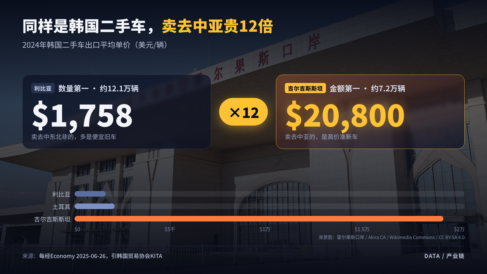

**▲ 图01-H0** `01_H0_主视觉_韩国二手车单价`

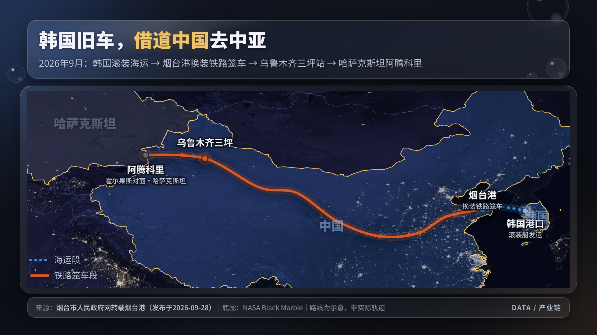

**▲ 图01-A** `01_A_过境路线地图`

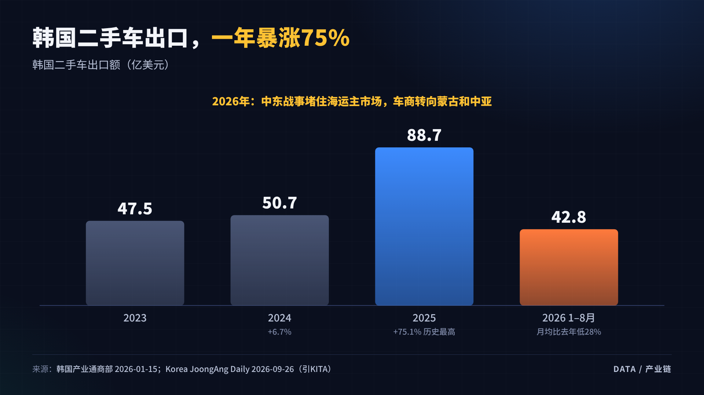

**▲ 图01-B** `01_B_韩国二手车出口额`

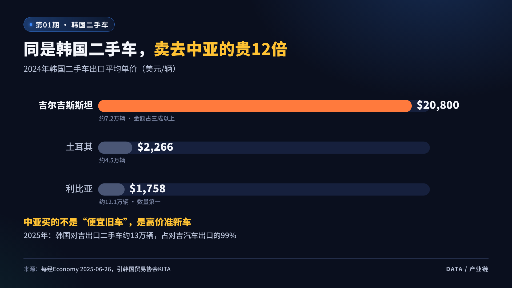

**▲ 图01-C** `01_C_单价差了12倍`

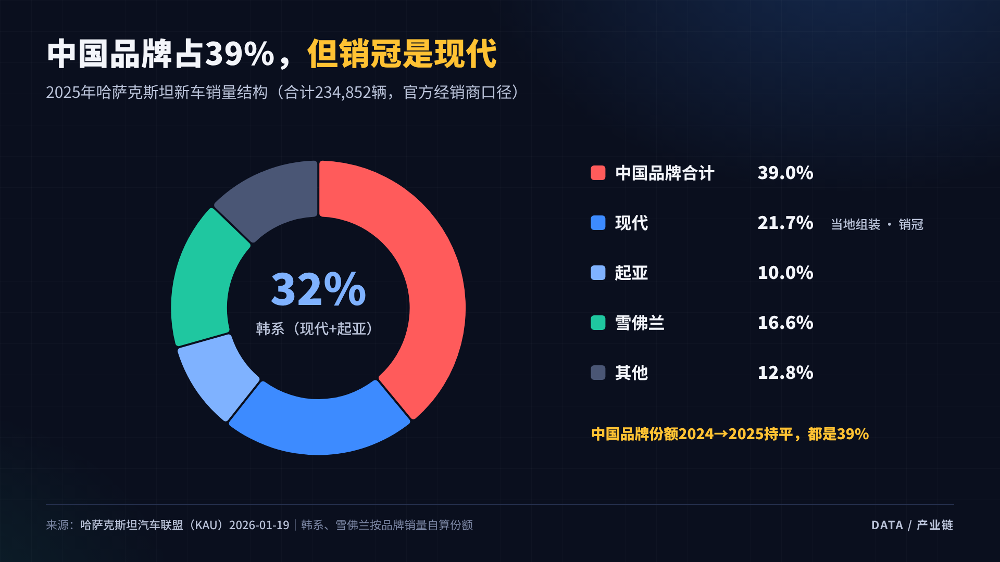

**▲ 图01-D** `01_D_哈萨克斯坦新车市场`

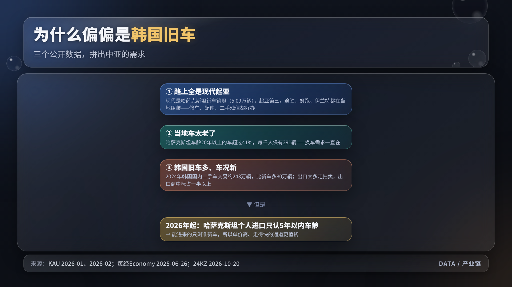

**▲ 图01-E** `01_E_为什么偏偏是韩国车`

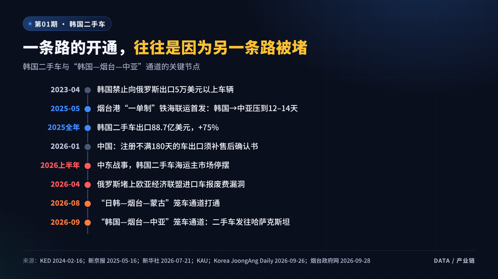

**▲ 图01-F** `01_F_通道时间轴`

## 五、素材链接

**事实来源（S）**

| 编号 | 内容 | 链接 |
|---|---|---|
| S1-1 | 烟台市政府网转载烟台港（2026-09-28）：韩国过境二手车搭笼车经三坪站发往阿腾科里 | <https://www.yantai.gov.cn/col/col34864/art/2026/art_0c0289973a9e4fc7aab13ca2c9637fe0.html> |
| S1-2 | 哈萨克斯坦汽车联盟KAU：2025年新车234,852辆，中国品牌39%（与上年持平） | <https://kao.kz/en/novosti/78/> |
| S1-3 | 烟台市政府网（2026-07-24）：海铁公一单制，仁川→烟台→喀什→比什凯克，12天 | <https://www.yantai.gov.cn/col/col34864/art/2026/art_81105a117cfe4c78a9b2f9761ae64af3.html> |
| S1-4 | 韩国产业通商部（2026-01-15）：二手车出口88.7亿美元、+75.1% | <https://www.motir.go.kr/kor/article/ATCL3f49a5a8c/171439/view> |
| S1-5 | Korea JoongAng Daily（2026-02-24）：对吉二手车约13万辆、占99% | <https://www.koreajoongangdaily.com/business/out-with-the-new-in-with-the-old-koreas-used-cars-driving-up-record-export-numbers/11953101> |
| S1-6 | 每经Economy（2025-06-26）：单价吉尔吉斯斯坦2.08万美元 vs 利比亚1758美元；韩国国内二手车243万辆 | <https://v.daum.net/v/20250626210305626> |
| S1-7 | Korea JoongAng Daily（2026-09-26）：1–8月42.8亿美元，月均-28%，转向蒙古和中亚 | <https://www.koreajoongangdaily.com/business/shut-out-of-middle-east-koreas-used-car-exporters-look-to-mongolia/12891906> |
| S1-8 | KED Global（2025-05-12）：帕里斯帕德二手价高于新车 | <https://www.kedglobal.com/automobiles/newsView/ked202505120006> |
| S1-9 | KAU（2026-02）：哈萨克斯坦车龄20年以上超过41% | <https://kao.kz/en/novosti/81/> |
| S1-10 | 24KZ（2026-10-20）：个人进口电子车辆护照限5年车龄 | <https://24.kz/ru/news/social/800638-236-9-tysyach-avtomobilej-zavezli-v-kazakhstan-za-god> |
| S1-11 | Moscow Legal（2026-04-01）：俄罗斯欧亚经济联盟进口车报废费新规 | <https://mosgolaw.com/en/news/Effective+April+1st%2C+2026%2C+new+regulations+governing+the+importation+of+vehicles+from+Eurasian+Economic+Union+%28EAEU%29+member+states-Belarus%2C+Kazakhstan%2C+Kyrgyzstan%2C+and+Armenia-will+come+into+force+in+Russia./> |
| S1-12 | 新京报（2025-05-16）：烟台港一单制首发，韩国→中亚12–14天 | <https://m.bjnews.com.cn/detail/1747381190129077.html> |
| S1-13 | 新华网（2025-11-17）：注册不满180天车辆出口新规 | <https://www.news.cn/tech/20251117/183bbe3b97574605890dd652730876cf/c.html> |
| S1-14 | 霍尔果斯：2025年出口车辆约45万辆 | <https://www.hellenicshippingnews.com/major-xinjiang-port-sees-record-export-of-450000-vehicles-in-2025/> |

**视频（V）**——YouTube 均已用官方接口核对标题与频道

| 编号 | 视频 | 链接 |
|---|---|---|
| V1-1 | ABC News：韩国二手车在俄罗斯、中东需求激增 | <https://www.youtube.com/watch?v=0urAhAByPx8> |
| V1-2 | SBS 8뉴스：停车场满是贵车，“要去吉尔吉斯斯坦” | <https://www.youtube.com/watch?v=iKQeDA2eeqQ> |
| V1-3 | 新华社：200多辆日本车经霍尔果斯铁路运往哈萨克斯坦 | <https://www.youtube.com/watch?v=ypVjH1PDLyw> |
| V1-4 | 新华社：新疆口岸汽车出口加速 | <https://www.youtube.com/watch?v=Jxa1-pCUYGk> |
| V1-5 | CGTN：霍尔果斯中哈贸易交通网 | <https://www.youtube.com/watch?v=vMCJQK3KiU4> |
| V1-6 | CGTN：中国每小时出口近1000辆车 | <https://www.youtube.com/watch?v=UI7cuq_IkyM> |
| V1-7 | 上观新闻（B站）：霍尔果斯国门口的“摆渡人” | <https://www.bilibili.com/video/BV1ag4EeAEJ4> |
| V1-8 | B站：商品车笼车运输装车 | <https://www.bilibili.com/video/BV18JnH6aEW9> |

**图片（P）**

| 编号 | 内容 | 链接 | 授权 |
|---|---|---|---|
| P1-1 | 烟台港铁路笼车（2026-09本条新闻配图） | <https://www.yantai.gov.cn/cms_files/filemanager/49/picture/20269/1f37be1db3d746e19c3b9b22e3280185.jpg> | 政府网新闻图，注明“图源：烟台港” |
| P1-2 | X80442次海铁公班列驶出烟台港 | <https://www.news.cn/20260721/79808170b8c547558349df351c759446/2026072179808170b8c547558349df351c759446_bb67053eb0444acd821218e9db28d80a.jpg> | 国铁济南局供图 / 新华网 |
| P1-3 | 新霍尔果斯口岸（Commons） | <https://commons.wikimedia.org/wiki/File:New_Khorgos_Port_of_Entry.jpg> | CC BY-SA 4.0 / Akira CA |
| P1-4 | 现代Glovis汽车滚装船（Commons） | <https://commons.wikimedia.org/wiki/File:Hyundai_Glovis_car_carrier,_Port_of_Santander.jpg> | CC BY-SA 4.0 |
| P1-5 | 阿斯塔纳街头现代途胜（Commons） | <https://commons.wikimedia.org/wiki/File:Daredzhani,_Astana_(20240819-2024-08-19_14.35.19).jpg> | CC BY-SA 4.0 |
| P1-6 | 俯瞰烟台港（Commons） | <https://commons.wikimedia.org/wiki/File:Yantai_port_harbor.jpg> | CC BY-SA 4.0 / K.Y.K.Z.K. |

## 六、事实边界（开拍前必读）

- 【确定】2026年9月韩国过境二手车经烟台港笼车→三坪站→阿腾科里（原文“近日”，9月28日发布）；烟台港**没有公布车辆数量**。
- 【确定】中国品牌39%是**新车**、官方经销商口径，2025年与2024年**持平**。
- 【确定】韩国二手车出口2025年88.7亿美元；对吉约13万辆占99%；单价2.08万 vs 1758美元。
- 【敏感，只能转述】“吉尔吉斯斯坦是对俄转口通道”是韩国媒体和研究员的说法；口播已加限定，**不得暗示烟台通道的车流向俄罗斯**。
- 【推断】“海路被堵 → 车商转陆路 → 烟台开通道”是时间上的吻合，原文没有直接因果，口播用“节奏严丝合缝”表达，不说“因为”。
- 【常识】吉尔吉斯斯坦人口约700万，可加字幕“约”。
- 【不要用】“韩国车右舵”“中国新能源进不了中亚”“烟台港57.6万辆二手车”。

## 七、申论式信源深挖（v3 新增：要素拆解 → 三问追问 → 新增来源）

> 方法见 Skill 第10节。下文【确定】可进口播；【推测】只能用“可能/或许”表述；【未验证】不进口播。口播里已用上的新事实，已在上面文案中补入。

### ① 核心信源要素拆解

核心信源：烟台市政府网《“韩国-烟台-中亚”！商品车过境物流通道再添新模式》，发布日期 2026-09-28，信息来源：烟台港。https://www.yantai.gov.cn/col/col34864/art/2026/art_0c0289973a9e4fc7aab13ca2c9637fe0.html （当天重新打开，200）

| 要素 | 原文 | 谁 | 做了什么 | 效果 / 备注 |
|---|---|---|---|---|
| 事件 | “近日，一批韩国过境二手车在山东港口烟台港搭乘笼车，经乌鲁木齐三坪站发往哈萨克斯坦阿腾科里” | 烟台港（山东港口集团） | 韩国二手车在烟台港中转，换铁路笼车西运 | “近日”没有写具体日期；**没有写车辆数量、车型、货主** |
| 时间顺序 | “继8月份打通‘日韩-烟台-蒙古’商品车笼车发运新通道后” | 烟台港 | 2026 年 8 月先开了蒙古方向，9 月再开中亚方向 | 蒙古方向的原始报道**没找到（未验证）** |
| 地点、路径 | 韩国启运→烟台港→乌鲁木齐三坪站→阿腾科里（Altynkol） | 国铁（原文写“国铁等口岸单位”） | 铁路干线联运 | 三坪站是乌鲁木齐国际陆港区的集结站，阿腾科里是哈方的霍尔果斯铁路口岸站 |
| 模式 | “韩国启运滚装海运+烟台港中转集散+铁路干线联运”“港站直通”“下船即装车” | 烟台港、烟台海关、国铁 | 下船以后直接装上铁路车 | 原文说“整体货物周转效率提升20%”，口径不清（是码头作业效率，不是全程时效） |
| 便利化措施 | “提前申报”“预约查验”“一企一策” | 烟台海关等 | 通关环节 | 原文没写具体能省多少时间 |
| 政策依托 | “依托山东自贸试验区烟台片区政策赋能” | 自贸试验区烟台片区 | — | 见下面问题3，政策原文能追溯到 2019 年的总体方案 |
| 规模数字 | “依托26条商品车内外贸航线”“1—8月份……57.6万辆，同比增长27.4%” | 烟台港 | — | **57.6 万辆是全部商品车，不是二手车**；而且和新华网转载的大众日报“1–7 月 50.1 万辆、+10.87%”算不拢，见③-4 |
| 定位 | “东北亚商品车物流枢纽港”“国际中转业务位居全国前列” | 烟台港自述 | — | 2025 年 2 月烟台港自述的还是“国际中转量稳居全国首位”，到这篇改成了“位居前列” |

### ② 三问追问

#### 问1：这件事和什么有关？帮谁解决了什么问题？
**答案摘要**：这条线解决的是韩国车商的“出货难”。2026 年中东战事让韩国二手车最大的市场停摆，韩国政府（KOTRA，联合仁川港务公社）专门组织车商分散市场。陆路去中亚原来要绕海路，烟台把“海运+铁路”接起来，时效从 25 天压到 12–14 天，再到一周左右。这条通道也不是 2026 年才有的：2021 年 7 月就开过“韩国—烟台—中亚”商品车海铁过境班列，到 2025 年 9 月累计 27 列、5800 多台。2026 年的变化在于：一是改用铁路笼车装车（以前多用集装箱或专列），二是从韩国新车、商用车扩展到二手车。

- **S1-22** Korea Times，2026-05-13：https://www.koreatimes.co.kr/amp/business/others/20260513/korea-seeks-new-markets-for-used-car-exports-amid-middle-east-war
  摘录：“The region accounts for about 30 percent of Korea’s used car exports, according to KOTRA.”“KOTRA… will hold a two-day export consultation event in Incheon… to help used car exporters diversify their markets and reduce dependence on the Middle East. The event, co-hosted with the Incheon Port Authority…”
- **S1-16** 水母网（烟台日报），2025-09-12：https://u.shm.com.cn/2025-09/12/content_5454511.html
  摘录：“一列装载300余辆日韩商品车的铁路专用列车从烟台港出发，驶向新疆霍尔果斯，经口岸出境分拨至哈萨克斯坦、乌兹别克斯坦等中亚国家。相比传统经欧洲中转的海运模式，中欧班列运输时间仅为海运的1/4，成本仅为空运的1/6到1/8。自2021年7月开通首条‘韩国—烟台—中亚’商品车海铁联运过境中转班列以来，该班列已累计开行27列，发运商品车5800余台。”
- **S1-20** 央视网，2025-05-15：https://city.news.cctv.com/2025/05/15/ARTIRoqw6Q9uCCgD4oMPOMwN250515.shtml
  摘录：“据烟台中外运国际物流有限公司总经理刘韶华介绍，此次海铁直连的供应链体系，使得韩国到中亚的货物运输时间，从过去的25天压缩至12—14天。”
- **S1-18** 烟台市政府网（信息来源：青岛中远海运），2026-04-17：https://www.yantai.gov.cn/col/col34864/art/2026/art_c1c84a56b3f240149f3126c1ef976f08.html
  摘录：“集装箱于4月14日在韩国仁川港装上中韩轮渡‘新香雪兰’轮，经十四小时的海上航程运抵烟台港后，立即转至铁路运输，直达霍尔果斯口岸，最终运抵哈萨克斯坦及其他中亚国家，跨境运输全程约一周时间”
- **S1-25** Lada.kz（引 Forbes.kz、韩国关税厅数据），2025-04-20：https://www.lada.kz/kazakhstan-news/137463-polmilliarda-pod-kapotom-koreiskie-mashiny-zapolonili-kazakhstan.html
  摘录：“С начала 2025 года и по конец марта объем поставок автомобилей из Южной Кореи в Казахстан составил 486 миллионов долларов США”（新车和二手车合计，哈萨克斯坦是韩国汽车第 6 大买家）

#### 问2：为什么要解决？痛点、成本、市场变化
**答案摘要**：痛点有三层。①**单证割裂**：海运提单、铁路运单、公路手续各办各的，货主要多头对接、多次结算。②**时间和成本**：走海运绕行慢，走空运太贵。③**市场突变**：中东约占韩国二手车出口的三成，一停摆就得找替代出路；另外，哈方阿腾科里—霍尔果斯这段铁路本身也在扩能，从每天 18 对列车提到 33 对，说明这条线原本就拥堵。

- **S1-19** 水母网，2026-07-22：https://news.shm.com.cn/2026-07/22/content_5497762.htm
  摘录：“‘长期以来，公路、铁路、海运分属不同部门管理，分段托运、多套单据、多方对接、多次结算、责任分割，这些一直是外贸物流领域的痛点和堵点。’中铁集装箱运输有限责任公司济南分公司副总经理赵伟在推介会上说。”“依托国铁95306平台统一签发全程提单”
- **S1-23** Bizmedia.kz，2026-02-23：https://bizmedia.kz/2026-02-23-zapusk-vtoryh-putej-na-zheleznoj-doroge-altynkol-zhetygen-zaplanirovan-na-2026-god/
  摘录（引哈萨克斯坦交通部）：“Это позволит увеличить пропускную способность линии с 18 до 33 пар поездов в сутки. Завершение работ запланировано на 2026 год”；“Через узел Алтынколь – Хоргос Казахстан перебрасывает значительный объём экспортно-импортных и транзитных грузов”
- **S1-24** KTZ Express（哈铁快运官网），2024-09-27：https://ktze.kz/en/news/f89a4373-17d6-459b-b512-1b11dec7552e
  摘录：“the pilot shipment of Chinese-manufactured cars in containers commenced at the Khorgos Gateway dry port… traveling via the Altynkol station towards Baku… Containerizing cars offers a cost-effective solution”（可以说明阿腾科里本身就是中国车进中亚、里海方向的汽车中转站）
- （旧）Korea JoongAng Daily 2026-09-26，1–8 月韩国二手车出口月均比上年低约 28%，经销商转向蒙古和中亚，见 ep1.md。

#### 问3：为什么是烟台港来做？背后有什么政策
**答案摘要**：政策链条从上到下有四层。
1. **国务院**：2019 年《山东自贸试验区总体方案》明确要求“建立以‘一单制’为核心的多式联运服务体系……构建东联日韩、西接欧亚大陆的东西互联互通大通道”。烟台片区的定位是“中韩贸易和投资合作先行区”。
2. **部委**：2023 年交通运输部等八部门印发“一单制”“一箱制”意见，鼓励地方给单证费补助和贷款贴息，并把“一单制”列为多式联运示范工程的重点支持方向；同年开展 12 个交通强国专项试点。
3. **新疆一端**：乌鲁木齐是国家中欧班列集结中心示范工程城市之一，2025 年 5 月陆港区推出“集结中转运输”模式，班列从“过路”变成“集结”。
4. **山东本省**：2022 年 5 月山东成为全国首个部省共建交通强国省域示范区；《山东省港口与航道布局规划（2025—2035年）》定下“三主四辅”格局，烟台港是“两翼”之一，定位为商品车物流基地。

此外，烟台港本身的硬件也撑得住：商品车发运量从 2019 年的 37.3 万辆涨到 2024 年的 73.4 万辆，自称“中国最大商品车国际中转港”。

- **S1-11** 《中国（山东）自由贸易试验区总体方案》，2019-08-26（中国一带一路网转中国政府网）：https://www.yidaiyilu.gov.cn/p/101183.html
  摘录：“16.提升航运服务能力……发挥港口功能优势，建立以‘一单制’为核心的多式联运服务体系，完善山东省中欧班列运营平台，构建东联日韩、西接欧亚大陆的东西互联互通大通道。”“烟台片区重点发展高端装备制造……打造中韩贸易和投资合作先行区、海洋智能制造基地”
- **S1-12** 中国政府网，交运发〔2023〕116号《关于加快推进多式联运“一单制”“一箱制”发展的意见》，2023-08-24：https://www.gov.cn/zhengce/zhengceku/202308/content_6899866.htm
  摘录：“鼓励各地方人民政府，通过对签发提单给予单证费补助，对使用多式联运单证融资给予贷款贴息……交通运输部将多式联运‘一单制’‘一箱制’作为多式联运示范工程创建重点支持方向”；“探索赋予多式联运单证物权凭证功能。依托国际铁路联运运单……探索推进以铁路为主的多式联运单证物权化”
- **S1-13** 交通运输部在线访谈，2026-06-16：https://www.mot.gov.cn/hudong/zaixianfangtan/202606/t20260615_4207547.html
  摘录：“同年，交通运输部组织开展了12个综合运输服务‘一单制、一箱制’交通强国专项试点……2025年，三部门联合制定《‘一港一策’推进集装箱铁水联运深度融合发展行动计划（2025—2027年）》”
- **S1-14** 人民日报，2023-10-02：https://paper.people.com.cn/rmrbwap/html/2023-10/02/nw.D110000renmrb_20231002_3-01.htm
  摘录：“10年来，我国积极推动郑州、重庆、成都、西安、乌鲁木齐等中欧班列集结中心示范工程建设……促进中欧班列开行由‘点对点’向‘枢纽对枢纽’转变”；“2022年，阿拉山口、霍尔果斯……分别过境中欧班列5141列、3150列”
- **S1-15** 光明日报（凤凰网转），2026-05-15：https://news.ifeng.com/c/8t9GiaLRoxY
  摘录：“为让货物更快抵达，2025年5月陆港区联合铁路、海关等部门创新推出‘集结中转运输’模式。与过去相比，班列由‘过路’变‘集结’，大大提高了‘带货’能力。”（**原文没有点名三坪站**，三坪站属于乌鲁木齐国际陆港区是行业常识，**未在本文找到原文支撑**）
- **S1-29** 新华社（科技日报转），2025-07-25：https://www.stdaily.com/web/gdxw/2025-07/25/content_375357.html
  摘录：“2022年5月，山东成为全国首个部省共建交通强国省域示范区”；“山东大力发展海铁联运……深化多式联运‘一单制’‘一箱制’试点，多式联运和集装箱铁水联运量年均增长10%和15%以上”（山东省交通运输厅副厅长高洪岩）
- **S1-28** 新华网《瞭望》，2026-08-08：https://www.news.cn/20260808/1536b77dbfe648bfbbf1013d3c141141/c.html
  摘录：“通过《山东省港口与航道布局规划（2025—2035年）》等政策……加快打造以青岛港为龙头，烟台港、日照港为两翼……的‘三主四辅’世界级海洋港口群布局”；“烟台港作为山东港口商品车物流基地、中国北方商品车物流枢纽港，目前拥有商品车外贸航线11条”
- **S1-17** 烟台市政府网（信息来源：烟台港），2025-02-28：https://www.yantai.gov.cn/art/2025/2/28/art_34864_3240502.html
  摘录：“从2019年的37.3万辆到2024年的73.4万辆，烟台港用五年时间实现发运量翻番，国际中转量稳居全国首位”；“中国最大商品车国际中转港”
- **S1-27** 人民论坛网（转经济日报），2024-07-10：https://www.rmlt.com.cn/2024/0710/707096.shtml
  摘录：“在国内率先集成商品车滚装、吊装、集装箱、框架箱全运输模式，去年作业量突破70万辆……商品车国际中转量全国第一”
- **S1-26** 新华网新疆频道，2026-07-11：http://www.xj.xinhuanet.com/20260711/eee34b73a9f5443ca1020de366a0e8c7/c.html
  摘录：“霍尔果斯市人民政府与哈萨克斯坦霍尔果斯国际边境合作中心国家股份管理公司签署合作协议，中哈汽车贸易综合服务平台……正式落户”（说明霍尔果斯一端也在为汽车贸易专门搭平台）
- **没找到（未验证）**：烟台港这条笼车线有没有入选国家级或省级“多式联运示范工程”；烟台、山东对过境商品车有没有专项补贴。可以确认的是省级有通用的海铁联运补贴（见 S2-15）。“日韩—烟台—蒙古”的原始稿件也没找到。

**谁受益**：①韩国车商和仁川港，多了一条中东以外的出路（S1-22）；②哈萨克斯坦进口商，多了一条比海运绕行更快的陆路（S1-20、S1-18）；③山东港口和国铁，拿到过境中转和铁路运量（S1-17、S1-19）。**没有任何来源点名具体的车商或货主。**

### ③ 可加入口播的新增事实
1. 【确定】这条“韩国—烟台—中亚”过境通道 **2021 年 7 月就开了**，到 2025 年 9 月累计 27 列、5800 多台。2026 年的新变化是改装铁路笼车、开始运二手车。（S1-16、核心信源）
2. 【确定】“一单制”在国务院 2019 年给山东自贸区的总体方案里就写着：“建立以‘一单制’为核心的多式联运服务体系，构建东联日韩、西接欧亚大陆的东西互联互通大通道”。（S1-11）
3. 【确定】韩国二手车出口约 30% 去中东。2026 年 5 月 KOTRA 和仁川港务公社专门办了对接会，帮车商换市场。（S1-22）
4. 【确定，口径打架】烟台港 1–8 月 57.6 万辆、+27.4%（烟台港稿），和 1–7 月 50.1 万辆、+10.87%（大众日报稿，S1-21）算不拢：两组数字反推出来的上年同期基数都是约 45.2 万辆，意味着上年 8 月几乎为零，不合常理。**口播建议只说“前 8 个月 57.6 万辆”并注明“据烟台港”，不要强调增速。**
5. 【推测】哈方阿腾科里—霍尔果斯段 2026 年要从每天 18 对列车扩到 33 对（S1-23）。如果按期完工，铁路笼车这条线的容量会变大。这只是推测，原文没有提到烟台线路。

### ④ 新增来源清单（EP1）
| 编号 | 来源 | 日期 | URL |
|---|---|---|---|
| S1-11 | 国务院《山东自贸试验区总体方案》（一带一路网转载） | 2019-08-26 | https://www.yidaiyilu.gov.cn/p/101183.html |
| S1-12 | 交通运输部等八部门“一单制”“一箱制”意见 | 2023-08-24 | https://www.gov.cn/zhengce/zhengceku/202308/content_6899866.htm |
| S1-13 | 交通运输部在线访谈 | 2026-06-16 | https://www.mot.gov.cn/hudong/zaixianfangtan/202606/t20260615_4207547.html |
| S1-14 | 人民日报《中欧班列谱写丝路新传奇》 | 2023-10-02 | https://paper.people.com.cn/rmrbwap/html/2023-10/02/nw.D110000renmrb_20231002_3-01.htm |
| S1-15 | 光明日报（凤凰网转），新疆对外开放 | 2026-05-15 | https://news.ifeng.com/c/8t9GiaLRoxY |
| S1-16 | 水母网，烟台港物流大通道 | 2025-09-12 | https://u.shm.com.cn/2025-09/12/content_5454511.html |
| S1-17 | 烟台市政府网，商品车国际中转 | 2025-02-28 | https://www.yantai.gov.cn/art/2025/2/28/art_34864_3240502.html |
| S1-18 | 烟台市政府网，中韩轮渡海铁联运 | 2026-04-17 | https://www.yantai.gov.cn/col/col34864/art/2026/art_c1c84a56b3f240149f3126c1ef976f08.html |
| S1-19 | 水母网，海铁公“一单制” | 2026-07-22 | https://news.shm.com.cn/2026-07/22/content_5497762.htm |
| S1-20 | 央视网，首趟“零散货源”跨境班列 | 2025-05-15 | https://city.news.cctv.com/2025/05/15/ARTIRoqw6Q9uCCgD4oMPOMwN250515.shtml |
| S1-21 | 新华网山东频道（大众日报），1–7 月商品车 50.1 万辆 | 2026-08-31 | http://www.sd.news.cn/20260831/3f8d1e98c0144349b7b7abd2a93402b0/c.html |
| S1-22 | Korea Times，韩国二手车找新市场 | 2026-05-13 | https://www.koreatimes.co.kr/amp/business/others/20260513/korea-seeks-new-markets-for-used-car-exports-amid-middle-east-war |
| S1-23 | Bizmedia.kz，阿腾科里—热特根复线 | 2026-02-23 | https://bizmedia.kz/2026-02-23-zapusk-vtoryh-putej-na-zheleznoj-doroge-altynkol-zhetygen-zaplanirovan-na-2026-god/ |
| S1-24 | KTZ Express，霍尔果斯无水港汽车装箱试运 | 2024-09-27 | https://ktze.kz/en/news/f89a4373-17d6-459b-b512-1b11dec7552e |
| S1-25 | Lada.kz，2025 年一季度韩国对哈汽车出口 | 2025-04-20 | https://www.lada.kz/kazakhstan-news/137463-polmilliarda-pod-kapotom-koreiskie-mashiny-zapolonili-kazakhstan.html |
| S1-26 | 新华网新疆，中哈汽车贸易综合服务平台 | 2026-07-11 | http://www.xj.xinhuanet.com/20260711/eee34b73a9f5443ca1020de366a0e8c7/c.html |
| S1-27 | 人民论坛网（经济日报），烟台港港产城融合 | 2024-07-10 | https://www.rmlt.com.cn/2024/0710/707096.shtml |
| S1-28 | 新华网《瞭望》，世界级海洋港口群 | 2026-08-08 | https://www.news.cn/20260808/1536b77dbfe648bfbbf1013d3c141141/c.html |
| S1-29 | 新华社（科技日报转），交通强国山东示范区 | 2025-07-25 | https://www.stdaily.com/web/gdxw/2025-07/25/content_375357.html |

### ⑤ 视频素材（已打开核对）
| 素材 | 链接 | 核对结果 | 能否下载 | 版权方 |
|---|---|---|---|---|
| 新华全媒+《山东烟台发出全国首趟一站式跨境“零散货源”班列》（2025-05） | 页面 https://app.xinhuanet.com/news/article.html?articleId=7f459a245e6f9097483d87aee0b091d2 ；mp4 直链 https://vodpub6.v.news.cn/yqfbzx-original/20250515/2025051528ff7c94dd634d58a536a421b82b2914_XxjfceC007076_20250515_CBVFN0A001.mp4 | 页面标题已核；直链 Range 请求返回 206，文件约 22.0MB | **能直接下载 mp4** | 新华社 |
| 新华网《我国首趟跨境海铁公“一单制”班列成功开行》（2026-07-21） | 页面 https://www.news.cn/20260721/79808170b8c547558349df351c759446/c.html ；mp4 https://vodpub6.v.news.cn/yqfbzx-original/20260721/e54d5634b915419598121ae87244cd33.mp4 | 页面 h1 已核；直链返回 206，约 17.3MB | **能直接下载 mp4** | 新华社 |
| 央视《国内联播快讯》（2025-05-14，第 5 条：全国首趟“一单制”跨境铁海联运班列开行） | https://tv.cctv.com/2025/05/14/VIDELnNkMcjYVjknRILqzUDw250514.shtml （guid 20a9844794994afd939b12ef8a7c5ea0） | 页面标题和简介已核 | 能在线播放；页面**不提供直链**，下载需要第三方工具 | 央视 |
| New China TV《Over 200 Japan-made vehicles exported to Kazakhstan via freight train through China's Horgos》 | https://www.youtube.com/watch?v=ypVjH1PDLyw | oEmbed 已核 | 平台不提供下载 | 新华社 |
| New China TV《Auto exports accelerate at Xinjiang port》 | https://www.youtube.com/watch?v=Jxa1-pCUYGk | oEmbed 已核 | 同上 | 新华社 |
| CGTN《Aerial China: How Port of Yantai handles loading of about 2,000 cars》 | https://www.youtube.com/watch?v=XIhSAiqT54g | oEmbed 已核 | 同上 | CGTN |
- 没找到：2026-09 韩国二手车笼车发运的官方视频（央视站内搜索“烟台港 商品车”“烟台港 一单制”都没有结果）。

---

# 第02期｜同一款挖掘机，南美挂到109万：从蓬莱港区一路追到紫金矿业的金矿

## 一、选题卡

| 项目 | 内容 |
|---|---|
| 备选标题 | ① 同一款挖掘机，国内二手25万，南美新机挂到109万 ② 从蓬莱港区开出的船，最后停在了紫金的金矿边上 ③ 中国挖掘机漂洋过海，到底是去挖什么的？ |
| 时长 / 字数 | 约4分50秒 / 口播约1,500字 |
| 核心反差 | 同一款徐工XE215DA：国内2022年二手挂24.9万元；阿根廷同款2026年新机挂16.3万美元，约109万元 |
| 要打掉的靶子 | “卖到国外贵四倍＝出口商暴利” |
| 钱流主线 | 中国资本先出去（紫金在圭亚那、苏里南收购金矿并追加十几亿美元扩建）→ 设备和建材跟出去（蓬莱港区开出加勒比件杂货航线）→ 金子回来 |
| 与上一版的改动 | ① 价格钩子换成南美公开挂牌价中**中国品牌最高的一条**（109万），国内对照用同型号二手；② 目的地落到**圭亚那、苏里南**；③ 延伸到**紫金矿业**的Aurora、Rosebel两座金矿；④ 删除巴西价格 |
| 诚实边界 | 公开报道**没有**把蓬莱航线的货和紫金直接对上号。口播用“同一片海岸的两端”并列叙事，不说“运给紫金” |

## 二、口播文案（可直接配音）

> 【0:00–0:15｜钩子】
> 同一款徐工XE215DA挖掘机。在国内二手平台上，2022年出厂、开了三千多个小时的，挂24万9。在南美的阿根廷，同款新机挂到了16万3千美元，折合人民币109万。一台挖掘机，过了一趟太平洋，身价翻了四倍多。

> 【0:15–0:35｜立靶子＋承诺】
> 你第一反应肯定是：暴利。先别急着下结论。今天我不跟你吵谁赚了差价，我想带你搞清楚另一件事：这些挖掘机漂洋过海，到底是去挖什么的？答案，就藏在山东蓬莱的一条航线里。 三个问题：船开去了哪？同一片海岸上还有什么？贵出来的钱又去了哪？

> 【0:35–1:20｜问题一：船开去了哪】
> 问题一：这些机器从哪儿出发、开去了哪？翻一下烟台港的公众号你就会看到：2024年7月31日，一艘货轮从烟台港蓬莱港区启航，船上装着218台工程车辆、5000多吨水泥、1369件钢结构，目的地是南美洲北边、加勒比海岸的圭亚那。这是山东第一条加勒比件杂货航线。
> 到了11月，从天津、南京、上海运来的水泥、工程车、钢材，先在蓬莱港区卸下、拼船，再一起发往圭亚那和它隔壁的苏里南。2025年9月，这条线还在跑。海关的稿子说得更直白：这条航线，“服务中国企业在圭亚那、苏里南承建的桥梁、道路等基础设施项目”，开通一年跑了15个航次，货值23.55亿元。
> 为什么是圭亚那？因为它是这几年全世界经济增速最快的国家。国际货币基金组织的数据：2022年以来，圭亚那实际GDP年均增长约47%。2026年政府预算是2021年的4倍多，光修路架桥就安排了1900多亿圭亚那元，差不多9亿美元。修路，就要挖掘机。

> 【1:20–2:30｜问题二：同一片海岸上，还有什么】
> 第二个问题来了：修路要挖掘机，这个大家都知道。但你忽略了一件事——你把地图上圭亚那和苏里南这一小块放大，会看到两座中国公司的金矿。
> 第一座在圭亚那，叫Aurora。2020年，紫金矿业花3亿多加元把它买了下来。2025年产金4.5吨，现在正从露天开采转向地下开采，打副井、换设备，目标是年产6吨左右。
> 第二座在苏里南，叫Rosebel。2023年，紫金花3.6亿美元买下95%的股权。2025年产金8.3吨。紫金给它列了三笔扩建：选厂扩建7亿美元，新采选项目5.7亿美元，再建一座100兆瓦的电厂2亿美元，加起来14.7亿美元。矿石处理能力要从每年800万吨扩到2300万吨，目标年产13吨金。为什么敢这么砸钱？今年上半年，紫金卖金的均价是每盎司4643美元，而Rosebel挖出一盎司金的全部维持成本是1701美元。
> 设备从哪来？矿方自己公布过：2023年底，6台三一的150吨矿卡运抵苏里南，是苏里南第一次用这种车；2025年8月，一批纯电动矿卡投运，苏里南总统亲自到场，矿方说这些设备“运了两万多公里”。
> 这里我得说句实话：公开报道里，蓬莱这条航线上的货，和紫金之间没有直接对上号。但同一片海岸，一头是港口在加密航线，一头是矿山在扩产、修路、建电厂，对挖掘机、矿卡、钢材、水泥的需求，是实打实的。

> 【2:30–3:20｜问题三：贵出来的80多万，去哪了】
> 最后一个问题：回到开头的109万和25万，差价是不是全是利润？屏幕上先打一行字：“暴利80万”。现在把它划掉，拆开看，至少有四层。
> 第一层，新机和二手本身就差一截。国内同级别的中型新机，几年前就要五六十万。
> 第二层，运输。从山东到南美，船要走两万公里，要装卸、绑扎、保险。
> 第三层，税。阿根廷要另加10.5%的增值税，厄瓜多尔是15%，还有进口关税。
> 第四层，经销商、配件、售后网点，都得养人。
> 有一个最硬的证据：三一今年在巴西建了自己的挖掘机厂，新闻稿写得很直白，就是为了降低进口关税成本。关税要是不痛，谁会跑到地球另一边建厂？

> 【3:20–3:55｜拔高：为什么是中国在卖】
> 那为什么是中国的挖掘机满世界跑？2021年，中国国内卖出挖掘机27万台；2025年，只剩11.9万台。可产能还在、工人还在，于是出口从6.8万台涨到11.7万台，出口和内销已经各占一半。2025年，山东一个省的工程机械出口就有90亿美元，全国第二。而且，跟着中国企业海外工程项目一起出去的工程机械，一年涨了51%。

> 【3:55–4:50｜收尾＋社交货币】
> 所以这条链是这样的：中国的钱先出去，紫金在加勒比海边砸下十几亿美元；设备和建材跟着出去，从山东的港口装船，走两万公里；最后回来的，是一吨一吨的黄金。
> 下次再有人跟你说“挖掘机卖到国外贵四倍，暴利”，你就问他一句：你知道它是去哪儿挖金子的吗？
> 你觉得，中国企业在海外买矿、建厂，下一站会是哪里？评论区聊聊。

## 三、分镜表

| 时间 | 口播要点 | 画面 | 素材编号 |
|---|---|---|---|
| 0:00–0:15 | 24.9万 vs 109万 | 三根柱子动画；Mercado Libre挂牌页录屏（打码卖家） | 图02-A（动画）/ S2-15 |
| 0:15–0:35 | 立靶子 | 18条南美挂牌价点图，最高点闪烁 | 图02-B（动画） |
| 0:35–1:00 | 蓬莱首航、拼船、发往圭亚那和苏里南 | 路线地图动画（5秒），航线画到加勒比后弹出放大镜 | 图02-E（动画 / 绿幕） / P2-1 |
| 1:00–1:20 | 圭亚那增速、预算、修路 | 预算柱状图；圭亚那街景/修路视频 | 图02-I / V2-15 |
| 1:20–1:55 | Aurora 4.5吨→6吨；Rosebel 8.3吨→13吨 | 双组柱状图；Aurora/Rosebel矿区视频 | 图02-G / V2-11 / V2-13 |
| 1:55–2:15 | 14.7亿美元扩建 | 瀑布图 | 图02-H（动画） |
| 2:15–2:30 | 三一矿卡、电动矿卡、两万公里 | Rosebel官方新闻图 / 视频 | V2-13 / V2-14 |
| 2:30–3:20 | 四层差价、三一巴西建厂 | 差价卡片逐条出现 | 图02-J |
| 3:20–3:55 | 国内销量腰斩、山东第二 | 堆叠柱状图 → 省份条形图 | 图02-C / 图02-F |
| 3:55–4:50 | 钱出去、设备出去、黄金回来 | 路线地图回放 + 金条/金矿空镜 | 图02-E / P2-8 |

## 三之一、章节条、证据截图与短视频切条（v2 新增）

**顶部章节条**（不露脸账号的“目录”，学自巫师财经）：每段开始时把对应的透明 PNG 叠在画面最上方，整段都保留。

| 时间段 | 文件 | 当前高亮 |
|---|---|---|
| 0:35–1:20 | `章节条/02_章节条_1_竖版.png` / `_横版.png` | 船开去了哪 |
| 1:20–2:30 | `章节条/02_章节条_2_竖版.png` / `_横版.png` | 海岸边的金矿 |
| 2:30–4:50 | `章节条/02_章节条_3_竖版.png` / `_横版.png` | 贵出来的钱去哪了 |

**证据截图高亮动画**（学自巫师财经、回形针）：网页截图 → 荧光笔扫过关键句 → 红框 → 镜头推近，约 5 秒。

| 口播时间 | 文件 | 高亮的原文 |
|---|---|---|
| 0:00 | `图表/证据截图/动画_竖版/02_证据3_南美挂牌109万_动画.mp4` | “US$ 163.000”（Mercado Libre 阿根廷） |
| 0:40 | `图表/证据截图/动画_竖版/02_证据1_蓬莱首航圭亚那_动画.mp4` | “218台各类工程车辆、5000余吨大包水泥、1369件钢结构” |
| 1:00 | `图表/证据截图/动画_竖版/02_证据2_圭亚那和苏里南_动画.mp4` | “发往加勒比地区圭亚那和苏里南…‘南京—蓬莱—圭亚那’” |

**单切短视频**（学自温义飞三段式）：每个“问题”段落可以单独剪成 60–90 秒短视频发布，标题直接用该段的问题句，结尾加“完整版看主页”。

## 四、本期图表（横竖双版本 + 动画 + 首尾帧）

| 编号 | 文件名 | 图形 |
|---|---|---|
| 图02-A | 02_A_同一款挖掘机109万vs25万 | 柱状对比 |
| 图02-B | 02_B_南美挂牌价一览 | 分国家点图（18条） |
| 图02-C | 02_C_国内卖不动了 | 堆叠柱状图 |
| 图02-D | 02_D_出口去哪了 | 横向条形图（备用） |
| 图02-E | 02_E_蓬莱到圭亚那苏里南 | 航线地图 + 放大镜（另有绿幕版） |
| 图02-F | 02_F_山东出口排第二 | 横向条形图 |
| 图02-G | 02_G_紫金两座金矿 | 分组柱状图 |
| 图02-H | 02_H_Rosebel扩建账单 | 瀑布图 |
| 图02-I | 02_I_圭亚那在狂奔 | 柱状图 |
| 图02-J | 02_J_差价去哪了 | 流程卡片 |

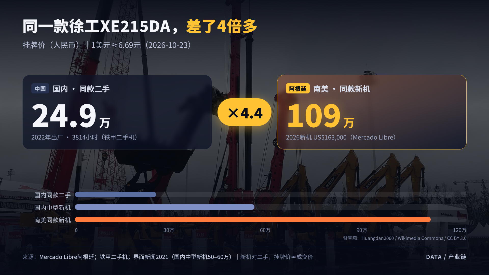

**▲ 图02-H0** `02_H0_主视觉_挖掘机两地价`

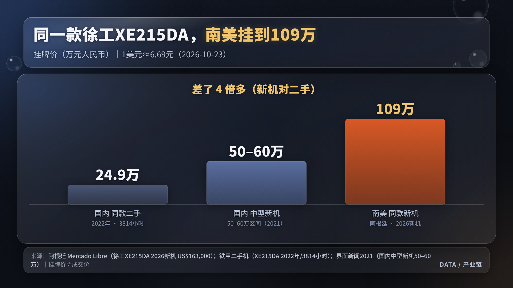

**▲ 图02-A** `02_A_同一款挖掘机109万vs25万`

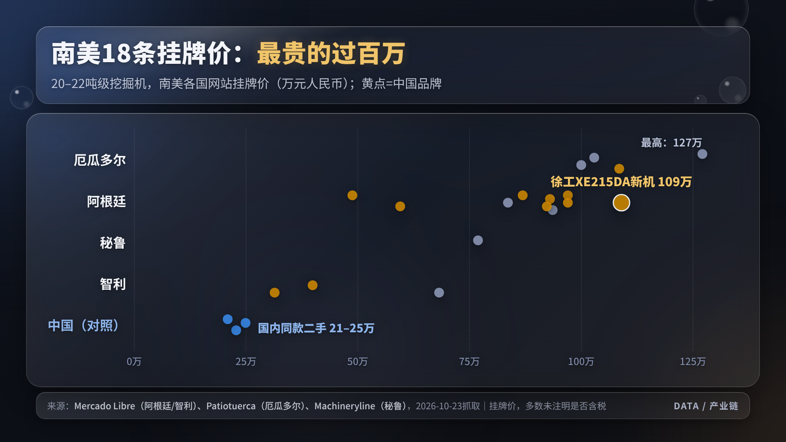

**▲ 图02-B** `02_B_南美挂牌价一览`

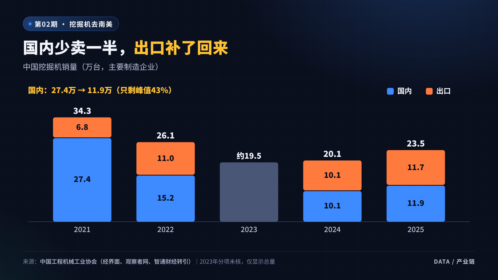

**▲ 图02-C** `02_C_国内卖不动了`

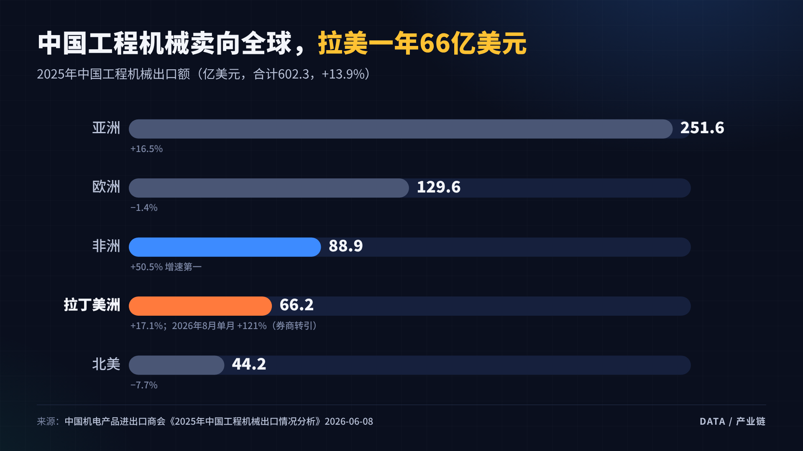

**▲ 图02-D** `02_D_出口去哪了`

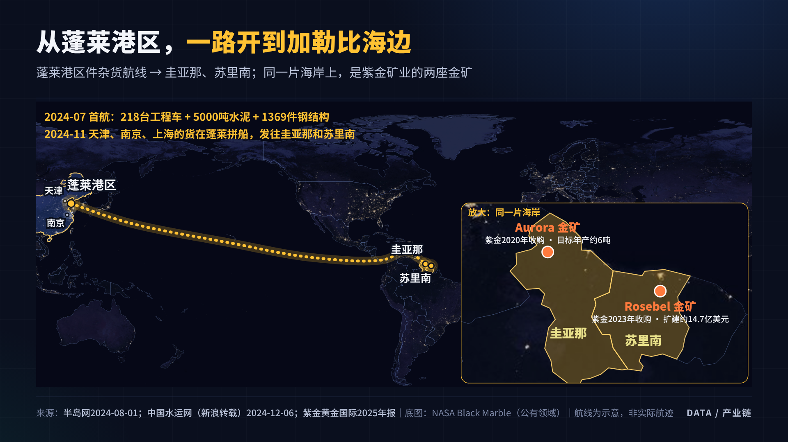

**▲ 图02-E** `02_E_蓬莱到圭亚那苏里南`

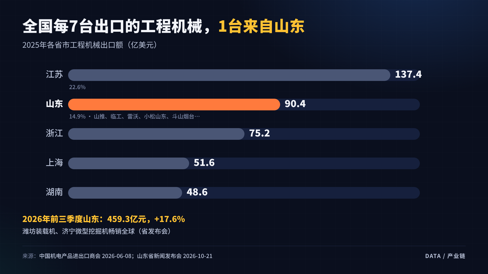

**▲ 图02-F** `02_F_山东出口排第二`

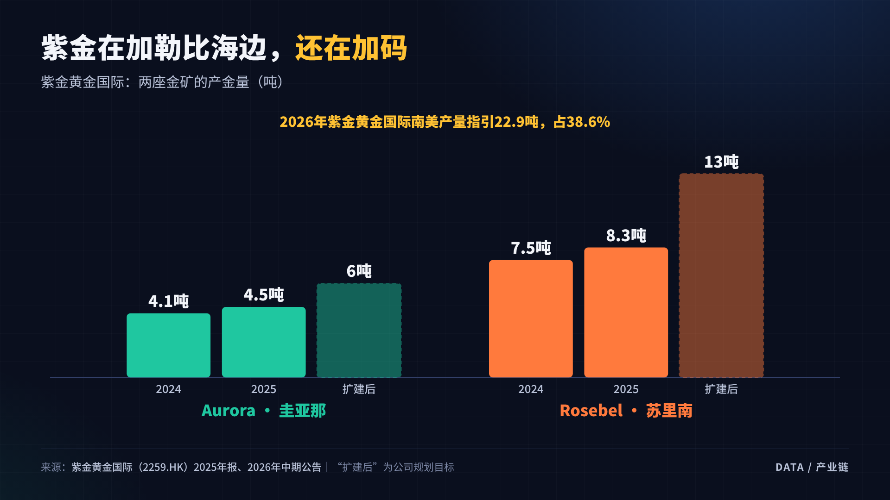

**▲ 图02-G** `02_G_紫金两座金矿`

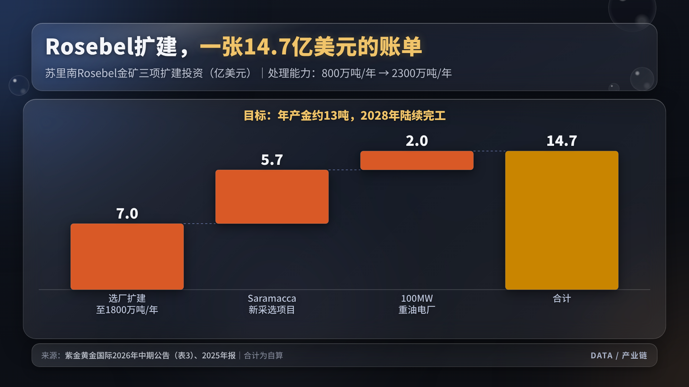

**▲ 图02-H** `02_H_Rosebel扩建账单`

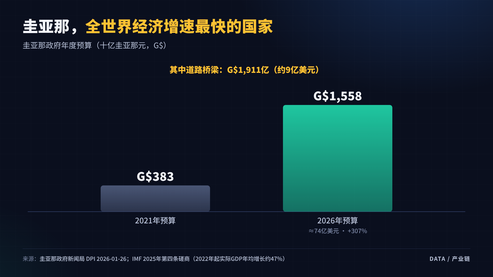

**▲ 图02-I** `02_I_圭亚那在狂奔`

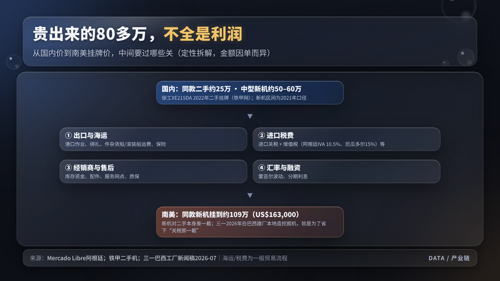

**▲ 图02-J** `02_J_差价去哪了`

## 五、素材链接

**事实来源（S）**

| 编号 | 内容 | 链接 |
|---|---|---|
| S2-15 | 阿根廷 Mercado Libre：徐工XE215DA 2026新机 US$163,000（钩子价格） | <https://vehiculo.mercadolibre.com.ar/MLA-3443699446-excavadora-xe215da-xcmg-nueva-_JM> |
| S2-16 | 铁甲二手机：徐工XE215DA 2022年/3814小时 24.9万元 | <https://www.tiebaobei.com/ue/wajueji/xcmg_xe215da_1832979.html> |
| S2-17 | 厄瓜多尔 Patiotuerca：全场最高 John Deere 210G US$190,000（不含IVA） | <https://ecuador.patiotuerca.com/vehicle/maquinarias-john-deere-210-g-guayaquil-2018/1756495> |
| S2-18 | 阿根廷 ML：徐工XE215G 新机 US$138,000，“No incluye IVA 10,5%” | <https://vehiculo.mercadolibre.com.ar/MLA-2080012725-excavadora-xcmg-xe215g-peso-operativo-22-ton-motor-cummins-_JM> |
| S2-19 | 界面新闻（2021）：国内中型挖掘机新机50–60万元 | <https://www.jiemian.com/article/6246941.html> |
| S2-5 | 半岛网（2024-08-01）：蓬莱港区→圭亚那首航，218台工程车 | <http://news.bandao.cn/a/1722504752562720.html> |
| S2-20 | 中国水运网（新浪转载，2024-12-06）：天津、南京、上海货物在蓬莱拼船发往圭亚那和苏里南 | <https://finance.sina.com.cn/jjxw/2024-12-06/doc-incynvut2160961.shtml> |
| S2-21 | 中华航运网（2024-08-27）：“天津—蓬莱—圭亚那”拼船、航线常态化 | <https://info.chineseshipping.com.cn/cninfo/News/202408/t20240827_1393879.shtml> |
| S2-22 | 山东省物流与交通运输协会（2025-09-15）：蓬莱港区货物发往圭亚那等国 | <http://www.sd56.org/web/archive/view?id=8413> |
| S2-23 | IMF 圭亚那2025年第四条磋商：2022年起实际GDP年均约47% | <https://www.imf.org/en/News/Articles/2025/05/07/pr-25132-guyana-imf-executive-board-concludes-2025-article-iv-consultation> |
| S2-24 | 圭亚那政府新闻局：2026年预算G$1.558万亿、比2021年+307% | <https://dpi.gov.gy/1-558-trillion-budget-2026-presented-marks-307-increase-in-spending-since-2021> |
| S2-25 | 圭亚那政府新闻局：道路桥梁G$1,911亿 | <https://dpi.gov.gy/191-1b-budgeted-for-major-roads-bridges-expansion> |
| S2-26 | 紫金黄金国际（2259.HK）2025年报：Aurora 4.5吨、Rosebel 8.3吨、扩建目标6吨/13吨、南美指引22.9吨 | <https://www.hkexnews.hk/listedco/listconews/sehk/2026/0429/2026042902638.pdf> |
| S2-27 | 紫金黄金国际2026年中期公告：Rosebel三项扩建7亿+5.7亿+2亿美元 | <https://www1.hkexnews.hk/listedco/listconews/sehk/2026/0816/2026081600097.pdf> |
| S2-28 | 紫金完成收购Guyana Goldfields（每股C$1.85） | <https://www.newswire.ca/news-releases/zijin-completes-acquisition-of-guyana-goldfields-858977339.html> |
| S2-29 | IAMGOLD完成向紫金出售Rosebel 95%（约US$3.6亿） | <https://www.globalminingreview.com/finance-business/08022023/iamgold-completes-the-sale-of-rosebel-gold-mines-to-zijin-mining> |
| S2-30 | Rosebel官网：6台三一150吨矿卡运抵苏里南 | <https://www.rosebelgoldmines.sr/sany-150-ton-mining-trucks-a-first-in-suriname/> |
| S2-31 | Rosebel官网：总统出席股东会、电动矿卡、“运输超过2万公里” | <https://www.rosebelgoldmines.sr/president-of-suriname-attends-annual-shareholders-meeting-of-rosebel-gold-mines-n-v/> |
| S2-9 | 三一巴西工厂首批挖掘机下线（本地化降关税） | <https://kyodonewsprwire.jp/release/202607142544> |
| S2-1 | 中国机电商会：2025年工程机械出口602.3亿美元、山东90.4亿、对外承包工程项下+51.4% | <https://www.cccme.org.cn/news/details.aspx?id=FA31909AA38635DB58A6BB39B8975578&classid=73DE9790C2E56969> |
| S2-13 | 挖掘机销量（2021/2024/2025） | <https://www.jiemian.com/article/7002738.html> · <https://www.jiemian.com/article/10811533.html> · <https://finance.sina.com.cn/stock/hkstock/hkstocknews/2026-01-08/doc-inhfreqm6542661.shtml> |

**视频（V）**——YouTube 均已用官方接口核对

| 编号 | 视频 | 链接 |
|---|---|---|
| V2-11 | Espy Guyana：Aurora金矿实景（Region 7） | <https://www.youtube.com/watch?v=p-2GRIKAQDo> |
| V2-12 | News Room Guyana：Aurora地下开采预计200万盎司 | <https://www.youtube.com/watch?v=qmc0sIpQQHg> |
| V2-13 | StarNieuws：Rosebel纯电动矿卡正式投运 | <https://www.youtube.com/watch?v=L1KnxVUMylQ> |
| V2-14 | Rosebel官方：光伏电站投运 | <https://www.youtube.com/watch?v=n0Op63jTJpg> |
| V2-15 | 圭亚那政府新闻局：587名圭亚那人重回Aurora | <https://www.youtube.com/watch?v=kzSsgCMKrGY> |
| V2-16 | B站 王德宏：紫金矿业收购圭亚那奥罗拉金矿案例分析 | <https://www.bilibili.com/video/BV1yDidBpEkg> |
| V2-7 | 央视财经（B站）：电动挖掘机出海爆单 | <https://www.bilibili.com/video/BV1FJbQ6pEiv> |

**图片（P）**

| 编号 | 内容 | 链接 | 授权 |
|---|---|---|---|
| P2-1 | 蓬莱港区货轮满载工程车开往圭亚那（半岛都市报） | <https://mfs.bandao.cn/storage/mfs/66ab56302c76e9009831709e.jpeg> | 媒体版权，注明出处 |
| P2-8 | Rosebel矿区（Commons） | <https://commons.wikimedia.org/wiki/File:Iamgold,_Rosebel_Goldmines_NV.jpg> | CC BY-SA 4.0 / Ymnes |
| P2-9 | Rosebel采坑（Commons） | <https://commons.wikimedia.org/wiki/File:Rosebel_pit.png> | CC BY-SA（引用前确认版本） |
| P2-10 | 蓬莱港（Commons，Unsplash） | <https://commons.wikimedia.org/wiki/File:Penglai_Port,_Yantai,_China_(Unsplash).jpg> | CC0 |

## 六、事实边界（开拍前必读）

- 【确定，但只是挂牌价】109万是阿根廷网站上中国品牌同型号新机的**挂牌价**，未写是否含税；对照的24.9万是国内**二手**挂牌。字幕必须写“新机 vs 二手、挂牌价”。
- 【确定】全场最高是厄瓜多尔一台John Deere 210G（约127万，不含税），这里没用它做钩子，因为它不是中国品牌，而且是2018年的库存车。
- 【确定】蓬莱港区→圭亚那（2024-07首航）；天津/南京/上海货物经蓬莱发往圭亚那和苏里南（2024-11）。
- 【不能说】“蓬莱运去的挖掘机是给紫金的”——没有公开证据。口播已经明确说明。
- 【确定】Aurora 2025年4.5吨、目标约6吨；Rosebel 2025年8.3吨、目标约13吨；Rosebel扩建三项合计14.7亿美元（合计为自算）。
- 【口径】Rosebel矿方口径2025年产金约9.5吨，比上市公司口径大，口播用上市公司口径8.3吨。
- 【口径】圭亚那47%是IMF口径的2022年以来年均增速；不要和政府口径的2025年19.3%混用。
- 【旧数据】国内中型新机50–60万是2021年口径，口播用“几年前就要五六十万”。

## 七、申论式信源深挖（v3 新增：要素拆解 → 三问追问 → 新增来源）

> 方法见 Skill 第10节。下文【确定】可进口播；【推测】只能用“可能/或许”表述；【未验证】不进口播。口播里已用上的新事实，已在上面文案中补入。

### ① 核心信源要素拆解

核心信源 A：半岛网，2024-08-01，http://news.bandao.cn/a/1722504752562720.html （旧，已核）
核心信源 B：新浪财经（转中国水运网），2024-12-06，https://finance.sina.com.cn/jjxw/2024-12-06/doc-incynvut2160961.shtml （旧，已核）

| 要素 | 原文 | 谁 | 做了什么 | 效果 / 备注 |
|---|---|---|---|---|
| 首航 | “7月31日，一艘满载218台各类工程车辆、5000余吨大包水泥、1369件钢结构等件杂货的货轮，在山东港口烟台港蓬莱港公司启航驶向圭亚那” | 烟台港蓬莱港公司 | 开出山东首条加勒比件杂货航线 | 原文写的货主是“客户”，**没有点名** |
| 组货 | “水泥+工程车+杂货”组货出海 | 港口 | 不同货主拼一条船 | 适合货量还不够包整船的新兴市场 |
| 腹地 | “一批来自上海、扬州、天津的水泥、工程车、钢材……发往加勒比地区圭亚那和苏里南”“天津—蓬莱—圭亚那”“南京—蓬莱—圭亚那” | 港口 | 先用内贸船把外地货运到蓬莱，再统一装外贸船（“多港联动、一港直装”） | 货源大部分**不是山东本地货** |
| 频次 | “已完成内、外贸船舶作业12艘次” | 港口 | — | 到 2025-08 已开 15 个航次，每月 2–3 个航次（S2-12） |
| 去向 | 圭亚那、苏里南 | — | — | 和紫金的 Aurora、Rosebel 金矿是同一个地区，但**没有任何报道把这条航线的货和紫金连起来** |

### ② 三问追问

#### 问1：和什么有关？帮谁解决了什么问题？
**答案摘要**：海关稿把货主说得很明白：这条航线“服务中国企业在圭亚那、苏里南等加勒比地区承建的桥梁、道路等基础设施项目”。最有代表性的项目是中国铁建承建的新德梅拉拉河大桥：2.8 公里斜拉桥，造价 2.62 亿美元，2025 年 10 月通车。苏里南一端，石油开发和紫金的金矿扩建也都要用设备。航线开通一年，蓬莱口岸累计出口件杂货 22.1 万吨、货值 23.55 亿元。

- **S2-12** 齐鲁网·闪电新闻，2025-08-18：https://news.iqilu.com/shandong/yuanchuang/2025/0818/5842580.shtml
  摘录：“一艘满载241台工程车辆、3029吨钢材等件杂货的‘忠孝洪’货轮，在青岛海关所属蓬莱海关监管下，从山东港口烟台港蓬莱港区驶往圭亚那，服务中国企业在圭亚那、苏里南等加勒比地区承建的桥梁、道路等基础设施项目。这也是山东首条加勒比件杂货航线正式开通一年以来的第15个航次。”“航次也从开通初期的每月不足1个到现在的每月2-3个航次”“累计完成15个航次，出口各类件杂货总量达22.1万吨，货值23.55亿元”
- **S2-14** 圭亚那政府新闻处（DPI），2024-09-19：https://dpi.gov.gy/over-us100m-expended-on-new-demerara-river-bridge-to-date/
  摘录：“The project is being executed by China Railway Construction Corporation Limited and supervisory firm, Politecnica.”
- **S2-15b** Bridge Design & Engineering，2025-10-09：https://www.bridgeweb.com/Guyanas-coming-of-age-investment-opens-to-traffic/9819
  摘录：“A new 2.8km cable-stayed bridge over the Demerara River in Guyana has opened to traffic… constructed by China Railway Construction Corporation… at a cost of US$262 million”
- **S2-13** 齐鲁网（烟台日报），2024-11-30：https://news.iqilu.com/shandong/shandonggedi/20241130/5750274.shtml
  摘录：“通过‘多港联动、一港直装’模式，蓬莱港区已完成内、外贸船舶作业12艘次，最高实现3条船同时在港作业”

#### 问2：为什么要解决？货主的痛点和市场变化
**答案摘要**：
- **需求在爆发**：圭亚那靠石油成为全球增长最快的经济体（IMF，见旧研究 ep2_zijin.md）。苏里南 2024 年 10 月拍板 105 亿美元的 GranMorgu 油田项目，2028 年出油。两国都在大规模修路建桥。
- **运力很稀缺**：去加勒比的中小批量件杂货一直缺固定班期。连欧洲船公司 UAL 都在 2025 年说“贸易商长期想要一条固定、可靠的航线”。
- **紫金为什么加码**：2026 年上半年紫金黄金国际实现金价 4643 美元/盎司，Rosebel 的全维持成本（AISC）是 1701 美元/盎司，Aurora 是 1682 美元/盎司，每盎司毛利空间接近 3000 美元。紫金三年规划把 Aurora 列为“成熟在产”，把 Rosebel 列为“重要增量项目”，2028 年矿产金目标 130–140 吨。

- **S2-16** TotalEnergies 新闻稿（挪威站），2024-10-01，帕拉马里博：https://corporate.totalenergies.no/news-overview/suriname-totalenergies-announces-final-investment-decision-granmorgu-development-block
  摘录：“Total investment is estimated at around $10.5 billion and first oil is expected in 2028.”
- **S2-17** AJOT，2025-08-26：https://www.ajot.com/news/ual-launches-caribbean-shuttle-connecting-guyana-trinidad-tobago-and-surinam
  摘录：“‘Traders and forwarders in these markets have long asked for a fixed, reliable short-sea option,’ said Martijn Hordijk”；“Guyana’s rapidly growing economy is driven by oil development, infrastructure projects and agriculture.”
- **S2-18** 紫金黄金国际（2259.HK）2026 中期业绩公告，2026-08-16：https://www1.hkexnews.hk/listedco/listconews/sehk/2026/0816/2026081600097.pdf
  摘录：“Average realised gold price US$4,643/oz [上年同期] US$3,085/oz +51%”；“pushed the price above US$5,500/oz early in the year. It then fell to around US$4,000/oz in late June”；Rosebel AISC “US$1,701/oz”，Aurora AISC “US$1,682/oz”（毛利空间是我自己算的）
- **S2-19** 紫金矿业《三年（2026-2028年）主要矿产品产量规划和2035年远景目标纲要》公告（临2026-012），上海证券报，2026-02-10：https://paper.cnstock.com/html/2026-02/10/content_2179725.htm
  摘录：“紫金黄金国际保持……圭亚那奥罗拉金矿……等一批成熟在产项目稳产高产，加速苏里南罗斯贝尔金矿……等重要增量项目产能释放”；“境外重点关注与中国陆路接壤国家，以及其他市场、法治环境良好的友好国家”；挑战：“地缘政治日益复杂，海外项目获取和运营管理难度增加”
- **S2-20** 东方财富网，2026-02-09（转述同一公告的数字）：https://finance.eastmoney.com/a/202602093645094796.html
  摘录：“具体规划指标为：矿产金130-140吨，矿产铜150-160万吨”（产量数字在公告里是图片表格，本文用的是媒体转述）

#### 问3：为什么是蓬莱港来做？背后有什么政策
**答案摘要**：
- **港口定位**：烟台港是“共建‘一带一路’15个支点港口之一”，发起了全国首个“件杂货多式联运发展联盟”，件杂货是它的“特色货源”。蓬莱港区原来就是风电设备出口母港，熟悉大件、超限货的装卸，有工程车滚装和吊装的经验。
- **省级补贴**：山东 2024 年首批政策清单写明，对新开、加密的国际海运航线**每个给 30–150 万元**补贴。蓬莱—圭亚那线正是 2024 年 7 月开的，时间上在补贴期内，但**有没有拿到补贴没有查到（未验证）**。
- **国家关系**：圭亚那 2018 年 7 月签共建“一带一路”谅解备忘录，自称“南美第一个签署”；苏里南 2018 年 5 月签，是“首个同中国签署‘一带一路’合作谅解备忘录的加勒比国家”。2025 年 5 月外交部表态：“圭亚那已成为中国在加勒比地区第一大贸易伙伴”。

- **S2-21** 外交部，2025-05-12，王毅会见圭亚那外长托德：https://www.mfa.gov.cn/web/gjhdq_676201/gj_676203/nmz_680924/1206_681120/xgxw_681126/202505/t20250512_11619554.shtml
  摘录：“圭亚那已成为中国在加勒比地区第一大贸易伙伴……高质量共建‘一带一路’，加强能矿、农渔业、制造业、基础设施建设等领域合作”
- **S2-22** 圭亚那 DPI，2018-07-27：https://dpi.gov.gy/guyana-china-sign-historic-mou-under-belt-and-road-initiative
  摘录：“first South American country to sign up with China’s Belt and Road Initiative”；“The government will prioritise transforming Guyana’s infrastructural landscape using funding from China’s Belt and Road Initiative.”
- **S2-23** 外交部，驻苏里南大使韩镜署名文章，2023-10-31：https://www.mfa.gov.cn/web/ziliao_674904/zt_674979/dnzt_674981/qtzt/ydyl_675049/zwbd_675055/202310/t20231031_11171058.shtml
  摘录：“2018年5月，苏成为首个同中国签署‘一带一路’合作谅解备忘录的加勒比国家，双方在‘一带一路’框架下开展道路、医院、住房、网络、电力……”
- **S2-24** 外交部，2024-04-12，习近平同苏里南总统单多吉会谈：https://www.mfa.gov.cn/web/gjhdq_676201/gj_676203/nmz_680924/1206_681144/xgxw_681150/202404/t20240412_11281006.shtml
  摘录：“苏里南是第一批同新中国建交、同中国建立战略伙伴关系以及同中国签署共建‘一带一路’合作规划的加勒比国家之一”
- **S2-15** 大众新闻《2024年山东首批“上新”50条新政策》：https://m.dzplus.dzng.com/share/general/0/NEWS1942185YFEUZRAPTEPEU （页面时间戳显示 2024-11-21，是否为首发日期不确定）
  摘录：“优化海运航线补贴政策，对2024年新开加密国际（地区）海运航线（航班）给予单个30—150万元补贴；鼓励发展集装箱海铁联运……（牵头单位：省交通运输厅、省商务厅、省财政厅）”
- （S1-27 同源）人民论坛网 2024-07-10：“烟台港发起全国首个件杂货多式联运发展联盟，件杂货发运量跃升全国港口第一方阵”。**联盟成立日期和成员名单没找到（未验证）。**
- **S2-25** 中新网，2026-09-15：https://www.chinanews.com.cn/cj/2026/09-15/10696743.shtml
  摘录：“统筹芝罘湾、龙口、蓬莱、莱州港区生产要素……南美航线通达圭亚那、苏里南等国家和地区”（同一篇报道：前 8 个月烟台港件杂货班轮发运量突破 1600 万吨、+52.9%）
- **S2-26** 新华网，2024-08-13：http://www.news.cn/photo/20240813/80f7981be48b4b47b34d8d88628a07cc/c.html
  摘录：“2022年以来，蓬莱港结合当地海工装备产业快速发展需求，确立了打造北方主要风电设备出口母港和重要海上风电中转港的目标……出口到意大利、巴西等20多个国家和地区”

### ③ 可加入口播的新增事实
1. 【确定】海关稿原话：这条航线“服务中国企业在圭亚那、苏里南等加勒比地区承建的桥梁、道路等基础设施项目”。开通一年 15 个航次、22.1 万吨、货值 23.55 亿元。（S2-12）
2. 【确定】圭亚那最大的中国项目之一：中国铁建承建的 2.8 公里斜拉桥，2.62 亿美元，2025 年 10 月通车。（S2-14、S2-15b）
3. 【确定】苏里南是加勒比第一个、圭亚那是南美第一个签“一带一路”备忘录的国家，都在 2018 年。（S2-22、S2-23）
4. 【确定】2026 年上半年紫金黄金国际卖金均价 4643 美元/盎司，Rosebel 全维持成本 1701 美元/盎司。【推测】每盎司近 3000 美元的毛利空间，就是紫金在苏里南追加约 14.7 亿美元扩建的底气。（S2-18；投资额见 ep2_zijin.md）
5. 【确定，但没有拿到补贴的证据】山东对 2024 年新开国际海运航线单条补贴 30–150 万元。蓬莱—圭亚那线在这个时间窗口内开通。（S2-15）

### ④ 新增来源清单（EP2）
| 编号 | 来源 | 日期 | URL |
|---|---|---|---|
| S2-12 | 齐鲁网，加勒比航线一周年 | 2025-08-18 | https://news.iqilu.com/shandong/yuanchuang/2025/0818/5842580.shtml |
| S2-13 | 齐鲁网（烟台日报），“上新又上量” | 2024-11-30 | https://news.iqilu.com/shandong/shandonggedi/20241130/5750274.shtml |
| S2-14 | 圭亚那 DPI，德梅拉拉河大桥 | 2024-09-19 | https://dpi.gov.gy/over-us100m-expended-on-new-demerara-river-bridge-to-date/ |
| S2-15b | Bridge Design & Engineering，大桥通车 | 2025-10-09 | https://www.bridgeweb.com/Guyanas-coming-of-age-investment-opens-to-traffic/9819 |
| S2-15 | 大众新闻，2024 山东政策清单（航线补贴） | 2024（日期待核） | https://m.dzplus.dzng.com/share/general/0/NEWS1942185YFEUZRAPTEPEU |
| S2-16 | TotalEnergies，GranMorgu 投资决定 | 2024-10-01 | https://corporate.totalenergies.no/news-overview/suriname-totalenergies-announces-final-investment-decision-granmorgu-development-block |
| S2-17 | AJOT，UAL 加勒比航线 | 2025-08-26 | https://www.ajot.com/news/ual-launches-caribbean-shuttle-connecting-guyana-trinidad-tobago-and-surinam |
| S2-18 | 紫金黄金国际 2026 中期公告 | 2026-08-16 | https://www1.hkexnews.hk/listedco/listconews/sehk/2026/0816/2026081600097.pdf |
| S2-19 | 紫金矿业三年规划公告（临2026-012） | 2026-02-10 | https://paper.cnstock.com/html/2026-02/10/content_2179725.htm |
| S2-20 | 东方财富，三年规划数字 | 2026-02-09 | https://finance.eastmoney.com/a/202602093645094796.html |
| S2-21 | 外交部，王毅会见圭亚那外长 | 2025-05-12 | https://www.mfa.gov.cn/web/gjhdq_676201/gj_676203/nmz_680924/1206_681120/xgxw_681126/202505/t20250512_11619554.shtml |
| S2-22 | 圭亚那 DPI，“一带一路”备忘录 | 2018-07-27 | https://dpi.gov.gy/guyana-china-sign-historic-mou-under-belt-and-road-initiative |
| S2-23 | 外交部，驻苏里南大使文章 | 2023-10-31 | https://www.mfa.gov.cn/web/ziliao_674904/zt_674979/dnzt_674981/qtzt/ydyl_675049/zwbd_675055/202310/t20231031_11171058.shtml |
| S2-24 | 外交部，习近平同单多吉会谈 | 2024-04-12 | https://www.mfa.gov.cn/web/gjhdq_676201/gj_676203/nmz_680924/1206_681144/xgxw_681150/202404/t20240412_11281006.shtml |
| S2-25 | 中新网，烟台港件杂货 1600 万吨 | 2026-09-15 | https://www.chinanews.com.cn/cj/2026/09-15/10696743.shtml |
| S2-26 | 新华网，蓬莱风电设备母港 | 2024-08-13 | http://www.news.cn/photo/20240813/80f7981be48b4b47b34d8d88628a07cc/c.html |

### ⑤ 视频素材（已打开核对）
| 素材 | 链接 | 核对结果（oEmbed 标题 / 频道） | 能否下载 | 版权方 |
|---|---|---|---|---|
| 德梅拉拉河大桥通车仪式 | https://www.youtube.com/watch?v=GO-TiFpWVmc | Official Commissioning Ceremony of the New Demerara River Bridge / Peoples Progressive Party/Civic | 平台不提供下载 | 圭亚那执政党频道 |
| 大桥通车新闻 | https://www.youtube.com/watch?v=nexw4uwk2zI | THE ‘BHARRAT JAGDEO DEMERARA RIVER BRIDGE’ COMMISSIONED… / News Room Guyana | 同上 | News Room Guyana（圭亚那国有媒体） |
| 中企中标大桥 | https://www.youtube.com/watch?v=BphGrip9GJQ | CHINESE COMPANY AWARDED CONTRACT TO CONSTRUCT NEW HARBOUR BRIDGE / News Room Guyana | 同上 | 同上 |
| Rosebel 光伏电站投运 | https://www.youtube.com/watch?v=n0Op63jTJpg | Official Launch of Solar Power Station / Zijin Rosebel Gold Mines（矿方官方） | 同上 | 紫金 Rosebel |
| Rosebel 电动矿卡投运 | https://www.youtube.com/watch?v=L1KnxVUMylQ | Straks: Official launch volledig electrische mijntrucks van Zijin Rosebel Goldmines / StarNieuws Suriname | 同上 | StarNieuws |
| 同上 | https://www.youtube.com/watch?v=cAtc98sk_94 | 25 08 2025 ZIJIN ROSEBEL GOLD MINES LEIDT DUURZAME TRANSFORMATIE… / ATV-Networks Suriname | 同上 | ATV |
| Aurora 矿区雇工 | https://www.youtube.com/watch?v=UvRwqA-cHcM | LARGE GUYANESE WORKFORCE AT AURORA GOLD MINES / News Room Guyana | 同上 | News Room Guyana |
| Aurora 航拍 | https://www.youtube.com/watch?v=p-2GRIKAQDo | Aurora Gold Mines (AGM)… Region 7. Guyana / Espy Guyana（个人） | 同上 | 个人，版权风险较高 |
- 没找到：蓬莱港区装船去圭亚那的官方视频。齐鲁网两篇稿件页面里都没有嵌入视频；央视站内搜索“蓬莱港”“烟台 圭亚那”都没有结果。紫金矿业集团自己的官方 YouTube 频道也没找到。

---

# 第03期｜一张横幅、四个logo：韩资在撤，这台五层楼高的锅炉为什么还在山东造？

## 一、选题卡

| 项目 | 内容 |
|---|---|
| 备选标题 | ① 一张横幅四个logo，拼出一条从阿联酋到山东的产业链 ② 韩国对华投资三年少了三分之二，蓬莱却新建了一座锅炉厂 ③ 挂着“现代”招牌，却已经不归HD现代管 |
| 时长 / 字数 | 约5分10秒 / 口播约1,570字 |
| 核心反差 | 韩国对华直接投资：2022年66亿美元 → 2025年22亿美元（−67%）；同一时期，蓬莱一座总投资5亿元的锅炉新厂竣工，订单排到2027年 |
| 要打掉的靶子 | ① “外资都撤光了”；② “17亿美元是这台锅炉的价格”；③ “现代=HD现代集团在扩产” |
| 钱流主线 | 阿联酋国家资本（ADNOC/ADQ）→ 韩国总包三星E&A → 韩国锅炉公司HPS → 中韩合资现代冰轮在蓬莱制造 → 整台设备出海 |
| 与旧稿的改动 | ① KOTRA的66/35/24/22是**中国商务部**口径（KOTRA整理），不是韩方统计；② 横幅上的 HYUNDAI POWER SYSTEMS（HPS）2021年起由韩国MiCo集团控股，**已不属于HD现代**；③ 照片设备与官网2025-09-30公布的TA'ZIZ工业锅炉订单（165t/h）对应；④ 补充“增收不增利”和“去中国化分散布局”两个反向事实，避免一边倒 |
| 身份保护 | 口播不说“我拍到/我在现场”。照片只以“这张画面”“横幅上写着”引用，使用已去水印、去EXIF的处理版 |

## 二、口播文案（可直接配音）

> 【0:00–0:15｜钩子】
> 先看这张画面：一台五层楼高的钢铁大家伙，趴在几十轴的模块运输车上。上面挂着一张横幅：X-781 Auxiliary Boiler Package，TA'ZIZ Methanol Project。下面四个logo：TA'ZIZ、三星E&A、两个HYUNDAI。这台设备在山东蓬莱造，要去阿联酋。

> 【0:15–0:45｜反差＋立靶子】
> 奇怪的地方在这：按中国商务部的数据，韩国对华直接投资2022年是66亿美元，到2025年只剩22亿，三年少了三分之二。都说韩资在撤。可偏偏在2025年3月，蓬莱一座总投资5亿元的锅炉新厂竣工了，挂的还是“现代”的牌子。
> 今天咱们就用这张横幅上的四个logo，把整条产业链拼出来。 三个问题：四个logo是谁？挂着“现代”的是谁的钱？为什么偏偏在蓬莱造？你会发现，它跟你想的“外资撤离”，完全不是一回事。

> 【0:45–1:45｜问题一：四个logo，是谁】
> 问题一：这四个logo分别是谁？第一个，TA'ZIZ。这是阿联酋国家石油公司ADNOC和主权基金ADQ旗下的化工平台，它在阿布扎比的鲁韦斯建一座甲醇厂，年产180万吨，目标2028年完工，今年5月刚拿到20亿美元的银团贷款。
> 第二个logo，三星E&A。注意，不是三星电子，是三星旗下做工程总包的公司。2025年2月，它拿下了这座甲醇厂17亿美元的设计、采购、施工总包，工期44个月。
> 很多人看到这就会说：哦，这台锅炉值17亿美元。错。17亿是整座工厂的总包，锅炉只是里面一个设备包。
> 第三个logo，HYUNDAI POWER SYSTEMS，简称HPS，一家韩国锅炉公司，它从三星E&A手里接了锅炉分包。
> 第四个logo，烟台现代冰轮重工。翻它的官网新闻就能对上：2025年9月19日，拿到TA'ZIZ项目两份合同，其中一台工业锅炉，每小时产蒸汽165吨，在蓬莱新厂总装，原计划2026年9月底交付。

> 【1:45–2:35｜问题二：挂着“现代”，是谁的钱】
> 第二个问题来了：你以为挂着HYUNDAI，就是HD现代集团在扩产？屏幕上先打一行字：“韩国财阀回流”。现在把它划掉。
> 往上穿透一下股权：现代冰轮是2004年成立的中韩合资，韩方HPS持股55%，烟台本地上市公司冰轮环境持股45%。而HPS是2018年从现代重工分拆出来的锅炉部门，2021年就被卖给了韩国一家叫MiCo的集团，现在由MiCo控股。
> 也就是说，招牌还叫“现代”，但这门生意，早就不归HD现代管了。这才是“韩资”的真实样子：大集团在收缩，专业的中型企业在找最划算的地方造东西。

> 【2:35–3:25｜问题三：为什么偏偏在蓬莱造】
> 最后一个问题：外资都在走，为什么偏偏在蓬莱造？看它的订单表：2024年8月，沙特Taiba 2项目，45个余热锅炉模块；2025年1月，沙特Qurayyah项目，36个模块，明确写着在蓬莱新厂组装；今年2月，土耳其浮动电站，50台直流蒸汽发生器；就在这个月，卡塔尔一个LNG项目，6台余热锅炉。全部出口，一台都不留在国内。这也是冰轮环境这两年的方向：今年上半年，它境外收入增长了46.9%，占到了总收入的四成。
> 这些设备有一个共同点：大。大到没法拆成零件运，只能在海边整体造好，直接装船。而蓬莱港区，正是烟台港做工程机械、风电设备这类大件的件杂货港区之一，旁边就是开发区，钢材进来、焊好、整装、出海，一条龙。
> 类似的事在山东不是孤例：青岛的海油工程，就给加拿大的LNG项目造过35个模块，总重17.9万吨。中东、北美的能源项目要赶工期，谁能按时把“整栋楼”交出来，订单就给谁。

> 【3:25–4:00｜拔高：反向事实也要讲】
> 但别急着喊“韩资回流”。两组反向数据：第一，现代冰轮2025年营收9.73亿元，增长32%，净利润却只有3401万元，反而降了44%，订单多了，钱更难赚了。第二，韩国媒体报道，HPS同时在韩国泗川和越南建基地，因为有客户提出“非中国采购”的要求，中国工厂只接美国以外的单。
> 所以真相是：消费、电子这类外资确实在走，现代汽车2023年就把重庆工厂卖了；但离不开港口、钢结构和熟练焊工的重装备，还在中国，只是也给自己留了后路。

> 【4:00–4:40｜收尾＋社交货币】
> 下次有人跟你说“外资全撤光了”，你就把这张横幅给他看：阿联酋的钱、韩国的总包、韩国的锅炉公司、山东的工厂。撤的是“一个国家投到另一个国家”的旧故事，留下来的，是一张谁能交货就跟谁干的全球分工网。
> 你觉得，这种“在中国造、卖去中东”的模式，还能持续几年？评论区说说。

## 三、分镜表

| 时间 | 口播要点 | 画面 | 素材编号 |
|---|---|---|---|
| 0:00–0:15 | 五层楼高设备 + 横幅 | 设备全景（处理版）缓慢推近 → 横幅特写 | 照片A / 照片B |
| 0:15–0:45 | 66→22 vs 5亿新厂 | 柱状图动画 → 蓬莱新厂鸟瞰（韩媒图） | 图03-A / P3-1 |
| 0:45–1:45 | 四个logo四层生意 | 横幅特写上逐个圈出logo → 产业链卡片 | 照片B / 图03-B / P3-2 |
| 1:20–1:30 | 17亿≠锅炉价 | 大字“总包≠设备价” | 字卡 |
| 1:45–2:35 | 股权穿透 | 股权树 | 图03-C |
| 2:35–3:25 | 订单全出口、整装出海 | 订单地图 → 订单时间轴 → 蓬莱HRSG装船视频 | 图03-D / 图03-E / V3-1 / V3-5 |
| 3:25–4:00 | 增收不增利、去中国化 | 双柱对比 | 图03-F |
| 4:00–4:40 | 收尾 | 回到横幅特写 | 照片B |

## 三之一、章节条、证据截图与短视频切条（v2 新增）

**顶部章节条**（不露脸账号的“目录”，学自巫师财经）：每段开始时把对应的透明 PNG 叠在画面最上方，整段都保留。

| 时间段 | 文件 | 当前高亮 |
|---|---|---|
| 0:45–1:45 | `章节条/03_章节条_1_竖版.png` / `_横版.png` | 四个logo是谁 |
| 1:45–2:35 | `章节条/03_章节条_2_竖版.png` / `_横版.png` | “现代”是谁的钱 |
| 2:35–4:40 | `章节条/03_章节条_3_竖版.png` / `_横版.png` | 为什么偏偏在蓬莱 |

**证据截图高亮动画**（学自巫师财经、回形针）：网页截图 → 荧光笔扫过关键句 → 红框 → 镜头推近，约 5 秒。

| 口播时间 | 文件 | 高亮的原文 |
|---|---|---|
| 1:10 | `图表/证据截图/动画_竖版/03_证据2_三星EA17亿美元_动画.mp4` | “SAMSUNG E&A wins contract worth USD 1.7 billion for Methanol Plant Project in the UAE” |

**单切短视频**（学自温义飞三段式）：每个“问题”段落可以单独剪成 60–90 秒短视频发布，标题直接用该段的问题句，结尾加“完整版看主页”。

## 四、本期图表与照片

| 编号 | 文件名 | 图形 |
|---|---|---|
| 图03-A | 03_A_韩资对华投资 | 柱状图（9年） |
| 图03-B | 03_B_横幅上的四个logo | 产业链卡片 |
| 图03-C | 03_C_股权穿透 | 股权树 |
| 图03-D | 03_D_蓬莱的订单去哪 | 世界地图弧线 |
| 图03-E | 03_E_蓬莱订单时间轴 | 时间轴 |
| 图03-F | 03_F_增收不增利 | 双柱对比 |
| 照片A | 原始照片_处理版/03_设备全景_已去水印.jpg | 已裁掉机型和日期水印、清除EXIF |
| 照片B | 原始照片_处理版/03_横幅四个logo_已去水印.jpg | 同上 |

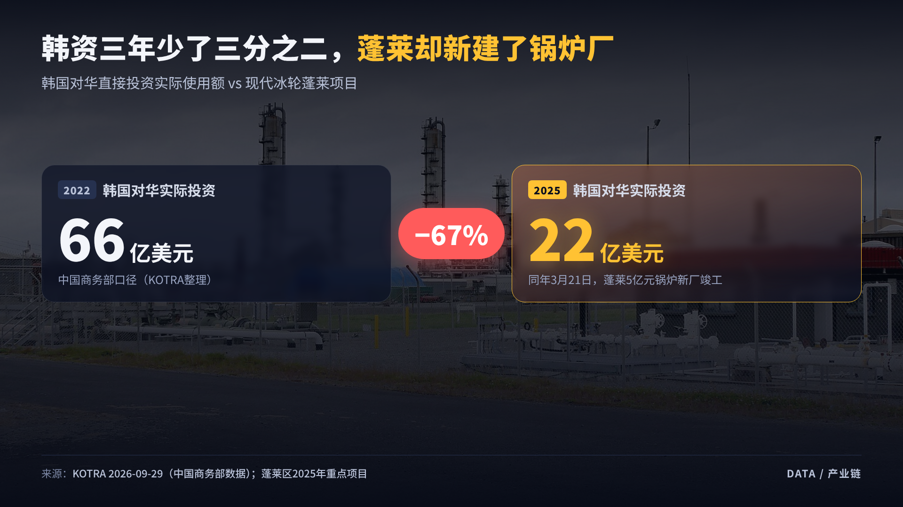

**▲ 图03-H0** `03_H0_主视觉_韩资与蓬莱`

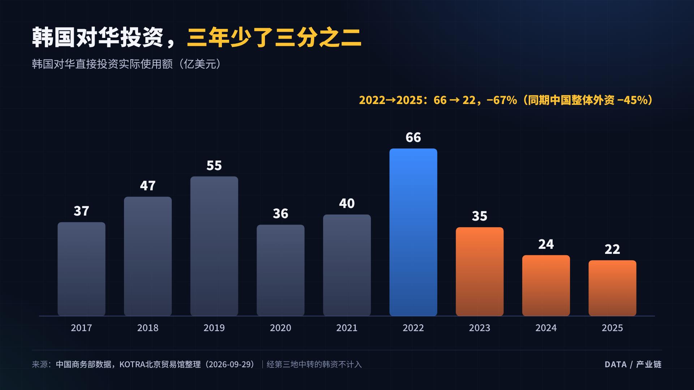

**▲ 图03-A** `03_A_韩资对华投资`

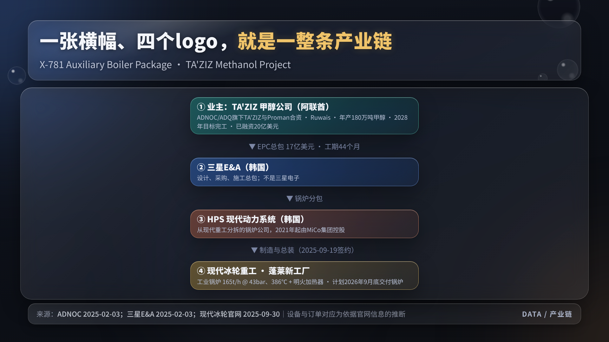

**▲ 图03-B** `03_B_横幅上的四个logo`

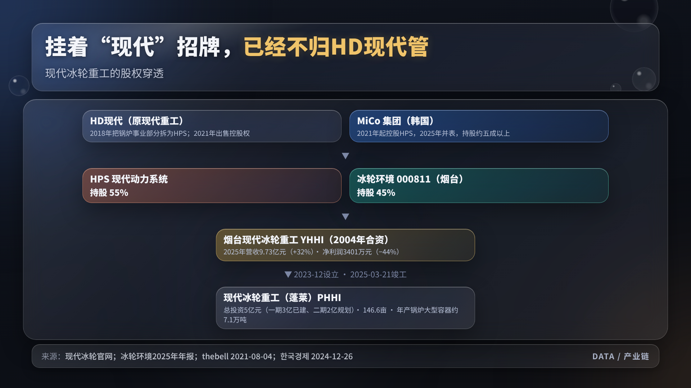

**▲ 图03-C** `03_C_股权穿透`

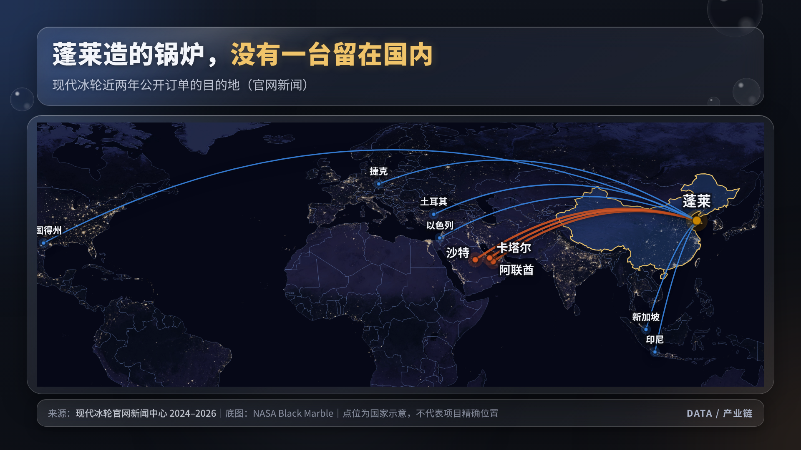

**▲ 图03-D** `03_D_蓬莱的订单去哪`

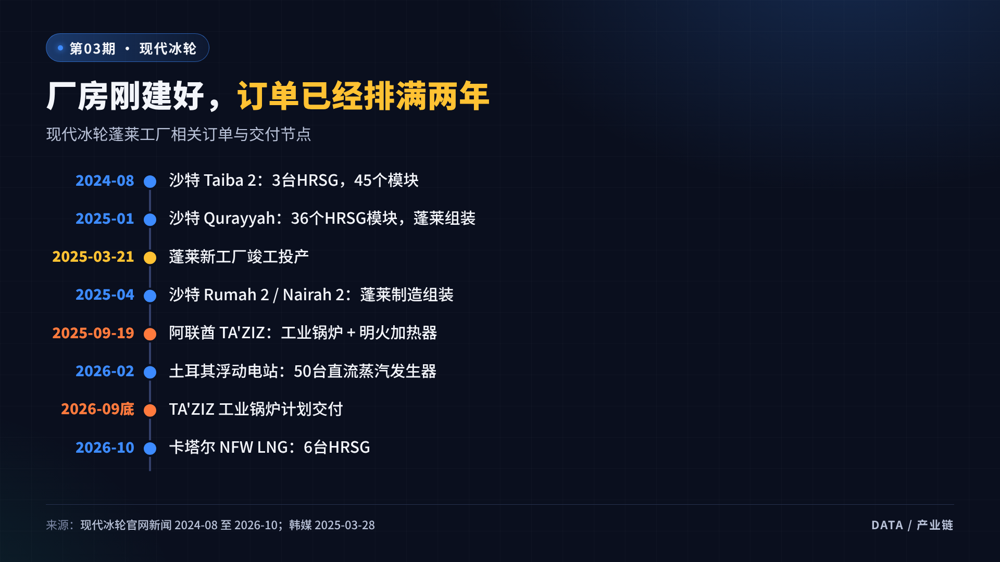

**▲ 图03-E** `03_E_蓬莱订单时间轴`

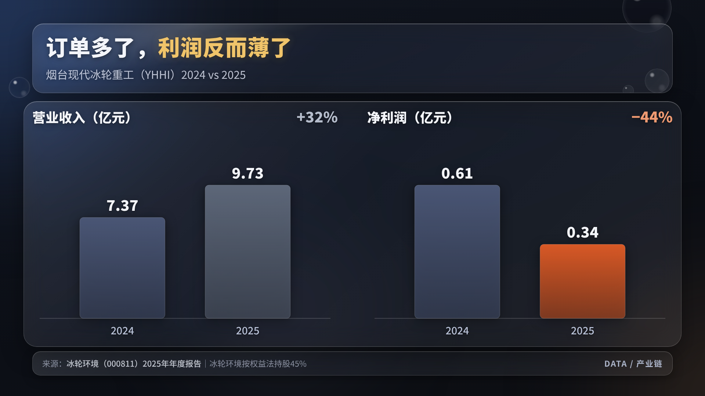

**▲ 图03-F** `03_F_增收不增利`

## 五、素材链接

**事实来源（S）**

| 编号 | 内容 | 链接 |
|---|---|---|
| S3-1 | KOTRA北京贸易馆（2026-09-29）：韩国对华投资实行额 66/35/24/22亿美元（中国商务部数据） | <https://dream.kotra.or.kr/kotranews/cms/news/actionKotraBoardDetail.do?CONTENTS_NO=1&MENU_ID=100&SITE_NO=3&bbsGbn=322&bbsSn=322&pNttSn=244299> |
| S3-2 | 蓬莱区2025年重点项目：现代冰轮重工（蓬莱）总投资5亿元、146.6亩、年产7.12万吨 | <https://www.penglai.gov.cn/art/2025/4/9/art_45032_34497.html> |
| S3-3 | 三星E&A（2025-02-03）：TA'ZIZ甲醇EPC 17亿美元、44个月 | <https://www.samsungena.com/en/newsroom/news/view?idx=15676> |
| S3-4 | ADNOC（2025-02-03）：年产180万吨、2028年完工 | <https://adnoc.ae/en/news-and-media/press-releases/2025/taziz-announces-billion-award-to-build-first-methanol-plant-in-the-uae> |
| S3-5 | 现代冰轮官网（2025-09-30）：TA'ZIZ两份合同、工业锅炉165t/h、蓬莱总装、2026年9月底交付 | <https://www.yhhi.com.cn/index/newscenter/89.html> |
| S3-6 | 现代冰轮官网（2025-01-24）：沙特Qurayyah 36个HRSG模块在蓬莱组装 | <https://www.yhhi.com.cn/index/newscenter/78.html> |
| S3-7 | 现代冰轮官网新闻中心（Taiba 2、Karpowership 50台OTSG、卡塔尔NFW等） | <https://www.yhhi.com.cn/index/newscenter.html> |
| S3-8 | 冰轮环境2025年年报（YHHI营收9.73亿、净利3401万、持股45%） | <https://disc.static.szse.cn/disc/disk03/finalpage/2026-04-11/853e84dd-e2aa-429d-99cb-8380c3b26a5d.PDF> |
| S3-9 | 烟台市政府网（2026-06）：烟台港专业化件杂货码头入选世界一流典型案例，芝罘湾、龙口、蓬莱、莱州四港区联动做大件 | <https://www.yantai.gov.cn/col/col34864/art/2026/art_d0b8e4b1cf3d4948afd571831af7dd64.html> |
| S3-10 | LNG Prime（2023-03-08）：海油工程青岛为LNG Canada造35个模块、17.9万吨 | <https://lngprime.com/asia/chinas-cooec-wraps-up-lng-canada-module-job/75612> |
| S3-11 | 투데이에너지（2025-03-28）：HPS蓬莱工厂3月21日竣工、一期3亿元/二期2亿元 | <https://www.todayenergy.kr/news/articleView.html?idxno=281232> |
| S3-12 | 헤럴드경제（2026-03-25）：客户“非中国采购”要求、泗川与越南基地、烟台前段/蓬莱后段 | <https://biz.heraldcorp.com/article/10702151> |
| S3-13 | 블로터（2026-10-23）：中国两法人负责美国以外订单 | <https://www.bloter.net/news/articleView.html?idxno=676376> |
| S3-14 | 머니투데이（2024-01-16）：现代汽车重庆工厂16.2亿元出售 | <https://www.mt.co.kr/industry/2024/01/16/2024011618483154811> |
| S3-15 | thebell（2021-08-04）/ 한국경제（2024-12-26）：MiCo收购、增持HPS | <https://www.thebell.co.kr/front/newsview.asp?key=202108041226082080109527> · <https://plus.hankyung.com/apps/newsinside.view?aid=202412269410c&category=&sns=y> |

> 注：现代冰轮官网（yhhi.com.cn）证书过期，浏览器可能提示“不安全”，点“继续访问”即可，内容为官方原文。

**视频（V）**

| 编号 | 视频 | 链接 |
|---|---|---|
| V3-1 | AAL Shipping：HRSG模块在蓬莱装船运往埃及（2017） | <https://www.youtube.com/watch?v=v2Ew7gZqA_0> |
| V3-2 | 三星E&A官方：TA'ZIZ甲醇项目短片 | <https://www.youtube.com/watch?v=7LJcoGPeDtQ> |
| V3-3 | 三星E&A：什么是模块化（中英字幕） | <https://www.youtube.com/watch?v=yWIv3CorUaY> |
| V3-4 | HPS官方宣传片 | <https://www.youtube.com/watch?v=G474LF92W4M> |
| V3-5 | 新华社：中国企业完成加拿大LNG项目最后一批模块 | <https://www.youtube.com/watch?v=CMc7qOqavpk> |
| V3-6 | LNG Canada官方：模块运抵现场 | <https://www.youtube.com/watch?v=9MPYyYwWB2o> |
| V3-7 | ADNOC：TA'ZIZ合资公司成立 | <https://www.youtube.com/watch?v=6OomeYXigV8> |
| V3-8 | B站：余热锅炉（HRSG）原理科普 | <https://www.bilibili.com/video/BV1sh411P7C8> |

**图片（P）**

| 编号 | 内容 | 链接 | 授权 |
|---|---|---|---|
| P3-1 | 蓬莱新厂鸟瞰（韩国每日经济配图） | <https://pimg.mk.co.kr/news/cms/202503/28/news-p.v1.20250328.2f4c14100e2443bca4f168cff9657503_R.jpg> | 媒体图，注明出处 |
| P3-2 | TA'ZIZ × 三星E&A 签约合影 | <https://www.samsungena.com/upload/editor/6f8f3c88a851431e823494d5c931a23f.jpg> | 官方新闻图 |
| P3-3 | 鲁韦斯工业区位置图（三星E&A） | <https://www.samsungena.com/upload/editor/ce9f902f6c204068bc07a65cde2ff91d.jpg> | 官方新闻图 |
| P3-4 | 鲁韦斯炼厂（Commons） | <https://upload.wikimedia.org/wikipedia/commons/9/9c/ADNOC_Refining_Ruwais_Site-96.jpg> | CC BY-SA 4.0 / Rickmaj |
| P3-5 | 甲醇厂（Commons） | <https://upload.wikimedia.org/wikipedia/commons/2/26/Methanex_-_Methanol_Plant.jpg> | CC BY-SA 4.0 / Ulrich Lange |

## 六、事实边界（开拍前必读）

- 【确定】66→22亿美元（中国商务部口径，KOTRA整理）；5亿元新厂（一期3亿已建、二期2亿规划）；17亿美元是整座甲醇厂EPC。
- 【确定】HPS是现代冰轮55%股东、TA'ZIZ锅炉分包方，2021年起由MiCo控股；口播说“不归HD现代管”是准确的。
- 【依据官网的推断】横幅X-781 = 官网TA'ZIZ订单里那台165t/h工业锅炉。X-781位号本身无公开资料，字幕可写“据现代冰轮官网订单信息”。
- 【不要评论】原计划9月底交付、10月下旬仍在厂内：不要说“延期”。
- 【未验证】PHHI是否有专用码头、从哪个泊位出运：口播只说“蓬莱港区是做大件的件杂货港区”，不说“厂门口直接装船”。
- 【不要用】用户截图里“五层楼高还在移动”的那段网络视频，来源不明，不作为本期素材。
- 身份保护：照片只用处理版；口播、字幕、评论区回复都不出现“我拍的”“我路过”。

## 七、申论式信源深挖（v3 新增：要素拆解 → 三问追问 → 新增来源）

> 方法见 Skill 第10节。下文【确定】可进口播；【推测】只能用“可能/或许”表述；【未验证】不进口播。口播里已用上的新事实，已在上面文案中补入。

### ① 核心信源要素拆解

核心信源 A：蓬莱区 2025 年重点项目通知，https://www.penglai.gov.cn/art/2025/4/9/art_45032_34497.html （旧，ep3.md 已核）
核心信源 B：现代冰轮官网新闻 89.html（2025-09-30，TA'ZIZ 两份合同）、78.html（2025-01-24，沙特 36 个模块）（旧，经 r.jina.ai 读取）
核心信源 C：冰轮环境 2025 年年报（旧）；本次新增 **2026 年半年报**（S3-11）

| 要素 | 原文 | 谁 | 做了什么 | 效果 / 备注 |
|---|---|---|---|---|
| 项目 | “现代冰轮重工（蓬莱）有限公司发电锅炉及船舶部件高端装备制造项目”，总投资 50,000 万元 | PHHI（HPS 与冰轮合资） | 在蓬莱经济开发区建厂，占地 146.6 亩 | 列在省级高质量发展项目第 1 项；2025 年的目标是竣工投产（已于 2025-03-21 竣工） |
| 产能 | “年生产锅炉产品大型容器合计71200吨” | 同上 | — | 韩国媒体的口径是两厂合计从 6 万吨增到 8 万吨 |
| 订单 | TA'ZIZ 甲醇厂“1台工业锅炉，165t/h @ 43bar、386℃”，“最后组装工作将在……蓬莱新厂房（PHHI）进行”，“工业锅炉计划于2026年9月底交付” | 业主 TA'ZIZ Methanol → EPC 三星E&A → 分包 HPS → 制造 YHHI/PHHI | 制造并组装辅助锅炉 | 交付时间已过；照片拍的时候设备还在厂里，**不要评论是否延期** |
| 股权 | YHHI：HPS 55% + 冰轮 45%（权益法核算） | 冰轮环境 | 联营 | 2026 年上半年冰轮从 YHHI 确认投资收益 811.6 万元，从 PHHI 确认 78.1 万元（S3-11） |

### ② 三问追问

#### 问1：和什么有关？帮谁解决了什么问题？
**答案摘要**：
- **帮阿联酋**：建本国第一座世界级甲醇厂，减少对进口的依赖。甲醇厂开车需要启动蒸汽和备用蒸汽，所以要配辅助锅炉。
- **帮韩国 HPS**：订单多了，产能跟不上，蓬莱工厂负责后段组装。
- **帮冰轮环境**：国内需求放缓，靠“向海”找增量。2026 年上半年冰轮境外收入 14.94 亿元，同比 +46.9%，占比从 32.61% 升到 40.61%。

- **S3-11** 冰轮环境 2026 年半年度报告全文（深交所），2026-08：https://disc.static.szse.cn/disc/disk03/finalpage/2026-08-21/aa6c8c4d-4790-40dc-abdc-ad25ebd6ec9f.PDF
  摘录（分地区）：“境外 1,493,930,863.28 40.61% 1,016,941,227.70 32.61% 46.90%”；“境内 2,184,507,589.80 59.39% … 3.95%”；“联营公司烟台现代冰轮重工有限公司出产联合循环燃气电厂余热锅炉（HRSG），与GE、西门子、三菱等合作”；投资收益表：烟台现代冰轮重工 8,116,000.42 元，现代冰轮重工（蓬莱）781,159.51 元
- **S3-12** 阿布扎比政府媒体办公室，2022-03-03：https://www.mediaoffice.abudhabi/en/energy/taziz-and-proman-partner-to-develop-world-scale-methanol-facility-in-ruwais/
  摘录：“to develop the United Arab Emirates’ (UAE) first world-scale methanol production facility at the TA’ZIZ Industrial Chemicals Zone in Ruwais”；“production of methanol in the UAE will support decreased reliance on imports, enabling local manufacturers to ‘Make it In the Emirates’”

#### 问2：为什么要解决？痛点、成本、市场变化
**答案摘要**：
- **全球燃机和联合循环设备严重紧缺**：美国 AI 数据中心带动电力需求，联合循环电厂的交付周期从 2023 年的 3.5 年拉长到 2025 年的 5 年。HRSG 是联合循环电厂的配套设备，所以 HPS 订单爆满，要找新产能。
- **客户要“去中国化”**：HPS 一边在蓬莱扩产，一边建韩国泗川基地、筹备越南基地，原因是“主要全球客户越来越多地要求非中国采购”。中国两家工厂只接美国以外的订单（旧，블로터 2026-10-23）。【推测】这和美国对华关税、232 条款钢铁类关税有关，但 HRSG 具体适用什么税率**没查到（未验证；Kroll 页面 403，没能打开）**。
- **阿联酋要工业化**：“Operation 300bn”计划到 2031 年把工业增加值从 1330 亿迪拉姆提高到 3000 亿迪拉姆。甲醇还有船用燃料（bunkering）的新需求。

- **S3-13** OilPrice.com，2026-02-04：https://oilprice.com/Energy/Energy-General/US-Power-Boom-Triggers-Global-Gas-Turbine-Shortage.amp.html
  摘录：“Gas turbine manufacturing backlogs have stretched U.S. power plant lead times to five years. Hyperscaler-driven demand is reshaping global turbine supply priorities toward the U.S.”
- **S3-14** 헤럴드경제 미주판（heraldk.com），2026-03-24：https://www.heraldk.com/article/2026032417263638382
  摘录：“HPS는 공급망 다변화 전략의 일환으로 베트남 생산거점 구축도 병행하여 계획하고 있다. 최근 주요 글로벌 고객사들 사이에서 탈중국(Non-China Sourcing) 공급망 확대 요구가 증가함에 따라”（注意：这篇和旧研究里的 heraldcorp 2026-03-25 很可能是同一篇通稿的两个版本，**不算完全独立的来源**）
- **S3-15** 阿联酋政府门户，Operation 300bn：https://u.ae/en/about-the-uae/strategies-initiatives-and-awards/strategies-plans-and-visions/industry-science-and-technology/the-uae-industrial-strategy
  摘录：“It aims to raise the industrial sector’s contribution to the GDP from AED 133 billion to AED 300 billion by 2031.”（页面没有日期；战略是 2021 年 3 月发布的）
- **S3-16** ENGINE（船用燃料媒体），2026-05-11：https://engine.online/news/proman-expands-methanol-reach-with-exclusive-uae-offtake-deal-7b3a
  摘录：“1.8 million mt/year of grey methanol by 2028. The fuel is intended for bunkering among other end uses. TA'ZIZ Methanol, a joint venture between Proman and TA'ZIZ, has secured around $2 billion in financing for what will be the UAE’s first world-scale methanol plant.”（Proman 拿到了独家包销权）

#### 问3：为什么是蓬莱？背后有什么政策
**答案摘要**：
- **产业集聚**：蓬莱海工装备是“省级现代海洋特色产业集聚区”。19 平方公里的海工产业园里，“韩国现代重工、法国液化空气、上海锅炉厂”等项目已经落地。2024 年海工装备产值 175 亿元、+21%。
- **码头条件**：蓬莱有 3 家海工企业的 12 个泊位对外开放，搞“企业自有码头开放、设备直装出口”。超大件装船从 9 天缩到 5 天，解决了“超大件公路运输难”的问题。
- **地方政府重视**：2026 年 5 月烟台市主要领导调研时，要求蓬莱“持续壮大绿色石化、海工装备等优势产业”。
- **自贸区定位**：山东自贸区烟台片区的定位里有“高端装备制造”和“中韩贸易和投资合作先行区”（S1-11）。
- **国资背景**：冰轮环境的实际控制人是烟台市国资委，和万华化学（蓬莱）是“同一实际控制人”。【推测】烟台国资体系在蓬莱的布局，可能是冰轮选择在这里合资建厂的背景之一，但没有原文直接这么说。

- **S3-17** 界面新闻，烟台市政府新闻办“十四五”发布会，2025-12-16：https://www.jiemian.com/article/13772592.html
  摘录：“长岛海洋渔业、蓬莱海工装备、芝罘海洋文旅入选省级现代海洋特色产业集聚区”；“海洋矿业、海工装备、海洋电力、海水淡化4个产业增加值居全省第1位”
- **S3-18** 新华网山东频道，2025-07-11：http://sd.news.cn/20250711/4fccd449a6c74a6490275cf4ae348a25/c.html
  摘录：“蓬莱区加快建设19平方公里海工产业园。随着法国液化空气、韩国现代重工、上海锅炉厂高端装备制造等一系列海工项目的落地，园区实现从风电装备向海工新能源装备转型迭代发展”；“2024年，海工装备产业完成产值175亿元、同比增长21%，完成进出口额90亿元”
- **S3-19** 央视网，2025-11-21：https://news.cctv.com/2025/11/21/ARTIvwCHpha4h8FGVFjPcqeP251121.shtml
  摘录：“企业面临的最大难题是货物是超大件，公路运输比较困难，成本也比较高……我们为企业量身定制了企业自有码头开放、设备直装出口、现场即查即放的检验监管模式”；“过去需要9天才能装船的设备，现在5天就可以出海……目前，蓬莱已有3家海工企业的12个泊位实现对外开放”（**原文没有点名 PHHI 是不是这 3 家之一，未验证**）
- **S3-20** 腾讯新闻（转烟台发布），2026-05-22：https://news.qq.com/rain/a/20260522A04I3600
  摘录：“要做强工业经济，持续壮大绿色石化、海工装备等优势产业，因地制宜发展新兴产业、未来产业”
- （S3-11 同源）冰轮半年报：“实际控制人烟台市人民政府国有资产监督管理委员会”；关联方表：“万华化学（蓬莱）有限公司 同一实际控制人”
- （S2-26 同源）新华网 2024-08-13：蓬莱港是“北方主要风电设备出口母港”。

### ③ 可加入口播的新增事实
1. 【确定】冰轮环境 2026 年上半年境外收入 14.94 亿元，同比 +46.9%，占总收入 40.61%（上年同期 32.61%）；境内只增长 3.95%。（S3-11）
2. 【确定】新华社 2025 年报道蓬莱海工产业园时，把“韩国现代重工”和法国液化空气、上海锅炉厂并列为落地项目；2024 年蓬莱海工装备产值 175 亿元。（S3-18）
3. 【确定】蓬莱为超大件出口开了“企业自有码头”，3 家企业 12 个泊位对外开放，装船从 9 天缩到 5 天。【未验证】PHHI 是否在其中。（S3-19）
4. 【确定】阿联酋建这座甲醇厂的官方理由是“减少对进口的依赖”，产品还瞄准船用燃料；Proman 拿到独家包销权。（S3-12、S3-16）
5. 【确定 + 推测】美国联合循环电厂交付期已拉长到 5 年（S3-13）。【推测】这是 HPS 一边在蓬莱扩产、一边为美国客户另建“非中国”产能的大背景。

### ④ 新增来源清单（EP3）
| 编号 | 来源 | 日期 | URL |
|---|---|---|---|
| S3-11 | 冰轮环境 2026 年半年度报告全文 | 2026-08 | https://disc.static.szse.cn/disc/disk03/finalpage/2026-08-21/aa6c8c4d-4790-40dc-abdc-ad25ebd6ec9f.PDF |
| S3-12 | 阿布扎比政府媒体办公室，TA'ZIZ 与 Proman 合作 | 2022-03-03 | https://www.mediaoffice.abudhabi/en/energy/taziz-and-proman-partner-to-develop-world-scale-methanol-facility-in-ruwais/ |
| S3-13 | OilPrice.com，燃机短缺 | 2026-02-04 | https://oilprice.com/Energy/Energy-General/US-Power-Boom-Triggers-Global-Gas-Turbine-Shortage.amp.html |
| S3-14 | 헤럴드경제 미주판，HPS 泗川、越南基地 | 2026-03-24 | https://www.heraldk.com/article/2026032417263638382 |
| S3-15 | 阿联酋政府门户，Operation 300bn | 无日期（战略 2021 年发布） | https://u.ae/en/about-the-uae/strategies-initiatives-and-awards/strategies-plans-and-visions/industry-science-and-technology/the-uae-industrial-strategy |
| S3-16 | ENGINE，Proman 独家包销 | 2026-05-11 | https://engine.online/news/proman-expands-methanol-reach-with-exclusive-uae-offtake-deal-7b3a |
| S3-17 | 界面新闻，烟台海洋经济发布会 | 2025-12-16 | https://www.jiemian.com/article/13772592.html |
| S3-18 | 新华网山东，蓬莱海上风电全产业链 | 2025-07-11 | http://sd.news.cn/20250711/4fccd449a6c74a6490275cf4ae348a25/c.html |
| S3-19 | 央视网，蓬莱“码头直装” | 2025-11-21 | https://news.cctv.com/2025/11/21/ARTIvwCHpha4h8FGVFjPcqeP251121.shtml |
| S3-20 | 腾讯新闻，烟台市领导蓬莱调研 | 2026-05-22 | https://news.qq.com/rain/a/20260522A04I3600 |

### ⑤ 视频素材（已打开核对）
| 素材 | 链接 | 核对结果（oEmbed 标题 / 频道） | 能否下载 | 版权方 |
|---|---|---|---|---|
| HRSG 模块在蓬莱装船（2017） | https://www.youtube.com/watch?v=v2Ew7gZqA_0 | AAL Brisbane loading HRSG Modules in Penglai & destined for Sokhna / AAL Shipping | 平台不提供下载 | AAL Shipping（船公司官方） |
| HPS 官方宣传片 | https://www.youtube.com/watch?v=G474LF92W4M | Hyundai Heavy Industries Power Systems Promotion Film(Eng) / 현대중공업파워시스템（官方） | 同上 | HPS |
| 三星E&A TA'ZIZ 项目短片 | https://www.youtube.com/watch?v=7LJcoGPeDtQ | SAMSUNG E&A Start Strong Forum with TA'ZIZ Methanol Project (ENG SUB) #shorts / 삼성E&A（官方） | 同上 | 三星E&A |
| TA'ZIZ 合资成立 | https://www.youtube.com/watch?v=6OomeYXigV8 | ADNOC and ADQ Launch TA’ZIZ Joint Venture / ADNOC Group（官方） | 同上 | ADNOC |
| 甲醇厂新闻 | https://www.youtube.com/watch?v=zWltNoEtYBE | UAE’s First Methanol Plant to Be Built by Samsung E&A / Channel IAM-English | 同上 | 第三方媒体 |
| YHHI 官网宣传片 mp4 | https://www.yhhi.com.cn/uploads/20210909/a0f5a9782b91af1cbd431d795e28f58d.mp4 | **未验证**：官网 SSL 证书过期，curl 打不开；而且拍的是 2021 年的烟台老厂 | 理论上是直链 | YHHI |
- 央视网 S3-19 的稿件（2025-11-21，蓬莱风电桩基“码头直装”）是图文页，本次**没能从页面里提取到视频 guid**，有没有视频未验证。

---

# 第04期｜一家卖牛奶的，为什么跑去巴西买150万吨大豆？

## 一、选题卡

| 项目 | 内容 |
|---|---|
| 备选标题 | ① 一家卖牛奶的，为什么去巴西买150万吨大豆？ ② 卖一公斤奶，四分之三的成本是饲料 ③ 中国每吃10斤大豆，8斤多靠进口 |
| 时长 / 字数 | 约4分20秒 / 口播约1,290字 |
| 核心反差 | 做牛奶的蒙牛系牧场，签下的却是2025—2030年150万吨巴西“零毁林”大豆；首船6.9万吨从桑托斯启航 |
| 要打掉的靶子 | ① “大豆是做豆浆的，跟牛奶没关系”；② “150万吨很大，能改变中国大豆进口格局” |
| 钱流主线 | 原奶价格连跌三年 → 牧场只能抠饲料成本（饲料占公斤奶成本约77%）→ 锁定长期、可认证的大豆来源 → 同时满足出口/ESG要求 |
| 与旧稿的改动 | ① 签约方是中粮国际与**蒙牛旗下现代牧业、中国圣牧**（2025年2月）；② 2025年5月这船是**协议首船**，“中国首单零毁林大豆”是2024年5月那单；③ 官方没写“压榨成豆粕”，口播加“一般会”限定；④ 补充进口结构、牧场成本、原奶价格等数据 |

## 二、口播文案（可直接配音）

> 【0:00–0:15｜钩子】
> 2025年5月29日，一艘叫“山东福义”的散货船，装着6.9万吨大豆，从巴西桑托斯港启航，目的地中国。收货的不是油厂，不是饲料厂，是一家卖牛奶的公司——蒙牛旗下的现代牧业。一家卖牛奶的，为什么要去地球另一边买大豆？

> 【0:15–0:40｜立靶子＋承诺】
> 你可能觉得：大豆嘛，做豆浆、榨豆油的，跟牛奶有什么关系？关系大了。今天这期，咱们从一盒牛奶倒着往上游追，一直追到巴西的农场，你会发现，乳企真正想买的，根本不是大豆。 三个问题：大豆和牛奶什么关系？为什么非要零毁林？150万吨到底多大？

> 【0:40–1:30｜问题一：大豆和牛奶什么关系】
> 问题一：一家卖牛奶的，跟大豆到底什么关系？先把合同说清楚。2025年2月，中粮国际跟蒙牛旗下的现代牧业、中国圣牧签了协议：2025到2030年，一共采购150万吨巴西大豆。条件很特别：必须是“零毁林、零植被破坏”的大豆，从2020年底以来，种豆的地没砍过林子，还要第三方认证、到农场现场审核。
> 再看中国大豆的大盘。2025年，中国进口大豆11183万吨，连续第三年创纪录；国产只有2091万吨。算下来，中国每吃10斤大豆，8斤多靠进口。进口的里面，七成多来自巴西。去年6月到10月下旬，中国还暂停了采购美国大豆，美豆的关税是13%，巴西豆只有3%。

> 【1:30–2:30｜问题一（续）：大豆怎么变成牛奶】
> 那大豆怎么变成牛奶？大豆进了中国，一般会先压榨，变成豆油和豆粕。豆粕是高蛋白饲料，奶牛要产奶，就得吃蛋白。
> 你看现代牧业的年报，2024年，他们每产一公斤原奶，成本2块5毛3，其中饲料就占了1块9毛5，饲料占了成本的77%。也就是说，一盒奶的成本里，大头不在奶牛，在饲料槽里。
> 这还没完。问题是奶价在跌。现代牧业的原奶售价，2023年一公斤4块03，2024年3块61，2025年3块34，今年上半年只剩3块21，连跌三年。2024年，现代牧业亏了14亿多。卖价压不住，那就只能从成本上抠，而饲料，就是最大的那块成本。

> 【2:30–3:20｜问题二：为什么非要“零毁林”】
> 第二个问题来了：抠成本，买便宜的就行，为什么非要“零毁林”的大豆？
> 第一，稳定。长期协议锁的是来源和数量，豆粕价格一波动，牧场利润就跟着坐过山车，同行优然牧业甚至专门做期货对冲豆粕和玉米价格。而且蒙牛给自己定了目标：2030年供应链里的大豆要做到零毁林。2024年，它牧场饲料里豆粕只占约7%，但其中45%已经是零毁林豆粕。
> 第二，门槛。欧盟的“零毁林法规”，要求大豆、牛肉、可可这些产品证明不是来自2020年后砍林子的土地，大企业从今年12月30日起适用。中粮的标准，基准日正好也是2020年12月31日。今天不做认证，明天可能就进不了某些市场、拿不到某些客户。
> 第三，码头。中粮国际在桑托斯投了2.85亿美元，建了自己的STS11码头。2024年它是巴西对华第四大大豆出口商。从农场到港口到船，全在自己手里。

> 【3:20–3:55｜问题三：150万吨到底有多大】
> 最后一个问题：150万吨到底有多大？屏幕上先打一行字：“改变中国大豆格局”。现在把它划掉。平摊6年，每年25万吨，放进中国一年1.1亿吨的进口里，只占0.2%左右。它改变不了中国的大豆格局，但它说明了一件事：中国的乳企、粮企，已经开始把手伸进全球农业的最上游，从“买得到”，走向“买得稳、买得干净”。
> 而且，今年8月，现代牧业已经完成要约收购，持有中国圣牧约53.5%的股份，当初签约的两家买方，现在并成了一家，奶牛存栏超过61万头。

> 【3:55–4:30｜收尾＋社交货币】
> 所以下次你拿起一盒牛奶，可以跟身边人说：这盒奶四分之三的成本是饲料，饲料的蛋白，八成以上靠进口，而进口大豆，七成多来自巴西。你喝的是牛奶，背后连着的，是半个地球的农场和航线。
> 你觉得，中国企业把手伸到海外农田，是在保供应，还是在抢定价权？评论区聊聊。

## 三、分镜表

| 时间 | 口播要点 | 画面 | 素材编号 |
|---|---|---|---|
| 0:00–0:15 | 山东福义号、6.9万吨 | 中粮官方首船合影 → 航线地图动画 | P4-1 / 图04-A（动画） |
| 0:15–0:40 | 立靶子 | 牛奶货架 + 奶牛 | P4-6 |
| 0:40–1:05 | 150万吨协议、零毁林 | 新闻截图高亮“零毁林和零植被破坏” | S4-1 |
| 1:05–1:30 | 1.12亿吨、八成靠进口、巴西七成 | 进口来源堆叠条 | 图04-B |
| 1:30–2:00 | 大豆→豆粕→奶牛 | 产业链卡片 | 图04-E |
| 2:00–2:30 | 饲料占77%、奶价连跌 | 瀑布图 → 双折线 | 图04-C / 图04-F |
| 2:30–3:20 | 稳定、EUDR、STS11 | 巴西大豆收获 / 桑托斯港 / WSJ码头视频 | V4-1 / V4-7 / P4-3 |
| 3:20–3:55 | 150万吨只占0.2% | 500格点阵图 | 图04-D（动画） |
| 3:55–4:30 | 收尾 | 牛奶 → 航线地图回放 | 图04-A |

## 三之一、章节条、证据截图与短视频切条（v2 新增）

**顶部章节条**（不露脸账号的“目录”，学自巫师财经）：每段开始时把对应的透明 PNG 叠在画面最上方，整段都保留。

| 时间段 | 文件 | 当前高亮 |
|---|---|---|
| 0:40–2:30 | `章节条/04_章节条_1_竖版.png` / `_横版.png` | 大豆和牛奶 |
| 2:30–3:20 | `章节条/04_章节条_2_竖版.png` / `_横版.png` | 为何要零毁林 |
| 3:20–4:30 | `章节条/04_章节条_3_竖版.png` / `_横版.png` | 150万吨到底多大 |

**证据截图高亮动画**（学自巫师财经、回形针）：网页截图 → 荧光笔扫过关键句 → 红框 → 镜头推近，约 5 秒。

| 口播时间 | 文件 | 高亮的原文 |
|---|---|---|
| 0:45 | `图表/证据截图/动画_竖版/04_证据1_中粮首船_动画.mp4` | “中粮国际6.9万吨巴西可持续大豆启航” |

**单切短视频**（学自温义飞三段式）：每个“问题”段落可以单独剪成 60–90 秒短视频发布，标题直接用该段的问题句，结尾加“完整版看主页”。

## 四、本期图表（横竖双版本，已生成，全部有3秒动画版）

| 编号 | 文件名 | 图形 |
|---|---|---|
| 图04-A | 04_A_一船大豆的航线 | 航线地图 |
| 图04-B | 04_B_大豆从哪来 | 堆叠条形图 |
| 图04-C | 04_C_一公斤奶的账 | 瀑布图 |
| 图04-D | 04_D_150万吨有多大 | 500格点阵图 |
| 图04-E | 04_E_从农场到奶杯 | 产业链卡片 |
| 图04-F | 04_F_原奶越卖越便宜 | 双折线 |

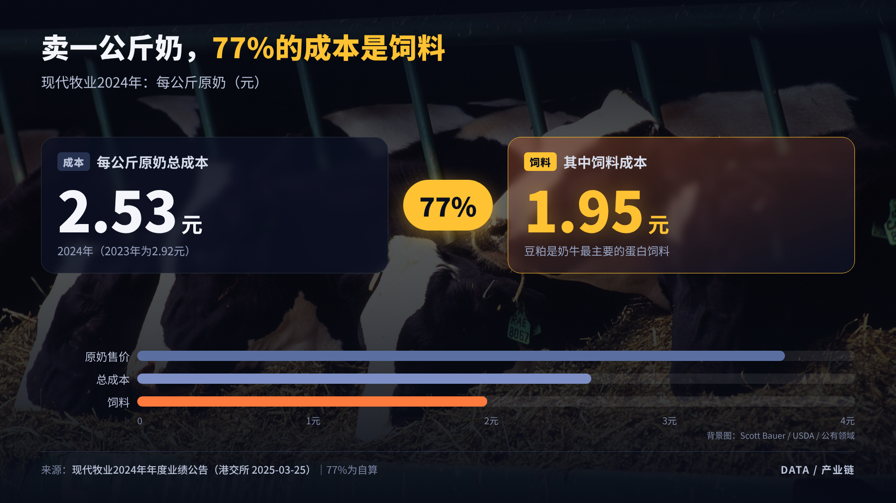

**▲ 图04-H0** `04_H0_主视觉_一公斤奶`

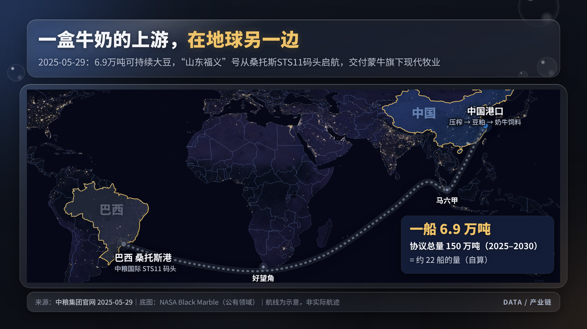

**▲ 图04-A** `04_A_一船大豆的航线`

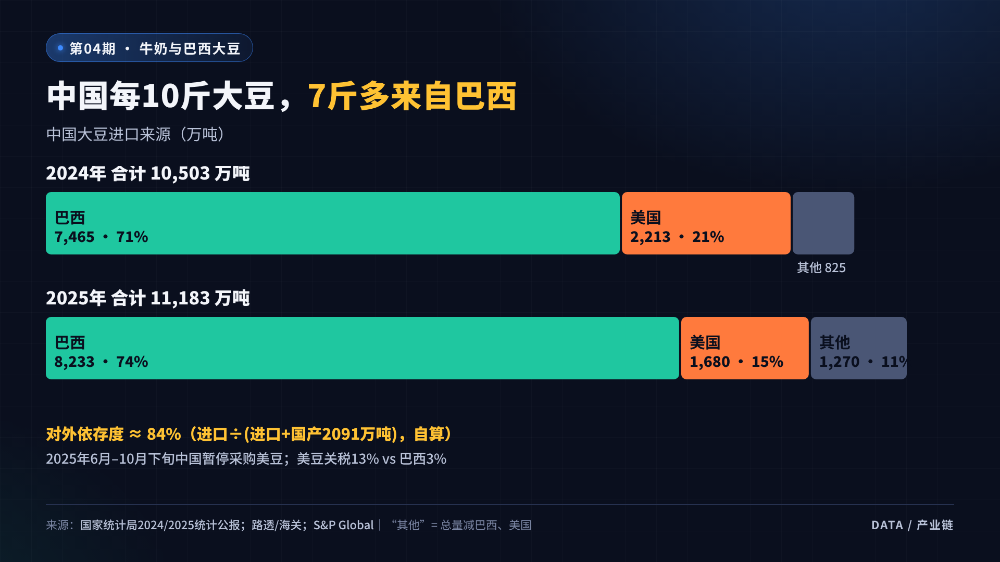

**▲ 图04-B** `04_B_大豆从哪来`

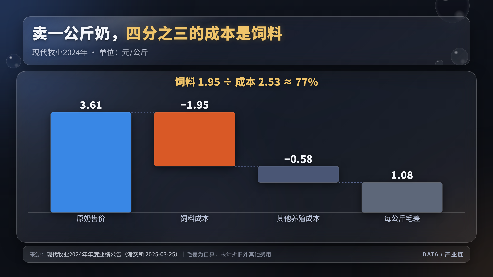

**▲ 图04-C** `04_C_一公斤奶的账`

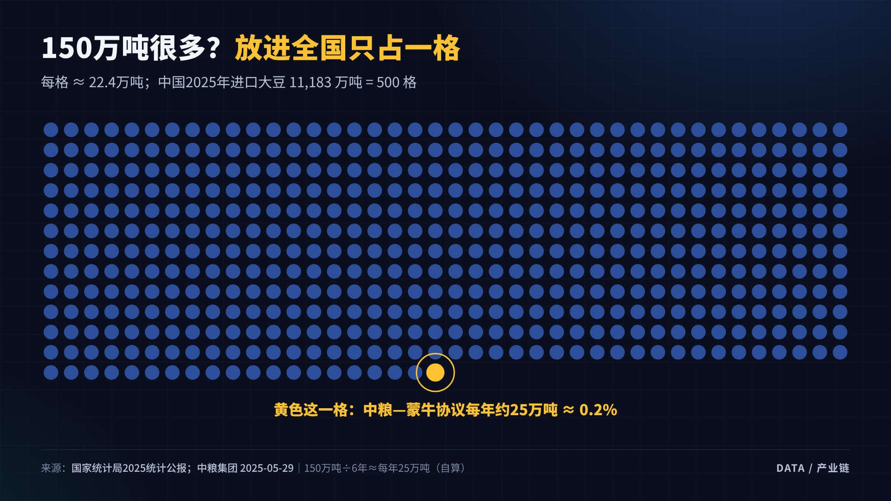

**▲ 图04-D** `04_D_150万吨有多大`

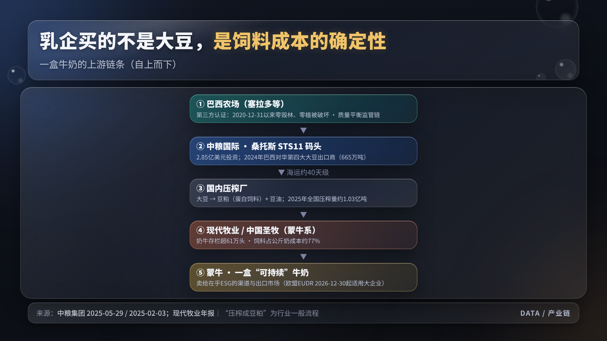

**▲ 图04-E** `04_E_从农场到奶杯`

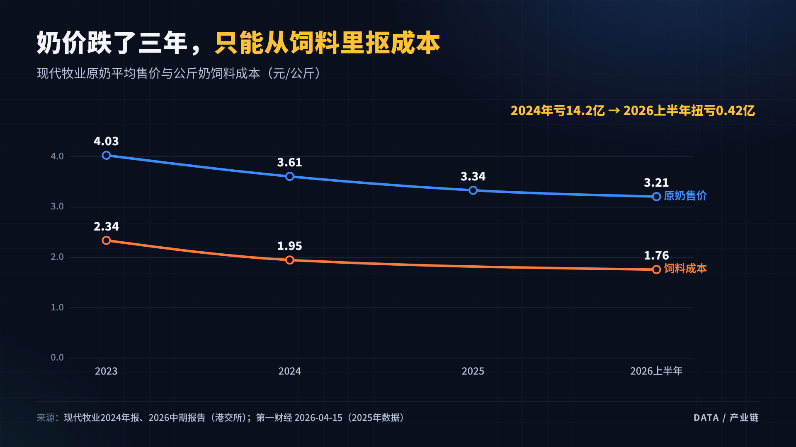

**▲ 图04-F** `04_F_原奶越卖越便宜`

## 五、素材链接

**事实来源（S）**

| 编号 | 内容 | 链接 |
|---|---|---|
| S4-1 | 中粮集团官网（2025-05-29）：山东福义号6.9万吨、150万吨、零毁林和零植被破坏、交付现代牧业 | <https://www.cofco.com/cn/News/Allnews/Latest/2025/0529/55917.html> |
| S4-2 | 中粮集团英文（2025-02-03，转路透）：协议、2025–2030交付、2024年巴西对华第四大出口商665万吨 | <https://www.cofco.com/en/News/Allnews/2025/0203/55449.html> |
| S4-3 | 中粮国际LinkedIn：STS11首船、基准日2020-12-31、质量平衡 | <https://www.linkedin.com/posts/cofco_santos-sustainability-responsiblesourcing-activity-7333456380307111936-0rgi> |
| S4-4 | 国家统计局2025年统计公报：大豆进口11183万吨、国产2091万吨 | <https://www.stats.gov.cn/sj/zxfbhjd/202602/t20260228_1962662.html> |
| S4-5 | S&P Global（转载）：2025巴西8233万吨占73.6%、美豆1680万吨、关税13% vs 3% | <https://www.hellenicshippingnews.com/tariff-gap-likely-to-keep-chinas-soybean-imports-anchored-to-brazil/> |
| S4-6 | 现代牧业2024年业绩公告（港交所）：售价3.61、成本2.53、饲料1.95元/公斤 | <https://www1.hkexnews.hk/listedco/listconews/sehk/2025/0325/2025032501713.pdf> |
| S4-7 | 现代牧业2026中期报告（港交所）：扭亏、3.21元/公斤、持有圣牧53.53% | <https://www1.hkexnews.hk/listedco/listconews/sehk/2026/0825/2026082502335.pdf> |
| S4-8 | 第一财经：2024年现代牧业亏14.2亿 / 2025年数据 | <https://www.yicai.com/news/102535229.html> · <https://www.yicai.com/news/103134342.html> |
| S4-9 | 优然牧业2024年报：豆粕玉米期货对冲 | <https://www1.hkexnews.hk/listedco/listconews/sehk/2025/0328/2025032802982.pdf> |
| S4-10 | 欧盟EUDR推迟至2026-12-30（FoodNavigator） | <https://www.foodnavigator.com/Article/2025/12/17/eudr-delay-confirmed/> |
| S4-11 | Datamar：STS11投资2.85亿美元 | <https://datamarnews.com/noticias/cofco-international-to-launch-first-phase-of-new-terminal-at-port-of-santos/> |
| S4-12 | 界面新闻：现代牧业收购圣牧、存栏超61万头 | <https://www.jiemian.com/article/14682838.html> |

**视频（V）**

| 编号 | 视频 | 链接 |
|---|---|---|
| V4-1 | 华尔街日报：中国在巴西2.85亿美元的出口枢纽 | <https://www.youtube.com/watch?v=A4l_wHA8kvk> |
| V4-2 | 中粮官方：支持巴西塞拉多可持续大豆种植 | <https://www.youtube.com/watch?v=nLX6soH-nDc> |
| V4-3 | CGTN America：中国转向巴西，大豆进口创纪录 | <https://www.youtube.com/watch?v=3jvmp53st1M> |
| V4-4 | AP Archive：巴西农民扩种大豆 | <https://www.youtube.com/watch?v=w1khpeYkzQU> |
| V4-5 | 中粮国际2026宣传片 | <https://www.youtube.com/watch?v=UY0FIlTV9lQ> |
| V4-6 | B站 海员-宋老师：巴西运6.3万吨大豆回国（一船有多大） | <https://www.bilibili.com/video/BV1uG4y1q7dQ> |
| V4-7 | B站 山村农经：巴西农场大豆收获（自制） | <https://www.bilibili.com/video/BV1Ga411G7pi> |
| V4-8 | B站 央视频：蒙牛总裁高飞专访（2026-10） | <https://www.bilibili.com/video/BV1WtJi6bEbk> |

**图片（P）**

| 编号 | 内容 | 链接 | 授权 |
|---|---|---|---|
| P4-1 | 中粮官方：150万吨可持续大豆首船合影 | <https://www.cofco.com/zljt/10/images/2025/0529/17484980820701046_5235x3490.jpg> | 中粮版权，注明“图源：中粮集团” |
| P4-2 | 巴西马托格罗索大豆田 | <https://commons.wikimedia.org/wiki/File:SojaBrasnorte.jpg> | CC BY 3.0 BR |
| P4-3 | 桑托斯港航拍 | <https://commons.wikimedia.org/wiki/File:Porto_de_Santos_a%C3%A9rea.jpg> | CC BY 2.0 |
| P4-4 | 巴西大豆收获 | <https://commons.wikimedia.org/wiki/File:Ronodon%C3%B3polis_colheita_soja_(Roosevelt_Pinheiro)_28mar09.jpg> | CC BY 3.0 BR |
| P4-5 | 桑托斯港散粮仓库 | <https://commons.wikimedia.org/wiki/File:Exports_Brazil_Santos_Port_-_Bulk_Warehouse.jpg> | CC BY-SA 4.0 |
| P4-6 | 荷斯坦奶牛（公有领域） | <https://upload.wikimedia.org/wikipedia/commons/b/b0/Holstein_dairy_cows.jpg> | Public domain / USDA |

## 六、事实边界（开拍前必读）

- 【确定】首船2025-05-29、6.9万吨、山东福义号、STS11；协议2025–2030共150万吨；买方现代牧业、中国圣牧。
- 【确定】进口11183万吨、国产2091万吨（统计局）；巴西73.6%（S&P）。
- 【推断，已加限定】“压榨成豆粕进奶牛饲料”：官方只说“用于生产可持续乳制品”，口播用“一般会”。
- 【确定】饲料占公斤奶成本约77%（1.95/2.53，自算）；2025年数据来自第一财经转述，港交所原文未打开。
- 【不要说】“每一粒都零毁林”：监管链是质量平衡，只保证总量对得上。
- 【不要说】“中国首单零毁林大豆”：那是2024年5月另一单。
- 【避坑】2025年11月另一船“6.9万吨巴西大豆”因混入农药处理小麦被拒（涉及嘉吉等，与中粮无关）；B站有同名视频，剪辑时千万别混用。

## 七、申论式信源深挖（v3 新增：要素拆解 → 三问追问 → 新增来源）

> 方法见 Skill 第10节。下文【确定】可进口播；【推测】只能用“可能/或许”表述；【未验证】不进口播。口播里已用上的新事实，已在上面文案中补入。

核心信源：中粮集团官网 2025-05-29 https://www.cofco.com/cn/News/Allnews/Latest/2025/0529/55917.html （ep4.md 已核）

### ① 核心信源要素拆解

| 要素 | 原文（中粮稿） | 谁 | 做了什么 | 效果/说法 |
|---|---|---|---|---|
| 时间地点 | "5月29日……自中粮国际桑托斯港STS11码头启航" | 中粮国际 | 装船发运 | 协议首船 |
| 货物数量 | "载有6.9万吨巴西可持续大豆的'山东福义'号散货船" | 中粮国际 | 出口 6.9 万吨 | 约占 150 万吨总量的 4.6%（自算） |
| 协议 | "今年2月中粮国际与蒙牛旗下现代牧业、中国圣牧签署巴西可持续大豆战略合作协议" | 卖方中粮国际；买方现代牧业、中国圣牧 | 签长期采购协议 | 2025–2030 年共 150 万吨 |
| 促成方 | "在世界经济论坛绿色价值链工作组的促成下" | WEF 热带雨林联盟（TFA）下设的工作组 | 撮合 | 见三问·问3 |
| 标准 | "零毁林和零植被破坏""第三方机构的可持续性认证""符合《中粮国际负责任农业标准》" | 第三方认证机构 + 中粮 | 认证、审核 | 基准日 2020-12-31，质量平衡（ep4 已核） |
| 用途 | "交付蒙牛集团旗下现代牧业，用于生产可持续乳制品" | 现代牧业 | 进入奶牛饲料链 | 蒙牛 ESG 目标的一部分 |
| 前史 | "2024年5月，中粮国际成功交付中国首单'零毁林'巴西大豆" | 中粮国际 | 首单 | 2023 年进博会签约（见 S4-01） |
| 承诺 | "2025年在全球范围内消除大豆和玉米供应链中的毁林现象" | 中粮国际 | 企业承诺 | 外部有质疑（S4-16） |

### ② 三问追问

#### 问1　这件事和什么有关？帮谁解决了什么问题？

**答案摘要**：表面上是一笔贸易，实际上是蒙牛的**上游减排/去毁林目标**和中粮的**合规+融资+市场准入**需求对上了。蒙牛要在 2030 年让供应链大豆"零毁林风险"，但它自己不进口大豆，只能找贸易商；中粮能提供可追溯、经认证的货源。

- **S4-05 蒙牛《2024可持续发展报告》**（港交所，PDF 生成日期 2025-04-28，已核）
  https://www1.hkexnews.hk/listedco/listconews/sehk/2025/0428/2025042803497.pdf
  - "By 2030, Mengniu aims to eliminate deforestation risk associated with timber products, soy products, and palm oil in its supply chain."
  - "In 2024, soybean meal accounted for approximately 7% of the total feed procurement by Mengniu's partner farms, of which, 45% was "zero deforestation" soybean meal."
  - "Mengniu achieved a reduction and substitution of 230,000 tons of soybean meal, low-risk procurement of 220,000 tons, and certified procurement of 51,000 tons. 100% of the soybean meal procured by Mengniu's farms can be traced back to the manufacturers."
  - "Mengniu, together with its subsidiaries Modern Dairy and China Shengmu, has jointly developed the 'Soybean-Zero Deforestation Joint Action Plan for Dairy Industry Chain', covering all partner farms."
  - 关于 2024 首单："The soybean order was signed between COFCO International … and Modern Dairy at the 6th China International Import Expo in 2023 … complying with … the 'COFCO International Responsible Agriculture Standards' reviewed by the European Feed Manufacturers' Federation (FEFAC)."
- **S4-01 中国日报网**（2024-06-04，已核）https://cn.chinadaily.com.cn/a/202406/04/WS665ede4ca3109f7860de09ca.html
  - "此批大豆顺利抵运天津佳悦粮油专用码头，由中粮油脂旗下中粮佳悦（天津）有限公司完成加工，并交付终端客户现代牧业。"→ 说明链条：巴西大豆 → 中粮天津工厂压榨 → 豆粕给现代牧业。**这补上了 ep4 里"压榨成豆粕"缺的官方依据**（针对 2024 首单；2025 年这船的加工厂未披露）。

#### 问2　为什么要解决？这些企业为什么需要（痛点、成本、市场变化）？

**答案摘要**：
1. **欧盟市场门槛**：EUDR 要求 2020 年后毁林土地的产品不得进欧盟，大企业 2026-12-30 起适用。中粮同时做对欧业务（已向欧盟交付零毁林阿根廷豆粕，ep4 已核），标准要统一。2026 年 5 月欧委会只调整范围、不重开法规文本。
2. **巴西本地"护栏"在松动**：亚马孙大豆禁令（Soy Moratorium，中粮是签署方）2025 年被巴西反垄断机构 CADE 叫停，又被法院恢复；马托格罗索州法律 2026-01-01 生效，取消参与这类自愿协议企业的税收优惠。行业自律靠不住，买家要自己做认证。
3. **钱的成本**：中粮国际的可持续挂钩贷款，利率和"巴西大豆可追溯和社会环境筛查"挂钩。
4. **声誉风险**：NGO 长期指控中粮供应链涉毁林。
5. **蒙牛这边**：碳中和目标（2050 全产业链）、牧场亏损期仍要完成 ESG 承诺；2025 年中央一号文件明确"推进肉牛、奶牛产业纾困"，说明行业在难过的时候。

- **S4-10 Mayer Brown**（2026-02-18，已核）https://www.mayerbrown.com/en/insights/publications/2026/02/eu-regulation-on-deforestation-free-products-eudr-what-lies-ahead-in-2026
  - "It also requested that by 30 April 2026 the European Commission carry out a simplification review of the EUDR and present a report to the European Parliament and to the Council along with a legislative proposal, where appropriate."
- **S4-11 Foods Connected 博客**（2026 年，已核，二手解读）https://blog.foodsconnected.com/7-key-takeaways-from-the-april-2026-eudr-review
  - "The EUDR 2026 draft Delegated Act, published by the European Commission on 4 May 2026 …""the core legal text remains as it is""get compliant ahead of the 30 December 2026"
- **S4-13 Mongabay**（2025-10，已核）https://news.mongabay.com/short-article/2025/10/brazil-soy-deal-that-curbs-amazon-deforestation-to-be-suspended-in-2026/
  - "Brazil's antitrust regulator, CADE, on Sept. 30 decided to suspend the Amazon soy moratorium from Jan. 1, 2026.""Its signatories include commodity-trading giants Cargill, Bunge, Cofco and Louis Dreyfus.""CADE suspended the moratorium in August this year, but a federal court reinstated it one week later."
- **S4-14 Greenpeace International**（2026 年初，已核；页面未显示日期）https://www.greenpeace.org/international/story/80655/amazons-best-shield-cracking-soy-moratorium-defended/
  - "a new law introduced by the state legislature of Mato Grosso … that came into force on 1 January 2026. This legislation … strips tax benefits from any company that participates in any voluntary environmental agreement"
  - 注：Abiove 宣布退出禁令（2026-01-05）只在搜索摘要中见到，**未验证**。
- **S4-15 Global Trade Review**（2022-07-20，已核）https://www.gtreview.com/news/sustainability/cofco-international-secures-us1-6bn-sustainability-linked-loan/
  - "Cofco International has closed a US$1.6bn sustainability-linked loan … signed with a consortium of 19 banks""These KPIs include its ESG management score … as well as aims related to the traceability and socio-environmental screening of direct soy supplies from Brazil."
- **S4-16 Global Witness 中文页**（2023-10-10，已核，NGO 立场）https://www.globalwitness.org/zh-cn/why-should-global-financiers-worry-about-cofco-zh-cn/
  - "根据数据平台Trase的数据，2020年，中粮国际是巴西第五大大豆出口商，从巴西出口了570万吨大豆。""中粮对其在上述巴西案例涉及毁林的指控提出异议……多次提到了涉及毁林的农场是其间接供应商"
  - "从2019年到2022年，中粮旗下的国际贸易子公司中粮国际总共获得了46亿美元的所谓'可持续指标关联贷款'"
- **S4-09 2025 年中央一号文件**（求是网 2025-02-23 转新华社，已核）https://www.qstheory.cn/20250223/27e093f72e1d4843936e28b65046f374/c.html
  - "多措并举巩固大豆扩种成果""推进肉牛、奶牛产业纾困，稳定基础产能。"

#### 问3　为什么是这些单位来做？上面有什么政策和国际框架？

**答案摘要**：
- **国际撮合平台**：WEF 热带雨林联盟于 2023-06-27 在天津夏季达沃斯成立"中国绿色价值链工作组"（Taskforce on Green Value Chains for China），**蒙牛是首批 5 家成员之一**，中粮国际后来加入（后者只在搜索摘要中见到）。所以"工作组促成"不是空话，买卖双方都在组里。
- **中国政策**：①国内大豆扩种（2022 年起"大豆和油料产能提升工程"，2025 年"巩固大豆扩种成果"）；②进口端，2021 年一号文件"实施农产品进口多元化战略，支持企业融入全球农产品供应链"；③国合会（CCICED，国务院批准成立的高层政策咨询机构）2020 年专题研究把大豆列为"软性商品价值链绿色化"的重点。
- **中巴政府层面**：2024-11-20 两国元首签署"中巴命运共同体"联合声明，中方欢迎巴方发起"永远的热带雨林基金"（TFFF），支持巴西办 COP30。2025-05-13 第二份联合声明再写农产品贸易、粮食安全和 COP30。**两份声明都没有"大豆""毁林"字样**，口播别说"中巴签了零毁林大豆协议"。
- **国际承诺**：2021 年 COP26《关于森林和土地利用的格拉斯哥领导人宣言》，中国和巴西都签了。
- **COP30 结果**：TFFF 启动，筹到近 70 亿美元；但最终文件没有"毁林路线图"。中方是否出资，媒体说法不一（未验证）。

- **S4-03 WEF 新闻稿转载**（Bioenergy International，2023-06-28，WebFetch 已核；WEF 原站 403）https://bioenergyinternational.com/businesses-to-drive-green-transition-of-chinas-agri-commodity-supply-chains/
  - "Taskforce on Green Value Chains for China""launched on June 27, 2023, at the Forum's Annual Meeting of the New Champions in Tianjin, China""Bunge, Cargill, China Mengniu Dairy, L'Oréal, Nestlé"
  - 四个方向："Engagement with the public sector to create an enabling policy environment""Encouraging partnerships with producer countries"
  - 后续成员名单（加入中粮国际、路易达孚、麦当劳中国、益海嘉里）只在 WEF 2023-11 新闻稿的搜索摘要里见到，原页 403，**未验证**。
- **S4-04 Germanwatch《Chinese strategies and approaches to greening soft commodity supply chains》**（2024-06-19，PDF 已核）https://germanwatch.org/sites/default/files/2024-06-19_-_chinese_strategies_and_approaches_to_greening_soft_commodity_supply_chains_final.pdf
  - 时间线条目："Memorandum of Understanding for the First Trade of 'Deforestation-free' Soybeans from Brazil to China — November 2023""The Taskforce on Green Value Chains for China — June 2023""China-Brazil Cooperation Dialogue on Sustainable Agriculture Business and Green Finance — March 2023"
- **S4-17 国合会（CCICED）《全球绿色价值链——中国软性商品价值链绿色化》专题政策研究**（2020-09，PDF 已核）https://cciced.eco/wp-content/uploads/2020/09/SPS-4-2-%E5%85%A8%E7%90%83%E7%BB%BF%E8%89%B2%E4%BB%B7%E5%80%BC%E9%93%BE-%E4%B8%AD%E5%9B%BD%E8%BD%AF%E6%80%A7%E5%95%86%E5%93%81%E4%BB%B7%E5%80%BC%E9%93%BE%E7%BB%BF%E8%89%B2%E5%8C%96-%E4%B8%AD%E6%96%87.pdf
  - "大豆、牛肉、棕榈油和林产品四种软性商品的全球价值链所造成的森林砍伐量至少约占全球森林砍伐总量的40%"
- **S4-08 2021 年中央一号文件**（FAOLEX 存档的全文副本，已核）https://faolex.fao.org/docs/pdf/chn221132.pdf
  - "优化农产品贸易布局，实施农产品进口多元化战略，支持企业融入全球农产品供应链。"
  - 另：2022 年一号文件（https://faolex.fao.org/docs/pdf/chn221131.pdf ，已核）"大力实施大豆和油料产能提升工程"。
  - 注：2025 年一号文件**没有**"进口多元化"字样（已逐字检索 S4-09），口播引用要说 2021 年。
- **S4-07 中巴联合声明（2024-11-20）**（中新网全文，已核）https://www.chinanews.com.cn/gn/2024/11-21/10322949.shtml
  - "中方支持巴西担任2025年金砖国家主席国、办好金砖国家领导人第十七次会晤，支持巴西办好2025年贝伦《联合国气候变化框架公约》第三十次缔约方大会。""中方欢迎巴方在《联合国气候变化框架公约》第三十次缔约方大会框架下倡议发起'永远的热带雨林基金'"
- **S4-06 中巴联合声明（2025-05-13）**（外交部，已核）https://www.mfa.gov.cn/web/zyxw/202505/t20250513_11622149.shtml
  - "两国元首认为双方在农产品贸易及农业科技、粮食安全领域的合作富有活力，重申将长期致力于推动这一关键领域双边关系的发展"
  - "访问期间，双方签署达成一系列合作文件，涵盖可持续发展、金融、数字经济、检验检疫、人文教育等领域。"
- **S4-02 人民日报（中国日报网转载）**（2024-10-28，已核）https://cn.chinadaily.com.cn/a/202410/28/WS671ef61ba310b59111da023e.html
  - "2021年，《联合国气候变化框架公约》第二十六次缔约方大会通过了《关于森林和土地利用的格拉斯哥领导人宣言》承诺，到2030年实现森林零砍伐。中国和巴西等均签署该宣言。"
- **S4-12 Global Canopy**（2025-11-27，已核）https://globalcanopy.org/insights/insight/cop-in-the-amazon-the-good-the-bad-and-the-ugly/
  - "ended with a deal that failed to mention fossil fuels or deliver a promised deforestation roadmap""It has raised almost US$7 billion to date – short of the US$25 billion sought"

### ③ 可加入口播的新增事实

1. **【确定】**蒙牛 2024 年牧场饲料里豆粕只占约 7%，其中 45% 已是"零毁林"豆粕；当年还减替了 23 万吨豆粕。（S4-05）→ 可讲"7% 的饲料，决定了一家乳企的森林账"。
2. **【确定】**"绿色价值链工作组"2023 年 6 月在天津夏季达沃斯成立，蒙牛是首批 5 家成员之一，同批还有邦吉、嘉吉、欧莱雅、雀巢。（S4-03）
3. **【确定】**中粮国际 2022 年签了 16 亿美元可持续挂钩贷款，利率和巴西大豆的可追溯程度挂钩。（S4-15）→ "零毁林"直接影响融资成本。
4. **【确定】**巴西亚马孙大豆禁令（中粮是签署方）2025 年被反垄断机构叫停，又被法院恢复；马托格罗索州法律 2026-01-01 起取消参与这类协议企业的税收优惠。（S4-13、S4-14）→ 买家自建认证体系的现实理由。
5. **【确定】**2024 年首单零毁林豆是在中粮佳悦（天津）压榨后交给现代牧业的。（S4-01）**【推测】**2025 年这船也走类似加工路径，但官方未披露加工厂。
6. **【确定】**中巴 2024、2025 两份联合声明都支持巴西办 COP30、欢迎"永远的热带雨林基金"，但都没有点名大豆或零毁林。（S4-06、S4-07）

### ④ 新增来源清单（选题04）

| 编号 | 来源 | 类型 | 日期 | URL | 状态 |
|---|---|---|---|---|---|
| S4-01 | 中国日报网：中粮交付国内首单零毁林大豆 | 第三方媒体 | 2024-06-04 | https://cn.chinadaily.com.cn/a/202406/04/WS665ede4ca3109f7860de09ca.html | 已核 |
| S4-02 | 人民日报：中国和巴西加强可持续农业合作 | 官媒 | 2024-10-28 | https://cn.chinadaily.com.cn/a/202410/28/WS671ef61ba310b59111da023e.html | 已核 |
| S4-03 | WEF 新闻稿（Bioenergy International 转载）：中国绿色价值链工作组成立 | 国际组织 | 2023-06-28 | https://bioenergyinternational.com/businesses-to-drive-green-transition-of-chinas-agri-commodity-supply-chains/ | 已核（WEF 原站 403） |
| S4-04 | Germanwatch：中国软性商品供应链绿色化策略 | 智库 | 2024-06-19 | https://germanwatch.org/sites/default/files/2024-06-19_-_chinese_strategies_and_approaches_to_greening_soft_commodity_supply_chains_final.pdf | 已核 |
| S4-05 | 蒙牛 2024 可持续发展报告 | 企业 ESG 报告（港交所） | 2025-04-28 | https://www1.hkexnews.hk/listedco/listconews/sehk/2025/0428/2025042803497.pdf | 已核 |
| S4-06 | 中巴联合声明（强化命运共同体） | 政府原文 | 2025-05-13 | https://www.mfa.gov.cn/web/zyxw/202505/t20250513_11622149.shtml | 已核 |
| S4-07 | 中巴联合声明（构建命运共同体） | 政府原文 | 2024-11-20 | https://www.chinanews.com.cn/gn/2024/11-21/10322949.shtml | 已核 |
| S4-08 | 2021 年中央一号文件（FAOLEX 存档） | 政策原文 | 2021-01-04 | https://faolex.fao.org/docs/pdf/chn221132.pdf | 已核 |
| S4-09 | 2025 年中央一号文件（求是网） | 政策原文 | 2025-02-23 | https://www.qstheory.cn/20250223/27e093f72e1d4843936e28b65046f374/c.html | 已核 |
| S4-10 | Mayer Brown：EUDR 2026 展望 | 律所 | 2026-02-18 | https://www.mayerbrown.com/en/insights/publications/2026/02/eu-regulation-on-deforestation-free-products-eudr-what-lies-ahead-in-2026 | 已核 |
| S4-11 | Foods Connected：2026 年 4 月 EUDR 复审要点 | 行业博客 | 2026 年 5 月后 | https://blog.foodsconnected.com/7-key-takeaways-from-the-april-2026-eudr-review | 已核（二手） |
| S4-12 | Global Canopy：COP30 总结 | NGO/智库 | 2025-11-27 | https://globalcanopy.org/insights/insight/cop-in-the-amazon-the-good-the-bad-and-the-ugly/ | 已核 |
| S4-13 | Mongabay：大豆禁令将被暂停 | 第三方媒体 | 2025-10 | https://news.mongabay.com/short-article/2025/10/brazil-soy-deal-that-curbs-amazon-deforestation-to-be-suspended-in-2026/ | 已核 |
| S4-14 | Greenpeace：大豆禁令出现裂缝 | NGO | 2026 年初 | https://www.greenpeace.org/international/story/80655/amazons-best-shield-cracking-soy-moratorium-defended/ | 已核 |
| S4-15 | GTR：中粮国际 16 亿美元可持续挂钩贷款 | 行业媒体 | 2022-07-20 | https://www.gtreview.com/news/sustainability/cofco-international-secures-us1-6bn-sustainability-linked-loan/ | 已核 |
| S4-16 | Global Witness：为中粮融资的银行应关注其毁林足迹 | NGO | 2023-10-10 | https://www.globalwitness.org/zh-cn/why-should-global-financiers-worry-about-cofco-zh-cn/ | 已核 |
| S4-17 | 国合会：全球绿色价值链专题政策研究 | 政策咨询机构 | 2020-09 | （见上文长链接） | 已核 |
| — | WEF 2023-11 新闻稿（工作组成员扩容、3000 万美元 MOU） | 国际组织 | 2023-11 | https://www.weforum.org/media/tropical-forest-alliance-facilitates-trade-of-deforestation-free-soybeans-from-brazil-to-china/ | **未验证（403）** |
| — | 蒙牛 SBTi 科学碳目标认证 | — | — | — | **未找到**，蒙牛 ESG 报告中没有 SBTi 字样，别说"蒙牛通过 SBTi 认证" |

### ⑤ 视频素材（选题04）

| 标题（页面实测） | URL | 版权方 | 可下载？ |
|---|---|---|---|
| [中国三农报道]从全球农场到中国餐桌 巴西"大豆+玉米草类+牲畜"生态循环农业一年三产（2025-11-06，120秒） | https://tv.cctv.com/2025/11/06/VIDEh9quFSAv6GM1vdW6pMi4251106.shtml | 央视 CCTV-17 | yt-dlp 可解析 HLS（480×270） |
| [今日环球]巴西今年大豆出口总量创新高（2025-10-09，40秒） | https://tv.cctv.com/2025/10/09/VIDEedH2mVs1UyFlHeboICyd251009.shtml | 央视 CCTV-4 | 可解析 |
| [经济信息联播]巴西亚马孙地区毁林面积降至38年来新低（2026-10-17，70秒） | https://tv.cctv.com/2026/10/17/VIDErbb76HFVf2f5q2XTGEcP261017.shtml | 央视 CCTV-2 | 可解析 |
| [天下财经]巴西：农产品丰收 桑托斯港货物外运却受限（2023-06-10，117秒） | https://tv.cctv.com/2023/06/10/VIDELVzve5WLnQXecWAwcQfj230610.shtml | 央视 CCTV-2 | 可解析 |
| [致富经]中国企业带动巴西大豆产业发展（2019-04-11，316秒） | https://tv.cctv.com/2019/04/11/VIDEcrOGVhNQqLu05XwtxwyG190411.shtml | 央视 CCTV-17 | 可解析（较旧） |
| COFCO "Supporting Sustainable Soy Farming in Brazil's Cerrado"（2025-07-04） | https://www.youtube.com/watch?v=nLX6soH-nDc | 中粮官方频道 | oEmbed 验证标题；本环境 yt-dlp 被 YouTube 要求登录，**下载未验证** |
| 中粮集团宣传片（中文）mp4 | https://www.cofco.com/cn/News/Media/Download/ | 中粮集团 | 官网直接提供下载（ep4 已核）；不是装船视频 |

- 央视视频：本次用 yt-dlp 对 tv.cctv.com 页面解析成功，并实测下载了一条（选题06 的国网 19 秒视频，480×270 h264）。**清晰度只有 270p**，版权归央视，只能按"引用"短片段使用，并注明"来源：央视"。
- 没有找到中粮装船或蒙牛收货的官方视频；新华网相关视频页**未找到**。

---

# 第05期｜悉尼只买16列地铁，为什么签了39.6亿澳元？

## 一、选题卡

| 项目 | 内容 |
|---|---|
| 备选标题 | ① 别再拿39.6亿除以16了：一份签到2047年的地铁合同 ② 买车只是门票，30年维护费约等于再买一遍车 ③ 同一个港铁，上一次在悉尼用的是法国车 |
| 时长 / 字数 | 约4分10秒 / 口播约1,230字 |
| 核心反差 | 16列车 vs 39.6亿澳元。除一下，一列车2.5亿澳元？错，这根本不是一张买车发票 |
| 要打掉的靶子 | “39.6亿÷16=单车价格，中国车卖得真贵/真便宜” |
| 钱流主线 | 州政府付钱 → 港铁牵头、中国中车参与的联营体 → 中车造车、交控科技做信号 → 港铁运营15年 → 长期现金流 |
| 与旧稿的改动 | ① 联营体只有港铁＋中国中车（香港），**没有西门子、阿尔斯通**；② 列车只能说“中国中车”，**具体工厂未公布**；③ 交控科技是联营体的**信号分包**（9353万澳元≈4.56亿元），公告时待生效；④ 港铁已于2025年移交伦敦伊丽莎白线和斯德哥尔摩地铁，要用过去时；⑤ 铺轨归John Holland，不在TSMO里 |

## 二、口播文案（可直接配音）

> 【0:00–0:15｜钩子】
> 澳大利亚悉尼，要给新地铁线买16列车。合同签了多少钱？39.6亿澳元，差不多190亿人民币。你掏出计算器一除：一列车两亿多澳元？先别除。 屏幕上打一行字：“一列车2.5亿澳元”。现在把它划掉。这根本不是一张买车的发票。

> 【0:15–0:40｜立靶子＋承诺】
> 网上很多人拿这个数说事，有人说中国车卖得贵，有人说中国车在国外被宰。都错在同一个地方：把一份22年的合同，当成了一次性的采购。今天咱们把这份合同一层一层剥开，看看39.6亿到底买了什么，钱又是谁赚。 三个问题：39.6亿买了什么？为什么造车要和运营绑在一起？同一个港铁，为什么换了车？

> 【0:40–1:30｜问题一：39.6亿到底买了什么】
> 问题一：39.6亿到底买了什么？先看这条线。悉尼地铁西线，从帕拉马塔方向的韦斯特米德到悉尼市中心，24公里，9个车站，总投资270亿到290亿澳元，目标2032年开通。今年3月，全线隧道已经打通。
> 39.6亿这份合同，叫TSMO。四个字母：Trains，列车；Systems，系统；Maintenance，维护；Operations，运营。中标的是港铁牵头、跟中国中车合组的联营体，叫Metro Trains West。合同期22年：先造车、装系统、调试，到2032年开通，然后再运营、维护15年。
> 而且它只是这条线的一层。铺60公里轨道是另一家公司John Holland，32亿澳元；车站又是另外的合同。TSMO只占这条线总投资的14%左右。

> 【1:30–2:25｜问题二：为什么造车要和运营绑在一起】
> 第二个问题来了：为什么要把造车和运营绑在一起？
> 有一篇研究列车全生命周期成本的论文给过一个行业经验：一辆列车用30年，光维护的总费用，大致就等于当初买车的价格。也就是说，每年维护费约等于车价的3.3%，30年下来，相当于再买一遍车，这还没算电费和人工。
> 所以在这种合同里，买车只是门票。谁造的车，谁来养；车造得好，后面15年维护就省钱，赚的是自己的；车造得烂，赔的也是自己。政府要的不是一堆车，是一条15年里按时、不坏、有人管的地铁。新州自己也吃过亏：2025年10月，新州审计署认定，交通部此前采购的两批列车、合计68亿澳元，“没有有效采购”。

> 【2:25–3:15｜问题二（续）：钱流到了谁手里】
> 这还没完，咱们往下拆。车，由中国中车提供，16列新一代无人驾驶列车，具体哪家工厂造，官方没公布。
> 信号系统，A股公司交控科技今年2月发公告：拿到联营体的FAO全自动运行系统分包，9353万澳元，约合4.56亿人民币，相当于它2025年全年营收的18%左右。不过注意，公告时合同还要满足一系列先决条件才生效，而且这笔钱要一直分到2032年交付才陆续确认。
> 你看，9353万，只占TSMO的2.4%。一份39.6亿的大合同，真正落到一家中国A股公司头上的，是这一小块。

> 【3:15–3:55｜问题三：同一个港铁，为什么换了车】
> 最后一个问题：你知道这次用的是中国车，但你可能忽略了——悉尼地铁的第一条线，M1西北线，2014年签约，也是港铁牵头的联营体运营15年，当时的列车是法国阿尔斯通的，在印度工厂造。这一次，同样是港铁，车换成了中国中车。
> 而港铁在海外的生意，也在往澳洲集中：它已经在2025年把伦敦伊丽莎白线、斯德哥尔摩地铁移交给了下一任运营商。2025年，墨尔本、悉尼三项业务，贡献了港铁国际附属公司EBITDA的将近六成。

> 【3:55–4:30｜收尾＋社交货币】
> 所以下次有人拿“39.6亿买16列车”说事，你就告诉他：这是一份签到2047年的合同，买的是车，加系统，加15年的运营和维护。买车只是开始，维护和运营，才是长期的现金流。
> 你觉得，中国企业出海，下一步应该只卖车，还是像这样，连车带服务一起卖？评论区聊聊。

## 三、分镜表

| 时间 | 口播要点 | 画面 | 素材编号 |
|---|---|---|---|
| 0:00–0:15 | 16列 vs 39.6亿 | 大字计算器“÷16”打叉 | 字卡 |
| 0:15–0:40 | 立靶子 | 悉尼地铁官方项目概览视频 | V5-1 |
| 0:40–1:05 | 24公里、9站、隧道打通 | TBM贯通视频 | V5-2 / P5-4 |
| 1:05–1:30 | TSMO四个字母、22年 | 时间轴动画 | 图05-B |
| 1:20–1:30 | 只占14% | 面积套娃图 | 图05-A（动画） |
| 1:30–2:25 | 维护≈再买一遍车 | 折线图 | 图05-C |
| 2:25–3:15 | 中车、交控、2.4% | 谁在干活结构图 | 图05-D |
| 3:15–3:55 | M1法国车 vs 西线中国车；港铁海外 | 对比卡 → 港铁EBITDA条形图 | 图05-F / 图05-E / P5-1 / P5-5 |
| 3:55–4:30 | 收尾 | 墨尔本HCMT列车（中车长客造）空镜 | V5-13 / P5-5 |

## 三之一、章节条、证据截图与短视频切条（v2 新增）

**顶部章节条**（不露脸账号的“目录”，学自巫师财经）：每段开始时把对应的透明 PNG 叠在画面最上方，整段都保留。

| 时间段 | 文件 | 当前高亮 |
|---|---|---|
| 0:40–1:30 | `章节条/05_章节条_1_竖版.png` / `_横版.png` | 39.6亿买了什么 |
| 1:30–3:15 | `章节条/05_章节条_2_竖版.png` / `_横版.png` | 钱给了谁 |
| 3:15–4:30 | `章节条/05_章节条_3_竖版.png` / `_横版.png` | 同一个港铁，换了车 |

**证据截图高亮动画**（学自巫师财经、回形针）：网页截图 → 荧光笔扫过关键句 → 红框 → 镜头推近，约 5 秒。

| 口播时间 | 文件 | 高亮的原文 |
|---|---|---|
| 0:55 | `图表/证据截图/动画_竖版/05_证据1_TSMO39.6亿_动画.mp4` | “a joint venture led by MTR Corporation with CRRC Corporation Limited. Value: $3.96 billion” |
| 2:30 | `图表/证据截图/动画_竖版/05_证据2_交控分包_动画.mp4` | “合同金额为：93,530,364.97 澳大利亚元…含交付、不含安装” |

**单切短视频**（学自温义飞三段式）：每个“问题”段落可以单独剪成 60–90 秒短视频发布，标题直接用该段的问题句，结尾加“完整版看主页”。

## 四、本期图表（横竖双版本，已生成）

| 编号 | 文件名 | 图形 |
|---|---|---|
| 图05-A | 05_A_金额套娃 | 等比例面积套娃 |
| 图05-B | 05_B_22年时间轴 | 甘特时间轴 |
| 图05-C | 05_C_买车vs维护 | 折线面积图 |
| 图05-D | 05_D_谁在干什么 | 结构图 |
| 图05-E | 05_E_港铁海外利润 | 横向条形图 |
| 图05-F | 05_F_同一个运营商换了车 | 对比卡 |

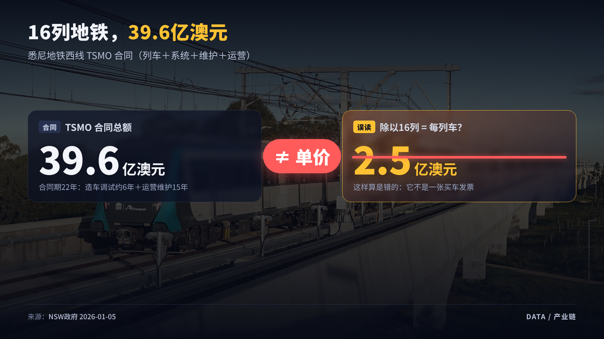

**▲ 图05-H0** `05_H0_主视觉_39.6亿`

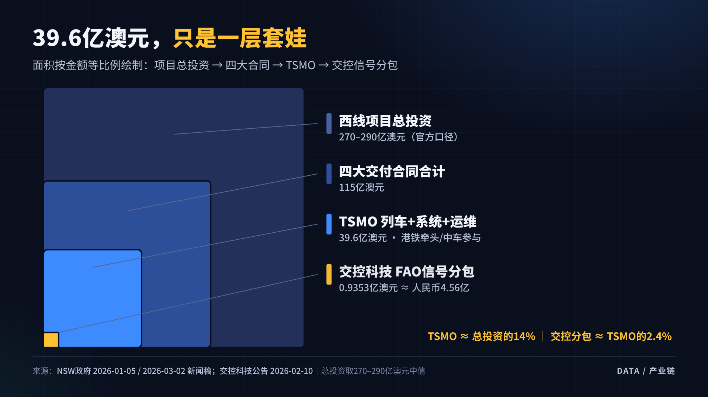

**▲ 图05-A** `05_A_金额套娃`

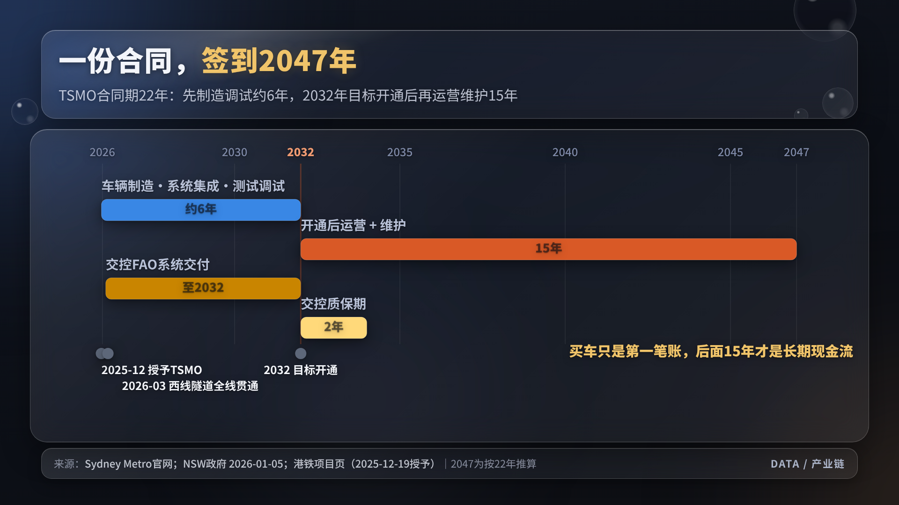

**▲ 图05-B** `05_B_22年时间轴`

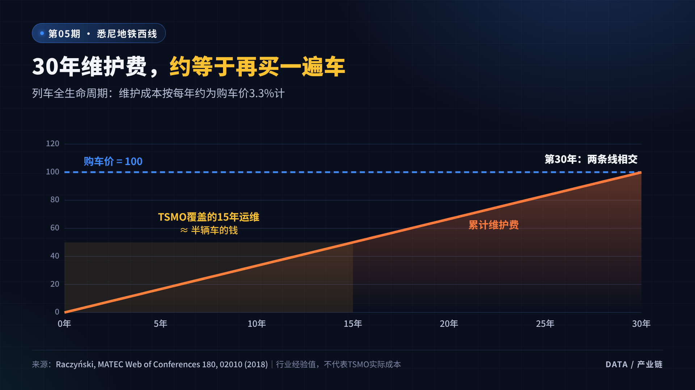

**▲ 图05-C** `05_C_买车vs维护`

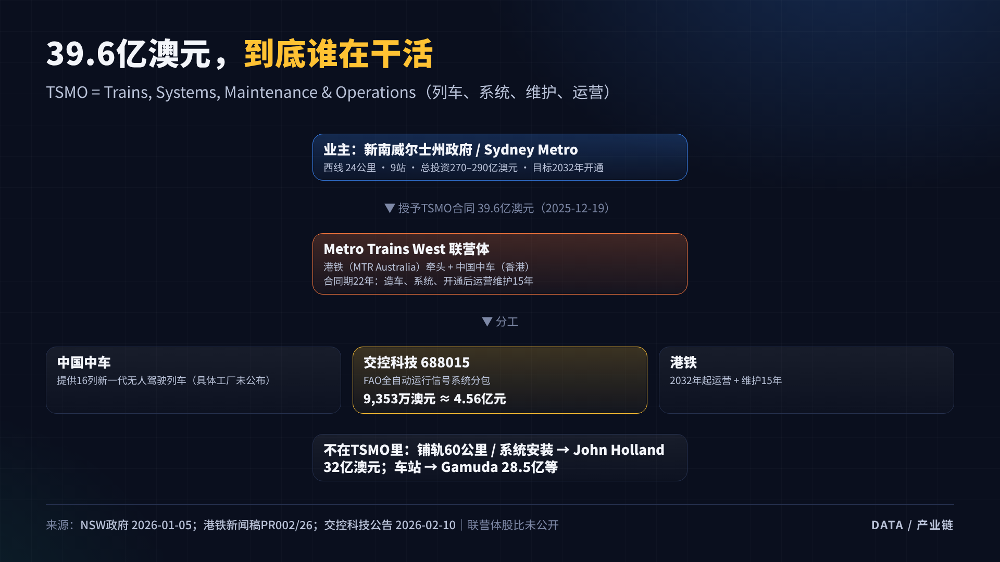

**▲ 图05-D** `05_D_谁在干什么`

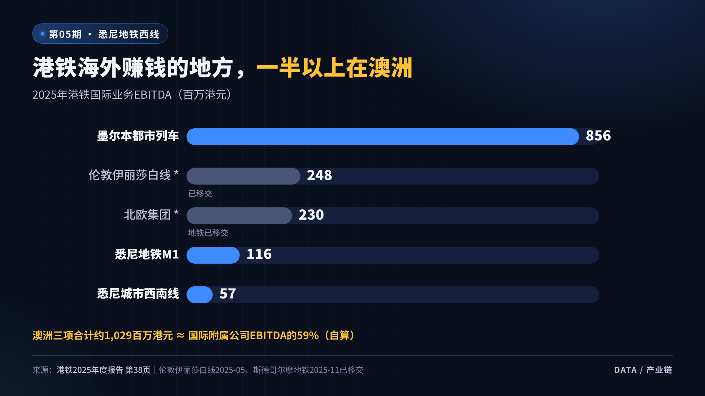

**▲ 图05-E** `05_E_港铁海外利润`

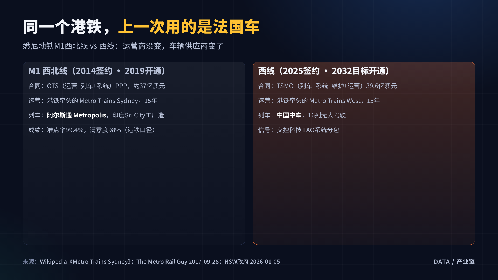

**▲ 图05-F** `05_F_同一个运营商换了车`

## 五、素材链接

**事实来源（S）**

| 编号 | 内容 | 链接 |
|---|---|---|
| S5-1 | NSW政府（2026-01-05）：TSMO 39.6亿澳元、16列、22年、15年运维；四大合同共115亿 | <https://www.nsw.gov.au/ministerial-releases/metro-west-contracts-open-next-phase-of-major-works> |
| S5-2 | Sydney Metro官网：TSMO范围 | <https://www.sydneymetro.info/article/contract-signings-progress-sydney-metro-west-2026> |
| S5-3 | 交控科技公告（新浪转载，2026-02-10）：93,530,364.97澳元、FAO、先决条件 | <https://finance.sina.com.cn/roll/2026-02-10/doc-inhmfysy1876430.shtml> |
| S5-4 | 港铁项目页：2025-12-19授予、24公里9站 | <https://www.mtr.com.hk/en/corporate/consultancy/sydneywest.html> |
| S5-5 | 港铁新闻稿PR002/26：联营体为港铁＋中车附属公司 | <https://www.mtr.com.hk/archive/corporate/en/press_release/PR-26-002-E.pdf> |
| S5-6 | NSW政府（2026-03-02）：隧道完工、总投资270–290亿 | <https://www.nsw.gov.au/ministerial-releases/tunnelling-complete-on-sydney-metro-west> |
| S5-7 | Raczyński（2018）列车全生命周期成本论文 | <https://doi.org/10.1051/matecconf/201818002010> |
| S5-8 | 港铁2025年报（第38页EBITDA、伦敦/斯德哥尔摩移交） | <https://www.mtr.com.hk/archive/corporate/ch/investor/annualresult2025/2025AR_Eng.pdf> |
| S5-9 | 交控科技2025年营收25.30亿元（证券市场周刊） | <https://static.weeklyonstock.com/26/0506/qdy201257.html> |
| S5-10 | M1列车为阿尔斯通印度Sri City工厂制造 | <https://themetrorailguy.com/2017/09/28/sydney-metro-receives-first-indian-built-alstom-train/> |
| S5-11 | 维州政府（2016）：墨尔本HCMT由中车参与、60%本地化 | <https://www.premier.vic.gov.au/1100-jobs-65-new-trains-built-victoria-victoria> |

**视频（V）**——全部已用 YouTube 官方接口核对

| 编号 | 视频 | 链接 |
|---|---|---|
| V5-1 | Transport for NSW：Sydney Metro West 项目概览 | <https://www.youtube.com/watch?v=U7YcrufB6v8> |
| V5-2 | Transport for NSW：历史性的隧道工程完工 | <https://www.youtube.com/watch?v=BzXg09EjLPo> |
| V5-3 | Transport for NSW：首批盾构机抵达西线 | <https://www.youtube.com/watch?v=XapFeAzTjP4> |
| V5-4 | 7NEWS：盾构机抵达西线终点 | <https://www.youtube.com/watch?v=m8nSEm1tDio> |
| V5-5 | 7NEWS：盾构机抵达帕拉马塔 | <https://www.youtube.com/watch?v=DoFzUPv47WA> |
| V5-6 | Transport Vlog：西线概览与车站位置 | <https://www.youtube.com/watch?v=gK8B-szIQLM> |
| V5-7 | BACKTRACKS.Trains：初探西线 | <https://www.youtube.com/watch?v=LxHLBbbXG-I> |
| V5-13 | 墨尔本HCMT首班载客 | <https://www.youtube.com/watch?v=6w4zh3qKdh8> |
| — | 旧稿的 RymVY6tFg4Q 无法核实标题与频道，已替换为 V5-2 | — |

**图片（P）**——Commons 可商用（按协议署名）；Sydney Metro官方图**禁止商用**，变现账号不要用

| 编号 | 内容 | 链接 | 授权 |
|---|---|---|---|
| P5-1 | M1线阿尔斯通列车（Sydenham） | <https://commons.wikimedia.org/wiki/File:Sydney_Alstom_Metropolis_at_Sydenham.jpg> | CC BY-SA 2.0 / JenperTV |
| P5-2 | 地铁列车驶近Kellyville | <https://commons.wikimedia.org/wiki/File:Sydney_Metro_train_approaching_Kellyville_01.jpg> | CC BY-SA 4.0 / MDRX |
| P5-3 | 悉尼首列地铁车发布（2017） | <https://commons.wikimedia.org/wiki/File:Minister_introduces_Sydney%27s_first_metro_train_(37069473950).png> | CC BY 2.0 / John Cowper |
| P5-4 | 西线The Bays站盾构机Ruby | <https://commons.wikimedia.org/wiki/File:The_Bays_Metro_Station_TBM.jpg> | CC BY-SA 4.0 |
| P5-5 | 墨尔本HCMT列车 | <https://commons.wikimedia.org/wiki/File:9049_Cranbourne.jpg> | CC BY 4.0 / LachlanTansey |

## 六、事实边界（开拍前必读）

- 【确定】39.6亿**澳元**（口播别只说“39.6亿”），16列、22年、开通后15年运维，目标2032年开通。
- 【确定】联营体：港铁牵头 + 中国中车（香港）；**无**西门子、阿尔斯通；股比未公开。
- 【不能说】“中车长客造”——官方未公布工厂。可以说“中车长客此前造过墨尔本HCMT”。
- 【确定，带条件】交控科技9353万澳元是**分包**，公告时**待先决条件满足后生效**，后续生效公告未查到。
- 【自算】TSMO≈总投资14%、交控≈TSMO 2.4%、交控≈2025营收18%、澳洲≈港铁国际EBITDA 59%——字幕标“自算”。
- 【不能说】“港铁正在运营伦敦、斯德哥尔摩”——2025年已移交。
- 【行业经验值】“30年维护≈车价”来自一篇论文的经验值，不代表TSMO实际成本，字幕标“行业经验”。
- 人民币换算“约190亿元”按1澳元≈4.8元粗算，字幕写“约”。

## 七、申论式信源深挖（v3 新增：要素拆解 → 三问追问 → 新增来源）

> 方法见 Skill 第10节。下文【确定】可进口播；【推测】只能用“可能/或许”表述；【未验证】不进口播。口播里已用上的新事实，已在上面文案中补入。

核心信源：NSW 政府新闻稿 2026-01-05 https://www.nsw.gov.au/ministerial-releases/metro-west-contracts-open-next-phase-of-major-works （ep5.md 已核）

### ① 核心信源要素拆解

| 要素 | 原文（NSW 稿） | 谁 | 做了什么 | 效果 |
|---|---|---|---|---|
| 金额 | "$3.96 billion" | NSW 政府 / Sydney Metro | 授予 TSMO 合同 | 占 115 亿四大合同的约 34%（自算） |
| 承包方 | "Metro Trains West Consortium, a joint venture led by MTR Corporation" | 港铁牵头，中国中车（香港）为股东 | 联营体中标 | 港铁从 M1 线延续到西线 |
| 范围 | "procure and commission a fleet of 16 new-generation metro trains" | MTW | 造车、系统、运维 | 系统分包给交控科技（9353 万澳元） |
| 期限 | "A 22-year contract … operate and maintain … for a period of 15 years" | MTW | 22 年合同、15 年运维 | 目标 2032 年开通 |
| 打包 | 4 份交付合同合计 "$11.5 billion" | NSW | 分包装招标 | 新闻稿**没有写为什么选 MTW**（已检索 "value / jobs / competitive"，无结果） |

### ② 三问追问

#### 问1　这件事和什么有关？帮谁解决了什么问题？

**答案摘要**：NSW 要解决的是"造车的人和开车的人互相甩锅"的接口风险，以及只看建设期报价、不看 30 年运营成本的老问题。西线把"造车+系统+运维"合成一个合同，就是把全生命周期责任交给一家。对交控科技来说，这是一个国内新线减少后的海外突破口。

- **S5-04 G20 全球基础设施中心（GI Hub）案例：西北线 OTS PPP**（已核）https://infrastructuredeliverymodels.gihub.org/case-studies/sydney-metro-northwest-operations-trains-and-systems-ppp
  - "Typically, infrastructure procurement decisions primarily focus on the construction phase at the expense of a whole-of-life approach. This frequently results in increased lifecycle cost and risks, poorer performance during the operations phase"
  - "the government reference design sought 8-car trains with five-minute headways. The successful consortium, Northwest Rapid Transit (NRT), proposed 6-car trains operating at four-minute headway"
  - "Considering the operations and maintenance of an asset in the design and procurement phase optimises the project's whole-of-life costs"
- **S5-02 Infrastructure Pipeline 项目页**（已核）https://infrastructurepipeline.org/project/sydney-metro-west
  - "Sep 2020 The NSW Government appointed Ricardo and Seoul Metro as the Shadow Operator … The Shadow Operator will provide advice and technical input from the viewpoint of the prospective operations and maintenance contractor."
  - "Sydney Metro further confirmed that it will no longer proceed with the Sydney Metro West Partnership Model."

#### 问2　为什么要解决？NSW 为什么需要这样做（痛点、成本、市场变化）？

**答案摘要**：
1. **超支**：2023 年独立评审时西线估价约 253 亿澳元，后来升到 270–290 亿（ep5 已核）。评审由 Mike Mrdak、Amanda Yeates 牵头，专门审查"交付模式"。
2. **审计署的教训**：2025-10-21 审计署报告认为，交通部**没有有效采购**新城际列车（NIF）和地区列车（RRF），两者合计 68 亿澳元；RRF 的 PPP 把"运营"排除在合同外，交通部也没吸取以往 PPP 的教训。
3. **招标过程**：2023-12 两包分别短名单，"列车与系统"有 4 家（Alstom、中车(香港)+港铁、现代 Rotem+UGL、西门子），"运营维护"也有 4 家。之后 Sydney Metro 研究把两包合并，最终成为 TSMO。**中车+港铁本来就是联合投标**，合并后港铁的运营优势和中车的车辆一起进来了。
4. **为什么中标的是 MTW**：官方没有公布评审理由（**未找到**）。只能确定竞争对手有谁。

- **S5-01 Sydney Metro：Sydney Metro West takes off**（2023-12-15，已核）https://sydneymetro.info/article/sydney-metro-west-takes
  - "The Trains and Systems package includes the procurement of 16 metro trains and associated rail systems, signalling systems, control systems, and platform screen doors. Shortlisted bidders … Alstom Transport Australia Pty Ltd; CRRC (Hong Kong) Co Ltd & MTR Corporation (Australia) Pty Ltd; Hyundai Rotem Company & UGL Engineering Pty Ltd; Siemens Mobility …"
  - "Operations and Maintenance package … GroWest Metro consortium comprising RATP Développement S.A. & John Holland Pty Ltd; Keolis Downer Pty Ltd; MTR Corporation (Australia) Pty Ltd; River City Metro …"
  - "Sydney Metro will explore the benefits of combining the Trains and Systems and Operations and Maintenance packages. This process will commence at the end of 2023."
- **S5-03 Sydney Metro Review 页面**（2023-12-07，已核）https://sydneymetro.info/article/sydney-metro-review
  - "The Sydney Metro Review examined value for money, delivery models, project governance and passenger impacts.""The review was conducted by Mr Mike Mrdak … Deputy Chair of the review was Amanda Yeates"
  - 评审报告 PDF（transport.nsw.gov.au）对本环境返回 403，**原文未打开**。
- **S5-05 NSW 审计署《Rail rolling stock procurement》**（2025-10-21，已核）https://www.audit.nsw.gov.au/our-work/reports/rail-rolling-stock-procurement
  - "TfNSW did not effectively procure the New Intercity Fleet or the Regional Rail Fleet.""these procurements are estimated to have a combined capital cost of $6.8 billion"
  - "the decision to exclude 'operate' from the contract""TfNSW did not apply lessons learnt from previous PPPs to effectively manage project-specific risks associated with the procurement of the RRF"
  - "it was estimated that the cost of the NIF would be $2.8 billion"（2014 年 EOI 时）

#### 问3　为什么是这些单位？上面有什么政策和监管？

**答案摘要**：
- **澳洲联邦层面**：《关键基础设施安全法》（SOCI Act 2018）把"关键公共交通资产"列为监管对象，责任实体要向登记册报告所有权和运营信息，报告网络安全事件。FIRB 管的是外资**收购股权**或**开办**"国家安全业务"，不是政府采购合同本身。MTW 是否向 FIRB 申报，**未找到公开信息（推测：可能需要，因为股东含中车(香港)、业务涉关键基础设施）**。
- **项目层面的安全安排**：MTW 2026-05 公开招"安全顾问"，覆盖物理、电子和**网络安全**，TSMO 的角色是"安全技术集成方"。这是能拿来回应"中国列车安全吗"的一手材料。
- **NSW 本地化政策**：2026-07-04 州政府宣布 120 亿澳元在 Hunter 地区重建列车制造，落实"轨道车辆合同本地化率不低于 50%"的目标。**西线 TSMO 合同里 16 列车在哪造、本地化率多少，官方没公布（未找到）**。
- **交控科技为什么出海**：国内城轨投资连续两年下滑（2024 年 -8.91%，2025 年 -13.38%），2026 年计划投资只有约 2727 亿元；协会提出"控制增量、优化存量"。交控年报自己写"国内城市轨道交通新线建设呈收紧状态"。但 2025 年境外收入只有 2181 万元，不到营收的 1%（自算）。

- **S5-08 澳洲网络与基础设施安全中心（CISC）：SOCI Act 2018 for transport**（页面更新 2023-11-22，已核）https://www.cisc.gov.au/information-for-your-industry/transport/legislation-regulation-and-compliance/soci-act-2018
  - "The transport sector includes owners or operators who transport goods or passengers on a commercial basis, including critical port, freight infrastructure, freight services, public transport or aviation assets."
  - "Provide operational and ownership information to the Register of Critical Infrastructure Assets. Report cyber security incidents."
  - "关键公共交通资产"= 单一实体管理、每月 500 万人次以上的定义，只在第三方数据库摘要里见到，**法条原文未打开（未验证）**。
- **S5-09 FIRB：National security**（已核）https://foreigninvestment.gov.au/guidance/types-investments/national-security
  - "You must notify us if you propose: … acquiring a direct interest in a national security business or entity that carries on a national security business; starting a national security business."
- **S5-07 MTW 招标：Security Consultant – Sydney Metro West TSMO**（发布 2026-05-05，已核）https://www.australiantenders.com.au/tenders/612940/security-consultant-sydney-metro-west-tsmo-trains-systems-maintenance-and-operations
  - "Organisation: Metro Trains West Pty Ltd""ensuring that physical security, electronic security, and cyber security risks are identified … assessed, treated, and managed""The role of TSMO is that of Technical Integrator for Security."
- **S5-06 NSW：$12 billion investment to rebuild Hunter train manufacturing**（2026-07-04，已核）https://www.nsw.gov.au/ministerial-releases/12-billion-investment-to-rebuild-hunter-train-manufacturing
  - "It also delivers on the Minns Labor Government's election commitments to set a target of a minimum 50 per cent local content for rolling stock contracts"
  - "after 12 years of offshoring transport manufacturing jobs by the former Liberal-National Government"
  - NSW 议会预算办公室 2023 年测算（"澳洲目前没有制造无人驾驶地铁列车的能力"）只见搜索摘要，PDF 403，**未验证**。
- **S5-12 中国城市轨道交通协会《2025年度统计和分析报告》**（2026-03-31，PDF 已核）https://infosharingp2-oss.camet.org.cn/resources/manual/2026/03/31/789660015317061.pdf
  - "完成城轨交通建设投资4114.16亿元，同比下降13.38%，年度完成建设投资额持续回落。"
  - "根据可统计的34个城市的数据预计，2026年计划完成投资总额约为2727.31亿元。"
  - "当年无新增城轨交通运营城市"
- **S5-13 同上《2024年度统计和分析报告》**（2025-03-28，PDF 已核）https://infosharingp2-oss.camet.org.cn/resources/manual/2025/04/01/660853988892741.pdf
  - "2024年全年共完成建设投资4749.41亿元，同比下降8.91%"
- **S5-10 交控科技《2025年年度报告》**（2026-04-28，东方财富镜像 PDF 已核；上交所原链接对本环境返回反爬页面）https://pdf.dfcfw.com/pdf/H2_AN202604271821625734_1.pdf
  - "国家新的政策已经明确提出'控制增量、优化存量'为行业指导思想""叠加土地财政退潮、地方债务收紧、客流强度不足等问题持续攀升，导致新线建设市场萎缩"
  - "受宏观经济增速放缓等因素影响，国内城市轨道交通新线建设呈收紧状态，市场竞争进一步加剧。"
  - "2025 年是公司国际业务实现'点状突破'与'网络化布局'的关键一年……新增三大洲、十个国家的业务触达"
  - "合同金额为 93,530,364.97 澳大利亚元（折合人民币约 4.37 亿元，含交付、不含安装）""中标土耳其安卡拉 A1 线更新改造及延长线项目，中标金额为 16,800,000.00 欧元（折合人民币约 1.39 亿元）"
  - 分地区收入表："境外 21,807,640.63（营业收入）… 134.04（同比%）"
  - "国家发展改革委已将城轨既有线改造列入超长期国债的申报范围予以支持"
- **S5-11 交控科技《2026年半年度报告》**（2026-08-29，已核）https://pdf.dfcfw.com/pdf/H2_AN202608281828630331_1.pdf
  - 重大合同表："澳大利亚悉尼地铁西线 TSMO 信号系统 … 4.38 … 2026 年 6 月 30 日汇率"

### ③ 可加入口播的新增事实

1. **【确定】**2023 年 12 月短名单里，"列车与系统"包有 4 家竞争：阿尔斯通、中车(香港)+港铁、现代 Rotem+UGL、西门子。中车和港铁从一开始就是联合投标。（S5-01）
2. **【确定】**NSW 审计署 2025 年 10 月认定，交通部此前采购的两批列车（新城际车队和地区车队，合计 68 亿澳元）"没有有效采购"，地区车队合同还把"运营"排除在外。（S5-05）**【推测】**这是西线把造车和运营打包的背景之一，官方没有直接这样说。
3. **【确定】**中标方 MTW 2026 年 5 月招了一个"安全顾问"，专管物理、电子和网络安全。（S5-07）
4. **【确定】**国内城轨建设投资 2024 年降 8.91%，2025 年降 13.38%；2026 年计划只有约 2727 亿元。（S5-12、S5-13）交控 2025 年境外收入 2181 万元，同比 +134%，但不到总营收 1%。（S5-10）
5. **【确定】**NSW 2026 年 7 月宣布 120 亿澳元重建本地列车制造，目标本地化率不低于 50%。（S5-06）**【未验证】**西线 16 列车的制造地和本地化率。
6. 注意口径：交控分包折合人民币，2026-02 公告说约 4.56 亿元，年报说约 4.37 亿元，半年报说 4.38 亿元（汇率不同）。口播建议说"约 4.4 亿元人民币"或直接说 9353 万澳元。

### ④ 新增来源清单（选题05）

| 编号 | 来源 | 类型 | 日期 | URL | 状态 |
|---|---|---|---|---|---|
| S5-01 | Sydney Metro：短名单公告 | 政府机构 | 2023-12-15 | https://sydneymetro.info/article/sydney-metro-west-takes | 已核 |
| S5-02 | Infrastructure Pipeline：Metro West 时间线 | 行业数据库 | 持续更新 | https://infrastructurepipeline.org/project/sydney-metro-west | 已核 |
| S5-03 | Sydney Metro Review 页面 | 政府机构 | 2023-12-07 | https://sydneymetro.info/article/sydney-metro-review | 已核（报告 PDF 403） |
| S5-04 | GI Hub：西北线 OTS PPP 案例 | 国际组织（G20） | 未标 | https://infrastructuredeliverymodels.gihub.org/case-studies/sydney-metro-northwest-operations-trains-and-systems-ppp | 已核 |
| S5-05 | NSW 审计署：列车采购审计 | 审计报告 | 2025-10-21 | https://www.audit.nsw.gov.au/our-work/reports/rail-rolling-stock-procurement | 已核 |
| S5-06 | NSW：120 亿澳元重建 Hunter 列车制造 | 政府新闻稿 | 2026-07-04 | https://www.nsw.gov.au/ministerial-releases/12-billion-investment-to-rebuild-hunter-train-manufacturing | 已核 |
| S5-07 | MTW 安全顾问招标 | 企业招标公告 | 2026-05-05 | https://www.australiantenders.com.au/tenders/612940/security-consultant-sydney-metro-west-tsmo-trains-systems-maintenance-and-operations | 已核 |
| S5-08 | CISC：交通行业 SOCI 义务 | 联邦政府 | 2023-11-22 | https://www.cisc.gov.au/information-for-your-industry/transport/legislation-regulation-and-compliance/soci-act-2018 | 已核 |
| S5-09 | FIRB：国家安全审查指引 | 联邦政府 | 未标 | https://foreigninvestment.gov.au/guidance/types-investments/national-security | 已核 |
| S5-10 | 交控科技 2025 年报 | 上市公司公告 | 2026-04-28 | https://pdf.dfcfw.com/pdf/H2_AN202604271821625734_1.pdf | 已核 |
| S5-11 | 交控科技 2026 半年报 | 上市公司公告 | 2026-08-29 | https://pdf.dfcfw.com/pdf/H2_AN202608281828630331_1.pdf | 已核 |
| S5-12 | 城轨协会 2025 年度统计报告 | 行业协会 | 2026-03-31 | https://infosharingp2-oss.camet.org.cn/resources/manual/2026/03/31/789660015317061.pdf | 已核 |
| S5-13 | 城轨协会 2024 年度统计报告 | 行业协会 | 2025-03-28 | https://infosharingp2-oss.camet.org.cn/resources/manual/2025/04/01/660853988892741.pdf | 已核 |
| — | Sydney Metro Independent Review 最终报告 PDF | 政府 | 2023-12-07 | https://www.transport.nsw.gov.au/system/files/media/documents/2024/Sydney-Metro-Independent-Review_Final-Report.pdf | **未验证（403）** |
| — | NSW 议会预算办公室：本地制造测算 | 议会 | 2023 | parliament.nsw.gov.au（C714） | **未验证（403）** |
| — | TSMO 评审理由、本地化率、FIRB 申报 | — | — | — | **未找到** |

### ⑤ 视频素材（选题05）

| 标题（页面实测） | URL | 版权方 | 可下载？ |
|---|---|---|---|
| Sydney Metro West Project Overview | https://www.youtube.com/watch?v=U7YcrufB6v8 | Transport for NSW（州政府官方频道） | oEmbed 验证；yt-dlp 本环境被要求登录，**下载未验证** |
| Sydney Metro: historic tunnelling job finished | https://www.youtube.com/watch?v=BzXg09EjLPo | Transport for NSW | 同上 |
| $2b contract awarded for Sydney Metro West project | https://www.youtube.com/watch?v=rVKXlmiSMec | News24（第三方媒体） | oEmbed 验证；未下载 |
| How Sydney's new Metro West line could transform the city | https://www.youtube.com/watch?v=7zUlOZm-CDU | CityMoose（自媒体） | oEmbed 验证 |
| [吉林新闻联播]中车长客与澳大利亚再签65列地铁车辆出口合同（2016-11-29，50秒） | http://news.cctv.com/2016/11/29/VIDE7Lh3cQhEAyzRjxa13eCT161129.shtml | 吉林台（央视网转载） | yt-dlp 可解析（640×360） |
| [交易时间]中国中车：子公司联合体签署101亿海外地铁车项目（2016-11-28，137秒） | https://tv.cctv.com/2016/11/28/VIDEv5PxTyZaZnX6OnbM1rRZ161128.shtml | 央视 CCTV-2 | 可解析（270p） |

- 央视网**没有**悉尼地铁西线 TSMO 的专题视频（已用央视站内搜索接口查"悉尼地铁""港铁 悉尼""悉尼 西线"，无相关结果）。
- 2016 年两条是墨尔本 HCMT（65 列）合同，可作"中车此前在澳洲的订单"背景，不能当西线画面用。
- Sydney Metro 官方图片的商用限制见 ep5.md。

---

# 第06期｜全世界都在抢芯片，美国人却在排队等一台“铁疙瘩”：要等两年半

## 一、选题卡

| 项目 | 内容 |
|---|---|
| 备选标题 | ① 在美国买一台变压器，要等两年半 ② AI卡脖子的不是芯片，是一台铁疙瘩？ ③ 中国变压器一年多卖170亿，美国只占一成 |
| 时长 / 字数 | 约4分20秒 / 口播约1,290字 |
| 核心反差 | 大家盯着芯片，美国大型电力变压器的平均交期却从2021年约50周拉到2025年128周；美国本土只能满足约20%需求 |
| 要打掉的靶子 | ① “全是AI带火的”；② “中国变压器主要卖给美国”（美国只占约11%） |
| 差异化（与央视的区别） | 央视讲“爆单”；本期讲**为什么美国自己造不出来**（取向硅钢全美只一家厂、老电网、进口依赖）、**订单流向**和**增速放缓**，并给出反方观点 |
| 与旧稿的改动 | ① 央视原文“美国市场50周→127周”，无“部分”“约”；② “订单排到2027年”限定为“部分面向数据中心的订单”；③ 30%缺口是**美国**不是全球；④ 2024年474亿元为推算；⑤ 补充2026年出口增速放缓与反方声音 |

## 二、口播文案（可直接配音）

> 【0:00–0:15｜钩子】
> 全世界都在抢英伟达的芯片，可在美国，还有一样东西排队排得更久：一台变压器。2021年，等大概50周；到2025年，平均要等128周，差不多两年半。芯片买回来了，电接不上，数据中心只能干等着。

> 【0:15–0:40｜立靶子＋承诺】
> 你可能觉得：这不就是AI太火了嘛。只对了三分之一。今天这期，咱们讲央视没细讲的那部分：美国为什么自己造不出来？中国的变压器到底卖给了谁？这波行情，还能热多久？ 就三个问题：到底缺多少？为什么缺？卖给了谁？

> 【0:40–1:30｜问题一：到底缺多少】
> 问题一：到底缺多少？咨询公司伍德麦肯兹的调查：2025年二季度，美国电力变压器平均交期128周，发电厂用的升压变压器要144周。价格呢？跟2019年比，电力变压器单价涨了77%。他们估算，2025年美国电力变压器的缺口高达30%。
> 再看中国这边。海关数据：2025年中国变压器出口646亿元，增长36%，比上一年多卖了170亿左右。单台出口均价从大约15万元涨到20.5万元，涨了三分之一。央视去江苏、佛山的工厂看过，部分面向数据中心的订单，已经排到了2027年。

> 【1:30–2:30｜问题二：为什么突然缺】
> 第二个问题来了：为什么突然这么缺？屏幕上先打一行字：“都是AI带火的”。现在把它划掉——不是一个原因，是三股需求撞在了一起。
> 第一股，AI数据中心。美国能源部的报告：2023年美国数据中心用电176太瓦时，占全国4.4%；到2028年，可能涨到325到580太瓦时，占比6.7%到12%。数据中心的供配电设备，功率一般是算力负载的好几倍。
> 第二股，老电网换新。美国能源部早年的研究：美国在役的大型电力变压器，平均年龄38到40岁，七成超过25年，到了该换的时候。
> 第三股，新能源并网。每接一座光伏电站、风电场，都要配升压变压器。
> 伍德麦肯兹算过：2019年以来，美国电力变压器需求涨了116%。所以别把账全算在AI头上，它只是压垮骆驼的最后一根稻草。

> 【2:30–3:20｜问题二（续）：美国为什么造不出来】
> 那问题来了：美国自己为什么不造？
> 卡在一种材料上：取向硅钢，变压器铁芯的核心材料，占一台变压器成本的两成左右。全美国，只有克利夫兰-克里夫斯一家工厂能生产，而且研究机构说，它的产品损耗还比日韩的高。从2020年到现在，这种硅钢价格涨了将近一倍。
> 结果就是：美国本土只能满足大约20%的变压器需求，进口要占到八成。美国从中国进口的大功率变压器，2022年不到1500台，2025年超过了8000台。在美国，变压器已经被当成国防物资：2022年和2026年，两任总统都动用了《国防生产法》。哪怕要多交至少25%的301关税，今年1到2月，中国对美大功率变压器出口还暴增了182%。
> 而中国这边，变压器行业有大约3000家企业，产能约占全球六成，定制化交货3到6个月，国外普遍要18个月以上。

> 【3:20–4:00｜问题三：中国到底卖给了谁】
> 最后一个问题：中国的变压器到底卖给了谁？你知道美国缺，但你可能忽略了：中国变压器最大的客户根本不是美国。今年前8个月，出口79.5亿美元，亚洲占45%，欧洲占21%，美国只占11%左右，只不过它是增量最大的单一国家。
> 第二，热度在降温。今年一季度出口增长43%，1到7月26%，前三季度降到了22%左右。也有美国业内人士说，短缺被夸大了，有人重复下单抬价格。
> 所以真正吃到红利的，是能出海建厂、有交付能力的公司：思源电气、金盘科技的海外收入，增速都在六七成以上。

> 【4:00–4:40｜收尾＋社交货币】
> 下次有人跟你说“AI就是芯片”，你就告诉他：芯片决定算多快，变压器决定能不能开机。而美国人现在要等两年半的东西，中国工厂3到6个月就能交。
> 你觉得，这波变压器出海，是长期的产业升级，还是一阵风？评论区说说你的判断。

## 三、分镜表

| 时间 | 口播要点 | 画面 | 素材编号 |
|---|---|---|---|
| 0:00–0:15 | 50周→128周 | 交期条形图动画 + 数据中心机房 | 图06-A / P6-5 |
| 0:15–0:40 | 立靶子 | Bloomberg 电网为AI重建 | V6-4 |
| 0:40–1:05 | 128周、+77%、缺口30% | 交期图定格 | 图06-A |
| 1:05–1:30 | 646亿、均价、排到2027 | 出口柱状图 → 央视工厂画面（引用需合规） | 图06-B / V6-1 |
| 1:30–2:30 | 三股需求 | 结构图 → 数据中心用电预测图 | 图06-E / 图06-D |
| 2:30–3:20 | 取向硅钢、进口八成、3–6个月 | 大型变压器实景 + 结构图供给端 | P6-1 / V6-5 / 图06-E |
| 3:20–3:40 | 美国只占11% | 环形图 | 图06-F |
| 3:40–4:00 | 增速放缓、谁在吃红利 | 增速折线 → 企业条形图 | 图06-C / 图06-G |
| 4:00–4:40 | 收尾 | 变电站空镜 | P6-4 |

## 三之一、章节条、证据截图与短视频切条（v2 新增）

**顶部章节条**（不露脸账号的“目录”，学自巫师财经）：每段开始时把对应的透明 PNG 叠在画面最上方，整段都保留。

| 时间段 | 文件 | 当前高亮 |
|---|---|---|
| 0:40–1:30 | `章节条/06_章节条_1_竖版.png` / `_横版.png` | 到底缺多少 |
| 1:30–3:20 | `章节条/06_章节条_2_竖版.png` / `_横版.png` | 为什么缺 |
| 3:20–4:40 | `章节条/06_章节条_3_竖版.png` / `_横版.png` | 中国卖给了谁 |

**证据截图高亮动画**（学自巫师财经、回形针）：网页截图 → 荧光笔扫过关键句 → 红框 → 镜头推近，约 5 秒。

| 口播时间 | 文件 | 高亮的原文 |
|---|---|---|
| 0:45 | `图表/证据截图/动画_竖版/06_证据2_WoodMac缺口30%_动画.mp4` | “supply shortage … to hit 30% and 10%, respectively, in 2025” |
| 1:15 | `图表/证据截图/动画_竖版/06_证据1_央视127周_动画.mp4` | “美国市场交付周期已经从50周延长至127周” |

**单切短视频**（学自温义飞三段式）：每个“问题”段落可以单独剪成 60–90 秒短视频发布，标题直接用该段的问题句，结尾加“完整版看主页”。

## 四、本期图表（横竖双版本，已生成）

| 编号 | 文件名 | 图形 |
|---|---|---|
| 图06-A | 06_A_等变压器要多久 | 横向条形图 |
| 图06-B | 06_B_出口额 | 柱状图 |
| 图06-C | 06_C_增速放缓 | 面积折线 |
| 图06-D | 06_D_数据中心用电 | 折线 + 预测区间 |
| 图06-E | 06_E_为什么缺 | 需求/供给结构图 |
| 图06-F | 06_F_卖给了谁 | 环形图 |
| 图06-G | 06_G_企业海外增速 | 横向条形图 |

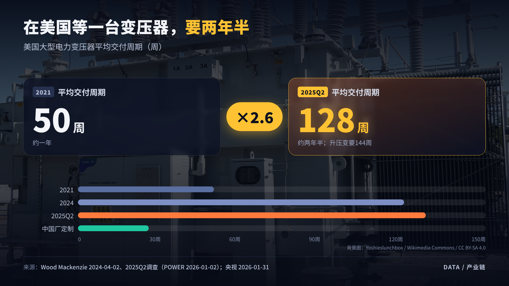

**▲ 图06-H0** `06_H0_主视觉_交付周期`

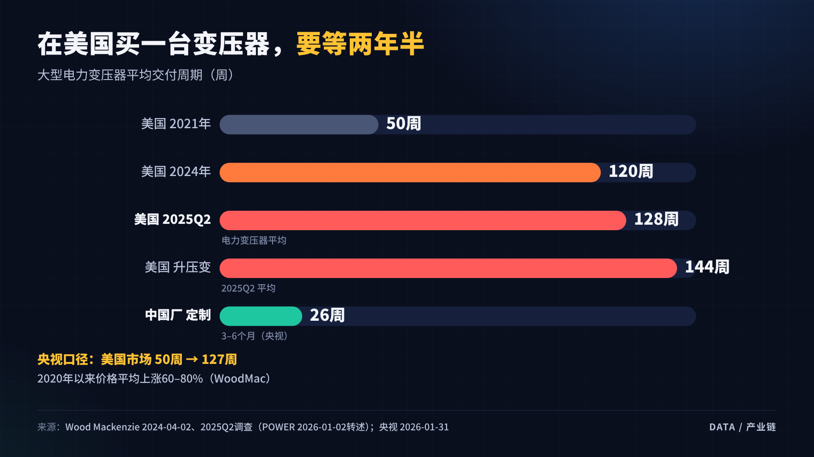

**▲ 图06-A** `06_A_等变压器要多久`

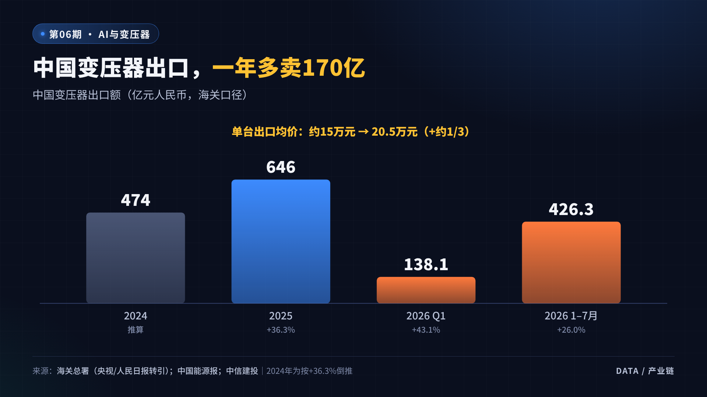

**▲ 图06-B** `06_B_出口额`

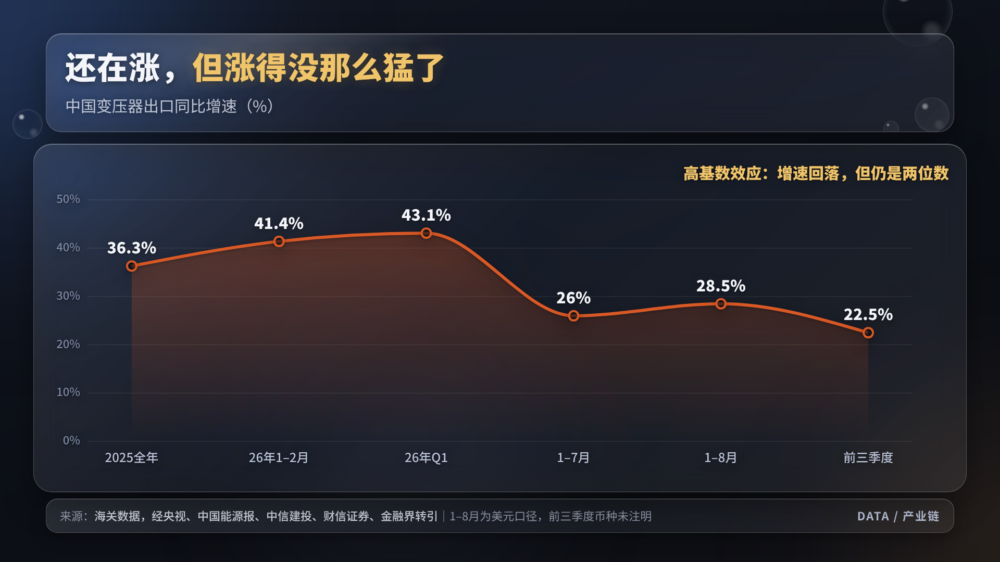

**▲ 图06-C** `06_C_增速放缓`

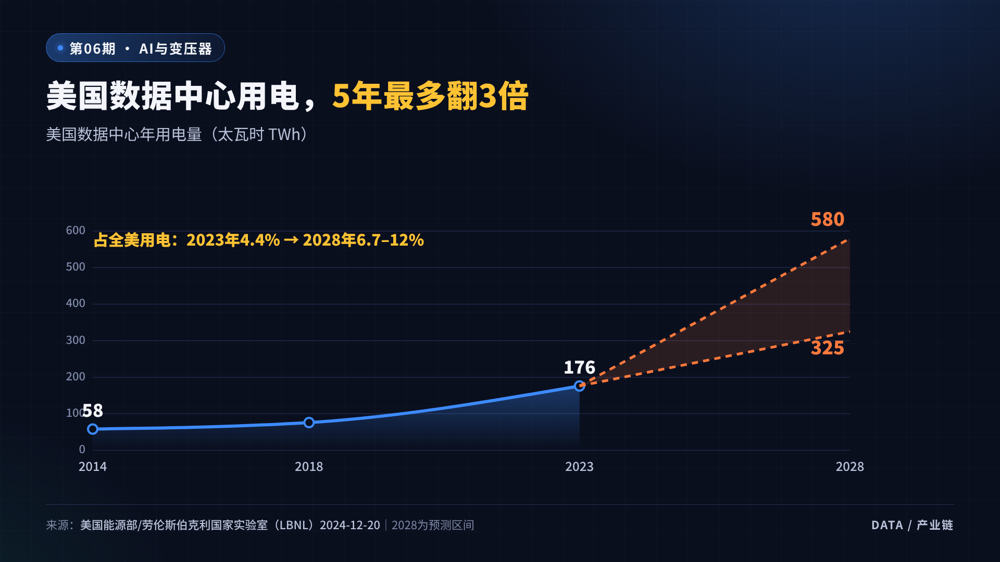

**▲ 图06-D** `06_D_数据中心用电`

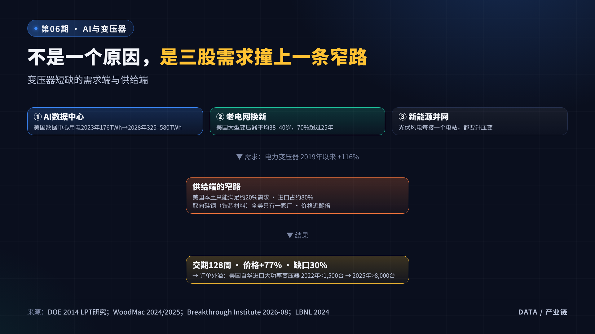

**▲ 图06-E** `06_E_为什么缺`

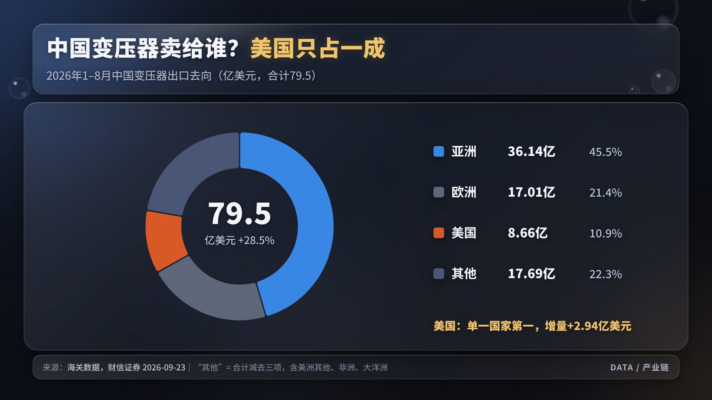

**▲ 图06-F** `06_F_卖给了谁`

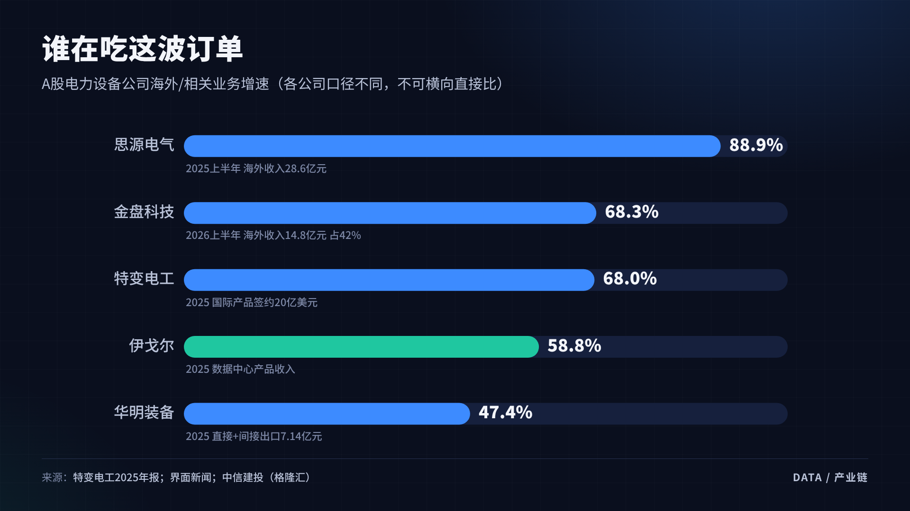

**▲ 图06-G** `06_G_企业海外增速`

## 五、素材链接

**事实来源（S）**

| 编号 | 内容 | 链接 |
|---|---|---|
| S6-1 | 央视网（2026-01-31）：美国市场50周→127周、部分数据中心订单排到2027、646亿元、行业3000家、产能占全球60% | <https://news.cctv.com/2026/01/31/ARTItXero5oWaZC1SXLVnmPh260131.shtml> |
| S6-2 | 浙江经信转人民日报（2026-03-13）：646亿元、均价20.5万元 | <https://zjic.zj.gov.cn/ywdh/cyfz/202603/t20260313_23988037.shtml> |
| S6-3 | 浙江经信转中国能源报（2026-07）：Q1出口138.09亿元+43% | <https://zjic.zj.gov.cn/ywdh/cyfz/202607/t20260723_24164966.shtml> |
| S6-4 | Wood Mackenzie（2025-08-14）：美国缺口30%/10%、需求+116%、进口约80% | <https://www.woodmac.com/press-releases/power-transformers-and-distribution-transformers-will-face-supply-deficits-of-30-and-10-in-2025/> |
| S6-5 | Wood Mackenzie（2024-04-02）：50周→120周、价格+60–80%、本土满足约20% | <https://www.woodmac.com/news/opinion/supply-shortages-and-an-inflexible-market-give-rise-to-high-power-transformer-lead-times/> |
| S6-6 | POWER Magazine（2026-01-02）：2025Q2 128周/144周、+77%、反方“短缺被夸大” | <https://powermag.com/transformers-in-2026-shortage-scramble-or-self-inflicted-crisis/> |
| S6-7 | 美国能源部LPT研究（2014）：平均38–40年、70%超25年 | <https://www.energy.gov/sites/prod/files/2014/04/f15/LPTStudyUpdate-040914.pdf> |
| S6-8 | 美国能源部/LBNL（2024-12-20）：数据中心用电176TWh→325–580TWh | <https://www.energy.gov/articles/doe-releases-new-report-evaluating-increase-electricity-demand-data-centers> |
| S6-9 | Breakthrough Institute（2026-08-14）：全美唯一取向硅钢厂、GOES约占成本20% | <https://thebreakthrough.org/issues/energy/america-makes-the-wrong-steel-for-its-transformer-supply-chain> |
| S6-10 | The Standard（2026-04-07）：美国自华进口大功率变压器 <1500台→>8000台 | <https://www.thestandard.com.hk/innovation/article/328687/US-AI-expansion-hit-by-power-shortages-half-planned-data-centers-delayed-or-canceled> |
| S6-11 | 财联社（2026-04-02）：1–2月大功率变压器对美+182% | <https://www.cls.cn/detail/2333025> |
| S6-12 | 新浪转财信证券（2026-09-24）：1–8月79.50亿美元、分区域 | <https://finance.sina.com.cn/roll/2026-09-24/doc-iniswrrp0622590.shtml> |
| S6-13 | 格隆汇转中信建投：1–7月426.3亿元+26%；金盘科技海外+68.3% | <https://m.gelonghui.com/news/5314949> |
| S6-14 | 金融界（2026-10-14）：前三季度变压器出口+22.5% | <https://m.jrj.com.cn/madapter/finance/2026/10/14112258711530.shtml> |
| S6-15 | 特变电工2025年报摘要：国际签约20亿美元+68% | <https://stock.10jqka.com.cn/20260415/c676020636.shtml> |
| S6-16 | 界面：思源电气2025上半年海外收入28.62亿元+89% | <https://www.jiemian.com/article/14204613.html> |
| S6-17 | USITC HTS 8504.23：MFN 1.6%；301加征25%（第三方镜像） | <https://hts.usitc.gov/reststop/search?keyword=8504.23> · <https://www.htshub.com/us-hs/head/8504> |

**视频（V）**

| 编号 | 视频 | 链接 |
|---|---|---|
| V6-1 | 央视《经济信息联播》2026-01-31：中国变压器工厂爆单 | <https://tv.cctv.com/2026/01/31/VIDEsnPCQXWs011QJPLmWuLz260131.shtml> |
| V6-2 | 央视《天下财经》2026-01-31 | <https://tv.cctv.com/2026/01/31/VIDETiv5YUZ9tTgUi7naMxpW260131.shtml> |
| V6-3 | CCTV《新闻1+1》：AI竞争的未来，电力扮演什么角色 | <https://www.youtube.com/watch?v=w3czJFGLRHM> |
| V6-4 | Bloomberg Originals：电网如何为AI重建 | <https://www.youtube.com/watch?v=8KOYyfZbPzo> |
| V6-5 | Zeihan：大型电力变压器 | <https://www.youtube.com/watch?v=M8vAolvjZGs> |
| V6-6 | TED-Ed：AI数据中心为何这么耗电 | <https://www.youtube.com/watch?v=z3Y-gsBKChc> |
| V6-7 | Hitachi Energy：最大的换流变压器运往中国 | <https://www.youtube.com/watch?v=LEsJfdp6YfQ> |
| V6-8 | B站 央视财经：中国特高压与变压器 | <https://www.bilibili.com/video/BV1Hu4m1g7KK> |
| V6-9 | B站：走进高压变压器工厂（自制） | <https://www.bilibili.com/video/BV1qpd1B8EB1> |
| V6-10 | B站：我们的变压器，为何全球都在抢？ | <https://www.bilibili.com/video/BV13oPazuEhu> |

**图片（P）**

| 编号 | 内容 | 链接 | 授权 |
|---|---|---|---|
| P6-1 | 大型电力变压器 | <https://commons.wikimedia.org/wiki/File:Power_Transformer_02.jpg> | CC BY-SA 4.0 / Sonia Budini |
| P6-2 | 变电站电力变压器 | <https://commons.wikimedia.org/wiki/File:Substation_Power_Transformer_1.jpg> | CC BY-SA 4.0 |
| P6-3 | 63kV变电站主变（无需署名） | <https://commons.wikimedia.org/wiki/File:Pont-l'Abbé_high-voltage_substation_14_-_Transformer_connections.jpg> | CC0 |
| P6-4 | 变电站全景（名古屋） | <https://commons.wikimedia.org/wiki/File:Chubu_Electric_Power_Company_Shimpo_transformer_substation_20130813.JPG> | CC BY-SA 3.0 |
| P6-5 | 数据中心机柜 | <https://commons.wikimedia.org/wiki/File:Wikimedia_Foundation_Servers-8055_35.jpg> | CC BY-SA 3.0 |
| P6-6 | CERN服务器机房 | <https://commons.wikimedia.org/wiki/File:CERN_Server_03.jpg> | CC BY-SA 3.0 |

> 旧稿里 cnenergynews 那张图是央视截图，有台标，**不能商用**，已弃用。

## 六、事实边界（开拍前必读）

- 【确定】央视“美国市场50周→127周”；WoodMac“2025Q2平均128周”。口播用128周（WoodMac），字幕可并列央视口径。
- 【限定】“订单排到2027年”只指部分面向数据中心的订单。
- 【确定】646亿元、+36.3%；2024年474亿元为倒推。
- 【确定】30%缺口是**美国**（WoodMac），中国能源报误写为“全球”。
- 【口径】“平均38–40年”只适用于≥100MVA的大型电力变压器，来源较旧（2014）。
- 【口径】出口目的地为美元口径（1–8月79.5亿美元），与人民币年度数不能混比。
- 【未验证】中国西电数据、1–9月累计金额、关税叠加总税率——口播已回避。
- 【反方】已在口播中保留“短缺被夸大”的声音，增加可信度。

## 七、申论式信源深挖（v3 新增：要素拆解 → 三问追问 → 新增来源）

> 方法见 Skill 第10节。下文【确定】可进口播；【推测】只能用“可能/或许”表述；【未验证】不进口播。口播里已用上的新事实，已在上面文案中补入。

核心信源：央视网 2026-01-31 https://news.cctv.com/2026/01/31/ARTItXero5oWaZC1SXLVnmPh260131.shtml （ep6.md 已核）

### ① 核心信源要素拆解

| 要素 | 原文（央视稿，ep6 已核） | 谁 | 做了什么 | 效果 |
|---|---|---|---|---|
| 美国缺口 | "美国市场……从50周延长至127周" | 美国电力公司、数据中心 | 排队等货 | 央视未注明数据来源 |
| 中国接单 | "部分面向数据中心的业务订单都排到了2027年" | 国内变压器厂 | 满产 | 江苏一家工厂排到 2027 年底 |
| 出口额 | "2025年，我国变压器出口总值达646亿元，比2024年增长近36%" | 海关总署 | 统计 | 创纪录 |
| 订单增速 | 佛山企业"同比订单比2025年增加七八成" | 单家企业 | 接单 | 个案，不代表行业 |
| 交付速度 | "定制化变压器交货周期仅3—6个月，远快于国外企业的18个月以上" | 中国厂商 | 快速交付 | 竞争力来源 |
| 产能 | "我国变压器行业企业约3000家""产能约占全球60%" | 中电联电力装备分会 | 行业口径 | 见问3 |

### ② 三问追问

#### 问1　订单从哪来？帮谁解决了什么问题？

**答案摘要**：三块需求叠在一起。
- **美国**：AI 数据中心 + 老旧电网更换，本土产能只能满足约 20%（ep6 已核）。
- **中东**：沙特电力公司（SEC）做框架采购。特变电工 2025-08 中标一个框架项目，估算约 164 亿元，7 年执行，**要求本地化**（沙特工厂建成前从中国供货）。
- **欧洲**：欧盟 2023 年电网行动计划估算到 2030 年需投资 5840 亿欧元，40% 配电网已用了 40 年以上。

- **S6-06 特变电工《收到海外产品中标通知书的公告》**（临 2025-059，2025-08-30，已核）https://pdf.dfcfw.com/pdf/H2_AN202508291736541601_1.pdf
  - "公司被确定为沙特电力公司超高压、高压电力变压器及电抗器的本地化采购项目中标单位之一"
  - "超高压(EHV)变压器产品 179 台，超高压和高压（EHV and HV）电抗器产品 108 台，高压（HV）变压器产品 391 台。根据招标文件，具体执行量不低于中标量的 70%。"
  - "本次中标总金额约 164 亿元人民币。按照执行量 70%测算，金额约为 115 亿元人民币。本次招标为框架招标，执行时间为 7 年"
- **S6-05 欧盟委员会新闻稿 IP/23/6044**（2023-11-28，通过 presscorner API 已核）https://ec.europa.eu/commission/presscorner/detail/en/ip_23_6044
  - "With 40% of our distribution grids more than 40 years old and cross-border transmission capacity due to double by 2030, € 584 billion in investments are necessary."
- 美国数据中心需求见 ep6.md（LBNL/DOE、WoodMac）；央视 2026-07-22《电力供应瓶颈制约美国AI数据中心建设》可作画面（见视频表）。

#### 问2　美国为什么缺？

**答案摘要**：
1. **国家层面已经把变压器当"国防物资"**：2022-06-06 拜登签署 DPA 第 303 条总统决定（No. 2022-19），认定变压器和电网组件"对国防至关重要"。2026-04-20 特朗普再签 No. 2026-10，把变压器、**电工钢（core steel）**、高压断路器等整条电网供应链列入。
2. **能效新规和材料瓶颈**：DOE 2024-04-22 发布配电变压器能效新规，2029-04-23 起执行，部分型号需要改用非晶合金铁芯。2026-06 DOE 发信息征询（RFI），问新规会不会加深对外国非晶带材的依赖、会不会削弱本土取向硅钢产能。
3. **关税反而推高成本**：2025-08-18 起，美国商务部把 HTS 8504.23.00（大型液浸变压器）、8504.33.00 及部分变压器零件列为钢铁衍生品，对其中的钢铁成分征 232 关税（公告写 50%）。加上 301 关税（ep6 已核），进口变压器更贵。
4. 本土 GOES 只有 Cleveland-Cliffs 一家（ep6 已核）。

- **S6-01 DOE《配电变压器能效标准 信息征询》**（Docket EERE-2026-BT-STD-0133，签署 2026-06-11，联邦公报公开检视版 PDF 已核）https://public-inspection.federalregister.gov/2026-11971.pdf
  - "A Presidential determination issued on April 20, 2026, found that grid infrastructure supply chains, including distribution transformers and electrical core steel, are essential to national defense, and that U.S. industry faces critical constraints from limited domestic product capacity, extended procurement timelines, and foreign supply dependence."
  - "DOE published a final rule on April 22, 2024, that adopted amended energy conservation standards for distribution transformers manufactured on or after April 23, 2029."
  - "DOE seeks information on (a) whether compliance with the adopted standards would require or increase reliance on foreign-sourced amorphous steel … (b) whether the adopted standards could reduce domestic production capacity for raw GOES, GOES cores, or GOES-core transf[ormers]"
- **S6-02 联邦公报：总统决定 No. 2022-19**（2022-06-06 签署，2022-06-09 刊登，PDF 已核）https://www.govinfo.gov/content/pkg/FR-2022-06-09/pdf/2022-12587.pdf
  - "transformers and electric power grid components are industrial resources, materials, or critical technology items essential to the national defense"
  - "action to expand the domestic production capability for transformers and electric power grid components is necessary to avert an industrial resource or critical technology item shortfall"
- **S6-03 BIS 联邦公报：232 钢铝衍生品新增 407 个税号**（2025-08-19，已核）https://www.govinfo.gov/content/pkg/FR-2025-08-19/html/2025-15819.htm
  - "BIS is adding 407 Harmonized Tariff Schedule of the United States (HTSUS) codes to the list of products that will be considered as steel or aluminum derivative products."
  - 清单内："8504.23.00; 8504.33.00; 8504.90.9634; 8504.90.9638; 8504.90.9642"
  - "effective … on or after 12:01 a.m. Eastern Time on August 18, 2025"
  - 注：白宫 2026-06 的 Annex III 文件写"25% Section 232 tariff"，与 50% 不一致，**当前实际税率未验证**。成品变压器是否按钢含量计征，也只在低可信论坛见到说法，**未验证**。口播只说"2025 年 8 月起，美国把大型变压器列入钢铁关税清单"。

#### 问3　中国为什么接得住？有没有支持或限制政策？

**答案摘要**：
1. **国内电网投资撑起了产能**：国家电网"十五五"计划投资 4 万亿元（比"十四五"增 40%）；2026 年上半年投资超 3100 亿元（+12.6%），前三季度超 4500 亿元（央视标题）。15 项特高压工程在建。
2. **政策链条**：①2024 年《加快构建新型电力系统行动方案（2024—2027年）》；②2024 年国务院大规模设备更新方案（到 2027 年设备投资比 2023 年增 25%以上），后续超长期国债把能源电力设备更新纳入支持范围（二手）；③工信部等《变压器能效提升计划（2021—2023年）》：高效节能变压器产量占比从 2021 年 15% 升到 2023 年 75%。国内能效升级先跑了一轮，产线和技术已经换代。
3. **材料自给**：宝钢取向硅钢产能 116 万吨，自称世界第一（2024-06）；美国只有一家 GOES 厂。前瞻转述"全国电工钢产量占全球75%"（二手）。
4. **出口限制/补贴**：**未检索到**中国对变压器出口的专项限制或专项补贴政策（不代表不存在）。限制主要来自进口国：美国 301 + 232 关税、DPA 扶持本土产能；沙特要求本地化生产。

- **S6-07 新华网：国家电网积极扩大有效投资**（2026-01-15，已核）https://www.news.cn/energy/20260115/58b781cfa59b4c16be7faca326074aea/c.html
  - "'十五五'期间，国家电网公司固定资产投资预计达到4万亿元，较'十四五'投资增长40%，以扩大有效投资带动新型电力系统产业链供应链高质量发展。"
  - "加快特高压直流外送通道建设，跨区跨省输电能力较'十四五'末提升超过30%"
- **S6-08 新华网：国家电网上半年固定资产投资超3100亿元**（2026-07-24，已核）https://www.news.cn/fortune/20260724/5e93fbff06124e0e98f6d67694cfb852/c.html
  - "2026年上半年公司完成固定资产投资超3100亿元，同比增长12.6%。"
- **S6-09 央视《正点财经》：前三季度国家电网固定资产投资超4500亿元**（2026-10-23，视频页已核，只有标题和简介，无文字稿）https://tv.cctv.com/2026/10/23/VIDE3qt1PdtoKlAYF5a6EehM261023.shtml
- **S6-10 国家发展改革委 国家能源局 国家数据局《加快构建新型电力系统行动方案（2024—2027年）》**（发改能源〔2024〕1128号，落款 2024-07-25，发布 2024-08-06，已核通知页）https://www.ndrc.gov.cn/xxgk/zcfb/tz/202408/t20240806_1392258_ext.html
  - 通知页列出配套解读："加快行动方案落实 助力配电网高质量发展"等。正文在附件 PDF，**本次未逐条核对**。
- **S6-11 国务院《推动大规模设备更新和消费品以旧换新行动方案》**（国发〔2024〕7号，生态环境部转载页，已核）https://www.mee.gov.cn/zcwj/gwywj/202403/t20240318_1068594.shtml
  - "到2027年，工业、农业、建筑、交通、教育、文旅、医疗等领域设备投资规模较2023年增长25%以上；重点行业主要用能设备能效基本达到节能水平"
  - 正文**没有**"变压器"字样（已检索）。
- **S6-12 人民日报：推动先进产能比重持续提升（政策解读）**（2024-04-29，已核）https://paper.people.com.cn/rmrb/html/2024-04/29/nw.D110000renmrb_20240429_3-03.htm
  - "在网运行电力变压器约1700万台，总容量约110亿千伏安，年电能损耗约2500亿千瓦时。"
  - "全国高效节能变压器产量分别为1.63亿千伏安、4.35亿千伏安、7.84亿千伏安，占电力变压器年产量的比例分别为15%、42%、75%。"
- **S6-13 中证网：宝钢股份打造全球顶尖取向硅钢制造基地**（2024-06-13，已核）https://cs.com.cn/ssgs/gsxw/202406/t20240613_6416997.html
  - "宝钢取向硅钢总产能将由100万吨提升至116万吨，目前位居世界第一。"
  - "随着电力变压器行业标准GB20052-2024《电力变压器能效限定值及能效等级》出台，变压器行业对能效等级提出了更高的要求"
- **S6-14 前瞻产业研究院《2025年中国硅钢行业全景图谱》**（2025-06，已核，二手）https://www.qianzhan.com/analyst/detail/220/250606-d80824d7.html
  - "中国已成为全球电工钢生产及消费大国，全国产量占全球电工钢产量的75%。"（未注明原始出处）
- 取向硅钢的全年产量（约 300 万吨）只见搜索摘要，**未验证**。

### ③ 可加入口播的新增事实

1. **【确定】**美国两任总统都动用了《国防生产法》：2022 年拜登把变压器列为"国防必需"，2026-04-20 特朗普又把变压器和电工钢整条链列进去。（S6-02、S6-01）→ "在美国，变压器已经是国防物资。"
2. **【确定】**2025 年 8 月起，美国把大型变压器（HTS 8504.23）列入 232 钢铁关税清单。（S6-03）配合 ep6 的"对华进口变压器仍大增"，可讲"越加税越要买"。
3. **【确定】**特变电工 2025 年 8 月中标沙特电力公司框架项目：179 台超高压变压器、391 台高压变压器，估算约 164 亿元，执行 7 年，要求本地化。（S6-06）→ 中东订单的实例，同时说明"出口"正在变成"出海建厂"。
4. **【确定】**欧盟估计到 2030 年电网需投资 5840 亿欧元，40% 配电网用了 40 年以上。（S6-05）
5. **【确定】**国家电网"十五五"投资 4 万亿元，比"十四五"多 40%；2026 年前三季度投资超 4500 亿元（央视标题）。（S6-07、S6-09）**【推测】**国内大规模投资让变压器厂维持高产能，才有余力接海外订单（这是因果推断，非官方原话）。
6. **【确定】**中国在网电力变压器约 1700 万台；2021–2023 年能效提升计划把高效节能变压器的产量占比从 15% 提到 75%。（S6-12）

### ④ 新增来源清单（选题06）

| 编号 | 来源 | 类型 | 日期 | URL | 状态 |
|---|---|---|---|---|---|
| S6-01 | DOE：配电变压器能效标准 RFI（引 PD 2026-10） | 美国政府原文 | 2026-06-11 签署 | https://public-inspection.federalregister.gov/2026-11971.pdf | 已核 |
| S6-02 | 总统决定 No. 2022-19（DPA，变压器） | 美国政府原文 | 2022-06-06 | https://www.govinfo.gov/content/pkg/FR-2022-06-09/pdf/2022-12587.pdf | 已核 |
| S6-03 | BIS：232 衍生品新增 407 个税号 | 美国政府原文 | 2025-08-19 | https://www.govinfo.gov/content/pkg/FR-2025-08-19/html/2025-15819.htm | 已核 |
| S6-04 | DOE 2024 配电变压器能效终规（89 FR 29834） | 美国政府原文 | 2024-04-22 | 经 S6-01 引用核实 | 已核（间接） |
| S6-05 | 欧盟委员会：电网行动计划新闻稿 | 欧盟原文 | 2023-11-28 | https://ec.europa.eu/commission/presscorner/detail/en/ip_23_6044 | 已核 |
| S6-06 | 特变电工：沙特 SEC 中标公告 | 上市公司公告 | 2025-08-30 | https://pdf.dfcfw.com/pdf/H2_AN202508291736541601_1.pdf | 已核 |
| S6-07 | 新华网：国网"十五五"4 万亿 | 官媒 | 2026-01-15 | https://www.news.cn/energy/20260115/58b781cfa59b4c16be7faca326074aea/c.html | 已核 |
| S6-08 | 新华网：国网上半年投资超 3100 亿 | 官媒 | 2026-07-24 | https://www.news.cn/fortune/20260724/5e93fbff06124e0e98f6d67694cfb852/c.html | 已核 |
| S6-09 | 央视：前三季度国网投资超 4500 亿 | 官媒视频 | 2026-10-23 | https://tv.cctv.com/2026/10/23/VIDE3qt1PdtoKlAYF5a6EehM261023.shtml | 已核（仅标题） |
| S6-10 | 新型电力系统行动方案（2024—2027） | 政策原文 | 2024-07-25 / 08-06 | https://www.ndrc.gov.cn/xxgk/zcfb/tz/202408/t20240806_1392258_ext.html | 已核通知页 |
| S6-11 | 国发〔2024〕7号 设备更新方案 | 政策原文 | 2024-03 | https://www.mee.gov.cn/zcwj/gwywj/202403/t20240318_1068594.shtml | 已核 |
| S6-12 | 人民日报：设备更新政策解读（变压器能效计划成效） | 官媒 | 2024-04-29 | https://paper.people.com.cn/rmrb/html/2024-04/29/nw.D110000renmrb_20240429_3-03.htm | 已核 |
| S6-13 | 中证网：宝钢取向硅钢 116 万吨 | 财经媒体 | 2024-06-13 | https://cs.com.cn/ssgs/gsxw/202406/t20240613_6416997.html | 已核 |
| S6-14 | 前瞻：硅钢行业全景图谱 | 咨询机构 | 2025-06 | https://www.qianzhan.com/analyst/detail/220/250606-d80824d7.html | 已核（二手） |
| — | 美国 EO 13920（2020 年禁止"外国对手"电网设备） | 美国政府 | 2020-05-01 | federalregister.gov | **未验证（需登录页）** |
| — | 中国对变压器出口的专项限制/补贴 | — | — | — | **未找到** |

### ⑤ 视频素材（选题06）

均为央视网页面实测标题，yt-dlp 可解析（480×270）；版权归央视，只能引用短片段并注明来源。

| 标题 | 时长 | URL | 用途 |
|---|---|---|---|
| [天下财经]AI催热变压器市场 全球算力建设加速 中国变压器工厂爆单（2026-01-31） | 131秒 | https://tv.cctv.com/2026/01/31/VIDETiv5YUZ9tTgUi7naMxpW260131.shtml | 核心信源对应视频 |
| [东方时空]从"默默无闻"到全球抢手 中国变压器为何热销海外？全球抢货！中国变压器海外订单暴增（2026-03-21） | 161秒 | https://tv.cctv.com/2026/03/21/VIDEhMua3gyuWh2OYWoHF9ff260321.shtml | 海外订单 |
| 《经济半小时》20260522 出口新爆款：变压器供不应求 产能拉满 | 27分18秒 | https://tv.cctv.com/2026/05/22/VIDEo44Caqww4U3Y3oEByg4z260522.shtml | 工厂长镜头素材最多 |
| [朝闻天下]美国 电力供应瓶颈制约美国AI数据中心建设（2026-07-22） | 124秒 | https://tv.cctv.com/2026/07/22/VIDEIckpfqTzNOU9ukeKPY9A260722.shtml | 美国侧画面 |
| [朝闻天下]前三季度我国外贸增势强劲 如何做到？全球AI投资提速 算力电力设备出口强劲（2026-10-15） | 117秒 | https://tv.cctv.com/2026/10/15/VIDEJISsmWcsjZr7un1MUquT261015.shtml | 最新外贸数据 |
| [正点财经]前三季度国家电网固定资产投资超4500亿元（2026-10-23） | 19秒 | https://tv.cctv.com/2026/10/23/VIDE3qt1PdtoKlAYF5a6EehM261023.shtml | **已实测下载成功**（1.1MB，480×270） |
| [经济信息联播]联播调查·变压器"升级" 固态变压器落地智算中心 铜用量最高降八成（2026-09-18） | 157秒 | https://tv.cctv.com/2026/09/18/VIDEfz9iQUvDuPxQg3Toag2c260918.shtml | 结尾"技术迭代"段 |
| [经济半小时]电力发展瓶颈被打破 取向硅钢助力中国发展（2021-06-23） | 256秒 | https://tv.cctv.com/2021/06/23/VIDE0vLA0bI9AblLLQE618Pi210623.shtml | 取向硅钢自给 |
| [中国经济大讲堂]取向硅钢是电力行业的"芯片"（2023-03-05） | 423秒 | https://tv.cctv.com/2023/03/05/VIDE8iv4UM8NDDYzHbSglxz3230305.shtml | 取向硅钢 |
| 《超级装备》第二集：特高压变压器的心脏——线圈（2019-10-25） | 228秒 | https://tv.cctv.com/2019/10/25/VIDERAsjfev1r2RlHq6orIE8191025.shtml | 特高压变压器制造空镜 |

- YouTube 厂商官方素材（Hitachi Energy 等）见 ep6.md，oEmbed 已核；本环境 yt-dlp 被 YouTube 要求登录，**下载未验证**。
- 新华网视频页：**未找到**。

---

# 第07期（人物今昔反差·示范）｜骑电摩的年轻人，和华为副总裁有这层关系？

## 一、选题卡

| 项目 | 内容 |
|---|---|
| 题材型 | B 人物今昔反差（见 Skill 第 9 节） |
| 备选标题 | ① 骑电摩的年轻人，和华为副总裁有这层关系？ ② 27岁华为副总裁，坐过牢，现在是小牛第一大股东背后的人 ③ 他不在小牛上班，却握着小牛四成股份 |
| 时长 / 字数 | 约4分30秒 / 口播约1,400字 |
| 核心反差 | 七成以上用户是90后、00后的电摩品牌 ↔ 27岁就当上华为副总裁、后来因内幕交易入狱的“华为太子” |
| 和别人的区别 | 虎嗅2021年《李一男 太子总是最危险的》、YouTube多个频道都讲过“华为太子”的故事。**我们只用30秒带过当年**，重点讲别人没讲的2022–2026：造车退款、出狱后不任职、信托持股41.9%、2026年海外销量涨了两倍多 |
| 三个问题（章节条） | 他当年是谁 / 中间发生了什么 / 他现在在做什么 |
| 必须避开 | 不说“华为最年轻副总裁”（原刊无此说法）；不说“17亿收购”（官方未披露）；不说“2015年被判刑”（2017年一审）；不把“炸街”和小牛品牌挂钩 |

## 二、口播文案（可直接配音）

> 【0:00–0:15｜钩子】
> 路上骑着电摩、戴着头盔一溜烟过去的年轻人，很多人对他们印象不太好。可你知道吗？他们骑的车里，有一个牌子的第一大股东背后，站着的是27岁就当上华为副总裁的人。

> 【0:15–0:35｜立靶＋三问】
> 这个人叫李一男。他的故事很多人讲过，“华为太子”“出走”“入狱”，今天我不打算再从头讲一遍。我只问三个问题：他当年是谁？中间到底发生了什么？以及，几乎没人讲过的——他现在在做什么？

> 【0:35–1:25｜问题一：他当年是谁】
> 问题一，30秒讲完。1985年，15岁考进华中理工大学少年班；1993年硕士毕业进华为，两年当上总工程师。2006年《中国企业家》的报道里写着：27岁，他就做到了华为副总裁，离职前是常务副总裁。
> 2000年底，他离开华为，北上创办港湾网络，拿到1900万美元风险投资，2003年合同销售额做到10亿元，跟老东家正面竞争。2006年，港湾把主要业务卖回给了华为。收购价官方没公布，坊间流传是17亿元，这个数字没有被证实。

> 【1:25–2:35｜问题二：中间发生了什么】
> 第二个问题来了。之后十年，他像一颗停不下来的陀螺：回华为两年，2008年去百度当CTO，2010年去中国移动做12580，2011年加入金沙江创投。2014年，他和胡依林联合创办了小牛电动，说这是他“最后一次创业”。
> 但就在小牛发布第一款车的两天后，2015年6月3日，他在深圳机场被带走。原因是他在金沙江创投任职期间，用亲属账户买入华中数控的股票，被认定为内幕交易。2017年1月，深圳中院一审判决：有期徒刑两年六个月。他本人在庭上否认获取了内幕信息。2017年12月，刑满出狱。
> 出狱后不到一年，2018年10月，小牛在纳斯达克上市，他出现在敲钟现场。可这还没完：2022年，他再次创业造车，品牌叫自游家，结果代工方资质出了问题，首款车交付不了，向24376名下单用户全额退款。

> 【2:35–3:45｜问题三：他现在在做什么】
> 最后一个问题，也是最少人讲过的：2026年的李一男，在做什么？
> 翻小牛电动今年交给美国证监会的年报，董事和高管名单里，没有他的名字。董事长兼CEO是李彦。但是再往下翻持股披露：一个叫BULL TRUST的信托，受益人是李一男，它通过下面两家公司，持有小牛41.9%的A类股，是第一大股东。而且今年6月到7月，这个信托还从公开市场又买了大约210万美元的小牛股票。
> 那小牛自己怎么样？2025年营收43亿元，增长31%；2026年前三季度卖了123万辆车，已经超过去年全年。最猛的是海外：今年三季度海外卖了4.7万辆，去年同期只有1.4万辆。不过它还在亏，二季度净亏损1亿元。

> 【3:45–4:30｜收尾】
> 所以回到开头那群骑电摩的年轻人。小牛自己说，它七成以上的用户是90后和00后。他们大概不会知道，自己骑的车背后，是一个从华为少帅、到入狱、到造车退款、再到默默增持的人。
> 他不在公司上班，却握着公司四成的股份。你觉得，这算是“退场”，还是换了一种方式“在场”？评论区说说。

## 三、分镜表

| 时间 | 口播要点 | 画面 | 素材编号 |
|---|---|---|---|
| 0:00–0:15 | 电摩年轻人 ↔ 华为副总裁 | 街头电动车空镜 → 主视觉对比卡（同一个人） | V7-6 / 图07-H0（动画） |
| 0:15–0:35 | 三问 | 章节条全屏卡 → **档案卡·人物标签**（六个竖排标签逐个落下；剪映里把李一男新闻照抠像盖在剪影位置） | 章节条07 / 图07-L1 |
| 0:35–1:25 | 少年班、华为、港湾 | 人生轨迹图前三段 → **档案卡·复古电视**（2006原刊放进老电视推近）→ 证据动画“27岁上就做到了副总裁” | 图07-A / 图07-L2 / 证据07-1 |
| 1:25–2:35 | 百度、12580、小牛、被带走、判决、上市、自游家 | 人生轨迹图后半段；判决新闻截图（只截标题）；2015首发会片段（注明来源）；证据动画“24376名用户全额退款” | 图07-A / S7-3 / V7-1 / 证据07-3 |
| 2:35–3:15 | SEC 持股披露 | 证据动画：SEC 13D/A “41.9%”高亮 → **档案卡·41.9%**（数字滚动＋进度条）→ 股权结构图 | 证据07-2 / 图07-L3 / 图07-C |
| 3:15–3:45 | 小牛业绩、海外 | 销量柱状图 | 图07-B |
| 3:45–4:30 | 收尾 | 回到街头空镜 + 小牛车特写 | P7-1 |

## 四、本期图表

| 编号 | 文件名 | 图形 |
|---|---|---|
| 图07-H0 | 07_H0_主视觉_李一男与小牛 | 主视觉对比卡（照片背景＋数字滚动＋印章） |
| 图07-A | 07_A_李一男人生轨迹 | 人生轨迹曲线（竖版为纵向时间轴） |
| 图07-B | 07_B_小牛卖了多少车 | 柱状对比 |
| 图07-C | 07_C_小牛到底是谁的 | 股权结构图 |
| 图07-L1 | 07_L1_档案卡_人物标签 | 档案馆版式：纸张底＋人物剪影位＋六个年份竖排标签（学虎嗅七上八下） |
| 图07-L2 | 07_L2_档案卡_复古电视 | 2006年原刊截图放进复古电视，扫描线＋推近 |
| 图07-L3 | 07_L3_档案卡_41.9% | 大数字滚动＋斜杠＋进度条 |
| 证据07-1/2/3 | `图表/证据截图/07_证据*` | 《中国企业家》原文、SEC 13D/A、IT之家退款报道，荧光笔高亮动画 |

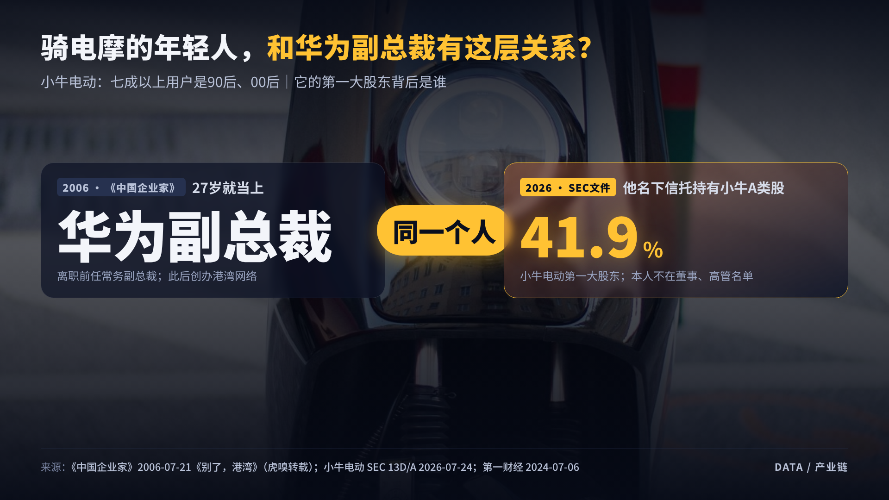

**▲ 图07-H0** `07_H0_主视觉_李一男与小牛`

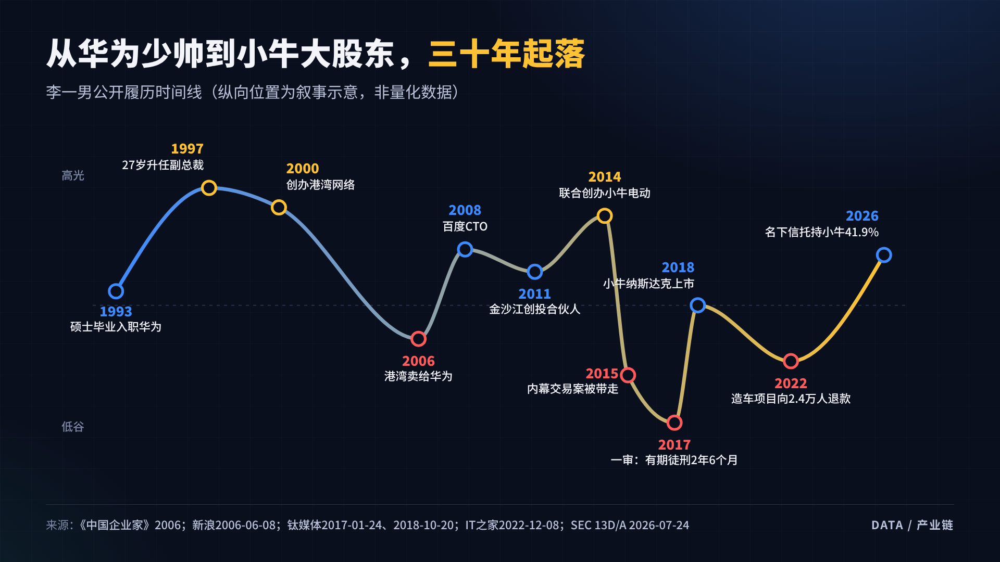

**▲ 图07-A** `07_A_李一男人生轨迹`

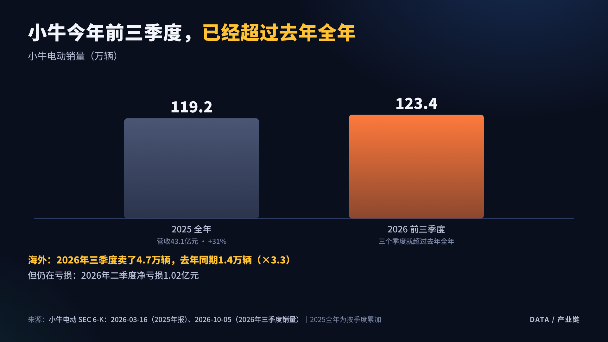

**▲ 图07-B** `07_B_小牛卖了多少车`

**▲ 图07-C** `07_C_小牛到底是谁的`

**▲ 图07-L1** `07_L1_档案卡_人物标签`

**▲ 图07-L2** `07_L2_档案卡_复古电视`

**▲ 图07-L3** `07_L3_档案卡_41.9%`

## 五、素材链接

**事实来源（S）**

| 编号 | 内容 | 链接 |
|---|---|---|
| S7-1 | 《中国企业家》2006-07-21《别了，港湾》（尹生，虎嗅2019转载）：“27岁上就做到了副总裁”“17亿是传言” | <https://m.huxiu.com/article/329451.html> |
| S7-2 | 新浪 2006-06-08：华为收购港湾资产范围、李一男致信员工 | <https://finance.sina.com.cn/roll/20060608/0948734803.shtml> |
| S7-3 | 钛媒体 2017-01-24：一审判决有期徒刑2年6个月、本人否认 | <https://www.tmtpost.com/2562597.html> |
| S7-4 | 钛媒体 2018-10-20：小牛纳斯达克上市 | <https://www.tmtpost.com/3540487.html> |
| S7-5 | 小牛 SEC 20-F（2026-04-17）：董事高管名单、BULL TRUST | <https://www.sec.gov/Archives/edgar/data/1744781/000110465926044568/niu-20251231x20f.htm> |
| S7-6 | 小牛 SEC 13D/A 第8号修正（2026-07-24）：41.9%、增持约210万美元 | <https://www.sec.gov/Archives/edgar/data/1744781/000110465926086437/primary_doc.xml> |
| S7-7 | 小牛 2025年报（6-K 2026-03-16）：营收43.08亿元、+31% | <https://www.sec.gov/Archives/edgar/data/1744781/000110465926029790/tm269229d1_ex99-1.htm> |
| S7-8 | 小牛 2026Q3 销量（6-K 2026-10-05）：53.7万辆、海外4.7万辆 | <https://www.sec.gov/Archives/edgar/data/1744781/000110465926113445/tm2627022d1_ex99-1.htm> |
| S7-9 | 小牛 2026Q2 业绩（6-K 2026-08-10）：净亏损1.02亿元 | <https://www.sec.gov/Archives/edgar/data/1744781/000110465926092992/tm2622687d1_ex99-1.htm> |
| S7-10 | 第一财经 2024-07-06：七成以上用户为90后、00后 | <https://www.yicai.com/news/102180597.html> |
| S7-11 | IT之家 2022-12-07：自游家NV向24376名用户全额退款，公告落款大乘汽车 | <https://www.ithome.com/0/659/499.htm> |

**视频（V）**

| 编号 | 视频 | 链接 | 备注 |
|---|---|---|---|
| V7-1 | 2015年小牛首发会（李一男本人出镜，搬运） | <https://www.youtube.com/watch?v=JD5lTJFWb40> | 版权风险，只截几秒并注明 |
| V7-2 | 小牛官方：NIU × Razer | <https://www.youtube.com/watch?v=_gcACOTYREg> | 官方频道 |
| V7-3 | 虎嗅2021《李一男 太子总是最危险的》（抖音@虎嗅APP） | 抖音内搜索标题 | **竞品参考，不要搬运** |
| V7-4 | 起源研究院：胡依林、李一男与小牛的十年歧路 | <https://www.youtube.com/watch?v=N9l_dxhFFac> | 竞品参考 |
| V7-5～ | 小牛官网宣传片 mp4、电动车街景免版权素材等 | 见“素材下载总表”一章 | — |

**图片（P）**

| 编号 | 内容 | 链接 | 授权 |
|---|---|---|---|
| P7-1 | 小牛 N1（维也纳街头） | <https://commons.wikimedia.org/wiki/File:NIU_N1_smart_electric_scooter_on_a_parking_lot_in_Vienna_(46621414665).jpg> | CC BY 2.0 / Ivan Radic |
| P7-2 | 小牛 NQi 2026 | <https://commons.wikimedia.org/wiki/File:NIU_NQi_2026.jpg> | CC BY-SA 4.0 |
| — | 李一男照片 | Commons 无可商用图片 | 用新闻截图并注明来源，或用插画 |

## 六、事实边界（开拍前必读）

- 【改口径】“27岁华为副总裁”有原刊依据；“最年轻”没有，不说。
- 【改口径】港湾收购价“官方未公布，坊间传17亿”。
- 【改口径】2015-06-03 被带走；2017-01 一审，有期徒刑2年6个月；二审结论未查到，不说“维持原判”；罚金口径不一，不报数字。
- 【平衡】加一句“他本人在庭上否认获取内幕信息”；不用贬损词。
- 【确定】2026年他不在小牛董事、高管名单；信托受益人，信托持A类股41.9%（SEC）。
- 【不能说】电摩“炸街”新闻都没有点名小牛，口播只说“很多人对骑电摩的年轻人印象不好”，不把炸街和小牛挂钩。
- 【差异化】虎嗅2021、起源研究院等已讲过“华为太子”，本期把重心放在2022–2026的新信息。

# 让图表在抖音里“动起来”：三种做法（以路线图为例）

每张图表都给了 4 种文件，按需要选用：

| 文件夹 | 是什么 | 什么时候用 |
|---|---|---|
| `图表/动画_竖版/` | 现成的动画 MP4：路线从起点一路画到终点，数字从0涨上去，柱子一根根长出来 | **首选**，直接拖进剪映就能用 |
| `图表/首尾帧/` | 每张图的**首帧**（动画开始前：只有底图、标题，没有线）和**尾帧**（动画结束：线和点全部画完） | 想自己控制速度和节奏，或者用剪映的“首尾帧”功能 |
| `图表/绿幕_竖版/`、`图表/绿幕_横版/` | 只有路线、点位和地名，背景是纯绿色（#00FF00） | 想把路线叠加到自己找的卫星图、实拍空镜或别的地图上 |
| `图表/竖版/`、`图表/横版/` | 静态成品图 | 封面、定格、画中画 |

## 做法一：直接用动画 MP4（最快，30秒搞定）

1. 剪映 → 开始创作 → 导入 `图表/动画_竖版/01_A_过境路线地图_动画.mp4`，拖到主轨道对应口播的位置。
2. 路线图动画长 5 秒，后面带 1.5 秒定格；数据图动画长 2.5 秒，同样带 1.5 秒定格。
3. 口播比动画长：选中片段 → **变速 → 常规变速**，调成 0.5x，线就画得更慢；或者在最后一帧上点 **定格**，按需要拉长。
4. 口播比动画短：变速调到 1.5x–2x。
5. 想让“烟台港”出现的那一刻正好对上口播里“烟台”两个字：先听口播，在“烟台”处按 **分割**，再调变速，让动画里线走到烟台的那一帧落在分割点上。

## 做法二：首尾帧 + 蒙版关键帧（自己控制线的走法）

适合路线大致是从东往西（或从西往东）的地图，比如韩国 → 烟台 → 新疆 → 哈萨克斯坦。

1. 主轨道放 **首帧**（`01_A_过境路线地图_首帧.png`），时长拉到 6 秒。这是“没有线的底图”。
2. 画中画轨道放 **尾帧**（`01_A_过境路线地图_尾帧.png`），起止时间和首帧对齐。
3. 选中尾帧 → **蒙版 → 线性**。把蒙版线旋转到竖直方向，**羽化**调到 10–20。
4. 在第 0 秒点 **关键帧**（菱形按钮），把蒙版线拖到画面**最右边**（韩国那一侧）。这时尾帧完全被遮住，只看得到首帧。
5. 把时间线移到第 5 秒，再点关键帧，把蒙版线拖到画面**最左边**（哈萨克斯坦那一侧）。尾帧被完整“擦”出来，看起来就是线从东往西画了过去。
6. 想在烟台停顿一下：在第 1.5 秒和第 2.2 秒各加一个关键帧，两个关键帧的蒙版位置都放在烟台，线就会在烟台停 0.7 秒。
7. 在关键帧上选 **曲线 → 缓入缓出**，速度变化更自然。

路线如果是南北向的，比如巴西 → 好望角 → 中国，就把蒙版线转成水平方向，或者分成两段各做一次擦除。

## 做法三：绿幕路线叠加到任何画面上

1. 主轨道放你想用的底层画面：卫星地图截图、港口空镜、谷歌地球录屏都可以。
2. 画中画放 `图表/绿幕_竖版/01_A_过境路线地图_绿幕动画.mp4`。
3. 选中它 → **抠像 → 色度抠图**，取色器点一下绿色背景，强度调到 30–50，阴影调到 10。绿色去掉后，只剩一条正在画出来的橙色路线和地名。
4. 用 **缩放、位置** 把路线对准底图上的实际位置。

## 关于剪映的“AI 首尾帧生成视频”

剪映和即梦都有“首尾帧生成视频”：上传首帧和尾帧，AI 自动补中间的过渡。它适合做镜头推拉、转场，**不适合数据图和路线图**，因为 AI 会把文字、数字和海岸线画变形，而数据图里的数字一个都不能错。数据图请用做法一或做法二。

## 每期哪些图适合哪种做法

| 图表类型 | 推荐做法 |
|---|---|
| 路线地图（01-A、02-E、03-D、04-A） | 做法一；需要卡口播节奏时用做法二；想叠在实拍上用做法三 |
| 柱状图、条形图、折线图 | 做法一（数字会从0涨上去） |
| 卡片、结构图、时间轴 | 做法一（会逐条出现）；也可以每张卡片配一个口播句子分段剪 |
| 环形图、点阵图 | 做法一 |

# 呈现形式：出镜、不出镜、动画还是漫画？（含剪映 SOP）

日期：2026-10-23
对象：做产业链、财经、人物商业故事的抖音中视频（4–5 分钟），剪辑是新手水平，不真人出镜，手里已有自动生成的数据图动画和证据截图动画。

材料范围：
- A、B 两组 11 位博主的拆解报告：`研究记录/博主学习/分析报告_A组.md`、`研究记录/博主学习/分析报告_B组.md`。
- 本次新取的 17 个账号、24 条视频的 B 站 videoshot 关键帧拼图，存放在 `研究记录/博主学习/形式研究/<博主>/frames_sheet.png`。每张每条视频均匀抽 16 帧，帧上标了 BV 号后 4 位和时间。原始雪碧图在 `研究记录/博主学习/形式研究/<博主>/raw/<BV>/`。
- 剪映、即梦、可灵的官方页面，以及其他网页资料（见第 6 节链接）。

本文只写实际打开、看过的内容。拿不准的地方会注明“未核实”或“疑似”。

---

## 1. 统计：已分析的 11 位博主中，出镜情况如何

| 类别 | 博主 | 出镜比例（报告估算） | 出镜方式 | 来源 |
|---|---|---|---|---|
| **真人出镜（4 位）** | 小Lin说 | 露脸约 45% | 棚拍，切到素材时保留圆形或矩形画中画头像 | A §1 |
| | 所长林超 | 单人版约 45%；2026 年对谈版几乎全程露脸 | 书房口播，人像两侧叠花字 | A §3 |
| | 进击的沈帅波（抖音） | 约 65% | 书房正面坐播，偶尔分屏小窗 | B §5 |
| | 商业小纸条（抖音） | 约 80% | 竖屏全程站播，戴礼帽，造型固定 | B §6 |
| **半出镜（2 位）** | 差评君 | 实拍加出镜合计约 30% | 部分棚播，加工厂、渔船上的实地出镜 | B §4 |
| | 汤质看本质 | 正脸约 0%，实拍约 10% | 只有背影和手写镜头 | B §2 |
| **不出镜（5 位）** | 巫师财经 | 0% | 素材加画框、水印、章节条 | A §5 |
| | 半佛仙人 | 0% | 图库、表情包、截图 | A §2 |
| | 温义飞（主号） | 0%（另一个对谈号全程露脸） | 复古拼贴加纸张肌理 | A §4 |
| | 回形针 PaperClip | 约 0%（只在结尾出现主播小窗） | 单色信息图加素材窗口 | B §1 |
| | 星球研究所 | 0% | 航拍、3D 字、发光地图 | B §3 |

从这张表能看出三点：

1. **11 位里有 7 位的正脸不到 30%。** 不露脸本身不是问题，巫师、回形针、星球都是头部账号。
2. **两位抖音原生博主（沈帅波、商业小纸条）都是全程出镜。** B 组报告的结论是“在抖音上，人就是封面”。不露脸的人需要别的固定识别物来代替这张脸，比如固定的形象、画框或配色。
3. **在露脸的博主里，小Lin 的“画中画头像”最适合迁移。** 头像位置在左下、右下、左上之间轮换，宽度约占画面的 15–19%（`研究记录/博主学习/小Lin说/frames_sheet.png`：c6oEL3 0:31 右下圆形，zYMEi6 5:30 左下矩形，s68EGf 12:48 左下圆形）。

---

## 2. 补充学习：五类不出镜（或弱出镜）的形式

### 2.0 实际取帧清单

| 类 | 博主（目录） | BV | 题材 | 实看结论 |
|---|---|---|---|---|
| a | 阿里鸭Alya | BV1R4pPenEHr、BV1mR4y1i7yJ | V 圈经济学 | Live2D 虚拟主播：一条全屏站播，一条用黑板加 Q 版头像 |
| a/b | 混知 | BV1JT41197HQ、BV1tP411y7Yu | 历史漫画 | 片头是固定卡通主持人“混子哥”，正片是漫画角色 |
| a | 小约翰可汗 | BV1WhaA6hE7s、BV1CgfHYQEda | 国际史 | **正片几乎看不到卡通形象**，全是影视和资料素材加字幕；卡通仓鼠只出现在广告段 |
| (a) | 懂点儿啥（观察者网） | BV1yv411B73k、BV1Xz411i72m | 李嘉诚、印度 | **是真人主持人**（棚内西装主播），不属于虚拟形象，已排除 |
| b | 漫腹经纶 | BV1Vv411v7dG、BV1SC4y147dw | 元朝、清朝商业史 | 白底手绘漫画，加箭头、思维导图和地图 |
| b | 柴知道 | BV1YWeg6TEjT、BV1JQJk6TEPQ | 网贷、人脸识别 | 扁平 MG 插画加真人主持，约占 1/4 到 1/3，属于半出镜 |
| b | 会讲故事的经济学 | BV1PR8rzQEhf | 货币 | 绘本插画翻页加中英字幕，**疑似直接使用出版绘本** |
| c | 地球知识局 | BV1ZxzvBfEQR、BV1ri421h78X | 高铁、中轴线 | 地图加红色路线、蓝色粗标题、新闻素材 |
| c | IC实验室 | BV1LHHs6DERH、BV1ArbszYEa9 | 河北电商、雪碧七喜 | 米色外框加台标水印，信息卡、素材，还有**固定的熊猫插画** |
| c | 小信所长 | BV15C4y1u7yp | 眼镜产业 | 素材加超大数字（75%）、环形图、饼图 |
| c | infinite灵感港 | BV16xnm6pEYr | AI 日报 | 米色底上放截图卡片加字幕，是最省事的“截图流” |
| d | 拖把鑫 | BV1tBQtBQEVi | 王阳明（AI 制作） | 全片 AI 电影感画面，暗调古风 |
| d | 史上那些事儿 | BV1PAnz6TE4r | 明朝两帝对话 | AI 生成两个固定角色，场景换了人物依然一致 |
| d | 翻译成中文可以是 | BV1rjn16DE16 | 1 分钱报纸 | 竖屏灰白极简象形图动画，**疑似 AI 生成或模板**，未核实 |
| d | 雅典的风 | BV1QPbSesE78 | 数字人播报 | 新闻台模板加 AI 女主播，第二段是另一个全身数字人 |
| d | 老撕Ben | BV1GQ4y1A7Qo | 剪映数字人教程 | 展示了剪映选数字人、换背景的界面 |
| e | 厂花蛋蛋姐 | BV1AB4y1P7Tq | 新化文印产业 | 实地拍摄、采访、车内视角、航拍；抽到的帧里没有主持人正脸 |
| e | 地道风物 | BV1ikh76xEVW、BV1JyBQYEEKN | 天麻、屯堡 | 实地加微距、航拍、手绘路线图，**但有主持人出镜** |

另外参考了 B 组已有的星球研究所（e 类，0% 出镜）和回形针、巫师（c 类）。

### 2.1 五类对比

难度按剪映新手打分，1 最容易，5 最难。耗时按一条 4–5 分钟成片估算，文案和配音已经准备好。

| 类 | 代表博主 | 画面特征（引用帧） | 新手难度 | 需要的工具 | 单期耗时 | 版权 / 身份风险 |
|---|---|---|---|---|---|---|
| **a. 动画/虚拟形象出镜** | 阿里鸭Alya、混知（混子哥）、IC实验室（熊猫）；小约翰可汗只做参照 | Alya nEHr 0:00–3:14：Live2D 少女全程居中，黑底，下方字幕，几乎不换画面。i7yJ 0:10–3:20：黑板加 Q 版头像加大字“听鸭鸭的话”。混知 97HQ/y7Yu 0:00：黑发卡通主持人加红色问号，作为固定开场。IC实验室 DERH 1:51：熊猫坐在沙发上，用作情绪插画。小约翰 hE7s 全片：卡通形象只用于品牌和封面，正片是素材 | **完整 Live2D：5；静态形象小窗：2** | Live2D 要建模加绑骨加 VTube Studio 驱动，门槛高。静态形象只需即梦或 MJ 生成 1 张主形象和 4–6 张表情差分 PNG，在剪映里叠到画中画轨，加“呼吸”缩放关键帧，口播时做轻微抖动 | 静态小窗只增加 20–30 分钟；Live2D 首次建模要几天到几周 | 身份零暴露。形象必须原创或自生成，**不能用别人的 IP**。AI 生成的形象要按标识办法标注 |
| **b. 漫画/手绘** | 漫腹经纶、混知；柴知道是 MG 半出镜 | 漫腹经纶 v7dG 1:09、2:54：白底手绘人物加流程箭头；2:01：手绘地图上色。47dw 4:50：“VS”对比构图。混知 y7Yu 1:16：章节标题卡“二、商朝人祭不全面概况”。柴知道 TEjT 2:36：扁平插画连接线；3:06：箭头流向加人物 | 4（要统一画风、逐镜画图） | 即梦或 MJ 统一风格生图（固定角色参考），剪映关键帧，AE 可选。真正手绘需要板绘能力 | 6–12 小时 | 用 AI 统一画风问题不大；**绘本或漫画书翻拍属于侵权**（会讲故事的经济学 QEhf 全片疑似就是这种） |
| **c. 纯素材加精良包装** | 巫师、回形针（已有）；地球知识局、IC实验室、小信所长 | 地球知识局 fEQR 1:07–4:13：浅色底图，红色路线，蓝色粗体标题“张日段”，右下角日期角标。IC实验室 DERH 全片：米色外框，右上角台标水印，1:21、5:03 用圆角信息卡讲数据，素材装在框里。小信所长 u7yp 1:12：素材上压超大数字“75%”；6:18：环形市场份额图；9:23：双环形“38% / 32%” | **2–3** | 剪映（画中画、蒙版、关键帧、文本模板），加我们已有的数据动画和证据截图动画。素材来自企业官网和宣传片、新闻（标注来源）、可商用素材库 | 4–6 小时 | 身份零暴露。主要风险在素材版权，影视剧和新闻台标会被判搬运；建议每个窗口都加“素材：来源”标签（回形针、差评都这么做） |
| **d. AI 数字人 / AI 生成画面** | 拖把鑫、史上那些事儿（AI 画面）；雅典的风（数字人主播）；老撕Ben（剪映数字人教程） | 拖把鑫 QEVi 0:15–4:35：暗调电影感古风，人物从少年到中年都由 AI 生成，好看但“AI 味”重。史上那些事儿 TE4r 0:10–3:44：两个固定角色在不同场景里对话，人物一致性好，但 1:42 的大字背景出现了**乱码字**。雅典的风 sE78 0:00–1:30：右侧 AI 女主播，左侧图片卡，下方“今日要闻”条，像政务新闻模板；1:47 起另一个全身数字人站在文字旁边。老撕Ben A7Qo 1:34–2:46：剪映中选数字人形象，再换背景 | 数字人：2；AI 场景：3 | 剪映“数字人”，即梦或可灵“首尾帧”图生视频，即梦或 MJ 生图 | 数字人增加 30 分钟；AI 场景每 5 秒镜头要 3–10 分钟、出 2–4 次图才能挑出可用的 | 身份零暴露。**观众对 AI 主播信任度低，播报腔重**。要按《人工智能生成合成内容标识办法》（2025-09-01 施行）标注；**不能用 AI 生成真实企业家的脸说话**，否则涉及肖像权和误导 |
| **e. 实地外景加旁白** | 厂花蛋蛋姐、星球研究所；地道风物只做参照（有主持） | 厂花蛋蛋姐 P7Tq 0:47：打印店门口；2:23–3:11：设备和印刷特写；7:58：车内前视角；9:34：“新化东站”空镜；11:10：大展厅俯拍，全程只有采访对象，没有主持。地道风物 xEVW 0:29、3:26：天麻微距；3:56：**手绘路线图“第二关”**；EEKN 10:25–12:02：航拍 | 3（拍摄比剪辑难） | 手机稳定器、无人机（可选）、剪映调色，加我们已有的数据动画 | 拍摄 1–3 天加剪辑 4–6 小时 | 不露脸也能拍。但**工厂、港口内部拍摄要许可**；拍到路人和工人需要打码；镜头里的车牌、门牌可能反向暴露拍摄者行踪 |

### 2.2 新发现（和预想不一样的地方）

1. **小约翰可汗不是“卡通小窗”形式。** 在 2 条视频共 32 个抽样帧（包括 sprite_0 的 100 个连续帧）里，正片全是影视资料和字幕，卡通形象只用于封面和品牌。也就是说，“虚拟形象”主要是**识别符号**，不必全程挂在画面上。
2. **IC实验室的熊猫、混知的混子哥**都是“固定角色在关键时刻出场”：开场、转场、吐槽或情绪点，不是全程小窗。
3. **全程挂 Live2D 的 Alya，画面信息量很低**（nEHr 16 帧几乎一样）。这不适合“证据加数据”型的产业链题材。
4. **数字人主播（雅典的风）的画面像政务新闻模板。** 它和财经博主要的“个人观点、可信”人设是冲突的。
5. **AI 生成的画面里会出现乱码字**（史上那些事儿 TE4r 1:42）。这印证了即梦、可灵不适合用来生成带数字和文字的画面。

---

## 3. 推荐：主形式加辅助形式

### 主形式：c 类“素材加精良包装”，以我们的数据动画和证据截图为骨架

**理由（证据）：**
- 不出镜的 5 位头部博主（巫师、回形针、星球、半佛、温义飞）和新看的地球知识局、IC实验室、小信所长都走这条路。它和产业链、财经题材的匹配已经被反复验证。
- 这条路**最吃“证据和数据”**，正好是我们已有的资产：数据图动画对应小信所长 u7yp 6:18、9:23 和小Lin 的数据图，证据截图动画对应巫师的高亮截图和小Lin c6oEL3 7:11 的论文截图堆叠。
- 新手难度 2–3，单期 4–6 小时，在可持续更新的范围内。
- 包装用固定外框、水印和章节条（IC实验室 DERH 的米色外框加右上台标，巫师的画框加章节条），可以替代“脸”成为识别物。

### 辅助形式：a 类的“轻量版”，即固定原创卡通形象小窗

**不推荐**完整 Live2D，也**不推荐**剪映写实数字人做主持。

**做法：**
- 用即梦生成 1 个原创卡通形象（半身），再生成 5 张表情差分：平静、惊讶、摊手、指向、皱眉。
- 形象只在三种时刻出场：
  - 开场 3–10 秒：出全身或大半身，抛出钩子；
  - 每个章节开头 2–3 秒：配合章节条出场；
  - 吐槽或总结金句时。
- 出场时放在左下或右下的圆形或圆角小窗里，学小Lin。
- 全片出场时间约 15–25%，其余时间让数据和证据占满画面。

**为什么选它，而不是剪映数字人：**
- 证据显示，写实 AI 主播带有“播报腔”（雅典的风 sE78），和财经观点类人设冲突。
- 卡通形象被成熟账号验证过，可以作为识别物（混知、IC实验室、小约翰的封面）。
- 卡通形象做封面也稳定。抖音上“人就是封面”，这个形象就是封面上的“人”。
- 风险低：原创形象不涉及肖像，也不暴露身份。

### 不建议主用的部分

| 形式 | 可以怎么用 | 不建议的原因 |
|---|---|---|
| d. 即梦/可灵首尾帧 | 只做每期 1–3 个“历史或人物情景”镜头和转场（见 4.3） | 字和数字会变形（TE4r 1:42），而且 AI 感会稀释可信度 |
| e. 实地外景 | 有条件时每期补 2–4 个自拍空镜，比如港口远景、工厂门口、产品微距 | 拍摄成本高，进厂需要许可 |
| b. 全手绘 | 只做“关系图、流程图”这类局部插画 | 逐镜画图，成本太高 |

> **身份提醒**：自拍空镜不要拍能认出厂区、门牌、车牌的画面，发布前去掉 EXIF 和手机水印；口播里也不要说“我拍到”。能用素材库空镜替代的，优先用素材库。

### 推荐的画面配比（4–5 分钟）

| 画面 | 占比 | 来源 |
|---|---|---|
| 数据图动画（柱、线、环、地图路线） | 30% | 已有自动生成 |
| 证据截图动画（财报、公告、新闻高亮） | 20% | 已有自动生成 |
| 素材 B-roll（企业宣传片、新闻、自拍空镜），加推拉摇移 | 30% | 官网、新闻、素材库、自拍 |
| 卡通主持人（全身开场，加小窗） | 15% | 即梦生图 |
| AI 首尾帧情景镜头和转场 | ≤5% | 即梦或可灵 |

---

## 4. 剪映落地 SOP（专业版，桌面端）

以下功能名已经和剪映官网首页（capcut.cn）列出的功能对照过：**数字人、文本朗读、智能剪口播、蒙版（含钢笔蒙版）、关键帧、多时间线、AI 音效、响度统一、人声美化**。具体按钮的位置会随版本变化，下文写的是常见位置，以你本机界面为准。

### 4.0 工程设置

| 步骤 | 操作 |
|---|---|
| 1 | 首页点“开始创作”。点右侧“草稿参数”或“修改”，设置比例 **16:9（1920×1080）**、帧率 **30fps**。抖音中视频按横屏做；要发竖屏版的话，另存一个 9:16 工程，上下加标题和字幕区 |
| 2 | 先建一个“包装模板”工程：外框、水印、章节条、字幕预设、卡通形象小窗都做好后，每期“复制草稿”再改内容。这是新手最省时间的一步 |

### 4.1 导入配音和对齐

| 步骤 | 按钮和参数 |
|---|---|
| 1 | 导入配音 wav 或 mp3，拖到主轨下方的音频轨。如果用 AI 配音：可以在“文本”里新建文本，然后用“文本朗读”选音色，生成后删掉文本层（功能名见官网） |
| 2 | 选中音频，右侧“音频”面板中，**人声美化**和**音频降噪**按需开启，**响度统一**开启 |
| 3 | 在“文本 → 智能字幕 → 识别字幕”中生成字幕，逐句校对错字，尤其是公司名和数字 |
| 4 | 按字幕在时间线上用 **M 键**（或“添加标记”）打标记：每个章节点、每个关键数字出现处、每个“问题重启”句。后面所有画面都按标记对齐 |

### 4.2 卡通主持人小窗（学小Lin画中画）

准备：用即梦“文生图”生成原创角色，提示词示例：“扁平插画风，半身，戴圆框眼镜的卡通财经分析师，纯绿色背景，正面”。再用“图生图”保持画风，生成 5 个表情。用即梦的“抠图”或剪映的“智能抠像”去掉背景，导出透明 PNG。

| 步骤 | 按钮和参数 |
|---|---|
| 1 | 把形象 PNG 拖到**主轨上方**的轨道，剪映里叫“画中画”轨 |
| 2 | 右侧“画面 → 基础 → 位置大小”：**缩放 28–32%**；位置放右下时 **X ≈ +700、Y ≈ −330**，放左下时 X ≈ −700（以 1920×1080 画布为参考，按预览微调，留出底部字幕区） |
| 3 | 圆形小窗：在“画面 → 蒙版”里选“圆形”，拖成正圆，**羽化 0–5**。如果想要白边，在下面一层放一个略大的白色圆形贴纸或形状 |
| 4 | “呼吸感”：在片段起点点“位置大小”右边的**菱形关键帧按钮**，记下缩放 30%；往后 1 秒，缩放改成 30.6%；再往后 1 秒改回 30%。复制这 3 个关键帧，往后铺开。也可以给片段加“动画 → 循环动画 → 轻微晃动”类效果，名称按版本而定 |
| 5 | 换表情：在口播的情绪点按 Ctrl+B 分割，用“替换素材”换成另一张表情 PNG，保持位置不变 |
| 6 | “说话感”（可选）：在“动画 → 入场”里选“弹入”或“缩放”，时长 0.3s；或者每 2–3 秒做一次 ±2° 的旋转关键帧 |
| 7 | 出场节奏：开场全身占屏 40–60%，大约 5 秒后缩到角落；章节开头出现，2–3 秒后淡出（“动画 → 出场 → 渐隐”）；数据图满屏时**隐藏小窗**，不要挡住数据 |
| 8 | 如果确实想用剪映“数字人”：选中一段文本，在右侧找“数字人”页签，选形象，然后生成（流程见老撕Ben A7Qo 1:34–2:46 的界面）。生成后同样按 2–3 步缩成小窗。**建议只选卡通或非写实形象**，并在简介写明“AI 生成” |

### 4.3 即梦/可灵“首尾帧”做转场和人物情景

官网确认的功能：即梦首页写有“首尾帧控制：通过首帧图片和尾帧图片输入提高可控性”，另有“视频对口型”；可灵的“图生视频”支持“自定义首尾帧”。

| 步骤 | 操作 |
|---|---|
| 1 | 用即梦生图做首帧，比如“1990 年代深圳港口，集装箱，胶片质感”；再做尾帧，比如“同一机位，2025 年自动化码头”。两张图的**构图和机位要接近**，否则中间会乱变 |
| 2 | 即梦进入“视频生成”，上传首帧和尾帧，提示词只描述**运动**，比如“镜头缓慢推进，时间流逝，从白天到黄昏”。时长 5s，比例 16:9 |
| 3 | 每个镜头生成 2–4 次，挑一个最稳的。导入剪映后可以“变速”到 0.8x，把动作拉慢 |
| 4 | 剪映里如果画面上有 AI 生成的乱字，用“画面 → 蒙版”或加一层模糊遮住 |

**适合用的地方：**
- 年代变迁转场（旧厂到新厂、荒地到园区）；
- 人物故事中的“情景再现”，用背影、剪影、远景、手部，**不要正脸**；
- 章节开场的氛围空镜；
- 产品从原料到成品的意象化过程。

**不适合用的地方：**
- 任何带**数字、文字、Logo、报表、K 线**的画面。数字和文字会变形，TE4r 1:42 就出现了乱码字；
- 真实企业家的正脸或说话镜头，涉及肖像权和误导风险；
- 地图和路线。地理会被画错，路线图请用 4.5 的蒙版方法；
- 需要事实准确的设备、工厂内景，AI 会画错工艺细节，懂行的观众一眼就能看出来。

### 4.4 关键帧推拉摇移（Ken Burns），让照片和截图动起来

| 镜头 | 起点关键帧 | 终点关键帧 | 时长 |
|---|---|---|---|
| **推（Push in）** | 缩放 100%，位置 (0,0) | 缩放 115–120%，位置移向主体，比如人脸方向 X −80 | 4–6s |
| **拉（Pull out）** | 缩放 125%，对准细节（比如截图上的某一行数字） | 缩放 100%，位置 (0,0) | 4–6s |
| **横摇（Pan）** | 缩放 120%，X = +150 | 缩放 120%，X = −150 | 5–8s（宽幅照片、厂区全景） |
| **竖摇（Tilt）** | 缩放 120%，Y = −150 | Y = +150 | 5s（高楼、长截图） |

操作步骤：
1. 选中图片片段，把**播放头放在片段第一帧**。
2. 打开右侧“画面 → 基础 → 位置大小”，点“缩放”和“位置”右侧的◇按钮，按钮变成实心表示已打关键帧。
3. 把播放头移到**片段最后一帧前约 5 帧**，修改缩放和位置数值。剪映会自动打第二个关键帧。
4. 缓入缓出：较新版本选中关键帧后，可以在面板里找到“关键帧曲线 / 动画曲线”，选“缓入缓出”类预设。**这个入口未在官方文档核实**；如果你的版本没有，保持线性，把幅度控制在 ≤20%，看起来同样平稳。
5. **缩放永远不能小于 100%**，否则会露出黑边。
6. 截图类素材先“拉”再停：第 0–1.5 秒从 125% 拉到 100%，停 1 秒，再“推”向要强调的数字。高亮框用我们的证据截图动画。
7. 节奏：静态图 **3–5 秒换一张**（A 组建议），信息图停 5–8 秒。相邻两张的运动方向要交替（推、横摇、拉），避免单调。

### 4.5 蒙版加关键帧，让路线图“画出来”

参照：地球知识局 fEQR 1:07–4:13 的红色路线，地道风物 xEVW 3:56 的手绘路线图。

| 步骤 | 按钮和参数 |
|---|---|
| 1 | 准备两层：**底图**（不带路线的地图）放在主轨；**路线层**（同尺寸、透明背景、只画红色路线的 PNG，可以用我们的数据动画脚本导出，或在 PPT、Figma 里描）放到画中画轨，对齐 |
| 2 | 选中路线层，打开“画面 → 蒙版”，选“**线性**”蒙版。路线大致从左到右时，把蒙版旋转 90°，让它成为竖线，可见区在左侧 |
| 3 | 起点：播放头放在路线层开头，把蒙版位置拖到路线**最左端以外**，此时整条线都看不见。点蒙版参数旁的◇，给“位置”打关键帧 |
| 4 | 终点：播放头往后 2–3 秒，把蒙版拖到**最右端以外**，整条线出现，第二个关键帧自动生成 |
| 5 | **羽化 10–20**，让线头柔和 |
| 6 | 曲折路线可以拆成 2–3 段，每段一个路线 PNG 和一个线性蒙版，**按顺序依次揭开**。也可以用“**钢笔蒙版**”（官网确认有这个功能）逐段画出可见区 |
| 7 | 终点城市：在路线到达的帧上叠一个圆点贴纸，加“入场 → 弹入”0.3s，再加城市名文字 |
| 8 | 地图整体同时做一个慢“推”（100% 到 108%，按 4.4 的方法），会更有空间感 |

### 4.6 字幕、章节条、音效、BGM

| 项目 | 规格 | 依据 |
|---|---|---|
| **字幕** | 思源黑体或抖音美好体 **Bold**，字号约画面高度的 5–6%（1080p 下 54–64px），**白字加 4–6px 黑描边**；放在下方居中，距底边约 8%。关键数字改成黄或红色，并单独放大 120%。设好后“保存预设” | A 组建议“白色粗体加黑描边大字”；巫师、林超都是这种做法 |
| **章节条** | 顶部做一条半透明深色横条（高 60px），写“① 谁在造 ② 钱从哪来 ③ 卡在哪”，当前章节高亮。每章开头先出现全屏章节卡 1.5–2s（参照混知 y7Yu 1:16“二、商朝人祭不全面概况”），然后缩成顶部条 | A 组技巧 5；巫师的章节条 |
| **外框和水印** | 统一的描边外框或圆角窗口，加右上角账号名水印，不透明度 60% | IC实验室 DERH 全片；巫师的画框 |
| **素材来源标签** | 外部素材窗口左上角写小字“素材：××官网 / ××新闻”，字号 18–22px | 回形针、差评的做法，能降低搬运判定 |
| **音效：转场** | 在“音频 → 音效”里搜“嗖 / whoosh / 转场”，放在切点前 2–3 帧，音量 −12dB 左右。官网另列有“AI 音效”可以生成 | — |
| **音效：数字跳动** | 搜“滴答 / tick / 数字滚动 / 计数器”，和数据动画里数字滚动的时长对齐；数字落定时加一声“叮 / ding” | — |
| **音效：截图高亮** | 高亮框出现时加“马克笔 / 划线 / 纸张”音效，音量 −15dB | — |
| **BGM** | 在“音频 → 音乐素材”里选**纯音乐**，风格用“紧张悬疑 / 科技 / 纪录片”，钢琴加弦乐的低频铺底。音量设在**人声下 18–22dB**（例如人声 0dB，BGM −20dB）。每章换一首或换一段，问题重启处做 1s 淡出、淡入。商用要用剪映曲库里标注可商用的曲目，或者用版权音乐库 | — |
| **导出** | 1080p，30fps，码率选“推荐”或“更高”，格式 MP4（H.264）。导出前全片看一遍：字幕错字、小窗挡数据、黑边、AI 乱码字 | — |

### 4.7 单期时间预算（新手，熟练后可以减半）

| 环节 | 耗时 |
|---|---|
| 配音导入、降噪、字幕识别和校对、打标记 | 40 min |
| 摆放数据动画和证据截图（已有） | 60 min |
| 素材 B-roll 搜集，做推拉摇移 | 90 min |
| 卡通主持人出场和换表情 | 30 min |
| 路线图蒙版动画（如果有） | 30 min |
| 即梦首尾帧镜头 1–3 个（含等待和挑选） | 30–60 min |
| 章节条、音效、BGM、检查、导出 | 45 min |
| **合计** | **约 5.5–6.5 小时** |

---

## 5. 风险清单

| 风险 | 对策 |
|---|---|
| 身份暴露 | 不用自己的声音时，可以用文本朗读，或者用变声后的配音。外景镜头不要拍自己的车牌、小区和工位；截图里不要留自己的账号和头像 |
| AI 标识 | 用了即梦或可灵画面、AI 形象、数字人，在发布时勾选平台的“AI 生成”声明，画面角标写“部分画面由 AI 生成”。依据是《人工智能生成合成内容标识办法》，2025-09-01 起施行 |
| 素材版权 | 优先用企业官网和宣传片、官方发布会、政府公开影像、可商用素材库、自己拍的素材。不用影视剧片段；新闻画面做窗口化处理并标注来源 |
| 肖像 | 不用 AI 生成真实企业家说话；真实人物只用新闻照片，并做推拉 |
| IP 形象 | 卡通形象自己生成，保存好生成记录，不模仿现有 IP，比如熊猫头、混子哥 |

---

## 6. 参考链接（实际打开或检索过）

**官方页面**
- 剪映官网，功能列表包括数字人、文本朗读、关键帧、蒙版（含钢笔蒙版）、AI 音效、响度统一：https://www.capcut.cn/
- 剪映专业版 App Store 页（列有曲线变速、蒙版、调色）：https://apps.apple.com/cn/app/id1529999940
- 即梦官网（首尾帧控制、视频对口型、抠图、图生图）：https://jimeng.jianying.com/
- 可灵官网（导航中有生成、Omni、全部工具；功能细节需要登录查看）：https://klingai.com/app/

**第三方资料（未经官方核实）**
- 可灵网页端上线，“图生视频”新增运镜控制和自定义首尾帧（IT之家，2024-07）：https://www.ithome.com/0/780/090.htm
- 可灵首尾帧、图生视频功能介绍：https://ai-bot.cn/sites/13002.html
- 即梦首尾帧教程：https://www.18183.com/soft/8913082.html 、https://ai-bot.cn/ai-tutorials-2025080601/
- 剪映数字人流程（第三方，部分说法互相矛盾）：https://www.tixiaolu.com/v2/posts/v2-694e5a94.html 、https://www.bilibili.com/opus/1119824104379121689

**政策**
- 《人工智能生成合成内容标识办法》（新华网）：https://www.news.cn/tech/20250314/f8b96305ff274e0cb70031c2819092ee/c.html

**B 站样本视频**：见 2.0 表中的 BV 号，网址为 https://www.bilibili.com/video/<BV>

**未能核实的项目**
- 剪映“关键帧曲线 / 缓入缓出”的具体入口：官方页面没有写，搜索结果里也没有可靠来源，4.4 已注明。
- 剪映数字人的“景别、背景”参数名称：未找到官方说明。
- 抖音上的 AI 数字人财经号：本次只在 B 站取帧，没有找到它们的 B 站同步号，d 类改用 AI 历史号和数字人播报号代替。

# 虎嗅怎么做视频：不出镜，为什么还显得高级

调研日期：2026-10-23。数据来源：B站「虎嗅视频」（mid 296399504，card 接口核对：34.8万粉、592 条投稿；合集只有「九叶刀」「虎学研究」「想通了吗」三个，七上八下没有建合集，是用空间搜索 keyword=七上八下 找到的，共 46 条，时间是 2021-07 到 2022-07）。

**没拿到的**：李一男 2021-12-17 那期（截图里的抖音竖版模板）在 B站搜不到。用“李一男”“华为”“任正非”“太子”“接班”在虎嗅视频空间里都搜过，均无结果；网页搜索和 YouTube 搜索也没有找到。虎嗅网的视频页 m.huxiu.com/article/1133760（2023-04，《3次创业1次入狱，细数李一男的传奇经历》）能下载 mp4，但它是第三方「帅真财经」的真人口播，**不是虎嗅自制**，只当对照（HX1133760/）。下文写到抖音竖版模板时，依据只有用户提供的截图。

| 目录 | 视频 | 时长 | 字/分 | 平均镜头时长 |
|---|---|---|---|---|
| BV1xL4y1W7gu | 26年前联想内斗（七上八下，2021-11-30） | 4:13 | 301 | 4.2s（59 刀，中位 3.5s） |
| BV19q4y1P77K | 潘石屹 3 次逃跑（七上八下，2021-10-04） | 9:58 | 430 | 2.9s（207 刀） |
| BV1NP4y1x73V | 俞敏洪五次悲惨时刻（七上八下，2021-08） | 6:32 | 330 | 拼图只有 160px |
| BV1ab4y167zz | 苏宁张近东（七上八下，2021-07） | 8:34 | 325 | — |
| BV1tC4y1K7Uy | 华为供应铁军（虎学研究，2024-01） | 8:13 | 271 | 2.8s（172 刀，中位 1.7s） |
| BV1FsnP6NE4T | 小鹏复刻华为红利（2026-10-20） | 5:20 | 313 | — |

- 每期的 12 帧拼图和转写稿在 `研究记录/博主学习/虎嗅/<BV号>/`。
- 切镜数据来自 ffmpeg scene>0.3 检测。
- 拼图帧的时间按均匀间隔推算，误差约 ±3 秒。

## 1. 七上八下的结构

**开头钩子（前 15–40 秒）：先用一个新闻由头，再抛出一个“反常”的判断，最后报栏目名。**
- 联想 00:00：“柳传志……如今深陷舆论危机。有人说，联想的危机不是过去，而是将来，但其实26年前就写下了危机的伏笔。”00:11 接着说“这让联想成为了联想，但也让中国错过了第二个华为”，然后才是“大家好，我是小七”。
- 潘石屹 00:00：“黑石集团放弃了收购SOHO中国……这已经是潘石屹的第三次跑路。”它用数字“3”把全片串起来：三段婚姻、三个孩子、三次逃跑。
- 俞敏洪 00:00：从一个场景开场，“考上北京大学那年……路人开始鼓掌喝彩”，然后在 00:37 反转：“在他最得意之时，（悲伤）成为硬币的反面猛然出现”。

**正文用“编号母题”来分段**：“三次逃跑”“五次悲惨时刻”“理想实现 / 悲观时刻”交替出现。故事按年份线性推进，每段都落在一个具体场面上：1995-06-30 的免职大会、三张纸条“模仿三国”（联想 01:43）、柳传志说出的那一个“不”字（02:33）。

**给人物贴标签**：用口语化的外号概括人物，比如“江苏狠人张近东”“理想主义者俞敏洪”“万通六君子”“地产大佬”“企业家教父”。截图里的“任正非『干儿子』”“华为最年轻副总裁”“华为未来接班人”也是同一种做法，而且做成了竖排标签。

**结尾有三步**：
1. 回扣开头的母题。例如“三、这个数字和潘石屹真的很有缘”（09:40）；锤子敲裂“像极了张近东的命运”（08:07）。
2. 落一句判断。例如“选择决定命运，时代造就英雄”（联想 03:48）。
3. 互动加引导关注。例如“你们有做出重大选择的故事吗？评论区说说吧……关注虎嗅App视频号”（联想 03:48、04:07 字幕）。

## 2. 画面系统（逐帧）

**七上八下 2021 横版**
- 纸张底：
  - 联想 00:28：浅灰做旧纸张上，竖排宋体大字“柳倪之争”，左右各放一张矩形人物照（没有描边）。
  - 联想 03:04：《中国科学院文件》放在纸面中央，四周留白。
  - 张近东 00:05：卡其色底上排了 9 张人物方形小头像，像组织架构图。
- 旧报纸、杂志：联想 01:55 拍的是“中文电脑成熟了”报纸（推近大标题），02:00 是《瞭望》周刊封面。
- 文件和截图：先整页出现，再用**红框圈出关键句**。例如张近东 00:10 的权益变动公告、03:50 和 03:55 的 2013/2014 年报表（红框 + 年份大字）、06:01 的新闻页（标题加粗红框）。
- 抠像拼贴：
  - 潘石屹 00:05：抠出的人物 + 抠出的城市天际线，放在黑底上，再贴一张白底黑字的“新闻标题贴纸”。
  - 张近东 00:40：青绿底上一个圆形遮罩人物，两侧是带白边的圆形小头像。
  - 张近东 02:30：黑白人物抠像叠城市，配白色宋体两行字“2012年8月 / 刘强东向苏宁发起价格战”。
- 道具框：潘石屹 05:48 和 06:16 把照片塞进复古电视机框；00:33 用的是发光圆角“屏幕”框。
- 数据：潘石屹 01:56 是满屏红色粗体“1910”，叠在钞票画面上，并带有 RGB 错位故障效果。
- 文字卡：潘石屹 05:43 是粉色纸纹底，红色 SOHO + 黑色英文全称；07:56 是楼盘名双列大字。
- 资料片：有来源的资料片，在右上角用竖排小字注明片名（联想 02:12 / 02:46 写的是“不老人生·倪光南”），左下角原台标打马赛克。
- 字幕：白色粗黑体加黑描边，放在底部中间。

**虎学研究 2024（华为）**
- 品牌色：黄 + 黑 + 白纸。
- 00:18 标题：黄色斜切色块，上面是黑色宋体“华为的『供应铁军』”，再贴一块“虎学研究”黑底标签。
- 00:36：白纸纹理底上做扁平点阵插画。01:00 是黄色世界地图加定位针和虚线航线。
- 02:06：任正非做成线描漫画头像，配黄色圆形底，加“任正非内部讲话：”黑底引语卡。
- 03:00 和 03:06：大数字“5432万元”“1136.73%”，用白色窄体粗字，中间嵌一道黄色斜杠。
- 04:30 和 04:36：黄色 3D 环形图，标注“占采购额 97%”。
- 右上角常驻“虎嗅”宋体水印。
- 切镜最快，中位 1.7 秒。

**2026 新版（小鹏）**
- 深灰六边形纹理底，左上角绿色 logo。
- 画面元素：圆角窗口里放采访画面，右侧有绿色竖线和人名条（00:05“蔚来创始人 李斌 2026年5月……”）；网页截图上做绿色高亮划线（01:48）。
- 用 AI 生成的 3D 盲盒风格“讲述者”角色贯穿全片（00:46、02:03、05:09）。

**和截图里的抖音竖版对照**：抖音竖版做了固定顶栏（虎嗅｜七上八下 + NOTHING BUT STORYTELLING）、底部大号 STORYTELLING 水印、白描边半身抠像加椭圆投影，还有竖排标签。B站横版里没有顶栏和水印，但纸纹底、竖排宋体、红框文件这三样是一致的。可以推断，同一期节目的横版和竖版用的是两套包装。

## 3. 配音与节奏

- 主持人设定是“小七”（“大家好，我是小七”）。按基频粗测：七上八下 107–155Hz，虎学研究 121Hz，偏男声；小鹏这期约 250Hz，可能是女声。**以上未经人工听辨**。
- 语速：一般 300–330 字/分；潘石屹这期 430 字/分，属于快嘴吃瓜腔（“吃瓜不怕碗的小七”）。
- 音乐：全片音频没有静音段（低于 -50dB 的占比 ≤0.6%），推断整片铺了连续的 BGM 底。具体曲目和音效没有核实。
- 与巫师财经、小Lin说的差异：巫师财经偏宏大叙事加强论断；小Lin说是真人出镜、讲解型、白板图。七上八下是**人物八卦感的故事会**，靠场景和细节（纸条、眼泪、敲裂的锤子）推进，数据只作点缀，结尾落在“选择 / 时代”上。

## 4. 剪映新手复刻（不出镜）

1. **纸张底**：搜索 Pexels 或 Unsplash 的“paper texture”（两站都可免费商用，不强制署名），也可以用剪映素材库里的“纸张 / 牛皮纸”。加“胶片颗粒”特效，不透明度设 20–30%。
2. **抠人像**：照片导入后，在“画面 → 抠像 → 智能抠像”里一键抠图；抠不干净时用“自定义抠像”画笔补。
   - 白描边：抠像面板里的“抠像描边”，选白色、粗细约 8–12。
   - 投影：另加一个黑色椭圆贴纸，模糊 30–40、不透明度 40%，放在脚下。不同版本菜单名可能不同，以上未实测。
3. **竖排标签**：新建文本，在“排列”里选竖排；或者每字一行，字号 40–48，加白色背景（文本 → 背景，不透明度 100%）。用思源宋体 Heavy。
4. **顶栏和水印做成预设**：把顶栏条、栏目名、英文小字、底部大号英文水印（不透明度 8–12%）放进同一个“复合片段”，然后“添加到我的预设 / 收藏”，以后每期直接拖进来。
5. **关键帧**：
   - 抠像在 0s 设缩放 100%、位置 Y+40，在 4s 设缩放 106%、Y 0，选“缓入缓出”曲线。
   - 标签延迟 0.5 秒入场，不透明度 0→100%，同时 X 方向偏移 30px→0，时长 0.4 秒。
   - 一个镜头 3–4 秒（对标联想这期的中位 3.5 秒）。
6. **文件截图**：截图放在纸张底上，缩放 85%；加红色矩形框贴纸，框住关键句；镜头推近 110%。资料片要在右上角注明出处。
7. **版权**：
   - 人物照片优先用官方新闻稿、维基共享资源（CC BY / CC BY-SA 要署名）或公司官网发布的图。
   - 新闻图片要在画面角落标“图源：XX”。
   - 别人的视频素材只截短片段，并注明来源；不要照搬虎嗅自己的版式元素（顶栏文案、英文水印）。

## 5. 我们 ep7（李一男 2022–2026）怎么做得和虎嗅 2021 版不同

- **时间重心**：虎嗅 2021 版讲的是“太子”宿命（华为 → 港湾 → 入狱）。我们只用 30 秒交代这段，主体放在 2022–2026：自游家停摆、小牛之后的造车与资本、2026 年的最新动态（要以公开报道核实）。
- **标签更新**：截图里的旧三标签是“干儿子 / 最年轻副总裁 / 接班人”。我们改成“三次创业”式的时间轴标签卡，每个标签都带年份和来源。
- **证据形态**：虎嗅用旧报纸做年代感。我们用工商变更、公告、判决书、财报截图，并加红框，突出“可核实”。
- **结尾**：不落在“宿命论”上，改成一个开放问题，比如“天才型创始人在重资产行业的边界”。

## 6. 自有版式 3 套（学其形不抄其样）

| 方案 | 底色 / 强调色 | 字体 | 顶栏文案 | 水印英文 |
|---|---|---|---|---|
| A 档案馆 | 米白纸 #EFE9DD / 朱红 #C8372D | 思源宋体 Heavy + 思源黑体 | ｜商业档案 No.07 | CASE FILE |
| B 夜读 | 炭黑 #1E1E1E / 琥珀 #E8A33D | 霞鹜文楷 + 阿里巴巴普惠体 | ｜人物沉浮录 | RISE & FALL |
| C 产业链 | 冷灰 #E6E8EB / 湖蓝 #1F6FEB | 思源黑体 Bold + DIN 类数字体 | ｜链上故事 | FOLLOW THE CHAIN |

可以用 HTML 动画生成器自动产出的素材（导出 PNG 或透明 MOV）：
- 栏目顶栏 PNG
- 底部英文水印
- 纸张底（CSS 噪点 + 渐变暗角）
- 人物标签卡（竖排，入场动画）
- 年份时间轴条
- 大数字卡（数字 + 斜杠色块）
- 红框高亮层
- 片尾关注卡

人物抠像本身仍然要在剪映里完成。

## 7. 已经做好的“档案馆”版式素材（第07期示范）

按上面方案 A（米白纸＋朱红＋宋体），用 HTML 生成器做了三种镜头。每种都有竖版、横版、动画 MP4 和首尾帧，在 `图表/竖版/07_L*`、`图表/动画_竖版/07_L*`、`图表/首尾帧/07_L*`：

| 镜头 | 学虎嗅哪一招 | 剪映里怎么用 |
|---|---|---|
| 07_L1 档案卡·人物标签 | 七上八下的竖排人物标签、纸张底 | 直接铺底。把新闻照片用“智能抠像”抠出来，盖在剪影位置，加白色描边；标签已经带动画 |
| 07_L2 档案卡·复古电视 | 潘石屹 05:48 / 06:16 的复古电视框 | 老资料（旧杂志、旧网页）都可以这样“放进电视”，有年代感，又不用找视频 |
| 07_L3 档案卡·大数字 | 潘石屹 01:56 的满屏大数字、虎学研究的斜杠数字 | 整段用在钩子数字或关键数字上，3 秒 |

**换成别的人物**：打开 `图表源码/hx.html`，改 `CFG` 里的标签（年份、四到六个字）、截图文件名和来源，然后运行 `node render_hx.mjs <输出目录> 07_L1` 重新导出。

**注意**：顶栏文案、英文水印、配色都是自有的（“商业档案 No.07 / CASE FILE”），不要照搬虎嗅的“七上八下 / NOTHING BUT STORYTELLING”。

# 素材下载总表：央视、YouTube、企业官网、免版权空镜

检索日期：2026-10-23。下面每一条都实际请求过，验证方式见每行末尾的代码：

- **V1**：用 curl 打开央视网页面，返回 HTTP 200，页面标题与表中一致；再用页面里的 guid 查询央视点播接口 `vdn.apps.cntv.cn/api/getHttpVideoInfo.do`，返回 status=001 和 HLS 播放流，即可正常播放。时长、日期取自接口的 totalLength 和 f_pgmtime（节目时间）。
- **V2**：YouTube oEmbed（`https://www.youtube.com/oembed?url=...&format=json`）返回 200，标题和频道与表中一致。时长和发布时间取自 YouTube 搜索结果，发布时间是相对时间，按 2026-10 推算。
- **V3**：用 WebFetch 打开 Pexels/Pixabay 详情页，确认标题、作者、上传日期、时长、分辨率，页面有 "Free download" 按钮。
- **V3s**：只在 Pexels 搜索结果页（WebFetch）里列出，没有单独打开详情页，时长和日期未核实。
- **V4**：`curl -I` 返回 HTTP 200，`content-type: video/mp4`，并记录了 content-length。

**授权说明（简写）**
- 新闻引用：央视、CGTN、新华社、电视台等新闻素材有版权。只能**短片段引用**（建议每段不超过 10–15 秒），画面上要标“来源：央视新闻/CCTV-2 等”，配上自己的解说和分析。不能整段搬运，也不能拿来做商业广告。
- 不可商用：企业宣传片和企业 YouTube 频道的视频，默认版权归企业所有，只能当参考或做评论性短引用，并标明来源。
- 可商用：Pexels 授权允许免费商用，不要求署名，可以修改。但不能出售未经修改的原片，不能暗示画面里的人或品牌为你背书，不能转传到其他素材站。Pixabay Content License 的规则与此类似。

**“是否可下载”的写法**：直链 = 浏览器打开就能存成 mp4；Free download = 素材站页面上的下载按钮；需 App = 用央视频 App 缓存或收藏；需插件 = 网页播放器是 HLS 流，需要浏览器插件才能下载；仅录屏 = 只能录屏引用。

---

## 选题1　韩国二手车经烟台港／中国铁路到中亚（滚装船、笼车、霍尔果斯）

| 标题 | 平台 | URL | 时长 | 发布日期 | 是否可下载 | 版权/授权 | 验证 |
|---|---|---|---|---|---|---|---|
| [新闻直播间]新年伊始 山东烟台港迎商品车发运小高峰 | 央视网 CCTV-13 | <https://tv.cctv.com/2025/01/05/VIDEQ8jDFbxTs6xdzvi7i5Ue250105.shtml> | 2:21 | 2025-01-05 | 需插件/需App | 新闻引用 | V1 |
| [新闻直播间]山东 新年伊始 烟台港汽车出口发运“开门红” | 央视网 CCTV-13 | <https://tv.cctv.com/2025/01/05/VIDEnvtWZMgmbGCdwmVrecI1250105.shtml> | 1:14 | 2025-01-05 | 需插件/需App | 新闻引用 | V1 |
| [山东新闻联播]烟台开通至中亚海铁联运、至中南美全模式商品车物流通道 | 央视网 新闻频道 | <https://news.cctv.com/2023/07/07/VIDElmsE4TtB1ChkMg4PIW0k230707.shtml> | 0:25 | 2023-07-07 | 需插件/需App | 新闻引用 | V1 |
| 二手车堆积如山，韩国最大二手车出口市场像“汽车坟场” | 央视网 新闻频道 | <https://news.cctv.com/2020/05/19/VIDE53U19sBFbGEOxKOQo0zG200519.shtml> | 0:47 | 2020-05-19 | 需插件/需App | 新闻引用 | V1 |
| [河北新闻联播]京津冀首列整车出口笼车班列开行 261辆汽车坐着专列去中亚 | 央视网 新闻频道 | <https://news.cctv.com/2023/03/28/VIDECxI7uKD4wvfbUwGcDKs9230328.shtml> | 1:43 | 2023-03-28 | 需插件/需App | 新闻引用 | V1 |
| [新疆新闻联播]霍尔果斯综保区首次以笼车形式出口商品车 | 央视网 新闻频道 | <https://news.cctv.com/2023/06/17/VIDEuK2PFlXLZYiDRUHOwrx9230617.shtml> | 0:22 | 2023-06-17 | 需插件/需App | 新闻引用 | V1 |
| [奋进的中国 我们的“十四五”]霍尔果斯口岸：全国最大汽车出口陆路口岸 | 央视网 特别节目 | <https://tv.cctv.com/2025/10/15/VIDEzum77Ecw9JD3sYqk5zzw251015.shtml> | 0:28 | 2025-10-15 | 需插件/需App | 新闻引用 | V1 |
| [朝闻天下]今年上半年 霍尔果斯口岸汽车出口同比增长25.7% | 央视网 CCTV-13 | <https://tv.cctv.com/2026/07/21/VIDEDgW8ALX81g8Jr4sadPWx260721.shtml> | 1:29 | 2026-07-21 | 需插件/需App | 新闻引用 | V1 |
| [朝闻天下]走向国际市场的二手车 多种政策加持 二手车出口再提速 | 央视网 CCTV-13 | <https://tv.cctv.com/2024/11/25/VIDEtzqbAhPx1jvhh0OY6LuO241125.shtml> | 2:13 | 2024-11-25 | 需插件/需App | 新闻引用 | V1 |
| [新闻直播间]加强二手车出口管理 严控新车以二手车名义出口 | 央视网 CCTV-13 | <https://tv.cctv.com/2025/11/18/VIDEngrf71vlNQ0lgIUUG1Vb251118.shtml> | 1:31 | 2025-11-18 | 需插件/需App | 新闻引用 | V1 |
| [正点财经]汽车滚装船行业调查 | 央视网 CCTV-2 | <https://tv.cctv.com/2022/12/13/VIDEVMtbEhQLnPAdzupdZK8h221213.shtml> | 6:54 | 2022-12-13 | 需插件/需App | 新闻引用 | V1 |
| Aerial China: How Port of Yantai handles loading of about 2,000 cars | YouTube @cgtn | <https://www.youtube.com/watch?v=XIhSAiqT54g> | 0:48 | 约2020 | 仅录屏 | 新闻引用 | V2 |
| China's largest ro-ro automobile terminal sees export growth | YouTube @cgtn | <https://www.youtube.com/watch?v=XpCV15hcaPk> | 0:42 | 约2023 | 仅录屏 | 新闻引用 | V2 |
| 10,000+ vehicles exported to Kazakhstan via new clearance model in Horgos, China | YouTube 新华社 New China TV | <https://www.youtube.com/watch?v=hx1ujK04nlI> | 1:06 | 约2021 | 仅录屏 | 新闻引用 | V2 |
| Vehicle Transport Operations at Auckland Port（港口商品车滚装作业） | Pexels（作者 Kiwi and Camera） | <https://www.pexels.com/video/vehicle-transport-operations-at-auckland-port-39130071/> | 0:53 | 2026-08-21 | Free download（1080p） | **可商用** | V3 |
| Roll On Roll Off Ship with tug boat（滚装船+拖轮） | Pexels（1Fred Films） | <https://www.pexels.com/video/roll-on-roll-off-ship-with-tug-boat-19073598/> | 0:13 | 2023-11-09 | Free download（4K） | **可商用** | V3 |
| Freight trains at industrial railway yard（货运铁路编组站） | Pexels | <https://www.pexels.com/video/freight-trains-at-industrial-railway-yard-35461702/> | 未核实 | 未核实 | Free download | **可商用** | V3s |

## 选题2　蓬莱港件杂货出口、工程机械出海、圭亚那/苏里南、紫金矿业金矿

| 标题 | 平台 | URL | 时长 | 发布日期 | 是否可下载 | 版权/授权 | 验证 |
|---|---|---|---|---|---|---|---|
| [天下财经]风电出海加速“扬帆” 山东蓬莱港风电出口热 有企业订单已排产至2027年 | 央视网 CCTV-2 | <https://tv.cctv.com/2025/03/23/VIDEWlJ03sMGuUw482U6DwmV250323.shtml> | 2:22 | 2025-03-23 | 需插件/需App | 新闻引用 | V1 |
| [经济信息联播]“绿色重器”破浪出海 “码头直装”新模式 助风电巨件高效出海 | 央视网 CCTV-2 | <https://tv.cctv.com/2025/11/21/VIDERUAUQTBqKwwZBq5umDHZ251121.shtml> | 1:21 | 2025-11-21 | 需插件/需App | 新闻引用 | V1（搜“蓬莱港”命中，是否拍的蓬莱需看画面确认） |
| [山东新闻联播]长113米风电叶片在山东港口蓬莱港成功吊装出海 | 央视网 新闻频道 | <https://news.cctv.com/2022/11/06/VIDEBqjxQqY9ZHGizP48JH1d221106.shtml> | 0:19 | 2022-11-06 | 需插件/需App | 新闻引用 | V1 |
| [山东新闻联播]山东港口烟台港东南亚件杂货精品航线一季度发运量同比增长77% | 央视网 新闻频道 | <https://news.cctv.com/2023/04/14/VIDE91etchJuZIfffJAxs56Q230414.shtml> | 0:18 | 2023-04-14 | 需插件/需App | 新闻引用 | V1 |
| [朝闻天下]“十四五”以来 我国工程机械产品出口持续保持快速增长 | 央视网 CCTV-13 | <https://tv.cctv.com/2026/05/14/VIDE0J7rmtmySrtCNHCSDcmn260514.shtml> | 1:12 | 2026-05-14 | 需插件/需App | 新闻引用 | V1 |
| [经济信息联播]工程机械出口观察 新兴市场订单增加 工程机械出口增长 | 央视网 CCTV-2 | <https://tv.cctv.com/2022/05/23/VIDE1o1cymoLV0r4ETEqgluK220523.shtml> | 1:22 | 2022-05-23 | 需插件/需App | 新闻引用 | V1 |
| [朝闻天下]总台记者探访苏里南自然保护区 探寻雨林保护与经济发展的平衡之道 | 央视网 CCTV-13 | <https://tv.cctv.com/2026/06/03/VIDEzOAfbz2Q4vsSwNKuyK6c260603.shtml> | 3:21 | 2026-06-03 | 需插件/需App | 新闻引用 | V1 |
| [视频]紫金矿业成功收购澳大利亚金矿 | 央视网 CCTV-1 | <https://tv.cctv.com/2012/08/06/VIDE1355757332277470.shtml> | 1:14 | 2012-08-06 | 需插件/需App | 新闻引用 | V1 |
| Zijin Mining - Introduction video | YouTube @Rosebel Gold Mines N.V.（紫金控股的苏里南金矿官方频道） | <https://www.youtube.com/watch?v=X3_SQYAHizo> | 7:44 | 约2023 | 仅录屏 | 不可商用（企业宣传片） | V2 |
| 2 MILLION OUNCES OF GOLD PROJECTED FROM AURORA GOLD MINES UNDERGROUND MINING（圭亚那奥罗拉金矿） | YouTube @News Room Guyana | <https://www.youtube.com/watch?v=qmc0sIpQQHg> | 4:15 | 约2018 | 仅录屏 | 新闻引用 | V2 |
| GTUC Condemns Worker Exploitation at Zijin Mining Aurora Gold Field（负面劳资新闻，引用需注意平衡） | YouTube @Capitol News Guyana | <https://www.youtube.com/watch?v=vYXE2xUthpY> | 1:56 | 约2025-12 | 仅录屏 | 新闻引用 | V2 |
| Aerial View of Expansive Open Pit Mine（露天矿航拍） | Pexels（celal keser） | <https://www.pexels.com/video/aerial-view-of-expansive-open-pit-mine-35362239/> | 0:34 | 2025-12-24 | Free download（4K） | **可商用** | V3 |
| Excavator Loading Dump Truck at Construction Site（挖掘机装车） | Pexels（Val А） | <https://www.pexels.com/video/excavator-loading-dump-truck-at-construction-site-35650012/> | 0:23 | 2026-01-13 | Free download（1080p） | **可商用** | V3 |
| Drone footage of trucks on a mining site（矿区卡车航拍） | Pexels | <https://www.pexels.com/video/drone-footage-of-trucks-on-a-mining-site-8382429/> | 未核实 | 未核实 | Free download | **可商用** | V3s |

## 选题3　中东化工/甲醇厂、余热锅炉模块制造与大件运输（SPMT）、烟台蓬莱

| 标题 | 平台 | URL | 时长 | 发布日期 | 是否可下载 | 版权/授权 | 验证 |
|---|---|---|---|---|---|---|---|
| **AAL Brisbane loading HRSG Modules in Penglai & destined for Sokhna**（蓬莱装船的余热锅炉模块，运往埃及苏赫纳） | YouTube @aalshipping（AAL 航运官方） | <https://www.youtube.com/watch?v=v2Ew7gZqA_0> | 1:13 | 约2017 | 仅录屏 | 不可商用（企业） | V2 |
| [天下财经]中东冲突推高国际甲醇价格 全球化工供应链承压 | 央视网 CCTV-2 | <https://tv.cctv.com/2026/03/26/VIDE68G7YHrzJsaKhEqJ0uok260326.shtml> | 3:31 | 2026-03-26 | 需插件/需App | 新闻引用 | V1 |
| [正点财经]燃气轮机市场“燃” 供应链企业积极扩产（含余热锅炉产业链） | 央视网 CCTV-2 | <https://tv.cctv.com/2026/04/10/VIDED2lVTKnt6Hqozzw4iu30260410.shtml> | 2:45 | 2026-04-10 | 需插件/需App | 新闻引用 | V1（搜“余热锅炉”命中） |
| [新闻直播间]四川 大件运输分几步？看56米化工罐“大挪移” | 央视网 CCTV-13 | <https://tv.cctv.com/2024/05/02/VIDE8pORXr0VOAfwr3VgQFpR240502.shtml> | 3:00 | 2024-05-02 | 需插件/需App | 新闻引用 | V1 |
| [海南新闻联播]全球首例一体化建造LNG模块化工厂在青岛完工交付 | 央视网 新闻频道 | <https://news.cctv.com/2023/03/16/VIDEJWrM3QVevp26J5boZ3CU230316.shtml> | 0:32 | 2023-03-16 | 需插件/需App | 新闻引用 | V1 |
| [正点财经]模块化建筑海外“圈粉” 变身“巨型快递” | 央视网 CCTV-2 | <https://tv.cctv.com/2026/07/08/VIDEQnP3TdKt8cj5OaJHDd5l260708.shtml> | 2:08 | 2026-07-08 | 需插件/需App | 新闻引用 | V1 |
| All you need to know about the Mammoet Self-Propelled Modular Transporter (SPMT) | YouTube @MammoetHeavyLifting | <https://www.youtube.com/watch?v=wL3YvOe0ZgE> | 2:17 | 约2014 | 仅录屏 | 不可商用（企业） | V2 |
| Moving massive furnace modules using the power of 322 SPMT axle-lines | YouTube @MammoetHeavyLifting | <https://www.youtube.com/watch?v=v7eq07aGo2Y> | 6:00 | 约2022 | 仅录屏 | 不可商用（企业） | V2 |
| Main Support Frame (MSF) transportation with 604 axle-lines of SPMTs | YouTube @MammoetHeavyLifting | <https://www.youtube.com/watch?v=MXn4s8dzvMY> | 1:44 | 约2021 | 仅录屏 | 不可商用（企业） | V2 |
| HRSG Module, Szczecin - Rybnik 290t（余热锅炉模块公路运输） | YouTube @DB-PRO Project Logistics | <https://www.youtube.com/watch?v=zJvyqpMye_8> | 2:41 | 约2025 | 仅录屏 | 不可商用 | V2 |
| Methanol plant in Damietta, Egypt（中东北非甲醇厂建设） | YouTube @techint | <https://www.youtube.com/watch?v=5acvYdujjT8> | 3:27 | 约2012 | 仅录屏 | 不可商用（企业） | V2 |
| Aerial View of Industrial Chemical Plant（化工厂航拍） | Pexels（K @kelly） | <https://www.pexels.com/video/aerial-view-of-industrial-chemical-plant-31025169/> | 0:16 | 2025-03-05 | Free download（4K） | **可商用** | V3 |
| Drone footage of an oil refinery at night（夜间炼化装置） | Pexels | <https://www.pexels.com/video/drone-footage-of-an-oil-refinery-at-night-10386895/> | 未核实 | 未核实 | Free download | **可商用** | V3s |
| A crane is lifting a large piece of metal（重型吊装） | Pexels | <https://www.pexels.com/video/a-crane-is-lifting-a-large-piece-of-metal-27513363/> | 未核实 | 未核实 | Free download | **可商用** | V3s |

## 选题4　巴西大豆收获与桑托斯港装船、中国奶牛牧场、豆粕饲料

| 标题 | 平台 | URL | 时长 | 发布日期 | 是否可下载 | 版权/授权 | 验证 |
|---|---|---|---|---|---|---|---|
| [经济信息联播]巴西：农产品丰收 桑托斯港货物外运受限 | 央视网 CCTV-2 | <https://tv.cctv.com/2023/06/09/VIDEk3dsLF78w5GfwO3mR9Ml230609.shtml> | 1:58 | 2023-06-09 | 需插件/需App | 新闻引用 | V1 |
| [朝闻天下]巴西今年大豆出口总量创新高 | 央视网 CCTV-13 | <https://tv.cctv.com/2025/10/09/VIDEacAnQ5wj1ekBQw44lDwj251009.shtml> | 0:37 | 2025-10-09 | 需插件/需App | 新闻引用 | V1 |
| [中国三农报道]从全球农场到中国餐桌 巴西“大豆+玉米草类+牲畜”生态循环农业 | 央视网 CCTV-17 | <https://tv.cctv.com/2025/11/06/VIDEh9quFSAv6GM1vdW6pMi4251106.shtml> | 2:00 | 2025-11-06 | 需插件/需App | 新闻引用 | V1 |
| [致富经]中国企业带动巴西大豆产业发展 | 央视网 CCTV-17 | <https://tv.cctv.com/2019/04/11/VIDEcrOGVhNQqLu05XwtxwyG190411.shtml> | 5:16 | 2019-04-11 | 需插件/需App | 新闻引用 | V1 |
| [新闻直播间]探秘兵团牧场：“好奶牛”如何产出好牛奶 | 央视网 CCTV-13 | <https://tv.cctv.com/2024/10/04/VIDEmliPJWUS9QkapTfCA4nX241004.shtml> | 4:07 | 2024-10-04 | 需插件/需App | 新闻引用 | V1 |
| [中国三农报道]甘肃白银 智慧养殖 每小时能给540头奶牛挤奶 | 央视网 CCTV-17 | <https://tv.cctv.com/2025/11/12/VIDEDtnRo2GOiR5Fqdj6W2TV251112.shtml> | 1:50 | 2025-11-12 | 需插件/需App | 新闻引用 | V1 |
| [正点财经]肉牛奶牛市场调查 多举措助力奶牛养殖走出困境 | 央视网 CCTV-2 | <https://tv.cctv.com/2025/05/12/VIDEH85N2GmwfbhQuqhqvXyO250512.shtml> | 1:39 | 2025-05-12 | 需插件/需App | 新闻引用 | V1 |
| [正点财经]豆粕价格上涨 饲料出厂价小幅提升 | 央视网 CCTV-2 | <https://tv.cctv.com/2025/02/24/VIDEc4T45sFg65f6pgutLDBI250224.shtml> | 2:01 | 2025-02-24 | 需插件/需App | 新闻引用 | V1 |
| Feeding 1.4 Billion: Inside China's largest dairy farm | YouTube @cgtn | <https://www.youtube.com/watch?v=QnNVX7ViOZU> | 5:38 | 约2020 | 仅录屏 | 新闻引用 | V2 |
| Brazil's soybean farmers see boom in Chinese business | YouTube @CGTNLatinAmerica | <https://www.youtube.com/watch?v=htGpFpwEeQs> | 4:34 | 约2026-05 | 仅录屏 | 新闻引用 | V2 |
| Vessel loading 68,700 tons of soybeans at Tergrasa terminal, Rio Grande port（巴西港口大豆装船，不是桑托斯港） | YouTube @Williams Serviços Marítimos | <https://www.youtube.com/watch?v=5Z_0kyjzA6w> | 0:33 | 约2021 | 仅录屏 | 不可商用 | V2 |
| Navio com containers entrando no porto de Santos 1（**桑托斯港**集装箱船进港） | Pexels（Fábio Reis de Abreu） | <https://www.pexels.com/video/navio-com-containers-entrando-no-porto-de-santos-1-16922514/> | 0:32 | 2023-05-21 | Free download（1080p） | **可商用** | V3 |
| Aerial View of Soybean Harvesting in Brazil（**巴西**大豆收获航拍） | Pexels（Melquizedeque Almeida） | <https://www.pexels.com/video/aerial-view-of-soybean-harvesting-in-brazil-32089141/> | 0:36 | 2025-05-15 | Free download（1080p） | **可商用** | V3 |
| Dairy Cattle Feeding at Sunny Farm（奶牛采食，竖屏9:16） | Pexels（Emilio Aguilar） | <https://www.pexels.com/video/dairy-cattle-feeding-at-sunny-farm-38926139/> | 0:09 | 2026-08-08 | Free download | **可商用** | V3 |
| Cows in a barn eating from a trough（牛舍采食） | Pexels | <https://www.pexels.com/video/cows-in-a-barn-eating-from-a-trough-19220536/> | 未核实 | 未核实 | Free download | **可商用** | V3s |

## 选题5　悉尼地铁、中车地铁列车、无人驾驶地铁

| 标题 | 平台 | URL | 时长 | 发布日期 | 是否可下载 | 版权/授权 | 验证 |
|---|---|---|---|---|---|---|---|
| [北京您早]澳大利亚首条无人驾驶地铁线在悉尼开通 | 央视网 新闻频道 | <https://news.cctv.com/2019/05/29/VIDEako9izbGlt6XY1ZLchmd190529.shtml> | 0:44 | 2019-05-29 | 需插件/需App | 新闻引用 | V1 |
| [新闻直播间]澳大利亚 悉尼地铁发生大面积延误 | 央视网 CCTV-13 | <https://tv.cctv.com/2019/08/24/VIDElLEQglDU4kiQKgLbwez7190824.shtml> | 0:43 | 2019-08-24 | 需插件/需App | 新闻引用 | V1 |
| [中国新闻]中国中车签出口发达国家最大地铁订单 | 央视网 CCTV-4 | <https://tv.cctv.com/2016/03/10/VIDEbU5cmAnHs5qa8UdFhdjh160310.shtml> | 1:39 | 2016-03-10 | 需插件/需App | 新闻引用 | V1（订单是哪个城市需看画面确认） |
| [新闻直播间]陕西西安 首条全自动无人驾驶地铁线路开通 | 央视网 CCTV-13 | <https://tv.cctv.com/2023/06/27/VIDEHQUOogGE1QmKREh3x6hU230627.shtml> | 0:58 | 2023-06-27 | 需插件/需App | 新闻引用 | V1 |
| [朝闻天下]北京“无人驾驶”地铁来了 记者体验地铁燕房线 | 央视网 CCTV-13 | <https://tv.cctv.com/2017/12/17/VIDEUhVxIzLkzGQAJF4nQp9H171217.shtml> | 1:54 | 2017-12-17 | 需插件/需App | 新闻引用 | V1 |
| [湖北新闻]首列“武汉造”全自动无人驾驶地铁列车下线 | 央视网 新闻频道 | <https://news.cctv.com/2020/06/02/VIDE59obJ4MJoQEZzo5m6HaN200602.shtml> | 1:52 | 2020-06-02 | 需插件/需App | 新闻引用 | V1 |
| Sydney Metro: New-look Western Sydney Airport metro train unveiled | YouTube @TransportForNSW（新州交通局官方） | <https://www.youtube.com/watch?v=u-5l74gCe8o> | 1:27 | 约2025 | 仅录屏 | 政府官方，引用标来源 | V2 |
| Driverless metro travels 66km track for the first time | YouTube @9NewsAUS | <https://www.youtube.com/watch?v=7bVXdLD84CM> | 1:54 | 约2026-01 | 仅录屏 | 新闻引用 | V2 |
| Modern Melbourne Metro Station with Platform Screen Doors（屏蔽门地铁站，澳洲城市） | Pexels（Joolsmagools） | <https://www.pexels.com/video/modern-melbourne-metro-station-with-platform-screen-doors-35005534/> | 0:30 | 2025-12-01 | Free download（4K） | **可商用** | V3 |
| A subway train is seen in a dark tunnel（隧道内列车） | Pexels | <https://www.pexels.com/video/a-subway-train-is-seen-in-a-dark-tunnel-16377188/> | 未核实 | 未核实 | Free download | **可商用** | V3s |
| Modern train arriving at busy city station（搜 "sydney metro" 的第一条结果） | Pexels | <https://www.pexels.com/video/modern-train-arriving-at-busy-city-station-34735641/> | 未核实 | 未核实 | Free download | **可商用**（是否悉尼未核实） | V3s |

> 注：悉尼地铁西北线、City 线的列车是阿尔斯通 Metropolis，不是中车造。中车的画面可以用上面央视那条订单新闻，或者武汉、西安的国产全自动列车。

## 选题6　大型电力变压器工厂、AI 数据中心、美国电网

| 标题 | 平台 | URL | 时长 | 发布日期 | 是否可下载 | 版权/授权 | 验证 |
|---|---|---|---|---|---|---|---|
| [天下财经]AI催热变压器市场 全球算力建设加速 中国变压器工厂爆单 | 央视网 CCTV-2 | <https://tv.cctv.com/2026/01/31/VIDETiv5YUZ9tTgUi7naMxpW260131.shtml> | 2:10 | 2026-01-31 | 需插件/需App | 新闻引用 | V1 |
| [东方时空]全球AI投资提速 算力电力设备出口强劲 | 央视网 CCTV-13 | <https://tv.cctv.com/2026/10/14/VIDELK1PzUBjFPPIEjGRuOwn261014.shtml> | 2:04 | 2026-10-14 | 需插件/需App | 新闻引用 | V1 |
| [朝闻天下]美国 电力供应瓶颈制约美国AI数据中心建设 | 央视网 CCTV-13 | <https://tv.cctv.com/2026/07/22/VIDEIckpfqTzNOU9ukeKPY9A260722.shtml> | 2:03 | 2026-07-22 | 需插件/需App | 新闻引用 | V1 |
| [天下财经]极端高温叠加强风暴 美国电网负荷飙升电价看涨 | 央视网 CCTV-2 | <https://tv.cctv.com/2026/07/06/VIDEo1xH0oNimRRHYcjNcfl0260706.shtml> | 3:12 | 2026-07-06 | 需插件/需App | 新闻引用 | V1 |
| [正点财经]算力需求爆发 广东韶关数据中心集群加快建设 | 央视网 CCTV-2 | <https://tv.cctv.com/2026/09/17/VIDEO9QbGyniKke6JDxf6Id8260917.shtml> | 2:26 | 2026-09-17 | 需插件/需App | 新闻引用 | V1 |
| [河北新闻联播]新型1000千伏特高压变压器在保变电气问世 | 央视网 新闻频道 | <https://news.cctv.com/2022/11/22/VIDELXQusqtiuoor5z83jAeB221122.shtml> | 0:26 | 2022-11-22 | 需插件/需App | 新闻引用 | V1 |
| Discover the Story that Powers the World. 100 Years of Transformer Production in Lodz, Poland | YouTube @HitachiEnergy | <https://www.youtube.com/watch?v=OWspsFFVelc> | 11:25 | 约2025 | 仅录屏 | 不可商用（企业） | V2 |
| Record transport of the largest HVDC VSC transformer from Ludvika to China | YouTube @HitachiEnergy | <https://www.youtube.com/watch?v=LEsJfdp6YfQ> | 2:57 | 约2026-05 | 仅录屏 | 不可商用（企业） | V2 |
| Siemens Transformer Factory Weiz - virtual tour - 360° video | YouTube @SiemensKnowledgeHub | <https://www.youtube.com/watch?v=3w2jTpRbm78> | 3:47 | 约2017 | 仅录屏 | 不可商用（企业） | V2 |
| How The Massive Power Draw Of Generative AI Is Overtaxing Our Grid | YouTube @CNBC | <https://www.youtube.com/watch?v=MJQIQJYxey4> | 14:49 | 约2024 | 仅录屏 | 新闻引用 | V2 |
| A large electrical substation with several power lines（变电站） | Pexels（Videas Cl） | <https://www.pexels.com/video/a-large-electrical-substation-with-several-power-lines-27844418/> | 0:08 | 2024-08-18 | Free download（4K） | **可商用** | V3 |
| Modern Data Center with Sustainable Architecture（数据中心外景） | Pexels（Jakub Zerdzicki） | <https://www.pexels.com/video/modern-data-center-with-sustainable-architecture-38000679/> | 0:15 | 2026-06-07 | Free download（1080p） | **可商用** | V3 |
| Database storage of a server（机房服务器） | Pexels | <https://www.pexels.com/video/database-storage-of-a-server-5028622/> | 未核实 | 未核实 | Free download | **可商用** | V3s |
| High voltage power lines against blue sky（高压线） | Pexels | <https://www.pexels.com/video/high-voltage-power-lines-against-blue-sky-34312355/> | 未核实 | 未核实 | Free download | **可商用** | V3s |
| transformer-device-electrical-device（变压器设备） | Pixabay | <https://pixabay.com/videos/transformer-device-electrical-device-100627/> | 未核实 | 未核实 | Free download | **可商用**（Pixabay Content License） | V3s（Pixabay 搜索结果页列出） |

## 选题7　小牛电动（NIU）、电动摩托车、外卖/年轻人骑电摩街景、华为早期历史

| 标题 | 平台 | URL | 时长 | 发布日期 | 是否可下载 | 版权/授权 | 验证 |
|---|---|---|---|---|---|---|---|
| 2026小牛电动科技新品发布会 | 央视网 财经频道 | <https://finance.cctv.com/2026/03/26/VIDEM0fOHdct4UCC1LbejnBx260326.shtml> | 7:12 | 2026-03-26 | 需插件/需App | 新闻/企业，引用标来源 | V1 |
| **小牛官网首页代言人视频 niu_spokes.mp4** | 小牛官网 niu.com/cn（CDN s.niucache.com） | <https://s.niucache.com/static-shop/NiuHome/2026/spokesperson/niu_spokes.mp4> | 未测（455.5MB） | Last-Modified 2026-09-17 | **直链** | 不可商用（企业广告，含代言人肖像） | V4（200, video/mp4, 455,526,995 B） |
| [正点财经]电动两轮车海外热销 国内企业加班加点赶订单 | 央视网 CCTV-2 | <https://tv.cctv.com/2026/04/06/VIDEZjWVASOjWfhBQb7HsNCz260406.shtml> | 2:01 | 2026-04-06 | 需插件/需App | 新闻引用 | V1 |
| [天下财经]英国电动两轮车市场升温 中国制造产品优势凸显 | 央视网 CCTV-2 | <https://tv.cctv.com/2026/06/04/VIDEZWOglzjtYjLI3vLnx3qj260604.shtml> | 2:06 | 2026-06-04 | 需插件/需App | 新闻引用 | V1 |
| [共同关注]外卖平台多地落地“红灯停表” 记者在北京跟随外卖骑手实测 | 央视网 CCTV-13 | <https://tv.cctv.com/2026/08/18/VIDEiSgfrg6XlXsaE8wyK0EZ260818.shtml> | 4:05 | 2026-08-18 | 需插件/需App | 新闻引用 | V1 |
| [读书]华为创业初期 任正非放话要跳楼 | 央视网 CCTV-10 | <https://tv.cctv.com/2019/07/30/VIDEEFBHAqLecwQ2lf53i8px190730.shtml> | 0:41 | 2019-07-30 | 需插件/需App | 新闻引用 | V1 |
| [面对面]任正非：时下的华为 | 央视网 CCTV-13 | <https://tv.cctv.com/2019/01/22/VIDEDClU910TjCBleL9DQXz6190122.shtml> | 24:59 | 2019-01-20（节目） | 需插件/需App | 新闻引用 | V1 |
| **华为“公司简介”页宣传片（1080p mp4）** | 华为官网 huawei.com/cn/corporate-information | <https://www-file.huawei.com/dam/asset/view/b8b93d1a5e4d4a4990c0a87af9a7c7c6.mp4> | 未测（116.1MB） | 未标注 | **直链** | 不可商用（企业） | V4（200, video/mp4, 116,100,707 B）；内容是公司现状宣传，不是早期历史 |
| Huawei: FT's Top 3 Questions For Founder Ren Zhengfei | YouTube @huawei（官方） | <https://www.youtube.com/watch?v=udvb8IfXRqk> | 4:59 | 约2019 | 仅录屏 | 不可商用（企业） | V2 |
| Why should you buy a NIU Electric Scooter? | YouTube @niuuk（NIU 英国） | <https://www.youtube.com/watch?v=RK0ZLGirwNg> | 2:32 | 约2022 | 仅录屏 | 不可商用（企业） | V2 |
| NQiX Series - Ultra Boost | YouTube @niumobility | <https://www.youtube.com/watch?v=fTUg7OHqoX4> | 1:11 | 约2025 | 仅录屏 | 不可商用（企业） | V2 |
| Urban Delivery Scooter in Busy City Street（外卖电摩街景，竖屏4K） | Pexels（Evgenij Mikhailov） | <https://www.pexels.com/video/urban-delivery-scooter-in-busy-city-street-31983535/> | 0:16 | 2025-05-07 | Free download | **可商用** | V3 |
| Traffic, Quitting Time, Scooter（台北下班高峰机车流，4K） | Pixabay（MagicTV） | <https://pixabay.com/videos/traffic-quitting-time-scooter-99704/> | 未标注 | 2021-12-08 | Free download | **可商用**（Pixabay Content License） | V3 |
| Delivery man on motorcycle（骑摩托送餐） | Pexels | <https://www.pexels.com/video/delivery-man-on-motorcycle-6867868/> | 未核实 | 未核实 | Free download | **可商用** | V3s |

---

## 如何下载（合规说明）

**1. 央视网（tv.cctv.com / news.cctv.com / finance.cctv.com）**
- 网页上的播放器是 HLS 流（m3u8 分片），页面没有官方下载按钮。
- **推荐用央视频 App 或 CCTV 官方客户端**：在 App 里搜标题，点“缓存/下载”离线保存。缓存文件只能在 App 内播放，用于个人观看和找画面参考。
- 浏览器插件（如 Firefox/Chrome 的 Video DownloadHelper、猫抓 cat-catch）可以识别 m3u8 并合并成 mp4。**合规提醒**：这只适合个人学习和备份。剪进作品时只能按“适当引用”的标准截短片段，并在画面上标“来源：央视新闻/CCTV-x”。不能整段转载，不能用于商业广告，也不能去水印。
- 退而求其次：用 OBS 录屏，引用要求同上。

**2. YouTube**
- 只有两种情况可以下载：一是视频标注了 **Creative Commons（CC BY）**，在视频描述的“许可”一栏查看；二是频道方明确允许下载。YouTube 服务条款禁止用第三方工具下载其他视频。
- 上表的 YouTube 条目都没核实过 CC 授权，一律按“仅录屏、短片段评论性引用、标频道名”处理。需要更长的素材时，联系频道方（CGTN、新华社、Mammoet、Hitachi Energy 都有媒体联系方式）。

**3. B 站**
- 官方客户端或 App 的“缓存”只能在 B 站内离线播放，仅供个人观看，不能拿出来二次发布。引用时要征得 UP 主同意或注明出处，只用短片段。

**4. Pexels / Pixabay（可商用，首选空镜）**
- 打开素材页，点右上角 **Free download**，可选分辨率（4K/1080p/720p）。不需要登录，Pixabay 部分高清版本要登录。
- Pexels 授权：免费商用、无需署名、可修改；不能原样转卖，不能暗示画面中的人或品牌为你背书，不能转传到其他素材站。Pixabay Content License 类似。
- 画面里有可识别的人脸、品牌 logo 时，不要配负面解说。

**5. 企业官网 mp4 直链（小牛、华为）**
- 浏览器直接打开链接，右键“另存为”，或者 `curl -O <URL>` 下载。版权归企业，只能做评论性短引用并标“来源：小牛电动官网/华为官网”。

**总原则**：新闻和企业素材只能**短片段引用**（建议单段 10–15 秒以内，总量占成片的小部分），画面角落标来源，并配上自己的解说和分析。能用 Pexels/Pixabay 空镜替代的画面，优先用这两个站。

---

### 未覆盖或未验证项
- 没找到能确认是“韩国二手车经烟台港”专题的央视视频。用上面的烟台港商品车发运和韩国二手车出口市场两条拼接。
- 没找到中车造悉尼地铁的视频：悉尼地铁列车是阿尔斯通造的。
- 没找到紫金矿业在圭亚那的央视报道，用的是圭亚那本地新闻和紫金在苏里南 Rosebel 金矿的官方频道。
- 华为早期历史：没找到官方的历史影像 mp4 直链，可用央视《读书》《面对面》两条。
- 标 V3s 的 Pexels 条目只在搜索结果页确认存在，时长和日期没打开详情页核实。
- 央视的“码头直装”那条和“燃气轮机”那条是关键词命中，具体画面是否对应蓬莱港、余热锅炉，需要播放确认。

# 人物今昔反差：李一男之后还能做谁

**先说实话**：李一男“华为太子”的故事，虎嗅2021年（七上八下系列《李一男 太子总是最危险的》）、起源研究院等频道已经讲过。照着再讲一遍，意义不大。所以第07期只用30秒带过当年，重心放在**别人没讲的2022–2026**：造车退款、出狱后不任职、信托持股41.9%、海外销量翻了两倍多。这一类题材的规律是：

1. **当年的报道去找原刊**（《中国企业家》《财经》《21世纪经济报道》、新浪/搜狐2005–2010年的老页面），用原刊截图做“那时候”。
2. **现在的状态去找一手文件**：SEC/港交所/巨潮的年报、股权披露、法院公告，用证据截图做“现在”。
3. **钩子是“意外关系”**：一个普通人熟悉的东西（电摩、彩电、手机），背后站着一个当年的大人物。
4. **先查有没有人做过**：抖音/B站/YouTube 搜“人名＋公司名”。做过的，只讲他们没讲的那一段。

下面是已经初步核实的 5 个候选（开拍前都要按 Skill 第 10 节的申论法再查一轮，做法见每期第七节）：

| # | 人物 | 当年报道（媒体 / 标题 / 日期 / 链接） | 当年状态 | 现在状态（2025–2026） | 反差钩子标题 | 能否做 4–5 分钟 | 风险 |
|---|---|---|---|---|---|---|---|
| 1 | **施正荣**（尚德 → 上迈） | 北京日报/新浪《施正荣异军突起成内地新首富》2006-01-13 <https://finance.sina.com.cn/roll/20060113/1010495350.shtml> ；市场报/中新网《尚德电力董事长施正荣:5年从科学家做到中国首富》2008-07-04 <https://www.chinanews.com.cn/cj/cjrw/news/2008/07-04/1302308.shtml> | 身家按股价算 22.44 亿美元，“稳稳超过黄光裕、荣智健”成内地首富 | 上迈集团宣布在澳大利亚猎人谷建光伏组件厂，获联邦及州政府 1.71 亿澳元资助（pv magazine 2025-12-03 <https://www.pv-magazine-china.com/2025/12/03/%E4%B8%8A%E8%BF%88%E9%9B%86%E5%9B%A2%E5%B0%86%E5%9C%A8%E6%BE%B3%E5%A4%A7%E5%88%A9%E4%BA%9A%E5%BB%BA500mw%E5%A4%AA%E9%98%B3%E8%83%BD%E7%BB%84%E4%BB%B6%E5%B7%A5%E5%8E%82> ） | “20 年前的中国首富，现在跑去澳洲给人家建光伏厂？” | 能，主线是首富 → 尚德 2013 年破产重整 → 再创业 → 出海 | 尚德破产的细节和责任归属有争议；尚德 2013 年破产重整只见于搜索摘要，本条【未打开核实】 |
| 2 | **黄宏生**（创维 → 创维汽车） | 每经《黄宏生提前出狱 回归创维可能性极小》2009-07-07 <https://www.nbd.com.cn/articles/2009-07-07/224830.html> | 2006 年 7 月被香港区域法院判串谋盗窃、串谋诈骗罪名成立，入狱 6 年；2009 年保释提前出狱 | 创维汽车 2026 年上半年国内累计销量仅 387 辆，英国进口商停运；他提出 2030 年年销百万辆的目标（界面 2026-07-26 <https://www.jiemian.com/article/14827290.html> ） | “彩电大王坐过牢，出来造车想做‘汽车界传音’，半年卖了 387 辆” | 能，有起有落 | 涉刑事旧案，需引原文；创维汽车的经营数据为第三方统计 |
| 3 | **刘自鸿**（柔宇） | 中国青年报/清华新闻网《刘自鸿是如何领航一家全球成长最快独角兽公司的》2017-05-09 <https://www.tsinghua.edu.cn/info/1182/46082.htm> ；中证网《柔宇科技：将“柔性+”融入各行各业》2017-08-23 <https://www.cs.com.cn/ssgs/gsxw/201708/t20170823_5437955.html> | 入选 2017 年世界经济论坛“全球青年领袖”；估值“突破 200 亿元” | 2024 年被裁定破产，负债超 47 亿元（界面 2024-11-28 <https://m.jiemian.com/article/12050034.html> ）；2025-01-25 资产以 5.04 亿元起拍价成交，仅一人竞价（瑞财经 2025-01-27 <https://m.rccaijing.com/news-7289198102522296250.html> ）；2024 年 8 月卸任董事长和 CEO | “折叠屏鼻祖估值曾破 200 亿，最后 5 亿被一个人拍走” | 能，但只有不到 10 年跨度（2017 → 2025） | 不是 10–20 年前；2026 年刘自鸿本人的动向【未找到】；欠薪话题较敏感 |
| 4 | **竺兆江**（波导业务员 → 传音） | 澎湃《起底非洲手机之王传音：竺兆江领衔前波导团队12年逆袭》2018-03-03 <https://www.thepaper.cn/newsDetail_forward_2015150> （**10 年以上的旧刊报道未找到**） | 1996 年进入波导，从卖传呼机的业务员做起，2006 年离开波导去做非洲市场 | 2026-10-15 传音在港交所挂牌（02636.HK），开盘价 34.96 港元，市值超 400 亿港元（界面 <https://m.jiemian.com/article/15193598.html> ）；2026 年上半年营收 354.31 亿元，归母净利润 17.73 亿元（瑞财经 2026-09-29 <https://m.rccaijing.com/news-7510152174723855608.html> ）；老东家波导 2026 年上半年营收约 2.65 亿元【只见于搜索摘要，未打开】 | “手机中的战斗机的业务员，成了非洲手机之王：老东家一年营收不够他三天” | 能，出海主线清晰；“三天”这个比较需要按真实数据重算 | 华为与传音的专利诉讼（2025）【未打开核实】；非洲份额有“按销量”和“按收入”两种口径 |
| 5 | **朱兴明**（华为电气 → 汇川技术） | 2003 年创业和 2010 年创业板上市时期的媒体报道**未找到**；最早核实到的是界面《前华为人，为何这么吃香？》（页面未显示日期，内容涉及 2022 年净利润）<https://www.jiemian.com/article/9134057.html> | 华为电气产品线总监；2001 年华为把电气业务卖给艾默生，他之后出走；界面称 19 位发起人中 16 人有华为背景 | 2026 年 5 月向港交所递交上市申请（证券之星 2026-05-08 <https://wap.stockstar.com/detail/IG2026050800028961> ）；2026 年 2 月成立家族办公室（投资界 2026-02-26 <https://news.pedaily.cn/202602/561185.shtml> ） | “华为卖掉的一个部门，走出了一家两千亿工控龙头” | 能，但人物反差偏弱，更适合讲“华为系意外关系” | 缺少当年的旧刊；各报道里的发起人数（18 / 19 人）不一致 |

**备选（未完成核实，不建议直接使用）**：李河君（汉能）。2022-12 被锦州警方带走一事只见于媒体报道，官方没有确认，2025–2026 的动向未找到，风险高。

---

# GitHub 调研：把博主视频变成文字稿

## 结论

1. **你点名的中文财经、科普博主，GitHub、HuggingFace、Gitee 上都没有现成的文字稿库。** 查过的有巫师财经、小Lin说、半佛仙人、回形针、所长林超、温义飞、罗翔、李永乐、何同学、影视飓风、毕导、星球研究所、柴知道、YJango、差评君、沈帅波、刘润，原因多半是版权。
2. **可行办法是自己转写**：B站音频 + 本地语音识别。这次已经跑通，36 篇文字稿都是这么来的。不需要登录，一期 15 分钟的视频大约 4–5 分钟就能转完。
3. B站官方 CC 字幕要登录才能拿；YouTube 批量抓会被封 IP；抖音接口会被拦，但大多数抖音财经博主都在 B站同步发布，直接用 B站版本即可。

## 推荐工具（按上手难度排序）

| 工具 | 适合谁 | 平台 | 输出 | 一句话用法 |
|---|---|---|---|---|
| [BiliNote](https://github.com/JefferyHcool/BiliNote)（⭐7.6k） | 不想碰命令行 | B站、抖音、YouTube、快手、本地 | 结构化 Markdown 笔记，可以插截图 | Docker 启动后打开网页，粘贴视频链接 |
| [bili2text](https://github.com/lanbinleo/bili2text)（⭐2k） | 批量转 B站 | B站 | 文字稿 | `bili2text tx "<B站链接>"`；批量用 `batch --file 链接清单.txt` |
| [VideoCaptioner](https://github.com/WEIFENG2333/VideoCaptioner)（⭐16k） | 本地视频、要字幕文件 | 本地、YouTube、B站 | srt / txt | `videocaptioner transcribe 视频.mp4` |
| [bilibili2text](https://github.com/KKKZOZ/bilibili2text) | 想直接要 Markdown | B站、YouTube、播客 | Markdown / PDF | `b2t "<B站链接>"` |
| [BiliBiliDecoder](https://github.com/Zhz2025/BiliBiliDecoder) | 按 UP 主整批下 | B站（整个空间） | .srt + .md | 在 list.txt 里放 UP 主空间链接（需要自己的 cookie） |
| [video-subtitle-extractor](https://github.com/YaoFANGUK/video-subtitle-extractor)（⭐9.6k） | 抖音这类字幕直接压在画面上的视频 | 本地视频 | srt | OCR 识别画面字幕，比语音识别更准 |
| [Douyin_TikTok_Download_API](https://github.com/Evil0ctal/Douyin_TikTok_Download_API)（⭐21k） | 下载抖音原片 | 抖音、TikTok、B站 | 视频 | 自己部署后调接口；下载后再交给上面的工具转写 |
| [bilibili-subtitle（vCaptions）](https://github.com/IndieKKY/bilibili-subtitle) | 已经登录 B站 | B站（浏览器插件） | 多种格式 | 装 Chrome 插件，在视频页右侧一键导出字幕 |
| [faster-whisper](https://github.com/SYSTRAN/faster-whisper) / [FunASR](https://github.com/modelscope/FunASR) | 想自己写脚本 | 本地音频 | 需要自己写 | 中文效果 FunASR / SenseVoice 更好 |

## 现成语料（不是你点名的博主，但可以参考）

| 语料 | 内容 | 用途 |
|---|---|---|
| [lizheng-open-context](https://github.com/sunyuzheng/lizheng-open-context) | 商业 / 增长博主“立正”的 400 多份视频字幕，CC BY 授权 | 学商业类口播 |
| [HF aipgpt/douyin_style](https://huggingface.co/datasets/aipgpt/douyin_style) | 严伯钧、EyeOpener、多多喂：“原稿 → 抖音风改写”配对，1,475 条 | 学同一内容怎么改写成抖音口吻 |
| [HF wencan2024/bilibili-masterpieces](https://huggingface.co/datasets/wencan2024/bilibili-masterpieces) | B站 1.1 万个代表作的标题、简介、播放量 | 学标题 |

## 你以后自己扩充学习库的步骤

1. 在浏览器打开博主的 B站空间，从地址栏抄下 mid。
2. 用 bili2text 或 BiliNote 批量转写，每位博主挑 5–10 期产业链或商业主题。
3. 文字稿放进 `研究记录/博主学习/<博主>/`。
4. 让 Claude 读完后更新 `.claude/skills/douyin-midvideo-script/SKILL.md`。

# 附录一｜旧稿更正汇总（一页看完）

| 期数 | 旧稿说法 | 更正后 |
|---|---|---|
| 01 | 哈萨克斯坦“汽车协会”、中国品牌39%在增长 | 发布方是哈萨克斯坦汽车联盟（KAU），口径是官方经销商新车。2024、2025年持平，都是39% |
| 01 | 烟台港1–8月57.6万辆 | 这是烟台港全部商品车的运量，不是二手车数量。本批二手车数量未公布 |
| 01 | “海铁联运”“全程12天” | 9月这批是滚装海运加铁路笼车。“12天”属于7月去吉尔吉斯斯坦那趟集装箱班列 |
| 01 | 韩国二手车便宜 | 卖到中亚的是高价准新车：2024年均价约2.08万美元，是利比亚的12倍 |
| 02 | 国内40万、非洲100万 | 无出处，作废。v2 改用南美18条挂牌价里中国品牌最高的一条：徐工XE215DA新机 US$163,000（约109万元），对比国内同款二手24.9万。巴西价格已删除 |
| 02 | 目的地非洲 | 改为蓬莱港区 → 圭亚那、苏里南，并延伸到紫金矿业在那里的两座金矿。注意：公开报道没有把航线上的货和紫金直接对应起来，口播用的是并列叙事 |
| 02 | 央视106.86亿美元 | 这是2026年1–2月的数据，不是全年。2025全年为602.3亿美元 |
| 03 | KOTRA韩方统计 | 实际是中国商务部“实际使用外资”口径，由KOTRA整理 |
| 03 | 现代=HD现代 | 横幅上的HPS从2021年起由MiCo集团控股，已经不属于HD现代 |
| 03 | 17亿美元的锅炉 | 17亿美元是整座甲醇厂的EPC总包，锅炉只是其中一个设备包 |
| 04 | 中粮与蒙牛签约 | 签约方是中粮国际，与蒙牛旗下现代牧业、中国圣牧 |
| 04 | 首单零毁林大豆 | 2025年5月这船是“协议首船”。中国首单零毁林大豆是2024年5月 |
| 05 | 联营体/列车厂/信号 | 联营体只有港铁和中国中车（香港）；造车工厂官方未公布；交控科技是分包，公告时尚待生效 |
| 05 | 港铁运营伦敦、斯德哥尔摩 | 2025年已经移交，要用过去时 |
| 06 | “部分市场”“约50周” | 央视原话是“美国市场从50周延长至127周”。WoodMac数据是2025Q2平均128周 |
| 06 | 全球缺口30% | 是美国的缺口（WoodMac） |
| 06 | 订单排到2027年 | 只是部分面向数据中心的订单 |
| 07 | 李一男是“华为最年轻副总裁” | 原刊只说“27岁上就做到了副总裁”，“最年轻”没有依据，不说 |
| 07 | 华为17亿收购港湾 | 官方未公布收购价，“17亿”是坊间传言 |
| 07 | 2015年被判刑 | 2015-06-03 被带走，2017-01 一审判决有期徒刑2年6个月 |

# 附录二｜交付文件清单

| 文件/文件夹 | 内容 |
|---|---|
| `抖音中视频制作手册_v3.docx` | 本手册（Word版，图表已嵌入） |
| `抖音中视频制作手册_v3.md` | 同内容的Markdown版，链接可直接点 |
| `图表/主视觉/` | 7 张主视觉对比卡（竖版、横版、动画、首尾帧），放在钩子 0–15 秒 |
| `图表/竖版/` | 44张 1080×1920 PNG |
| `图表/横版/` | 44张 1920×1080 PNG |
| `图表/动画_竖版/` | 每张图一段竖版动画MP4：路线图 5–6 秒，数据图 2.5 秒，再定格 1.5 秒 |
| `图表/首尾帧/` | 每张图的首帧和尾帧 PNG（剪映蒙版擦除用） |
| `图表/绿幕_竖版/`、`图表/绿幕_横版/` | 4 张路线图的绿幕动画，可叠加到任何画面上 |
| `图表/证据截图/` | 11 段原网页证据截图高亮动画（竖版、横版、动画） |
| `章节条/` | 7 期 × 3 段 × 横竖版，透明 PNG 章节导航条 |
| `图表源码/` | 生成图表用的HTML源文件，可以改字、改数后重新导出 |
| `原始照片_处理版/` | 第03期两张照片，已去水印、去EXIF |
| `研究记录/` | 事实核查记录（含第02期紫金专项）；`研究记录/博主学习/` 是 11 位博主的 36 篇文字稿、关键帧和分析报告；`形式研究/` 是另外 17 个账号的关键帧和呈现形式报告；`虎嗅/` 是虎嗅视频拆解；`研究记录/人物选题研究.md`、`研究记录/申论深挖_*.md`、`研究记录/视频素材清单.md` 是 v3 新增的核查记录 |
| `素材链接总表.csv` | 全部 S/V/P 链接汇总，可以用Excel打开做分工 |
| `.claude/skills/douyin-midvideo-script/SKILL.md` | 中视频文案 Skill，以后写新选题可以直接调用 |
